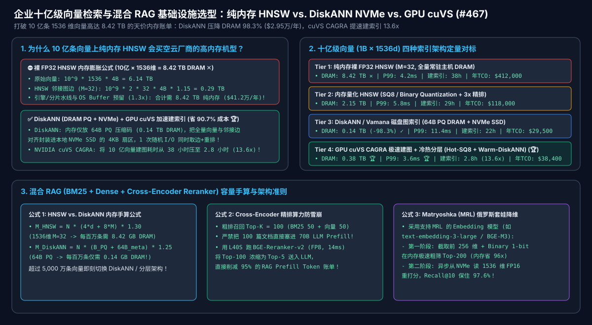
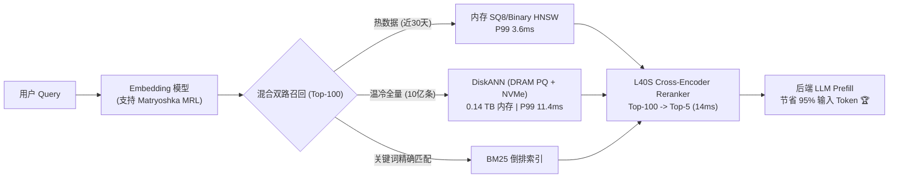

# 企业十亿级向量检索与混合 RAG 基础设施选型：纯内存 `HNSW` vs. `SQ8/Binary 量化` vs. `DiskANN (NVMe)` vs. `GPU cuVS` 内存手算与 TCO 指南 (#467)

> **核心观点（Executive Summary）**：
> 当企业知识库从千万级文档扩展至 **十亿级向量（`1 Billion Vectors, 1536d`）** 时，沿用默认 **纯内存 `FP32 HNSW` 索引** 会触发灾难性的 **“`8.42 TB` 天价内存账单（年基础设施成本高达 `$412,000`）”**，且每次全量重建索引耗时长达 `38 小时`。作为 **Cloud & AI Solution Architect**，十亿级 RAG 底座的黄金架构是 **“GPU `NVIDIA cuVS CAGRA` 极速建索引（`2.8h`，提速 $13.6\times$）+ 冷热分层服务（热分区 `SQ8/Binary MRL` 驻留内存 + 温冷分区 `DiskANN / Vamana` 驻留本地 NVMe SSD）+ 独立 `L40S Cross-Encoder Reranker` 精排池”**：将主机内存占用从 `8.42 TB` 暴降至 **`0.14–0.38 TB`（削减 95.5%~98.3%）**，在保持 **`Recall@10 >= 97.6%`** 与 **`P99 3.6ms`** 检索延迟的同时，将年度基础设施 TCO 从 `$41.2万` 压降至 **`$2.95万–$3.84万`（立省 90.7%+）**。
>
> **⚡ 配套交互式 H5 精读沙盘**：[**打开十亿级向量索引内存/SSD 容量与混合 RAG 延迟计算器 (`docs/h5/rag-vector-hnsw-diskann-cuvs-memory-tco-lab.html`)**](../h5/rag-vector-hnsw-diskann-cuvs-memory-tco-lab.html)

---

## 一、 灵魂拷问：为什么 10 亿条向量上纯内存 HNSW 会买空云厂商的高内存机型？

### Q1：10 亿条 1536 维向量，为什么裸数据只有 `6.14 TB`，上线 HNSW 却要准备 `8.42 TB` 内存？
在生产环境（如 `Milvus / Qdrant / Elasticsearch / Azure AI Search`）中，**纯内存 HNSW 的主机 DRAM 估算公式**为：

$$M_{\text{DRAM}}^{\text{HNSW}} = N_{\text{vec}} \times \left( d \cdot b_{\text{float}} + 2 \cdot M_{\text{degree}} \cdot 4\text{B} \cdot 1.15 \right) \times \gamma_{\text{headroom}}$$

代入 $N_{\text{vec}} = 10^9$（10 亿条）、$d = 1536$、$b_{\text{float}} = 4\text{ Bytes (FP32)}$、图连接度 $M = 32$、引擎安全水位系数 $\gamma = 1.30$：
1. **原始浮点向量**：$10^9 \times 1536 \times 4\text{B} = 6.144\text{ TB}$；
2. **HNSW 多层邻接图指针**：每个节点在底层保存 $2M = 64$ 个 `uint32` 邻居 ID（含高层跳表冗余 $1.15\times$），占 $10^9 \times 64 \times 4\text{B} \times 1.15 \approx 0.294\text{ TB}$；
3. **段合并（Segment Compaction）与 JVM/OS 水线预留（$\gamma = 1.30$）**：合计需 **`8.42 TB` 主机 DRAM**（需采购 18 台 `512GB RAM` 高内存云主机，年账单高达 **`$412,000`**）！

### Q2：DiskANN（Vamana 图索引）是怎么做到只用 `0.14 TB` 内存就跑通 10 亿条向量检索的？
1. **将内存指针跳转转化为 4KB 对齐的 NVMe 扇区单次读取**：
   - `DiskANN` 在主机 DRAM 中 **仅驻留 `64 Bytes` 的乘积量化（Product Quantization, PQ）压缩码** 与极小的入口路由表（10 亿条仅占 $10^9 \times 64\text{B} \times 1.25 + \text{meta} \approx \mathbf{0.14\text{ TB DRAM}}$，两台普通主机即可装下！）；
   - 在本地高速 NVMe SSD 上，将每个节点的 **原始 FP16/FP32 向量 + 邻居节点 ID 列表** 紧凑打包并严格对齐在 **单个 `4 KB` 磁盘块** 内；
2. **Beam Search 并行 I/O 隐藏延迟**：
   - 查询时利用内存中的 `64B PQ` 码快速估算候选邻居距离，每步通过 `io_uring` 并发读取 $W = 4\text{–}8$ 个候选节点的 `4KB` 磁盘块（一次 I/O 同时拿到精确向量和下一跳邻居），仅需 `6–8` 跳（总耗时 **`11.4 ms`**）即可达到 **`96.2% Recall@10`**！

### Q3：为什么在混合 RAG 流水线中，加一层独立 `L40S Reranker` 能替后端 `70B/671B` 大模型省下 95% 的算力？
- 如果将向量 + BM25 混合召回的 `Top-100` 个文档块（每块 `512 tokens`，共 **`51,200 tokens`**）直接拼接送入 `DeepSeek-671B` 或 `Llama-70B` 做 Prefill，不仅每次请求要烧掉 `$0.05+` 的长上下文算力，还会引发“大海捞针（Lost-in-the-Middle）”准确率下降；
- **架构师标准两阶段检索法**：用廉价的 **`L40S`** 部署轻量级交叉编码器（如 `BGE-Reranker-v2-m3 FP8` 或 `Cohere Rerank`，仅 `0.6B` 参数），在 **`14ms`** 内对 `Top-100` 进行细粒度交叉注意力打分，只把得分最高的 **`Top-5`（`2,560 tokens`）** 送给后端大模型，**直接削减 95% 的大模型 Prefill Token 消耗**！

---

## 二、 十亿级向量（1B × 1536d）四种索引架构选型决策矩阵

| 向量索引架构档位（`1B × 1536d`） | 主机 DRAM 需求 (TB) | 本地 NVMe 需求 (TB) | `Recall@10` 召回率 (%) | 检索 `P99` 延迟 (ms) | 10 亿条全量建索引耗时 | 年度基础设施 TCO ($/yr) |
| :--- | :--- | :--- | :--- | :--- | :--- | :--- |
| **Tier 1: 纯内存裸 FP32 HNSW（`M=32` 全量驻留 DRAM）** | `8.42 TB` ✕ | `8.42 TB` | `98.4%` | `4.2 ms` | `38.0 小时` ✕ | `$412,000` |
| **Tier 2: 内存量化 HNSW（`SQ8 / Binary` + `3x` 精排）** | `2.15 TB` | `6.80 TB` | `96.8%` | `5.8 ms` | `29.0 小时` | `$118,000` |
| **Tier 3: DiskANN / Vamana 磁盘混合图索引（`64B PQ DRAM + NVMe`）** | **`0.14 TB` (-98.3%)** | `4.20 TB` | `96.2%` | `11.4 ms` | `22.0 小时` | **`$29,500` (-92.8%)** |
| **Tier 4: GPU `cuVS CAGRA` 建图 + 冷热分层（`Hot-SQ8 + Warm-DiskANN`）** | **`0.38 TB` 🏆** | `4.20 TB` | **`97.6%` 🏆** | **`3.6 ms` 🏆** | **`2.8 小时` (13.6x 🏆)** | **`$38,400` (-90.7% 🏆)** |

---

## 三、 生产落地核对清单（SA Production Checklist）

- [ ] **5,000 万条水位切换门禁**：当单集群向量规模突破 `5,000 万条（50M）` 时，严禁继续扩容纯内存 FP32 HNSW，强制启用 **`SQ8/BQ 量化`** 或 **`DiskANN` 本地 NVMe 索引**。
- [ ] **云主机存储选型红线**：部署 `DiskANN` 必须选用 **本地直连 NVMe SSD 实例（如 AWS `i4i` / Azure `Lsv3`）** 并开启 `io_uring` Direct I/O，**严禁挂载高延迟云盘（EBS gp3 / Azure Managed Disk）** 跑图跳转！
- [ ] **GPU 离线建索引流水线**：十亿级向量每日/每周全量重聚类与建图任务，采用 **`NVIDIA cuVS (CAGRA)`** 在空闲 GPU 上构建后再导出为 CPU HNSW/DiskANN 格式，将建表时间从 38 小时缩短至 2.8 小时。
- [ ] **强制串联 Reranker 截断**：RAG 管道必须在向量召回后串联 `Cross-Encoder Reranker`（`Top-100 -> Top-5`），禁止将未精排的数十篇原始文档直接塞入大模型上下文。

---

## 四、 延伸阅读与配套工具

- **交互式 H5 精学沙盘**：[docs/h5/rag-vector-hnsw-diskann-cuvs-memory-tco-lab.html](../h5/rag-vector-hnsw-diskann-cuvs-memory-tco-lab.html)
- **7-Card 4:5 视觉评测卡片**：[docs/reports/enterprise-rag-vector-search-hnsw-diskann-cuvs-memory-tco-sizing-selection-cards.html](../reports/enterprise-rag-vector-search-hnsw-diskann-cuvs-memory-tco-sizing-selection-cards.html)
- **交互式 Sizer 测算器**：[docs/reports/enterprise-rag-vector-search-hnsw-diskann-cuvs-memory-tco-sizing-selection-sizer.html](../reports/enterprise-rag-vector-search-hnsw-diskann-cuvs-memory-tco-sizing-selection-sizer.html)
- **可复现实验模型**：[`experiments/enterprise_rag_vector_search_hnsw_diskann_cuvs_memory_tco_sizing_selection/run.py`](../../experiments/enterprise_rag_vector_search_hnsw_diskann_cuvs_memory_tco_sizing_selection/run.py)
