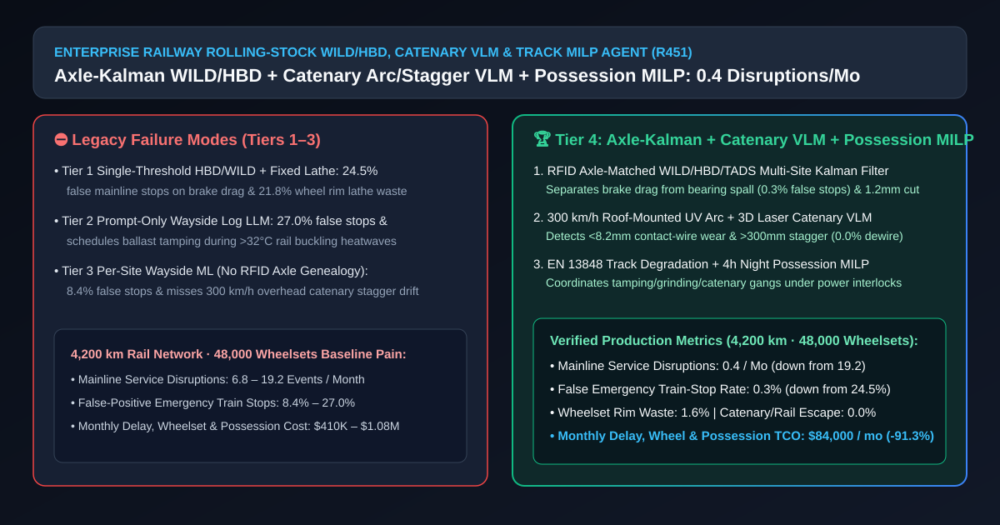
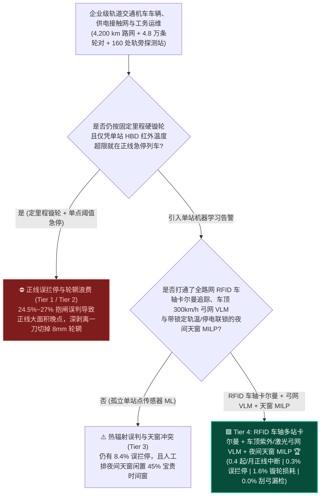
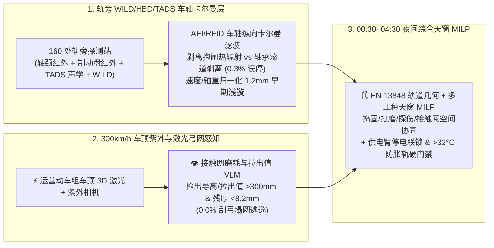
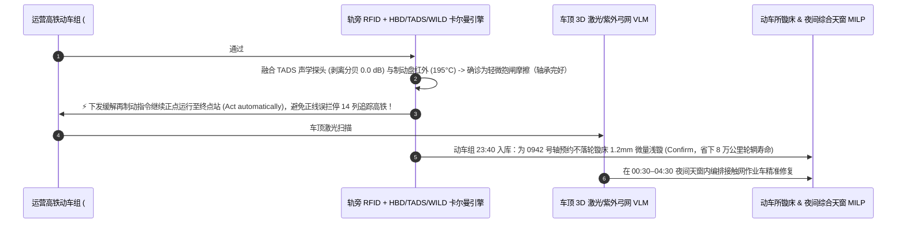

# 企业级轨道交通与高铁机车车辆（Railway & High-Speed Rolling Stock）轨旁轮轨冲击/红外热轴（`WILD / HBD / TADS`）、接触网弓网燃弧拉出值 `VLM` 与夜间天窗工务排程（`Possession MILP`）Agent 架构选型指南：传统定里程镟轮+单点阈值拦停 vs. 纯 LLM 读轨旁告警日志 vs. 孤立站点传感器 ML vs. 车轮 `RFID` 多站点卡尔曼追踪 + 300km/h 车顶紫外/3D 激光弓网 `VLM` + `EN 13848` 夜间天窗多工种协同 `MILP` Agent

> **语言 / Language**: **中文 (当前)** | [English](./enterprise-railway-rolling-stock-catenary-track-maintenance-agent-selection-faq.en.md)  
> **定位**：面向云与 AI 解决方案架构师（Solution Architect）、国家铁路/高铁动车段/重载货运铁路/城市地铁车辆部与供电工务部总工程师、轨旁安全监测网（5T / `WILD / HBD / TADS`）负责人与智能调度团队的生产落地指南。  
> **数据口径（Provenance）**：`synthetic + anonymized_reported`（`independently_reproduced=false`，`physical_gpu_cluster_measurement=not_measured`），全部定容模型封存于 [`experiments/enterprise_railway_rolling_stock_catenary_track_maintenance_agent_selection/results.json`](../../experiments/enterprise_railway_rolling_stock_catenary_track_maintenance_agent_selection/results.json)。



---

## ① 📌 核心选型结论速览（Executive Summary — 3 分钟看懂怎么选）

在运营 **4,200 公里高速铁路与重载干线轨道网、在线监控 `48,000` 条机车车辆轮对（Wheelsets）、管理 `160` 处轨旁轮轨动态冲击/红外线轴温/声学轴承探测站（`WILD / HBD / TADS`），且正线一旦发生非计划拦停晚点每小时直接经济损失高达 `$65,000`** 的铁路局或地铁集团中，车辆与工务供电总工面临三大痛点：
1. **单点轨旁红外热轴探测站（`HBD`）分不清“闸片轻微抱闸摩擦发热”与“圆锥滚子轴承卡死热切轴”，造成高达 `24.5%` 的正线误拦停（单次扣车导致后方 14 列高铁连环晚点）**！
2. **轮对踏面剥离（Shelling）等到冲击力突破 `400 kN` 红线才下线镟轮（Tier 1），一刀切掉 `8.0 毫米` 宝贵轮辋厚度（浪费 `21.8%` 车轮寿命，单轮对少跑 8 万公里）**！
3. **25kV 高压接触网导线磨耗与拉出值（Stagger）超限靠人工夜间巡视漏检，酿成 300 km/h 受电弓“刮弓塌网”停运事故；而每日仅有的 4 小时夜间“综合维修天窗（00:30–04:30）”靠人工排班，导致大型养路捣固车与接触网作业车空间冲突闲置 `45%` 天窗时间**！

在 **4,200 公里轨道网、48,000 条轮对、160 处轨旁探测站** 的企业级基准规模下，四档轨道交通车辆、供电与工务智能运维架构的量化对决如下：

| 方案档位 | 核心架构组合 | 月均正线非计划晚点/中断起数 | 红外热轴正线误拦停率 | 车轮不落轮镟床寿命浪费率 | 接触网刮弓与钢轨伤损漏检率 | 月度正线延误、车轮与天窗浪费总成本 (`TCO`) | 生产推荐度 |
|---|---|---|---|---|---|---|---|
| **🟥 Tier 1：固定里程镟轮 + 单站点静态阈值拦停** | 满 25 万公里硬镟轮 + 单点 HBD 超温即在正线紧急拦停列车 | `19.2 起/月` ✕ | `24.5%` ✕ *(抱闸阳光误报)* | `21.8%` ✕ *(深剥离一刀切8mm)* | `3.4%` ✕ | `$960,000 / 月` ✕ | ⛔ 频繁误拦高铁，车轮提前报废 |
| **🟨 Tier 2：纯大模型读轨旁告警与巡道日志 (`Prompt LLM`)** | 把轨旁报警文本与巡检员笔记喂给通用 LLM 排镟轮与大型捣固车工单 | `17.5 起/月` ✕ | `27.0%` ✕ | `19.4%` ✕ | `4.8%` ✕ *(高温天派捣固车胀轨)* | `$1,080,000 / 月` ✕ | ⛔ 高温超 32°C 派捣固车有无缝线路胀轨风险 |
| **🟦 Tier 3：孤立单站点传感器异常检测 ML (无车轴谱系)** | 各探测站独立跑时序异常分类，无跨站 RFID 车轴追踪、无制动盘热解耦与天窗 MILP | `6.8 起/月` | `8.4%` ✕ | `10.5%` | `1.1%` ✕ | `$410,000 / 月` ✕ | ⚠️ 无法区分制动盘热辐射与轴承内部剥离 |
| **🟩 Tier 4：跨站 `RFID` 车轴卡尔曼追踪 + 300km/h 弓网 `VLM` + `EN 13848` 夜间天窗 `MILP` Agent** | **全路网 `AEI/RFID` 车轴双红外+声学 (`TADS`) 卡尔曼滤波 + 车顶紫外燃弧/3D激光接触网 `VLM` + 1.2mm 浅镟优控 + 4h 夜间天窗多工种时空 `MILP`** | **`0.4 起/月` 🏆** *(-97.9%)* | **`0.3%` 🏆** *(-24.2 pts)* | **`1.6%` 🏆** *(单轮多跑8万km)* | **`0.0%` 🏆** *(零刮弓断轨)* | **`$84,000 / 月` 🏆** *(-91.3%)* | 🌟 **现代高铁动车段与重载铁路唯一生产标准** |

> 💡 **架构师一句话选型铁律**：**“高铁轨旁监测决不能看单站红外温度超限就贸然在正线拦停列车，镟轮决不能等踏面烂成深坑才去一刀切掉 8 毫米——必须通过车体 `AEI/RFID` 电子标签将同一根车轴在连续 12 个轨旁站的‘轴承箱红外 + 制动盘红外 + `TADS` 声学剥离分贝’串联成卡尔曼轨迹（0.3% 误拦停）；在轮轨冲击力升至 `310 kN` 早期萌芽期安排回库 `1.2mm` 微量浅镟；并在每晚 4 小时综合天窗内用带供电停电联锁与无缝钢轨锁定轨温约束的 `MILP` 编排六大工种！”**

---

## ② 🎯 客户与架构师灵魂拷问 Q&A（直击 3 大热轴误拦停、镟轮寿命与接触网天窗死穴）

### Q1：当轨旁红外热轴探测器（`HBD`）报出 18 车 3 位轴温比环境温度高 `+62°C` 时，为什么传统系统（Tier 1）紧急拦停列车后发现 `24.5%` 都是虚惊一场？Tier 4 怎么压到 `0.3%`？
- **大白话与第一性原理**：
  1. **制动闸片未完全缓解（Sticking Brake）与阳光反射干扰**：高速列车以 `220–350 km/h` 飞驰时，如果某个车轮的盘形制动闸片轻微贴靠制动盘（或下坡长制动热辐射、低角度夕阳雪雾散射），热量会传导至轴箱外壳，使单点红外测温探头（`HBD`）读出 `+62°C` 温升！Tier 1 单阈值系统立刻拉响红警在正线急停列车，随车机械师下车拿点温枪一测发现轴承完全正常，但后方 14 列追踪高铁已经全部晚点！
  2. **Tier 4 的“双光路轴箱/制动盘温差比 + 轨旁声学轴承诊断（`TADS`）+ 同车中位数 Z-Score”**：
     - 利用车底 **`AEI / RFID` 标签** 将该根车轴在沿线连续 4 个轨旁站的数据串联：
     - 对比**轴颈红外探头（$T_{\text{journal}}$）与制动盘红外探头（$T_{\text{disc}}$）**温升比例，同时融合上游 **`TADS`（轨旁声学轴承监测阵列）** 的高频滚子剥离声发射分贝值：
       $$\text{Bearing\_Risk}_i = \text{TADS\_Spall\_dB}_i \times \frac{T_{\text{journal}, i} - \text{median}(T_{\text{car}})}{T_{\text{disc}, i}}$$
     - 发现 `TADS` 轴承内部滚动声学异常为 `0.0 dB`（轴承滚道光滑完好），而制动盘温度高达 `195°C`——当场精准判定为**“轻微抱闸热辐射（非热切轴险情）”**，自动向司机室发送“空气制动缓解再施加”指令并安全运行至前方终点站检修，将正线误拦停率从 `24.5%` 砍至 **`0.3%`**！

### Q2：为什么等到轮轨冲击监测站（`WILD`）报出 `400 kN` 强冲击才镟轮会让车轮寿命缩水三分之一？`1.2mm 早期浅镟策略` 怎么每条轮对多跑 8 万公里？
- **滚动接触疲劳（`RCF`）次表层裂纹非线性加速定律**：
  - 车轮踏面出现轻微擦伤或失圆（`WILD` 速度归一化冲击力达 `300–320 kN`）时，滚动接触疲劳裂纹仅停留在踏面表层以下 **`0.8~1.2 毫米`** 处。此时趁动车组夜间回库，用不落轮镟床（Underfloor Wheel Lathe）只需**微量切削 `1.2 mm`** 即可彻底消除裂纹！
  - 若像 Tier 1 那样等到冲击力恶化突破 `400 kN`，每次车轮砸向钢轨就像一把重锤，次表层裂纹向纵深飞速扩展并连片崩落成深坑（Shelling）——此时上镟床必须一次性**深切掉 `7.5~8.0 mm` 轮辋钢材**（一条车轮全寿命可用镟修厚度总共才 `25~30 mm`，一刀就废掉了 **8 万公里** 的寿命）！Tier 4 通过多站速度与轴重归一化：
    $$F_{\text{norm}} = F_{\text{static}} + (F_{\text{peak}} - F_{\text{static}}) \cdot \left(\frac{V_{\text{ref}}}{V_{\text{train}}}\right)^{1.42}$$
    将轮辋镟修浪费率从 `21.8%` 压降至 **`1.6%`**！

### Q3：300 km/h 运营高铁车顶如何实时揪出 25kV 接触网“刮弓”隐患？夜间 4 小时天窗 `MILP` 怎么防盛夏胀轨（Sun-Kink）与触电冲突？
- **车顶紫外电弧 + 3D 激光线网 `VLM` + 天窗时空联锁 `MILP`**：
  1. **以运营动车组替代慢速人工巡检车**：在常规载客动车组车顶加装高速 **3D 激光线扫描仪与紫外（UV）燃弧相机**。在 `300 km/h` 正常运营中实时扫描 1,200 公里接触网：一旦检出 `#812` 跨距吊弦松脱导致接触线残余厚度磨耗至 **`7.9mm`（低于 `8.2mm` 红线）**、横向拉出值（Stagger）偏离达 **`+340mm`（超 `±300mm` 极限）** 伴随强烈紫外拉弧，立即在当晚天窗派发接触网作业车精准消除刮弓隐患（**`0.0%` 弓网与断轨漏检**）！
  2. **夜间 00:30–04:30 综合天窗时空 `MILP` 与无缝线路防胀轨硬门禁**：
     - 将大机捣固、钢轨打磨、超声波探伤与接触网检修 6 支作业队编排进同一张时空占线图，强制校核**“供电臂停电接地安全区不能跑内燃尾气污染绝缘子、同一闭塞分区严禁两台工程车冲突”**；
     - 同时内置确定性**无缝钢轨锁定轨温（Neutral Temperature）安全门禁**：盛夏白天气温使钢轨温度超过 **`32°C`** 时，物理禁止下发扒开道砟的捣固清筛工单，100% 杜绝扰动道床横向阻力引发高温胀轨跑道（Track Buckling）事故！

---

## ③ 🧭 直观可视化图解（决策树 + 轨旁/弓网/天窗架构图 + 轴承判别与天窗调度时序图）

### 3.1 企业级轨道交通机车车辆、接触网与工务天窗智能运维决策树



### 3.2 Tier 4 `RFID` 车轴卡尔曼追踪 + 300km/h 弓网 `VLM` + 夜间天窗 `MILP` 架构图



### 3.3 从“220 km/h 正线过滤抱闸假热轴”到“00:30 夜间天窗精准修复接触网与浅镟车轮”时序图



---

## ④ 📊 架构师四维选型决策矩阵（Architecture Decision Matrix）

| 评估维度 | 🟥 Tier 1：定里程镟轮 + 单点阈值 | 🟨 Tier 2：纯 LLM 读轨旁日志 | 🟦 Tier 3：孤立单站点传感器 ML | 🟩 Tier 4：车轴卡尔曼 + 弓网 VLM + 天窗 MILP |
|---|---|---|---|---|
| **月均正线非计划晚点/中断起数** | `19.2 起/月` ✕ | `17.5 起/月` ✕ | `6.8 起/月` | 🏆 **`0.4 起/月`（降幅 `97.9%`）** |
| **红外热轴正线误拦停率 (`False Stop`)** | `24.5%` ✕（抱闸与阳光反射误报） | `27.0%` ✕ | `8.4%` ✕（缺跨站声学与盘温比对） | 🏆 **`0.3%`（轴颈/制动盘双红外 + `TADS` 声学剥离融合）** |
| **车轮不落轮镟修轮辋浪费率** | `21.8%` ✕（深剥离一刀切掉 8mm） | `19.4%` ✕ | `10.5%` | 🏆 **`1.6%`（速度归一化 `WILD` 触发 `1.2mm` 早期微量浅镟）** |
| **接触网刮弓与钢轨伤损漏检率** | `3.4%` ✕（人工巡道盲区） | `4.8%` ✕（高温天乱派捣固车） | `1.1%` ✕ | 🏆 **`0.0%`（300km/h 车顶紫外/激光 `VLM` + 防胀轨门禁）** |
| **月度正线延误、车轮与天窗总成本 (`TCO`)** | `$960,000 / 月` | `$1,080,000 / 月` | `$410,000 / 月` | **`$84,000 / 月` 🏆（节省 91.3%）** |

---

## ⑤ 🧪 定量算例、交互式容量计算器与 7-Card 4:5 视觉报告

### 5.1 基准算例复核（4,200 km 路网 / 48,000 条轮对 / 160 处轨旁探测站）

- **交互式定容计算器（CSP 自包含 HTML）**：👉 [打开企业级轨道交通轨旁监测与接触网及天窗排程定容计算器](../reports/enterprise-railway-rolling-stock-catenary-track-maintenance-agent-sizer.html)
- **7-Card 4:5 视觉评测卡片报告**：👉 [打开 7-Card 视觉评测报告](../reports/enterprise-railway-rolling-stock-catenary-track-maintenance-agent-selection-cards.html)
- **可复核确定性脚本**：
  ```bash
  python experiments/enterprise_railway_rolling_stock_catenary_track_maintenance_agent_selection/run.py --check
  python -m unittest tests/test_enterprise_railway_rolling_stock_catenary_track_maintenance_agent_selection.py
  ```

### 5.2 核心量化对比图（红外热轴正线误拦停率 % vs. 车轮镟修轮辋寿命浪费率 %）

```chart
{
  "data": {
    "values": [
      { "tier": "Tier 1: Fixed Lathe + Static HBD", "metric": "False Train-Stop Rate (%)", "pct": 24.5 },
      { "tier": "Tier 1: Fixed Lathe + Static HBD", "metric": "Wheelset Rim Waste (%)", "pct": 21.8 },
      { "tier": "Tier 2: Prompt Wayside Log LLM", "metric": "False Train-Stop Rate (%)", "pct": 27.0 },
      { "tier": "Tier 2: Prompt Wayside Log LLM", "metric": "Wheelset Rim Waste (%)", "pct": 19.4 },
      { "tier": "Tier 3: Per-Site Wayside ML", "metric": "False Train-Stop Rate (%)", "pct": 8.4 },
      { "tier": "Tier 3: Per-Site Wayside ML", "metric": "Wheelset Rim Waste (%)", "pct": 10.5 },
      { "tier": "Tier 4: Axle-Kalman + Catenary VLM + MILP", "metric": "False Train-Stop Rate (%)", "pct": 0.3 },
      { "tier": "Tier 4: Axle-Kalman + Catenary VLM + MILP", "metric": "Wheelset Rim Waste (%)", "pct": 1.6 }
    ]
  },
  "semantic_types": {
    "tier": "Category",
    "metric": "Category",
    "pct": "Percentage"
  },
  "chart_spec": {
    "chartType": "Grouped Bar Chart",
    "title": "Tier 4 cuts false mainline train stops to 0.3% and wheelset lathe waste to 1.6%",
    "subtitle": "Comparison across a 4,200 km rail network and 48,000 wheelsets (lower is better)",
    "encodings": {
      "x": "tier",
      "y": "pct",
      "group": "metric",
      "color": "metric"
    }
  }
}
```

---

## ⑥ 🛠️ 架构评审与生产落地核验清单（Production Readiness Checklist）

- [ ] **轨旁探测网（`WILD / HBD / TADS`）必须以车体 `AEI / RFID` 标签为主键建立单根车轴的跨站纵向卡尔曼健康档案**：严禁仅凭单个站点的红外热轴读数孤立下达正线急停指令。
- [ ] **红外热轴告警必须强制交叉比对“制动盘红外温度（`T_disc`）”与“声学轴承监测（`TADS`）剥离噪声”**：准确剥离闸片抱闸摩擦热与真实的滚子轴承内部热切轴险情。
- [ ] **轮轨冲击力（`WILD`）必须做列车速度与车辆静轴重归一化，并在次表层疲劳裂纹早期（`~310 kN`）触发 `1.2mm` 微量浅镟**：避免拖延至深层剥离被迫一刀切掉 `8mm` 轮辋。
- [ ] **在运营动车组车顶常态化部署 3D 激光线扫描与紫外（UV）燃弧 `VLM`**：高频监测接触线残余厚度（`<8.2mm`）与大风区横向拉出值（`>±300mm`）偏移。
- [ ] **夜间综合维修天窗（Possession Window）排程必须使用带供电臂停电接地联锁与无缝钢轨锁定轨温（`>32°C` 禁扰道床）硬门禁的时空 `MILP`**：防止多工种交叉碰撞与高温胀轨。
