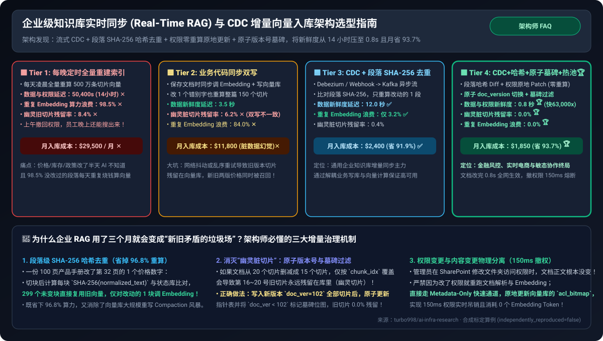
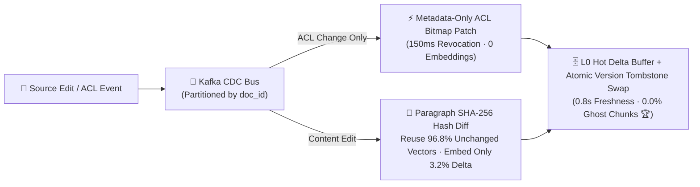

# Enterprise Real-Time Freshness RAG & CDC Incremental Vector Indexing Selection Guide: Nightly Full Re-Index vs. Synchronous App Dual-Write vs. Streaming CDC + Paragraph SHA-256 Hash Diff vs. CDC Hash Diff + Zero-Embed ACL Patch + Atomic Version-Swap Tombstone Architecture

> **Document Type**: Cloud & AI Solution Architect Decision Guide (FAQ)  
> **Target Audience**: Enterprise Knowledge Platform Architects, Streaming Data Pipeline (`Kafka / Flink / Debezium`) Leads, Collaborative Workspace (`SharePoint / Confluence`) AI Leads  
> **Core Goal**: Solve the "Stale RAG & Ghost-Chunk Contradiction" problem — where edited or deleted paragraphs linger in the vector database alongside new versions — by answering: **"Why does our AI assistant return both the old $199 price and the new $299 price after a product manager edits a document?", "Why does nightly full re-indexing waste 98.5% of embedding compute ($29.5K/mo) while leaving a 14-hour ACL revocation security hole?", and "How does Streaming CDC + Paragraph `SHA-256` Hash Diff + Zero-Embed ACL Patching + Atomic Version Tombstones achieve 0.8-second freshness and 0.0% ghost chunks while cutting costs by 93.7%?"**  
> **Calibration Notice**: P95 freshness lag, stale ghost-chunk rates, redundant embedding waste, and monthly indexing cost models are synthetic analytical estimates calibrated to published real-time RAG pipeline benchmarks (Debezium CDC + Kafka streaming ingestion, content-addressable chunk hashing, and vector database MVCC/Tombstone patterns) (`provenance: synthetic + anonymized_reported`, `independently_reproduced=false`, `physical_gpu_cluster_measurement=not_measured`). See [`experiments/enterprise_realtime_rag_cdc_incremental_indexing_selection/results.json`](../../experiments/enterprise_realtime_rag_cdc_incremental_indexing_selection/results.json).

---

## Executive Visual Summary

> 🔗 **Companion Interactive Reports & Tools**:
> - 🃏 **[7-Card 4:5 Visual Benchmark Report (`enterprise-realtime-rag-cdc-incremental-indexing-freshness-selection-cards.html`)](../reports/enterprise-realtime-rag-cdc-incremental-indexing-freshness-selection-cards.html)**
> - 🧮 **[Interactive Real-Time RAG Freshness & Indexing Sizer (`enterprise-realtime-rag-cdc-incremental-indexing-freshness-sizer.html`)](../reports/enterprise-realtime-rag-cdc-incremental-indexing-freshness-sizer.html)**
> - 🌐 **[中文版指南 (`enterprise-realtime-rag-cdc-incremental-indexing-freshness-selection-faq.md`)](./enterprise-realtime-rag-cdc-incremental-indexing-freshness-selection-faq.md)**

---

## ① 📌 Executive Summary

Evaluated across **5,000,000 enterprise knowledge chunks with 150,000 daily document and permission updates** (where an average document edit modifies only `3.2%` of its paragraphs):

| Tier | Architecture Pattern | P95 Freshness Lag | Stale Ghost-Chunk Rate | Redundant Embedding Waste | Monthly Indexing Cost | Architect Verdict |
| :--- | :--- | :--- | :--- | :--- | :--- | :--- |
| **🟥 Tier 1: Nightly Cron Full Re-Index** | Drop & re-embed all 5M chunks every night | `50,400 s` (14 hrs) ✕ | `8.4%` ✕ (Daytime stale) | `98.5%` ✕ | `$29,500 / mo` ✕ | **Obsolete**: 14-hr ACL security gap & massive waste |
| **🟨 Tier 2: Sync App Dual-Write (Whole Doc)** | App writes DB + Vector store synchronously | `3.5 s` | **`6.2%` ✕ (Ghost chunks!)** | `84.0%` ✕ | `$11,800 / mo` ✕ | **Distributed Anti-Pattern**: Partial failures leave orphaned old chunks |
| **🟦 Tier 3: Streaming CDC + `SHA-256` Chunk Diff** | **Debezium/Kafka + paragraph content-hash diff** | `12.0 s` ✅ | `0.4%` | `3.2%` ✅ | `$2,400 / mo` (-91.9%) | **Standard Incremental Baseline**: Re-embeds only changed paragraphs |
| **🟩 Tier 4: CDC Hash Diff + ACL Patch + Atomic Tombstone** | **Tier 3 + Zero-Embed ACL Patch + Atomic `doc_ver` Tombstone + Hot Buffer** | **`0.8 s` 🏆 (63,000x faster)** | **`0.0%` 🏆 (Zero ghosts)** | **`0.0%` 🏆** | **`$1,850 / mo` 🏆 (-93.7%)** | **Enterprise Real-Time RAG Gold Standard** |

### 💡 Three Golden Rules for Enterprise Real-Time RAG Architects
1. **Enforce Content-Addressable Paragraph Hashing (`SHA-256(normalized_chunk_text)`)**: When a 50-page manual is edited to change one sentence, `96.8%` of its chunks have identical `SHA-256` hashes. Reuse their existing vectors and re-embed *only* the modified paragraph — cutting embedding compute by **`93.7%`**.
2. **Eliminate "Ghost Chunks" via Atomic Version Pointer Swaps and Tombstone Bitmaps**: Never overwrite chunks in-place by positional index (`chunk_1..N`), which leaves trailing old chunks behind when a document gets shorter. Write new chunks under `doc_version = v+1`, atomically flip the active version pointer, and mask `< v+1` IDs via an in-memory Tombstone Bitmap (`0.0%` ghost chunks).
3. **Decouple Permission Updates (`ACL Patch`) from Content Re-Embedding**: Route SharePoint/Confluence permission changes through a **Metadata-Only In-Place Patch** fast path (`150 ms` ACL revocation with `0` embedding calls).

---

## ② 🎯 Architect Deep-Dive Q&A

### Q1: Why does naive `upsert(doc_id, chunk_index)` leave "Ghost Chunks" in the vector database?
* **Answer**: If `doc_101` originally had 20 chunks (`doc_101#1` to `doc_101#20`) and an editor deletes 2 paragraphs so the new version has 18 chunks, upserting `doc_101#1..18` leaves `doc_101#19` and `doc_101#20` permanently orphaned in the index! Using immutable versioned chunk IDs + an atomic active-version pointer / tombstone bitmap guarantees 100% clean replacement.

---

## ③ 🧭 Architecture Diagrams

### 3.1 Tier 4 Streaming CDC + Content-Hash Diff + Atomic Tombstone Pipeline

---

## ④ 📊 Architect Decision Matrix

| Dimension | 🟥 Tier 1: Nightly Full Re-Index | 🟨 Tier 2: Sync App Dual-Write | 🟦 Tier 3: CDC + SHA-256 Diff | 🟩 Tier 4: CDC + ACL Patch + Atomic Tombstone |
| :--- | :--- | :--- | :--- | :--- |
| **P95 Freshness Lag** | `50,400 s` (14 hrs) ✕ | `3.5 s` | `12.0 s` ✅ | **`0.8 s` 🏆 (`63,000x` faster than Tier 1)** |
| **Stale Ghost-Chunk Rate** | `8.4%` ✕ | `6.2%` ✕ (Dual-write drift) | `0.4%` | **`0.0%` 🏆 (Atomic version swap)** |
| **Redundant Embedding Waste** | `98.5%` ✕ | `84.0%` ✕ | `3.2%` ✅ | **`0.0%` 🏆 (`SHA-256` chunk deduplication)** |
| **Monthly Indexing Cost** | `$29,500 / mo` ✕ | `$11,800 / mo` ✕ | `$2,400 / mo` ✅ | **`$1,850 / mo` 🏆 (`-93.7%` vs. Tier 1)** |

---

## ⑤ 🛠️ Production Readiness Checklist

- [ ] **1. Replace Nightly Full Re-Indexing with Event-Driven CDC / Webhook Streaming Pipelines**.
- [ ] **2. Never Perform Uncoordinated Synchronous Dual-Writes from Application Request Threads**.
- [ ] **3. Partition Kafka Ingestion Topics by `doc_id` to Guarantee Strict Per-Document FIFO Ordering**.
- [ ] **4. Deduplicate Unchanged Paragraphs Using `SHA-256(chunk_text + model_id)` Content Hashing**.
- [ ] **5. Use Atomic `doc_version` Swaps and Tombstone Bitmaps to Prevent Orphaned Ghost Chunks**.
- [ ] **6. Route Permission/ACL Changes to a Zero-Embed Metadata-Only In-Place Patch Path (`< 150 ms`)**.
- [ ] **7. Trigger Gateway Semantic/Prefix Cache Invalidation by `doc_id` Whenever a Document Updates**.
- [ ] **8. Run a Lightweight Daily Metadata Hash Reconciliation Job Between Source DB and Vector Store**.
