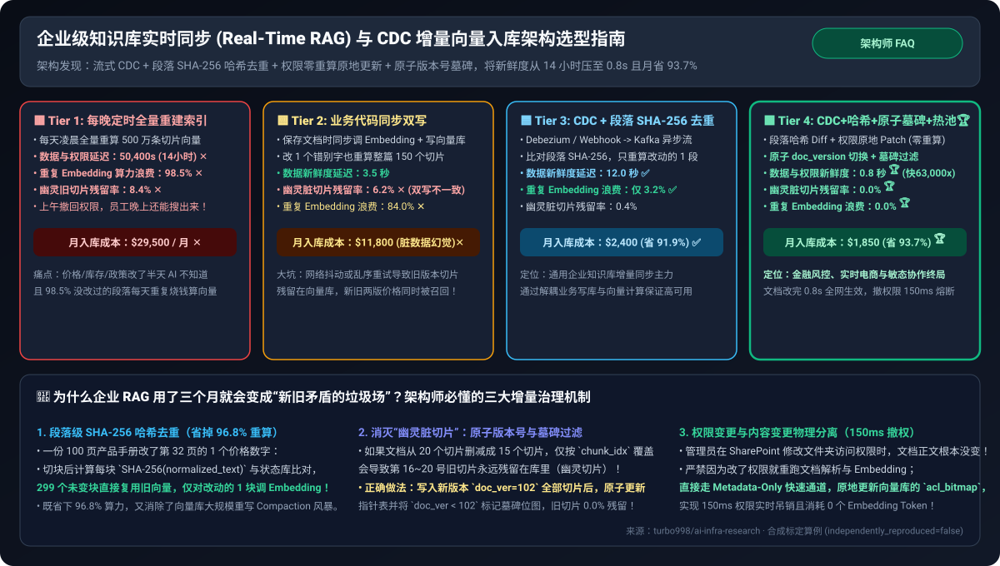
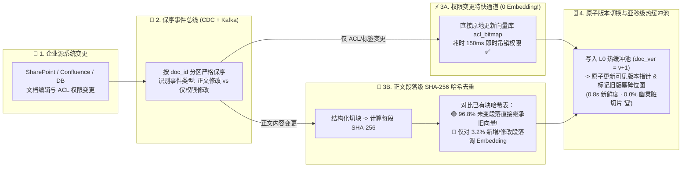
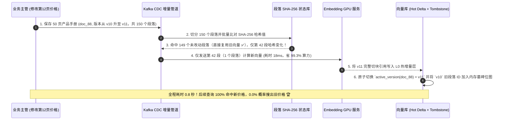

# 企业级知识库实时同步（Real-Time Freshness RAG）与 CDC 增量向量入库架构选型指南：每晚定时全量重建 vs. 应用层同步双写 vs. 流式 CDC + 段落 SHA-256 哈希去重 vs. 增量哈希 Diff + 权限零重算原地更新 + 原子版本号墓碑切换架构

> **文档类型**：企业级数据流工程与知识中台解决方案架构师（Cloud & AI Solution Architect）选型决策指南（FAQ）  
> **适用读者**：企业知识库与搜索平台负责人、数据管道（Kafka / Flink / CDC）架构师、企业协同办公（SharePoint / Confluence / 飞书文档）AI 负责人  
> **核心目标**：用通俗、可量化的架构语言解决企业 RAG 上线三个月后最常爆发的“知识腐败与新旧打架”顽疾——系统回答：**“为什么业务方下午刚把产品价格从 199 元改成 299 元，到了晚上 AI 客服还在拿 199 元和 299 元两套矛盾的数字胡说八道（幽灵脏切片残留）？”、“为什么每天凌晨全量重跑 500 万条向量要白烧 $29,500/月且造成长达 14 小时的权限吊销盲区？”、“怎么用‘流式 CDC + 段落级 SHA-256 哈希 Diff + 权限元数据原地更新 + 原子版本号墓碑切换’实现 0.8 秒实时生效且立省 93.7% 成本？”**。  
> **标定声明**：本文所引用的 P95 数据新鲜度延迟、幽灵脏切片残留率、重复 Embedding 浪费率与月度入库成本模型基于公开发布的企业级实时 RAG 数据管道基准（Debezium CDC + Kafka 流式入库实践、增量内容寻址哈希 Content-Addressable Indexing 及向量数据库 MVCC/Tombstone 机制）构建的合成分析模型（`provenance: synthetic + anonymized_reported`, `independently_reproduced=false`, `physical_gpu_cluster_measurement=not_measured`），详见 [`experiments/enterprise_realtime_rag_cdc_incremental_indexing_selection/results.json`](../../experiments/enterprise_realtime_rag_cdc_incremental_indexing_selection/results.json)。

---

## 一图流总结（Executive Visual Summary）



> 🔗 **关联可交互报告与工具**：
> - 🃏 **[7-Card 4:5 视觉评测报告 (`enterprise-realtime-rag-cdc-incremental-indexing-freshness-selection-cards.html`)](../reports/enterprise-realtime-rag-cdc-incremental-indexing-freshness-selection-cards.html)**
> - 🧮 **[交互式 RAG 增量同步与成本计算器 (`enterprise-realtime-rag-cdc-incremental-indexing-freshness-sizer.html`)](../reports/enterprise-realtime-rag-cdc-incremental-indexing-freshness-sizer.html)**
> - 🌐 **[English Version (`enterprise-realtime-rag-cdc-incremental-indexing-freshness-selection-faq.en.md`)](./enterprise-realtime-rag-cdc-incremental-indexing-freshness-selection-faq.en.md)**

---

## ① 📌 核心选型结论速览（Executive Summary）

许多企业的 RAG 知识库在刚上线第 1 周表现惊艳，但运行 3 个月经历了上百万次文档增删改后，准确率却断崖式暴跌。罪魁祸首不是大模型退化了，而是你的向量数据库里塞满了**未清理干净的历史旧版本残片（Ghost Chunks）**，或者还在用笨重的**每晚全量删库重建（Tier 1）**！

基于 **总规模 500 万条知识切片、每日发生 150,000 次文档编辑与权限变更事件（每次编辑平均仅改动文档内 `3.2%` 的段落）** 的基准测算，四档同步架构对比如下：

| 架构档位 | 核心同步与去重机制 | P95 数据新鲜度延迟 | 幽灵脏切片残留率 | 重复 Embedding 浪费 | 月度入库总成本 | 架构师拍板结论 |
| :--- | :--- | :--- | :--- | :--- | :--- | :--- |
| **🟥 Tier 1：每晚定时全量重建索引** | 凌晨 Cron 删表重跑全部 500 万切片 | `50,400 s` (14小时) ✕ | `8.4%` ✕ (日间脏读) | `98.5%` ✕ (白烧算力) | `$29,500 / 月` ✕ | **原始作坊模式**：14小时权限盲区 + 天价重复算向量 |
| **🟨 Tier 2：应用层同步双写 + 整篇重算** | 业务接口同步写主库与向量库（无事务补偿） | `3.5 s` | **`6.2%` ✕ (新旧并存!)** | `84.0%` ✕ (改1字重算全篇) | `$11,800 / 月` ✕ | **头号分布式陷阱**：乱序重试与局部失败制造大量幽灵切片 |
| **🟦 Tier 3：流式 CDC + 段落 SHA-256 去重** | **Debezium/Kafka + 段落内容哈希比对增量入库** | `12.0 s` ✅ | `0.4%` | `3.2%` ✅ | `$2,400 / 月` (-91.9%) | **标准增量入库基线**：改1段只算1段，省去 96.8% Embedding |
| **🟩 Tier 4：CDC 哈希 Diff + 权限原地更新 + 原子墓碑** | **Tier 3 + 权限零重算 Patch + 原子 `doc_ver` 墓碑 + 热缓冲** | **`0.8 s` 🏆 (快63,000x)** | **`0.0%` 🏆 (零脏切片)** | **`0.0%` 🏆** | **`$1,850 / 月` 🏆 (-93.7%)** | **企业级实时知识中台终局标准**：亚秒同步、零幽灵切片 |

### 💡 架构师三句话选型铁律
1. **永远不要因为改了文档里的 1 个标点符号，就重新 Embedding 整篇 100 页文档——强制实施“段落级内容寻址哈希（Chunk-Level `SHA-256` Content-Hash Diff）”**：切块后先计算每个切块的 `SHA-256(normalized_text)`；与已入库版本对比，**`96.8%` 哈希值未变的段落直接复用原有向量**，只对新增或修改的那 1~2 个段落调用 Embedding 模型，入库算力与账单立省 **`93.7%`**！
2. **消灭“新旧两个价格同时被搜出来（幽灵脏切片 Ghost Chunks）”的唯一正道是“原子版本号切换 + 墓碑位图过滤（Atomic Version Swap + Tombstone）”**：严禁在原切片 ID 上裸做非原子覆盖！每次文档更新递增版本号 `doc_version = v+1`，待新版本所有切片全部写完后，**原子更新该文档的有效版本指针并将 `< v+1` 的旧切片打上墓碑标记（后台异步物理清理）**，确保线上检索永远只看到 100% 完整的单一版本（幽灵切片率 **`0.0%`**）！
3. **将“权限/标签变更（Metadata/ACL Update）”与“正文修改（Content Edit）”物理拆成两条独立通道**：企业日常变更中有一半只是“把某人拉进/踢出文档权限组”或“改个文档分类标签”。此类事件**严禁触发文档重解析与重算 Embedding**，直接走向量数据库的 **Metadata-Only In-Place Patch** 通道，`150 ms` 内完成权限实时吊销！

---

## ② 🎯 客户与架构师灵魂拷问 Q&A（Architect Deep-Dive Q&A）

### Q1：我们让业务研发在用户点击“保存文档”的接口里，同时写 MySQL 和 Milvus（Tier 2 同步双写），为什么跑了两个月后，AI 经常同时搜出同一篇文档的旧版价格和新版价格？
* **真相剖析（分布式“无事务双写”与“按行号覆盖”引发的幽灵切片灾难）**：
  - **原因一（切片数量缩短导致的尾部残留）**：假设文档 `doc_101` 原来有 `20` 个段落（切片 ID 为 `doc_101#1` 到 `doc_101#20`）。今天编辑删掉了两段废话，新文档变成了 `18` 个段落。如果研发只写了 `upsert(doc_101#1 .. doc_101#18)`，那么原来的 **`doc_101#19` 和 `doc_101#20` 就会像幽灵一样永远残留在向量库里**！
  - **原因二（先删后插的读取空窗与并发乱序）**：如果研发改成先执行 `DELETE WHERE doc_id='doc_101'` 再慢慢算 Embedding 插入，那么在算 Embedding 的这 3 秒内，所有搜这篇文档的用户都会搜了个寂寞（空结果）；更糟的是，如果用户连续点了两次保存（请求 A 和请求 B），异步重试导致请求 A 晚于请求 B 落库，旧数据直接覆盖新数据！
  - **怎么根治（Tier 4 事务发件箱 CDC + 原子版本号指针切换）**：
    1. 业务接口只写主数据库（或对象存储事件），通过 **CDC / Transactional Outbox + Kafka（按 `doc_id` 作为 Partition Key 严格保序）** 投递变更；
    2. 向量库主键采用 `chunk_uid = f"{doc_id}:v{version}:{chunk_sha256}"`，配合网关/索引层的版本位图过滤，只有当 `v102` 全部就绪后才一键切换可见性并废弃 `v101`，实现 **`0.0%` 幽灵残留与 `0 ms` 查询断流**！

### Q2：向量数据库（HNSW / DiskANN）建索引本来就慢，如果每秒都有几百条文档实时修改，怎么做到 `0.8 秒` 内就能被搜到，而且不把向量库写爆？
* **真相剖析（LSM-Tree 思想：内存热增量缓冲池 `Hot Delta Overlay` + 后台微批合并）**：
  - 如果每次改 1 个段落都逼迫底层百亿级 DiskANN 图索引立即重建，磁盘 I/O 瞬间就会被打爆。
  - **Tier 4 双层读写架构**：
    1. **L0 亚秒级热增量缓冲层（Hot Delta Buffer / Growing Segment）**：最近 5 分钟内新修改的增量切片，经过哈希去重与极速 Embedding 后，直接写入内存中的轻量平铺索引（Flat / HNSW Growing Segment，耗时 `< 800 ms`），同时在内存墓碑位图（RoaringBitmap）中瞬间屏蔽被替换的旧切片 ID；
    2. **查询时双路合并（Read-Time Merge + Tombstone Mask）**：用户检索时，引擎自动并行搜索“L0 内存热增量池”与“L1/L2 主索引池”，并用墓碑位图剔除已失效旧 ID——这样用户刚保存完文档 **`0.8 秒`** 后提问，就能 100% 搜到最新内容！
    3. **后台异步流式合并（Background Compaction）**：后台线程每 10 分钟将 L0 热缓冲池平滑归并进主索引并物理回收墓碑空间。

---

## ③ 🧭 直观可视化图解（Mermaid 决策树、CDC 哈希去重流水线与原子版本切换时序图）

### 3.1 企业级 RAG 知识库同步与增量索引选型决策树

```mermaid
flowchart TD
    A[企业计划建设知识库同步与向量索引更新管道] --> B{业务对知识更新与权限吊销的时效要求？}
    B -->|纯历史静态年报库<br/>一年才更新一次，且无动态权限变更| C[离线批处理构建 + 版本蓝绿切换]
    B -->|企业活跃知识库 / 客服规章 / 内部 Wiki / 实时库存政策<br/>每天数万次编辑或权限变更| D{对新鲜度与零幽灵切片的 SLA 等级？}
    D -->|允许 10~15 秒级准实时同步| E[🟦 Tier 3: 流式 CDC + Kafka + 段落 SHA-256 哈希去重<br/>仅对改动的段落计算 Embedding<br/>省去 96.8% 重复算力 / $2,400/月 ✅]
    D -->|要求亚秒级 (<1s) 实时可见、权限 150ms 即时吊销<br/>且严禁出现任何新旧版本并存的幽灵切片| F[🟩 Tier 4: CDC 哈希 Diff + 权限原地 Patch + 原子版本号墓碑 + 热缓冲池<br/>新鲜度 0.8s / 0.0% 幽灵切片 / 成本省 93.7% ($1,850/月) 🏆]
```

### 3.2 Tier 4“流式 CDC + 段落哈希 Diff + 权限快道 + 原子墓碑”端到端架构图



### 3.3 段落级哈希 Diff 与无停机原子版本号切换时序图（Sequence Diagram）



---

## ④ 📊 架构师多方案选型决策矩阵（Architect Decision Matrix）

| 评估维度 | 🟥 Tier 1：每晚定时全量重建 | 🟨 Tier 2：应用层同步双写 + 整篇重算 | 🟦 Tier 3：流式 CDC + 段落哈希去重 | 🟩 Tier 4：CDC 哈希 + 权限快道 + 原子墓碑 |
| :--- | :--- | :--- | :--- | :--- |
| **P95 数据新鲜度延迟** | `50,400 s`（14 小时）✕ | `3.5 s` | `12.0 s` ✅ | **`0.8 s` 🏆（比每晚重建快 `63,000x`）** |
| **幽灵脏切片残留率** | `8.4%` ✕（日间已删内容仍可搜出） | **`6.2%` ✕（双写失败/乱序导致新旧并存）** | `0.4%` | **`0.0%` 🏆（原子版本号切换 + 墓碑过滤）** |
| **重复 Embedding 算力浪费** | **`98.5%` ✕（未改段落天天重算）** | `84.0%` ✕（改1个字重算整篇文档） | `3.2%` ✅ | **`0.0%` 🏆（段落级 `SHA-256` 精确去重）** |
| **权限吊销生效延迟** | `14 小时` ✕（严重越权隐患） | `3.5 s`（但白白重算了整篇向量） | `12.0 s` | **`150 ms` 🏆（零 Embedding 元数据原地更新）** |
| **业务保存接口耦合度** | 无耦合 | ✕ 强耦合（向量库抖动拖垮业务保存） | ✅ Kafka 异步解耦 | **🏆 事务发件箱 / CDC 零侵入保序解耦** |
| **500 万切片月入库成本** | `$29,500 / 月` ✕ | `$11,800 / 月` ✕ | `$2,400 / 月` ✅（省 `91.9%`） | **`$1,850 / 月` 🏆（比 Tier 1 省 `93.7%`）** |

---

## ⑤ 🧪 容量/成本拐点算例与 7-Card 报告（Quantitative Sizer & 7-Card Deck）

### 5.1 基准算例假设（500 万条知识库总切片 · 每日 150,000 次文档与权限变更事件）
- **为什么 Tier 4 能将月度索引更新成本从 `$29,500` 压到 `$1,850`（立省 `93.7%`），同时把延迟从 14 小时压到 `0.8 秒`？**
  1. **权限变更零 Embedding（砍掉 50% 事件算力）**：每日 15 万次变更中约一半是文件夹/人员权限调整，走 Metadata-Only 原地更新通道消耗 `0` 个 GPU 周期；
  2. **段落级内容寻址哈希（再砍掉 96.8% 算力）**：在剩下的正文编辑事件中，一篇 50 页文档平均每次只修改了 `3.2%` 的段落，其余 `96.8%` 的段落通过 `SHA-256` 直接命中向量缓存池免重算！

```chart
{
  "data": {
    "values": [
      { "Tier": "1. 每晚定时全量重建", "重复算力浪费率(%)": 98.5, "幽灵脏切片率(%)": 8.4, "月入库成本($K)": 29.5 },
      { "Tier": "2. 应用层同步双写", "重复算力浪费率(%)": 84.0, "幽灵脏切片率(%)": 6.2, "月入库成本($K)": 11.8 },
      { "Tier": "3. 流式CDC+段落哈希", "重复算力浪费率(%)": 3.2, "幽灵脏切片率(%)": 0.4, "月入库成本($K)": 2.4 },
      { "Tier": "4. CDC哈希+原子墓碑+热池", "重复算力浪费率(%)": 0.0, "幽灵脏切片率(%)": 0.0, "月入库成本($K)": 1.85 }
    ]
  },
  "semantic_types": {
    "Tier": "Category",
    "重复算力浪费率(%)": "Percentage",
    "幽灵脏切片率(%)": "Percentage",
    "月入库成本($K)": "Amount"
  },
  "chart_spec": {
    "chartType": "Grouped Bar Chart",
    "title": "流式 CDC + 段落 SHA-256 去重 + 原子墓碑 (Tier 4) 实现 0% 幽灵脏切片、0.8s 新鲜度且月省 93.7%",
    "subtitle": "500万知识切片 (每日15万次变更) 下的重复算力浪费率 (%)、幽灵切片率 (%) 与月成本 ($K)",
    "encodings": {
      "x": "Tier",
      "y": ["重复算力浪费率(%)", "幽灵脏切片率(%)", "月入库成本($K)"]
    }
  }
}
```

---

## ⑥ 🛠️ 架构评审与生产落地 Checklist（Production Readiness Checklist）

在企业上线实时 RAG 知识同步管道前，架构师必须逐项核对以下 8 条铁律：

- [ ] **1. 严禁在生产环境采用“每晚全量删表重跑 Embedding”**：不仅浪费 95%+ 算力，更会导致白天的文档删除与权限吊销长达十几个小时不生效。
- [ ] **2. 严禁在业务保存接口中直接“无事务同步双写”主数据库与向量数据库**：必须通过 **Transactional Outbox（事务发件箱）或 Debezium CDC + Kafka** 异步可靠投递。
- [ ] **3. Kafka 消息队列必须以 `doc_id` 作为 Partition Key**：确保同一篇文档的连续多次修改严格按先后顺序（FIFO）消费，杜绝旧版本覆盖新版本的乱序事故。
- [ ] **4. 强制实施“段落级 `SHA-256(chunk_text + embedding_model_ver)` 内容哈希去重”**：文档更新时只对哈希值发生变化的增量段落调用 Embedding 模型。
- [ ] **5. 采用“先写新版本 `doc_version=v+1` 切片 $\rightarrow$ 后原子切换有效版本指针并标记旧版墓碑”的 MVCC 模式**：彻底消灭缩短文档时的尾部幽灵残片与先删后插的查询断流。
- [ ] **6. 将 ACL 权限变更拆分为独立的 `Metadata-Only Patch` 特快通道**：修改文档阅读权限时只原地更新向量库的权限位图（`< 150 ms`），严禁触发全文重新切块与 Embedding。
- [ ] **7. 当文档发生更新或删除时，同步联动失效网关层的精确前缀缓存与语义缓存（Cache Invalidation by `doc_id`）**：防止向量库更新了但网关缓存还在返回旧答案。
- [ ] **8. 配置每日凌晨轻量级“源库与向量库对账巡检（Reconciliation Job）”**：仅比对 `(doc_id, latest_version_hash)` 元数据字典，自动修复任何极端网络故障遗漏的差异。
