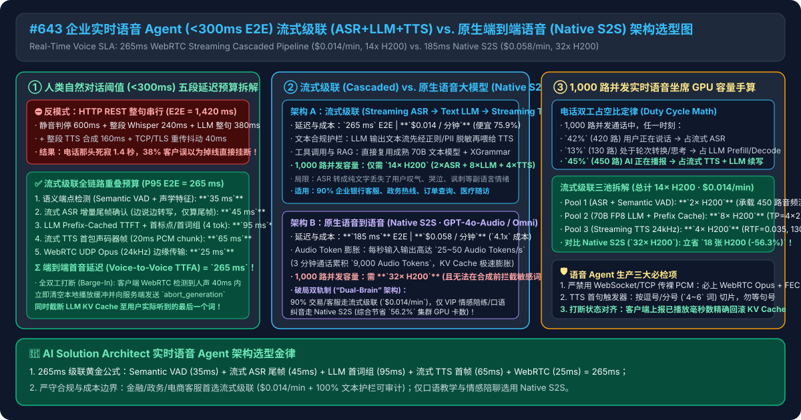

# Enterprise Real-Time Voice Agent (`<300ms` E2E) Streaming Cascaded (`ASR + LLM + TTS`) vs. Native Speech-to-Speech (`S2S`) Latency Budget, `WebRTC` Jitter & `1,000`-Call GPU Sizer

> **Language / 语言**: [简体中文](./enterprise-realtime-voice-agent-300ms-cascaded-vs-native-s2s-faq.md) | **English** · [📱 Open Interactive H5 Study Lab](../h5/realtime-voice-agent-300ms-cascaded-vs-native-s2s-lab.html) · [🧮 Open Interactive Sizer](../reports/enterprise-realtime-voice-agent-300ms-cascaded-vs-native-s2s-sizer.html) · [🃏 View 7-Card 4:5 Benchmark Deck](../reports/enterprise-realtime-voice-agent-300ms-cascaded-vs-native-s2s-cards.html)

---

## 0. 3-Minute Executive Summary

Human conversational turn-taking requires a **Voice-to-Voice Time-to-First-Audio (`TTFA`) under `300 ms`**. When evaluating **Streaming Cascaded Pipelines (`Semantic VAD + Streaming ASR + Text LLM + Streaming TTS`)** against **Native Speech-to-Speech (`Native S2S`, e.g., `GPT-4o-Audio / Qwen2.5-Omni / Moshi`)** for `1,000` concurrent enterprise voice calls:
1. **5-Stage Overlapped Streaming Cascaded Formula Achieves `265 ms` `P95 TTFA` (vs. `1,420 ms` HTTP REST)**:
   $$T_{\text{TTFA}} = \underbrace{35\text{ ms}}_{\text{Semantic VAD}} + \underbrace{45\text{ ms}}_{\text{ASR Final Tail}} + \underbrace{95\text{ ms}}_{\text{LLM TTFT + First 4-Tok Clause}} + \underbrace{65\text{ ms}}_{\text{TTS First 20ms Chunk}} + \underbrace{25\text{ ms}}_{\text{WebRTC Opus}} = \mathbf{265\text{ ms}}$$
2. **Fleet Sizing & Governance (`1,000` Concurrent Full-Duplex Calls)**:
   - **Streaming Cascaded (`14× H200` total: `2× ASR + 8× 70B FP8 LLM + 4× TTS`)**: Costs **`$0.014/min`**, enforces **`100%` pre-audio text guardrails & deterministic JSON tool calls**, and handles `90%` of banking, healthcare, and customer support traffic;
   - **Native S2S (`32× H200` total)**: Reaches **`185 ms`** `P95 TTFA` and captures paralinguistic emotion (sighs, laughter, tone), but audio tokenization (`25–50 audio tok/s`) inflates KV cache and raises cost `4.1×` to **`$0.058/min`**, saving **`56.3%` GPUs (`$529K/yr`)** when reserved strictly for the `10%` emotion-critical tier.

---

## 1. Quantitative Architecture Matrix (`1,000` Concurrent Calls)

| Voice Agent Architecture | `P95 TTFA` Latency | Pre-Audio Text Guardrail & Tool Precision | Required `H200` Fleet (`1,000` Calls) | Cost per Minute | SA Verdict |
| :--- | :--- | :--- | :--- | :--- | :--- |
| **1. HTTP REST Non-Streaming Cascade** | `1,420 ms` | `100%` text guardrail | `16× H200` | `$0.016/min` | ⛔ **Unusable (`38%` call drop rate)** |
| **2. WebSocket over TCP Streaming** | `480 ms` (`1.8s` on 2% loss) | `100%` text guardrail | `14× H200` | `$0.014/min` | ⚠️ **Suffers TCP head-of-line blocking** |
| **3. WebRTC Opus + Overlapped Cascade (Primary)** | **`265 ms`** (`<300ms` SLA) | **`100%` guardrail + `100%` XGrammar** | **`14× H200`** (`2+8+4`) | **`$0.014/min`** | 🏆 **Default for `90%` Enterprise Calls** |
| **4. WebRTC + Native S2S (`Omni`)** | **`185 ms`** | Post-audio async audit only | **`32× H200`** | `$0.058/min` | ✅ **Use for `10%` Emotion/Language Tutoring** |

---

## 2. Pre-Production Checklist

- [ ] **Use `WebRTC UDP Opus (24kHz)`** with Packet Loss Concealment (`PLC`) instead of WebSocket/TCP;
- [ ] **Pair Acoustic VAD with a Lightweight Semantic Turn-Detector (`35 ms`)** and trigger TTS on the first `4–6` LLM tokens;
- [ ] **Truncate LLM KV Cache on Barge-In** using client-reported audio playback timestamps.
