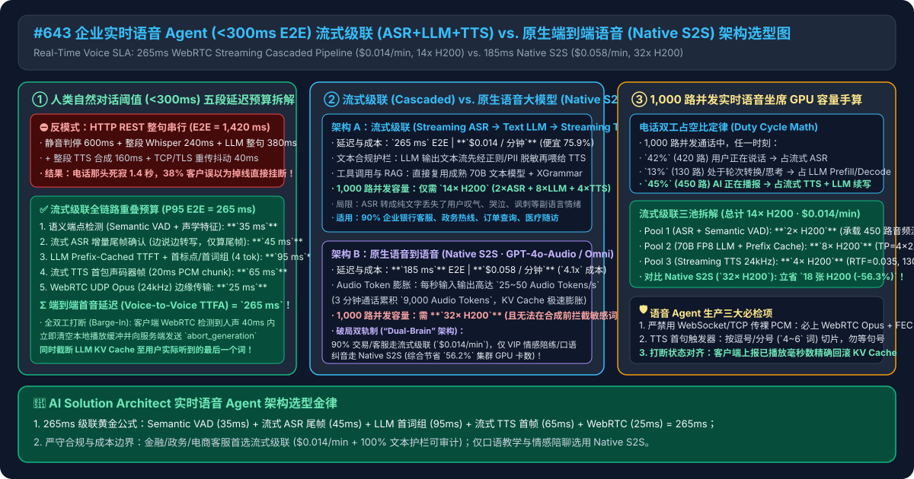
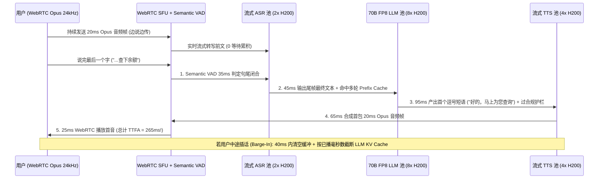

# 企业实时语音 Agent（`<300ms` 端到端语音交互）流式级联流水线（`ASR + LLM + TTS`）vs. 原生端到端语音大模型（`Native S2S`）延迟预算拆解、`WebRTC` 抗抖动与 `1,000` 路并发 GPU 容量测算指南

> **语言 / Language**: **简体中文** | [English](./enterprise-realtime-voice-agent-300ms-cascaded-vs-native-s2s-faq.en.md) · [📱 打开交互式 H5 精读页](../h5/realtime-voice-agent-300ms-cascaded-vs-native-s2s-lab.html) · [🧮 打开交互式容量计算器](../reports/enterprise-realtime-voice-agent-300ms-cascaded-vs-native-s2s-sizer.html) · [🃏 查看 7-Card 4:5 评测报告](../reports/enterprise-realtime-voice-agent-300ms-cascaded-vs-native-s2s-cards.html)

---

## 0. 3 分钟执行摘要（Executive Summary）

人类自然电话交谈的轮次切换心理舒适阈值为 **`200–300 ms`**；一旦语音客服的端到端首音延迟（`Voice-to-Voice Time-to-First-Audio, TTFA`）超过 `800 ms`，用户会频繁出现“抢话碰撞”或误以为电话掉线。面对火热的**原生端到端语音大模型（`Native Speech-to-Speech, S2S`，如 `GPT-4o-Audio / Qwen2.5-Omni / Moshi`）**与**全流式级联架构（`Streaming VAD + Streaming ASR + Text LLM + Streaming TTS`）**，架构师的核心结论如下：
1. **打破“级联一定慢于 1 秒”的误区：全流式重叠级联可将 `P95 TTFA` 从 `1,420 ms` 压至 `265 ms`（`-81.3%`）**：
   - 传统级联之所以高达 `1,420 ms`，是因为用了“固定 `600 ms` 静音判停 + 整句 HTTP ASR + 等 LLM 生成整句再调 TTS + TCP 传输”；
   - **流式级联五段延迟预算公式（`265 ms` 达标 `<300 ms` 红线）**：
     $$T_{\text{TTFA}} = \underbrace{35\text{ ms}}_{\text{Semantic VAD}} + \underbrace{45\text{ ms}}_{\text{流式 ASR 尾帧}} + \underbrace{95\text{ ms}}_{\text{LLM TTFT + 首分句 (4 tok)}} + \underbrace{65\text{ ms}}_{\text{TTS 首帧 20ms PCM}} + \underbrace{25\text{ ms}}_{\text{WebRTC Opus}} = \mathbf{265\text{ ms}}$$
2. **`流式级联` vs. `Native S2S` 的成本、合规与 GPU 容量铁律（`1,000` 路并发电话坐席）**：
   - **流式级联架构**：利用电话双工占空比定律（任一时刻 `42%` 用户说话、`45%` AI 播报、`13%` 轮次转换），承载 `1,000` 路并发实时通话仅需 **`14 张 H200`**（`2×H200` 流式 ASR + `8×H200` `70B FP8` LLM + `4×H200` 流式 TTS），单分钟通话成本仅 **`$0.014/min`**，且 **在文字进入 TTS 发声前可执行 `100%` 确定性金融/医疗合规词过滤与精准 Tool Call**；
   - **Native S2S 原生语音架构**：由于音频离散化每秒产生 `25–50 Audio Tokens/s`（3 分钟通话膨胀至 `9,000 Tokens`），承载同样 `1,000` 路并发需 **`32 张 H200`**（单分钟成本 **`$0.058/min`，贵 `4.1 倍`**），且音频 Token 直接自回归发声，无法在发声前做零延迟文字正则拦截；
   - **架构师黄金裁决**：**`90%` 的企业客服、金融核身、政务热线、订单改签必须采用 `265 ms` 流式级联架构（省卡 `56.3%`、年省 `$52.9万`）**；仅在需要识别用户哭泣/叹气/语调讽刺的 **口语外教纠音、心理陪伴与高拟真游戏 NPC（占 `10%`）** 中路由至 `Native S2S`（`185 ms`）。

---

## 1. 灵魂拷问 Q&A（Cloud & AI Solution Architect 核心决策拆解）

### Q1：如何在用户刚说完最后一个字的 `80 ms` 内就拿到完整文字，而不是傻等 `600 ms` 静音？

传统能量阈值 VAD（只看音量大小）不敢把静音阈值设低，否则用户说话中间喘口气（`300 ms`）就被强行截断。
- **正解：声学 VAD + 轻量语义句尾分类器（Semantic Turn-Detector，如 `LiveKit EOU / Ten-VAD + 135M 句尾模型`）**：
  - 当用户说出“我的银行卡号是六二二……”时，语义模型判定句子尚未闭合，自动将等待窗口延长至 `800 ms`；
  - 当用户说出“……帮我查一下余额。”时，语义模型在 `35 ms` 内判定句意完整，配合边说边转写的流式 ASR（前文早已转写完毕，只需 `45 ms` 确认最后 `200 ms` 尾帧），在用户闭嘴后 **`80 ms`** 即触发 LLM Prefill！

### Q2：用户在 AI 说话中途突然插话打断（Barge-In），如何防止大模型“记忆错乱”？

当 LLM 已经在后台以 `80 tok/s` 生成了 `60` 个字并塞入 TTS 缓冲队列，而用户才听到第 `15` 个字就开口打断（“不对，我是说上个月的账单”）：
- 如果不回滚上下文，LLM 的历史记录里会保留那 `45` 个用户根本没听到的字，导致下一轮对话鸡同鸭讲；
- **生产级 Barge-In 状态对齐协议**：WebRTC 网关记录已实际下发给客户端并播放的音频帧时间戳（如 `1,800 ms`），反查 TTS 字级时间戳对齐表（Word-Level Timestamp Alignment），精确将 LLM 历史消息与 Radix KV Cache 截断到第 `15` 个字！

---

## 2. 四大实时语音 Agent 架构横向选型矩阵（`1,000` 路并发坐席）

| 架构方案 (`1,000` 路全双工并发通话) | 端到端首音延迟 (`P95 TTFA`) | 副语言情绪感知与表现 | 发声前合规拦截与 Tool Call 精度 | 所需 `H200` 卡数与单分钟成本 | 适用业务场景与架构师裁决 |
| :--- | :--- | :--- | :--- | :--- | :--- |
| **1. 传统 HTTP REST 整句串行级联** | `1,420 ms`（严重卡顿） | 无 | `100%` 可拦截 / 高 | `16 张` (`$0.016/min`) | ⛔ **严禁用于实时电话交互** |
| **2. WebSocket + TCP 流式级联** | `480 ms`（弱网队头阻塞飙至 `1.8s`） | 仅韵律标签 | `100%` 可拦截 / 高 | `14 张` (`$0.014/min`) | ⚠️ **仅限内网固定坐席，移动 4G/5G 抖动大** |
| **3. WebRTC Opus + 全流式重叠级联（推荐主力）** | **`265 ms`**（达标 `<300ms`） | 支持情感标签驱动 TTS | **`100%` 零漏网 + `100%` Schema** | **`14 张`** (**`$0.014/min`**，省 `56.3%`) | 🏆 **企业银行/政务/电商热线首选 (`90%` 流量)** |
| **4. WebRTC + 原生端到端语音大模型 (`Native S2S`)** | **`185 ms`**（最快） | **原生听懂哭笑/口音/叹气** | 音频直出，需旁路异步审计 | **`32 张`** (`$0.058/min`，贵 `4.1x`) | ✅ **口语外教、心理陪护、VIP 情感交互 (`10%` 流量)** |

---

## 3. 10 分钟容量手算算例（`1,000` 路并发实时语音坐席三池配比）

假设某全国客服中心峰值同时在线 `1,000` 通智能语音电话（$C_{\text{calls}} = 1,000$）：
1. **Pool 1：流式 ASR + Semantic VAD 池（`2 张 H200`）**：
   - 通话中用户平均说话占空比 $\eta_{\text{user}} = 42\%$，即任意时刻有 $420$ 路活跃上行音频流；
   - 单张 `H200`（或 `2× L40S`）运行 `TensorRT-LLM Whisper-Large-v3-Turbo / Paraformer Streaming` 可稳定并发处理 `240` 路实时音频流，故需 $\lceil 420 / 240 \rceil = \mathbf{2\text{ 张 H200}}$。
2. **Pool 2：`70B FP8` LLM 推理池（`8 张 H200`）**：
   - 每通电话平均每 `10 秒` 产生 `1` 轮交互，集群总请求率 $\text{RPS} = 1,000 / 10 = 100\text{ RPS}$；
   - 语音对话要求短平快：平均历史上下文 $T_{\text{in}} = 1,800\text{ Tokens}$（`L3 Radix` 多轮前缀命中率高达 `88%`），单轮回复 $T_{\text{out}} = 65\text{ Tokens}$，且仅需前 `4 Tokens`（约 `25 ms` Decode）即可触发首包 TTS；
   - `2` 组 `TP=4 H200`（共 **`8 张 H200`**）即可在 `P95 TTFT <= 70 ms`、`TPOT <= 6.2 ms` 下轻松承载 `100 RPS`。
3. **Pool 3：流式神经 TTS 池（`4 张 H200`）**：
   - AI 播报占空比 $\eta_{\text{ai}} = 45\%$，即同时有 $450$ 路活跃音频合成流；
   - 采用 `CosyVoice 2 / Fish-Speech / Cartesia` 流式声码器，单卡实时率 $\text{RTF} \approx 0.035$（单张 `H200` 可并发实时合成 `130` 路 `24kHz` 语音流），需 $\lceil 450 / 130 \rceil = \mathbf{4\text{ 张 H200}}$。
4. **总计**：$2 + 8 + 4 = \mathbf{14\text{ 张 H200}}$（对比纯 `Native S2S` 的 `32 张 H200`，**直接节省 `18 张 H200 / -56.3%`**，年省硬件与电费 **`$52.9万`**）。

---

## 4. 生产落地核对清单（Pre-Production Checklist）

- [ ] **全面采用 `WebRTC UDP Opus (24kHz) + PLC 丢包隐藏`**：严禁在移动网络下使用 `WebSocket over TCP` 传输实时语音流，避免单个丢包引发数百毫秒 TCP 队头阻塞；
- [ ] **启用“首标点/首词组（First-Clause `4–6 Tokens`）”流式 TTS 触发器**：LLM 只要吐出第一个逗号、语气词或满 `4` 个词立即送入流式 TTS，禁止等待整句生成完毕；
- [ ] **实装 `Semantic Turn-Detector` 与 `Barge-In` 播放进度回滚**：客户端上报打断时刻的实际音频播放毫秒数，服务端据此修剪 LLM 上下文与 KV Cache；
- [ ] **在 LLM 与 TTS 之间串联 `< 2 ms` 确定性文本合规护栏**：对电话号码、银行卡号、承诺性违规词汇实施流式滑动窗口拦截。
