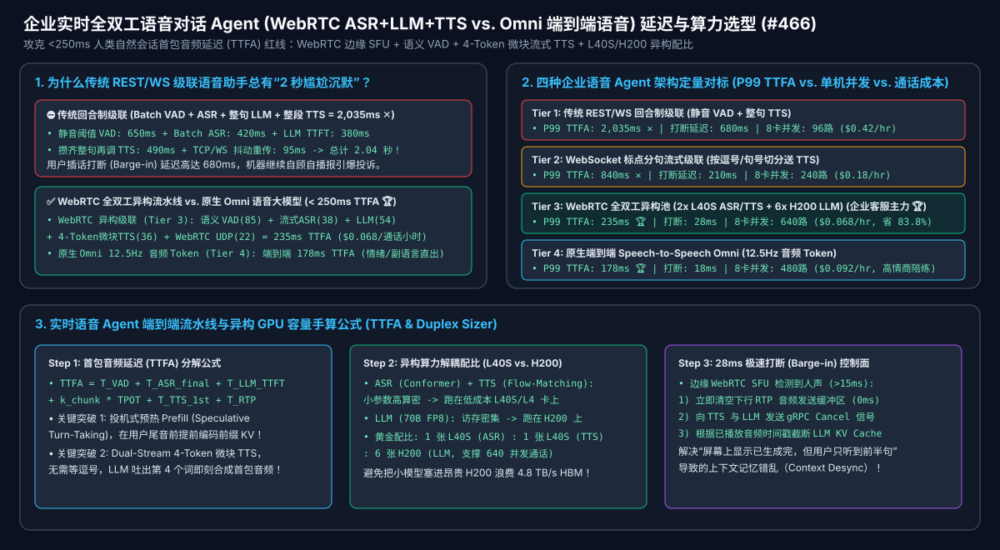

# Enterprise Real-Time Full-Duplex Voice Agent (`WebRTC + Streaming ASR/LLM/TTS` vs. `Native Omni Speech-to-Speech`) Latency & GPU Sizing Guide (#466)

> **Executive Summary**:
> Natural human phone conversation operates on a **`200ms–250ms` turn-taking response latency baseline**. Yet first-generation enterprise voice agents built on **"Turn-Based REST/WebSocket Cascades (Silence VAD $\rightarrow$ Batch ASR $\rightarrow$ Full-Sentence LLM $\rightarrow$ Batch TTS)"** suffer **`2,035ms` (>2 seconds) of awkward silence** before Time-To-First-Audio (`TTFA`) and `680ms` barge-in lag. For **Cloud & AI Solution Architects**, production voice infrastructure requires a dual-track architecture:
> 1. **Auditable, Tool-Calling Enterprise Contact Centers (Recommended Tier 3)**: Deploy **WebRTC Edge SFUs + Semantic Turn Detection (`85ms`) + Speculative Prefix Prefill Warming + 4-Token Micro-Chunk Streaming TTS** across a **disaggregated `2x L40S (ASR/TTS) + 6x H200 (70B FP8 LLM)` pool**, compressing `P99 TTFA` to **`235ms`**, scaling to **`640 concurrent calls`** per 8-GPU unit, and cutting active call cost to **`$0.068/hr` (-83.8%)**;
> 2. **Emotion-Aware Coaching & Roleplay (Recommended Tier 4)**: Deploy **Native Speech-to-Speech Omni Audio-Token Models (`12.5 Hz` dual codebook)**, eliminating intermediate ASR text conversion to achieve **`178ms P99 TTFA`**.
>
> **⚡ Interactive H5 Study Lab**: [**Open the Real-Time Voice Agent `< 250ms` TTFA Waterfall & Heterogeneous GPU Sizer (`docs/h5/realtime-voice-agent-webrtc-omni-ttfa-sizer-lab.html`)**](../h5/realtime-voice-agent-webrtc-omni-ttfa-sizer-lab.html)

---

## 1. Core Q&A: Breaking the 2-Second Silence and Context Desync on Barge-In

### Q1: How do we compress Time-To-First-Audio (`TTFA`) from `2,035ms` down below `250ms`?
The end-to-end voice turn latency is governed by:

$$\text{TTFA} = T_{\text{VAD\_endpoint}} + T_{\text{ASR\_tail}} + T_{\text{LLM\_TTFT}} + k_{\text{tts\_chunk}} \times \text{TPOT} + T_{\text{TTS\_1st\_packet}} + T_{\text{RTP\_network}}$$

1. **Replacing Fixed `650ms` Silence Timers with Semantic Endpointing (`85ms`) + Speculative Prefill**:
   - Lightweight semantic turn-detection models evaluate syntactic completeness and prosodic pitch drop to trigger end-of-turn in **`85ms`**;
   - Simultaneously, streaming ASR transcripts pre-warm the LLM's KV Cache every `500ms` while the user is still speaking, leaving only the final 3–5 words to prefill (`54ms` `TTFT`).
2. **Replacing Punctuation-Clause TTS (`150ms`) with 4-Token Micro-Chunk Streaming TTS (`36ms`)**:
   - Dual-stream flow-matching TTS synthesizes the first `20ms Opus` frame as soon as the LLM emits its first **`3–4` tokens**, eliminating the wait for a comma or period.

### Q2: Why must Barge-In truncate the LLM KV Cache by exact played-audio timestamp?
- When the LLM generates 40 tokens ahead of real-time playback and the user interrupts after hearing only 10 tokens, committing all 40 tokens to conversation history causes severe **Context Desync** (the agent assumes the user heard unspoken statements).
- **Golden Rule**: On WebRTC SFU barge-in detection (`> 15ms` voice), flush the outbound RTP buffer (`0ms`), cancel in-flight TTS/LLM streams, and roll back the LLM conversation state and KV Cache to the exact token timestamp played on the client device (`28ms` total recovery).

---

## 2. Quantitative Architecture Decision Matrix

| Architecture Tier | VAD Wait (ms) | ASR Tail (ms) | LLM TTFT (ms) | TTS 1st Chunk (ms) | End-to-End P99 TTFA (ms) | Barge-In Cancel (ms) | Concurrent Calls / 8-GPU Unit | Cost / Active Call Hour ($/hr) |
| :--- | :--- | :--- | :--- | :--- | :--- | :--- | :--- | :--- |
| **Tier 1: Legacy REST/WS Turn-Based Cascade** | `650 ms` | `420 ms` | `380 ms` | `490 ms` | `2,035 ms` ✕ | `680 ms` ✕ | `96 calls` | `$0.420` |
| **Tier 2: Streaming WebSocket Clause-Chunked Cascade** | `320 ms` | `140 ms` | `165 ms` | `150 ms` | `840 ms` ✕ | `210 ms` | `240 calls` | `$0.180` |
| **Tier 3: WebRTC Full-Duplex Disaggregated (`2x L40S + 6x H200`)** | **`85 ms`** | **`38 ms`** | **`54 ms`** | **`36 ms`** | **`235 ms` 🏆** | **`28 ms` ✓** | **`640 calls` 🏆** | **`$0.068` (-83.8%)** |
| **Tier 4: Native Speech-to-Speech Omni (`12.5 Hz` Audio Token)** | **`40 ms`** | **`0 ms`** | **`92 ms`** | **`26 ms`** | **`178 ms` 🏆** | **`18 ms` 🏆** | `480 calls` | `$0.092` |
