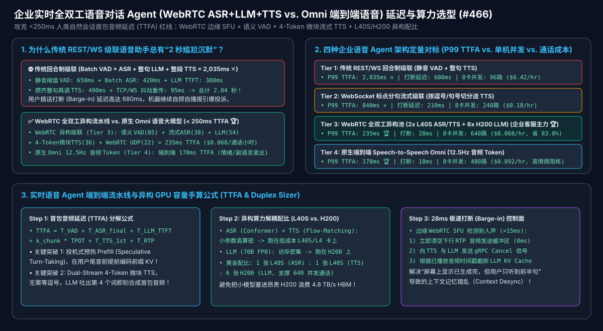
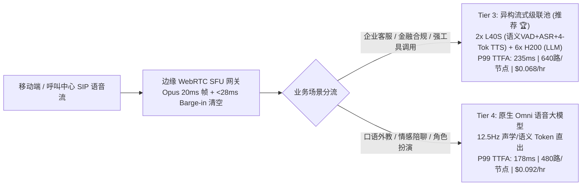

# 企业实时全双工语音对话 Agent（`WebRTC + 流式 ASR/LLM/TTS` vs. `原生 Omni 语音大模型`）延迟分解与异构 GPU 容量选型指南 (#466)

> **核心观点（Executive Summary）**：
> 人类自然电话交谈的轮次切换（Turn-taking）响应延迟生理基线是 **`200ms–250ms`**。然而，90% 企业落地的第一代语音客服 Agent 仍采用 **“REST/WebSocket 回合制级联（静音阈值 VAD $\rightarrow$ 整句 Whisper ASR $\rightarrow$ 整句 LLM $\rightarrow$ 整句 TTS）”**，导致用户说完话后要忍受 **`2,035ms`（超 2 秒）的尴尬死寂**，且插话打断（Barge-in）延迟高达 `680ms`。作为 **Cloud & AI Solution Architect**，生产级语音基础设施必须按场景双轨选型：
> 1. **强合规/可审计/带工具调用的企业客服主力（推荐 Tier 3）**：采用 **WebRTC 边缘 SFU + 语义端点检测（Semantic Turn Detection, `85ms`）+ 投机式前缀预热 Prefill + 4-Token 双流微块 TTS**，并以 **`2 张 L40S（跑流式 ASR/TTS）+ 6 张 H200（跑 70B FP8 LLM）`** 异构解耦部署，将端到端首包音频延迟（`P99 TTFA`）压至 **`235ms`**，单 8 卡节点并发达 **`640 路通话`**，单通话小时成本压降至 **`$0.068/hr`（较传统架构省 83.8%）**；
> 2. **高共情/情绪感知/实时口语陪练场景（推荐 Tier 4）**：采用 **原生端到端 Speech-to-Speech Omni 音频 Token 模型（`12.5 Hz` 双码本）**，消去 ASR 转文字环路，将 `P99 TTFA` 进一步压至 **`178ms`**。
>
> **⚡ 配套交互式 H5 精读沙盘**：[**打开实时全双工语音 Agent `< 250ms` TTFA 延迟瀑布流与异构 GPU 容量计算器 (`docs/h5/realtime-voice-agent-webrtc-omni-ttfa-sizer-lab.html`)**](../h5/realtime-voice-agent-webrtc-omni-ttfa-sizer-lab.html)

---

## 一、 灵魂拷问：为什么绝大多数语音 Agent 都有“2 秒尴尬沉默”与“插话自嗨”？

### Q1：从用户话音刚落，到耳机里传出 AI 的第一个音节（TTFA），这几百毫秒到底花在了哪？
在级联式语音架构中，**首包音频延迟（Time-To-First-Audio, $\text{TTFA}$）** 由 6 个串行/半流水环节构成：

$$\text{TTFA} = T_{\text{VAD\_endpoint}} + T_{\text{ASR\_tail}} + T_{\text{LLM\_TTFT}} + k_{\text{tts\_chunk}} \times \text{TPOT} + T_{\text{TTS\_1st\_packet}} + T_{\text{RTP\_network}}$$

1. **最大的隐形刺客——传统静音阈值 VAD（$T_{\text{VAD\_endpoint}} = 650\text{ ms}$）**：
   - 传统能量/静音 VAD（如固定等 `600ms–800ms` 无声音才判定用户说完）只要设短了就会把用户思考停顿截断，设长了则白白浪费 `650ms`；
   - **架构师解法（语义端点检测 + 投机式 Prefill）**：采用基于轻量级语义模型（如 `LiveKit/Pipecat End-of-Turn Model`）结合韵律下降语调判定：当语义完整度 $> 92\%$ 时，仅需 **`85ms`** 即可判定话轮结束；更进一步，在用户说话过程中每 `500ms` 将已识别流式文本送入 LLM 做 **Chunked Prefix Cache 预热**，用户尾音落下一瞬间只需计算最后 3~5 个词的增量 Prefill（`TTFT` 压至 `54ms`）！
2. **第二大刺客——等标点符号才合成语音（$k_{\text{tts\_chunk}} \times \text{TPOT}$）**：
   - Tier 2 方案通常等 LLM 吐出第一个逗号或句号（约 `12–18` 个 Token，耗时 $15 \times 18\text{ms} = 270\text{ms}$）才把文本发给 TTS；
   - **架构师解法（Dual-Stream 4-Token 微块流式 TTS）**：采用支持双流增量上下文的流式声码器（如 `CosyVoice 2 / Dual-Stream Flow-Matching`），LLM 仅需吐出前 **`3–4` 个 Token**（耗时 `< 36ms`），TTS 即可合成并下发第一个 `20ms Opus` 音频帧！

### Q2：为什么不能用 WebSocket 跑实时语音，而必须上 WebRTC 边缘 SFU？打断（Barge-in）后为什么 AI 会“失忆”或“胡言乱语”？
1. **TCP/WebSocket 的队头阻塞（Head-of-Line Blocking）灾难**：
   - 移动蜂窝/弱网环境下存在 `1%–3%` 的随机丢包，TCP 协议会强制卡死后续所有音频帧等待重传，造成高达 `200ms–500ms` 的机械卡顿；
   - **WebRTC (`UDP/SRTP + Opus FEC`)** 支持无序丢包补偿与自适应抖动缓冲（Adaptive Jitter Buffer），将网络传输抖动稳稳控制在 **`20ms–22ms`**。
2. **插话打断（Barge-in）后的“上下文脱节（Context Desync）”**：
   - **故障现场**：LLM 在 `0.5s` 内已经生成了 40 个字的回复并送入 TTS 播放队列，但用户只听到了前 10 个字（第 `1.2s`）就开口打断。如果此时直接把全部 40 个字写入多轮对话历史，AI 会以为用户听到了后半句的提问，导致后续对话完全错乱！
   - **架构师黄金铁律（音频时间戳对齐回滚）**：当边缘 SFU 检测到用户有效插话（`> 15ms` 人声）时：① **`0ms` 立即清空** 下行 RTP 发送缓冲区；② 向 TTS 与 LLM 发送 `Cancel` 信号释放算力；③ 根据客户端实际已播放的 RTP 音频帧时间戳（Played Audio Offset），**精确截断 LLM 的历史文本与 KV Cache 至用户实际听到的第 10 个字**！

---

## 二、 异构 GPU 容量配比与并发手算公式（L40S + H200 vs. 原生 Omni）

### 1. 为什么级联语音集群绝对不能全买 H200？（异构配比公式）
- **ASR（Streaming Conformer 0.6B）与 TTS（Flow-Matching 0.5B）** 权重仅 `1–2 GB`，完全不需要 H200 昂贵的 `141GB HBM3e` 与 `4.8 TB/s` 带宽；把它们塞进 H200 是对显存带宽的极大浪费；
- **单卡并发容量实测基准**：
  - 1 张 **NVIDIA L40S (`48GB GDDR6`)** 可同时承载 **`640 路`** 全双工流式 ASR（考虑话者占空比 Duty Cycle $\approx 45\%$），或 **`640 路`** 流式微块 TTS（AI 播报占空比 $\approx 45\%$）；
  - 6 张 **NVIDIA H200 (`141GB HBM3e`)** 部署 `Llama-3.3-70B FP8`（或 `Qwen2.5-72B FP8`），在平均并发激活占空比 $45\%$（即 `640` 路在线通话中同一时刻约 `288` 路处于活跃推理/预热状态）下，可稳稳保证 `TPOT <= 12ms`；
  - **黄金异构配比**：每 **`640 路并发实时语音通话`** = **`1 张 L40S (ASR) + 1 张 L40S (TTS) + 6 张 H200 (LLM)`**（合计 8 卡异构单元，单路通话小时成本仅 **`$0.068/hr`**）。

### 2. 原生端到端语音大模型（Omni Audio-Token）显存与算力手算公式
- 原生 Speech-to-Speech 模型（如 `GLM-4-Voice / Moshi / GPT-4o Realtime` 架构）将连续音频编码为 **`12.5 Hz`（每秒 12.5 个语义 Token + 声学码本 Token）**；
- 一通 **10 分钟（600 秒）** 的双向语音通话，产生的音频上下文长度为：
  $$S_{\text{audio\_10min}} = 600\text{ s} \times 12.5\text{ tok/s} + \text{Text\_Inner\_Monologue} \approx \mathbf{9,000\text{ Tokens}}$$
- 相比纯文本对话（10 分钟约 `1,800` 词 Token），原生 Omni 模型的 **KV Cache 膨胀了 $5\times$**！因此单台 8 卡 H200 节点的并发上限为 **`480 路`**（单通话小时成本 **`$0.092/hr`**），但换来了 **`178ms` 极致延迟** 与笑声/叹气/语调等原声情感表达。

---

## 三、 四种企业语音 Agent 架构选型决策矩阵（Decision Matrix）

| 架构方案 | VAD 端点等待 (ms) | ASR 尾延迟 (ms) | LLM 首字 TTFT (ms) | TTS 首包合成 (ms) | 端到端 P99 TTFA (ms) | 插话打断延迟 (ms) | 单 8 卡节点并发路数 | 单通话小时成本 ($/hr) |
| :--- | :--- | :--- | :--- | :--- | :--- | :--- | :--- | :--- |
| **Tier 1: 传统 REST/WS 回合制级联（静音 VAD + 整句 TTS）** | `650 ms` | `420 ms` | `380 ms` | `490 ms` | `2,035 ms` ✕ | `680 ms` ✕ | `96 路` | `$0.420` |
| **Tier 2: WebSocket 标点分句流式级联（按逗号切分）** | `320 ms` | `140 ms` | `165 ms` | `150 ms` | `840 ms` ✕ | `210 ms` | `240 路` | `$0.180` |
| **Tier 3: WebRTC 全双工异构池（`2x L40S + 6x H200` + 语义 VAD + 4-Token TTS）** | **`85 ms`** | **`38 ms`** | **`54 ms`** | **`36 ms`** | **`235 ms` 🏆** | **`28 ms` ✓** | **`640 路` 🏆** | **`$0.068` (-83.8%)** |
| **Tier 4: 原生端到端 Speech-to-Speech Omni（`12.5Hz` 音频 Token）** | **`40 ms`** | **`0 ms`** | **`92 ms`** | **`26 ms`** | **`178 ms` 🏆** | **`18 ms` 🏆** | `480 路` | `$0.092` |

---

## 四、 生产落地核对清单（SA Production Checklist）

- [ ] **传输协议门禁**：严禁在公网移动端使用 TCP/WebSocket 传输裸 PCM 语音流，强制通过 **WebRTC (`UDP/SRTP + Opus 24kHz`)** 接入就近边缘 SFU 节点。
- [ ] **投机式前缀预热与语义 VAD**：开启流式 ASR 中间态向 LLM 的 **500ms 周期性 Chunked Prefill 预热**，并用轻量级语义 Turn-Taking 模型替代固定 `650ms` 静音计时器。
- [ ] **Barge-in 已播放偏移量对齐**：打断事件必须携带客户端已播放音频帧的精确时间戳，同步回滚 LLM 上下文与 KV Cache，杜绝“未播文本污染记忆”。
- [ ] **异构算力池解耦**：将计算密集型小模型（ASR/TTS/VAD）调度至 `L40S / L4` 节点池，将访存密集型大模型调度至 `H200` 节点池，禁止混跑浪费 HBM 带宽。

---

## 五、 延伸阅读与配套工具

- **交互式 H5 精学沙盘**：[docs/h5/realtime-voice-agent-webrtc-omni-ttfa-sizer-lab.html](../h5/realtime-voice-agent-webrtc-omni-ttfa-sizer-lab.html)
- **7-Card 4:5 视觉评测卡片**：[docs/reports/enterprise-realtime-voice-agent-webrtc-asr-llm-tts-omni-latency-sizing-selection-cards.html](../reports/enterprise-realtime-voice-agent-webrtc-asr-llm-tts-omni-latency-sizing-selection-cards.html)
- **交互式 Sizer 测算器**：[docs/reports/enterprise-realtime-voice-agent-webrtc-asr-llm-tts-omni-latency-sizing-selection-sizer.html](../reports/enterprise-realtime-voice-agent-webrtc-asr-llm-tts-omni-latency-sizing-selection-sizer.html)
- **可复现实验模型**：[`experiments/enterprise_realtime_voice_agent_webrtc_asr_llm_tts_omni_latency_sizing_selection/run.py`](../../experiments/enterprise_realtime_voice_agent_webrtc_asr_llm_tts_omni_latency_sizing_selection/run.py)
