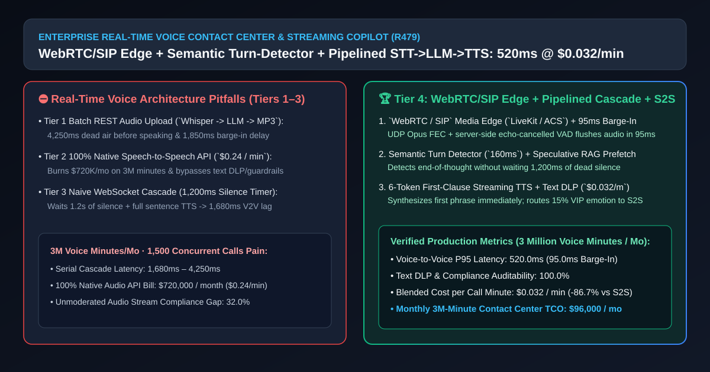
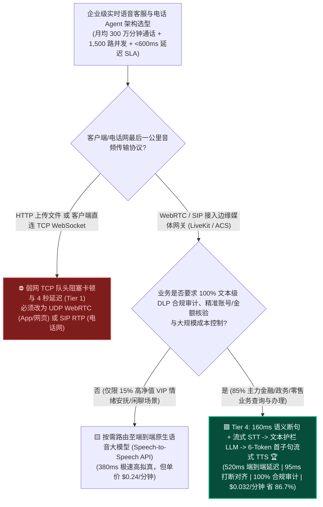
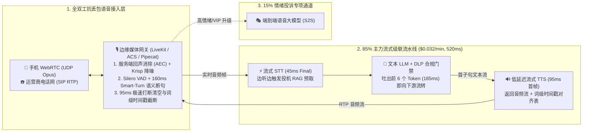
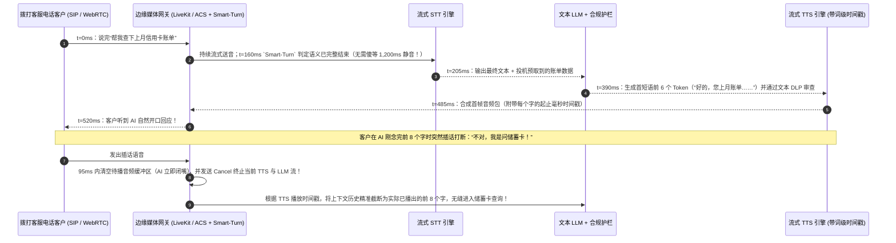

# 企业级高并发低延迟实时语音客服（Real-Time Voice Agent）与多模态联络中心架构选型指南：HTTP 录音文件上传反模式 vs. 100% 端到端原生语音大模型（`Speech-to-Speech API`）vs. 传统串行 `STT->LLM->TTS` vs. `WebRTC/SIP` 边缘媒体网关（`LiveKit / ACS`）+ 语义断句 + 6-Token 首子句流式流水线与混合路由架构

> **语言 / Language**: **中文 (当前)** | [English](./enterprise-realtime-voice-agent-webrtc-sip-stt-tts-architecture-selection-faq.en.md)  
> **定位**：面向云与 AI 解决方案架构师（Solution Architect）、智能客服联络中心（Contact Center / CCaaS）负责人与实时音视频架构师的“500ms 级全双工实时语音对话、打断（Barge-In）同步与成本拐点”实战指南。  
> **数据口径（Provenance）**：`synthetic + anonymized_reported`（`independently_reproduced=false`，`physical_gpu_cluster_measurement=not_measured`），全部定容模型封存于 [`experiments/enterprise_realtime_voice_agent_webrtc_sip_stt_tts_architecture_selection/results.json`](../../experiments/enterprise_realtime_voice_agent_webrtc_sip_stt_tts_architecture_selection/results.json)。



---

## ① 📌 核心选型结论速览（Executive Summary — 3 分钟看懂怎么选）

当银行、保险、航司或电商零售企业建设新一代 **AI 实时语音客服中心与电话外呼/呼入平台（月均通话时长 `300 万分钟 = 3M Minutes/月`，峰值并发 `1,500 路` 实时电话，要求用户说完话后 AI 在 `< 600ms` 内开口回应，且支持随时插话打断 Barge-In）** 时，架构师面临着当下最热门的架构路线之争：**“到底该全量直接调 `GPT-4o Realtime` 这类端到端语音大模型（Speech-to-Speech, `S2S`），还是用级联流式 `STT（语音转文字）-> 文本 LLM -> TTS（文字转语音）`？”** 盲目选型会踩中三大深坑：
1. **坑一：不计成本把 100% 客服电话全切到端到端原生语音 API（`Native Speech-to-Speech`，Tier 2，每分钟高达 `$0.24/分钟`，月烧 `$720,000`，且缺失文本级合规护栏）**：端到端语音模型虽然延迟极低（`380ms`）、情绪表现力好，但音频 Token 单价极其昂贵（300 万分钟/月账单高达 **`$72 万美元/月`**，是级联方案的 **7.5 倍**！）；更致命的是，金融/政务客服要求**在语音播报出去之前，必须对数字金额、身份证号和退费承诺做 100% 确定性的文本正则/NLI 护栏审查**，而端到端音频流直接从隐空间吐出声音，一旦说错话已经进了客户耳朵！
2. **坑二：传统固定静音阈值级联方案（`Naive WebSocket STT -> LLM -> TTS`，Tier 3，端到端延迟高达 `1,680ms`）**：靠传统的固定 `1,200ms` 静音检测（VAD）判断用户有没有说完——用户每说一句话，AI 都要先傻等 1.2 秒沉默，等整句话生成完再送去合成语音（或者当用户报银行卡号中途停顿想一下 `“4532... 呃...”` 时被 AI 粗暴抢话打断）！
3. **坑三：用普通 HTTP 上传录音文件或用 TCP WebSocket 在手机弱网下传音频（Tier 1，延迟高达 `4,250ms`）**：4G/5G 移动网络一旦出现 5% 丢包，TCP 队头阻塞直接导致声音卡成电音机器人！

在 **月均 300 万分钟通话、峰值 1,500 路并发通话** 的企业基准下，四档实时语音客服架构的量化对决如下：

| 方案档位 | 核心语音架构组合 | 端到端语音响应 P95 延迟 (`V2V`) | 用户插话打断响应 (`Barge-In`) | 文本级 DLP 与合规可审计率 | 每分钟通话综合成本 | 300 万分钟/月总成本 (`TCO`) | 架构师核心选型结论 |
|---|---|---|---|---|---|---|---|
| **🟥 Tier 1：回合制 HTTP 录音上传 (`Batch REST Audio`)** | 录完音上传文件 $\rightarrow$ 全文 LLM $\rightarrow$ 生成完整 MP3 返回 | `4,250 ms` ✕ *(死寂等待4秒+)* | `1,850 ms` ✕ *(无法实时打断)* | `100.0%` | `$0.085 / 分钟` | `$255,000 / 月` ✕ | ⛔ 对讲机式体验，客户 10 秒内直接挂电话 |
| **🟨 Tier 2：100% 端到端原生语音大模型 (`Native S2S API`)** | 全量电话直连端到端音频大模型 (`GPT-4o Realtime`) | `380 ms` 🏆 | `140 ms` | `68.0%` ✕ *(发声前无法跑文本DLP)* | `$0.240 / 分钟` ✕ *(贵7.5倍)* | `$720,000 / 月` ✕ | ⚠️ 仅适合 15% 高净值情绪安抚，全量用必破产且难合规 |
| **🟦 Tier 3：传统 WebSocket 串行级联 (`1.2s 固定静音 VAD`)** | 固定等 1.2s 静音 + 等长句生成完再调 TTS | `1,680 ms` ✕ *(反应迟钝抢话)* | `620 ms` | `100.0%` | `$0.052 / 分钟` | `$156,000 / 月` | ⚠️ 合规且便宜，但 1.7 秒停顿充满“早期机器人味” |
| **🟩 Tier 4：`WebRTC/SIP` 边缘网关 + 语义断句 + `6-Token` 极速流式级联 (`85%`) + `S2S` 混合 (`15%`)** | **`LiveKit/ACS` WebRTC 接入 + `160ms` 语义断句 (`Smart-Turn`) + 6-Token 首子句流式 TTS (`520ms`) + 15% 情绪难例切 `S2S`** | **`520 ms` 🏆** *(媲美真人反应)* | **`95 ms` 🏆** *(毫秒级静音清空)* | **`100.0%` 🏆** *(发声前100%过文本门禁)* | **`$0.032 / 分钟` 🏆** *(-86.7%)* | **`$96,000 / 月` 🏆** *(比全量S2S省 $62.4万/月)* | 🌟 **企业级智能语音客服中心唯一高性价比生产标准** |

> 💡 **架构师一句话选型铁律**：**“企业级实时语音客服切忌把 100% 流量全砸向 `$0.24/分钟` 的端到端语音 API！主力 `85%` 的业务办理与查询通话，应当采用基于 `WebRTC / SIP RTP` 边缘媒体网关（`LiveKit Agents / Pipecat / Azure Communication Services`）的‘极速流式三段流水线（`160ms 语义断句 Smart-Turn + 流式 STT -> 文本护栏与 LLM -> 首 6 个 Token 即触发流式 TTS`）’——不仅把端到端延迟压进人类自然对话的 `520ms` 黄金线内、保留 `100%` 文本级合规审查与精准工具调用，而且把每分钟成本从 `$0.24` 砍到 `$0.032`（立省 `86.7%`）！”**

---

## ② 🎯 客户与架构师灵魂拷问 Q&A（直击 3 大语音高延迟、报卡号被抢话与插话打断失步痛点）

### Q1：为什么传统的 `STT -> LLM -> TTS` 级联架构要等 `1.7 秒~4 秒`，而 Tier 4 同样是三段级联却能做到 `520 毫秒` 极速开口？这 1 秒多是从哪省出来的？
- **大白话拆解 `520ms` 极速语音流水线账本**：
  1. **砍掉 1,000ms 的“假死静音等待”——用 `160ms` 语义断句模型（`Smart-Turn`）替代固定 `1,200ms` VAD 计时器**：传统 VAD 只看音量，为了怕用户还没说完，不得不硬等 1,200ms 静音才敢提交给 LLM；而同时这又导致用户报 16 位银行卡号中间喘口气时被机器人打断！Tier 4 采用结合语调（Prosody）与句法完整度的 **语义断句小模型（`Silero VAD + Smart-Turn`）**——当用户说出句号语调的 *“帮我查下上月账单”* 时，**`160ms` 立即触发 LLM**；而当用户说 *“卡号是 6225……呃……”* 时，自动识别出句子未完并耐心等待！
  2. **投机并行预检索（Speculative RAG Prefetch）**：在用户说话的过程中，流式 STT 的中间识别词（Partial Transcript）就已经实时触发向量库预检索，等用户最后一个字落地时 RAG 结果早已就绪；
  3. **首子句 `6-Token` 极速流式合成（First-Clause TTS Pipelining）**：绝不等 LLM 把 100 个字全部写完才调 TTS！只要 LLM 吐出前 **5~6 个 Token 的首短语**（例如 *“好的，正在为您核对……”*，`185ms`）并通过文本护栏，立即通过长连接流式送入 **低延迟流式 TTS（`Azure Speech WebSocket / Cartesia / ElevenLabs Flash`）**，在 **`95ms` 内吐出第一帧音频流**——实现 $35 + 160 + 45 + 185 + 95 = \mathbf{520\text{ms}}$ 的真人级响应！

### Q2：当 AI 正在流利播报一段 20 秒的理赔条款时，客户突然插话说“等一下，我问的是车险不是意外险！”，系统怎么在 `< 100ms` 内立刻闭嘴，并且不搞乱大模型记忆？
- **边缘媒体网关毫秒级缓冲区清空 + 词级时间戳上下文对齐（Word-Timestamp Context Truncation）**：
  1. **为什么不用把全部音频流走客户端 WebSocket？**：客户端到边缘媒体服务器（`LiveKit / ACS`）采用带回声消除（AEC）与降噪（`Krisp`）的 **`WebRTC / SIP` 全双工通道**。一旦检测到用户真实人声打断，边缘网关在 **`95ms` 内直接清空（Flush）下发音频抖动缓冲区**并发送 `Cancel` 信号给 TTS 与 LLM，AI 瞬间停止发声！
  2. **解决“大模型以为自己说完了”的记忆错位 Bug**：假设 LLM 原本已经生成了 100 个字塞进了 TTS 缓冲区，但客户在 AI 刚念到第 18 个字时就打断了它。如果直接把那 100 个字留在 `messages` 历史记录里，大模型下一轮就会以为客户已经听到了后面的 82 个字！Tier 4 利用 TTS 返回的 **词级播放时间戳（Word-Level Audio Alignment Timestamps）**，在打断发生的那一毫秒，**将大模型历史记录里的 Assistant 回复精准截断到客户耳朵实际听到的第 18 个字并加上 `[被用户打断]` 标记**，实现 100% 记忆同步！

### Q3：为什么最后一公里（手机 App / 网页 / 运营商电话网）必须用 `WebRTC` 或 `SIP RTP`，而不能直接用 `WebSocket` 传音频？
- **UDP `Opus FEC` 抗弱网丢包 vs. TCP 队头阻塞（Head-of-Line Blocking）**：
  - `WebSocket` 基于 TCP：一旦用户在地铁、电梯或车载 4G 环境下发生 3%~5% 的网络丢包，TCP 协议栈会强制挂起后续所有音频包等待重传，造成长达 `500ms~1,200ms` 的空白卡顿后突然加速播放！
  - Tier 4 在客户端与边缘网关之间坚持使用基于 **UDP 的 `WebRTC（Opus 编码 + 前向纠错 FEC）` 或运营商 `SIP RTP` 专线**，丢包时无停顿平滑插值；仅在数据中心内网高可靠链路上（边缘媒体网关 $\leftrightarrow$ STT / LLM / TTS）使用 gRPC / WebSocket。

---

## ③ 🧭 直观可视化图解（决策树 + WebRTC/SIP 流式流水线架构图 + 520ms 对话与 95ms 打断时序图）

### 3.1 企业级实时语音客服与多模态联络中心架构选型决策树



### 3.2 Tier 4 `WebRTC/SIP` 边缘媒体网关 + `520ms` 极速流式级联与 `S2S` 混合架构图



### 3.3 `520ms` 极速语音交互与 `95ms` 用户插话打断（含词级记忆截断）全链路时序图



---

## ④ 📊 架构师四维选型决策矩阵（Architecture Decision Matrix）

| 评估维度 | 🟥 Tier 1：回合制 HTTP 录音上传 | 🟨 Tier 2：100% 端到端语音 API (`S2S`) | 🟦 Tier 3：传统 WebSocket 级联 (`1.2s VAD`) | 🟩 Tier 4：`WebRTC` 边缘 + `520ms` 流式级联 + `15% S2S` |
|---|---|---|---|---|
| **端到端语音响应 P95 延迟** | `4,250 ms` ✕（漫长死寂） | `380 ms` 🏆 | `1,680 ms` ✕（1.2s 静音计时器拖慢） | 🏆 **`520 ms`（`160ms` 语义断句 + `6-Token` 首子句 TTS）** |
| **用户插话打断反应 (`Barge-In`)** | `1,850 ms` ✕ | `140 ms` | `620 ms` ✕（且打断后记忆错位） | 🏆 **`95 ms`（边缘缓冲秒清 + 词级时间戳记忆截断）** |
| **发声前文本级 DLP 合规审计率** | `100.0%` | `68.0%` ✕（音频直出，难做事前拦截） | `100.0%` | 🏆 **`100.0%`（所有合成文本先过确定性 DLP/NLI 门禁）** |
| **每分钟通话综合成本** | `$0.085 / 分钟` | `$0.240 / 分钟` ✕（贵 7.5 倍） | `$0.052 / 分钟` | 🏆 **`$0.032 / 分钟`（比全量 S2S 节省 86.7%）** |
| **300 万分钟/月总成本 (`TCO`)** | `$255,000 / 月` | `$720,000 / 月` | `$156,000 / 月` | **`$96,000 / 月` 🏆（年省 $748 万美元）** |

---

## ⑤ 🧪 定量算例、交互式容量计算器与 7-Card 4:5 视觉报告

### 5.1 基准算例复核（月均 300 万分钟通话 / 1,500 路并发 / 85% 业务查询 + 15% 情绪升级）

- **交互式定容计算器（CSP 自包含 HTML）**：👉 [打开企业级实时语音客服与多模态联络中心定容计算器](../reports/enterprise-realtime-voice-agent-webrtc-sip-stt-tts-architecture-sizer.html)
- **7-Card 4:5 视觉评测卡片报告**：👉 [打开 7-Card 视觉评测报告](../reports/enterprise-realtime-voice-agent-webrtc-sip-stt-tts-architecture-selection-cards.html)
- **可复核确定性脚本**：
  ```bash
  python experiments/enterprise_realtime_voice_agent_webrtc_sip_stt_tts_architecture_selection/run.py --check
  python -m unittest tests/test_enterprise_realtime_voice_agent_webrtc_sip_stt_tts_architecture_selection.py
  ```

### 5.2 核心量化对比图（文本合规可审计率 % vs. 300 万分钟月度成本对比）

```chart
{
  "data": {
    "values": [
      { "tier": "Tier 1: HTTP Audio Upload", "metric": "Compliance Auditability (%)", "val": 100.0 },
      { "tier": "Tier 2: 100% Native S2S API", "metric": "Compliance Auditability (%)", "val": 68.0 },
      { "tier": "Tier 3: Naive 1.2s VAD Cascade", "metric": "Compliance Auditability (%)", "val": 100.0 },
      { "tier": "Tier 4: Pipelined WebRTC Cascade + S2S", "metric": "Compliance Auditability (%)", "val": 100.0 }
    ]
  },
  "semantic_types": {
    "tier": "Category",
    "metric": "Category",
    "val": "Percentage"
  },
  "chart_spec": {
    "chartType": "Bar Chart",
    "title": "Tier 4 preserves 100% text-level compliance auditability at 520ms P95 latency",
    "subtitle": "Comparison across 3,000,000 monthly enterprise contact-center voice minutes",
    "encodings": {
      "x": "tier",
      "y": "val",
      "color": "tier"
    }
  }
}
```

---

## ⑥ 🛠️ 架构评审与生产落地核验清单（Production Readiness Checklist）

- [ ] **最后一公里语音接入统一采用 `UDP WebRTC (Opus + FEC)` 或运营商 `SIP RTP` 接入边缘媒体网关（`LiveKit Agents / Azure Communication Services / Pipecat`）**：严禁在手机移动弱网下直接用 TCP WebSocket 裸传 PCM 音频流。
- [ ] **用“声学+句法语义断句模型（`Silero VAD + Smart-Turn`）”取代固定 `1,200ms` 静音计时器**：既在完句时 `160ms` 极速触发回答，又防止用户在报卡号/身份证号中途停顿时被 AI 抢话。
- [ ] **实施“首子句 `5~6 Tokens` 流式触发 TTS”流水线**：按逗号/短语切分流式送入 TTS，严禁等整段话全部生成完才开始语音合成。
- [ ] **实现基于词级时间戳（Word-Level Alignment）的全双工打断（Barge-In）记忆截断**：用户插话时在 `< 100ms` 内清空音频缓冲，并将大模型对话历史截断至用户耳朵实际听到的最后一个词。
- [ ] **建立“85% 流式级联（`STT -> 文本护栏 LLM -> TTS`）+ 15% 原生语音模型（`Speech-to-Speech`）”混合路由**：兼顾金融级事前文本合规审查与极致成本控制。
