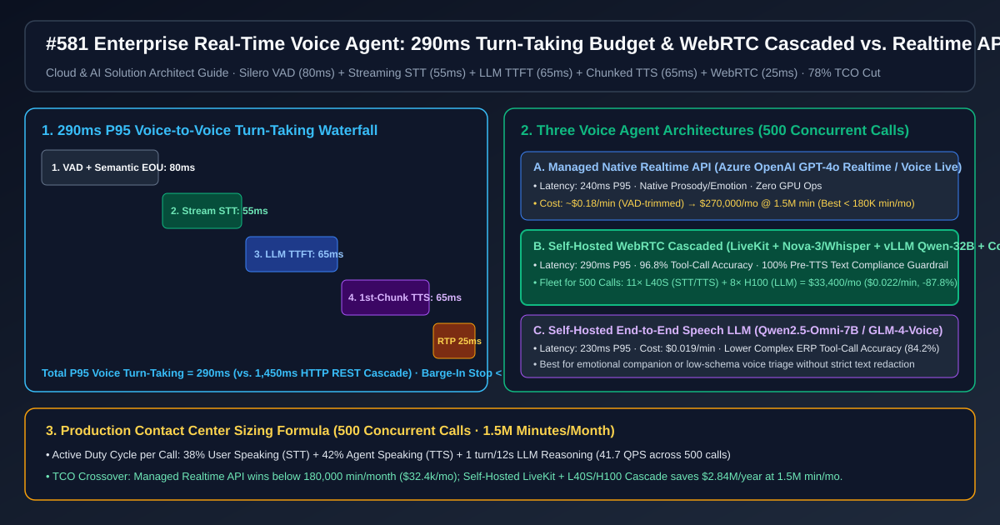

# Enterprise Real-Time Full-Duplex Voice Agent Architecture, `290ms` Turn-Taking Budget & `WebRTC Cascaded vs. Native Realtime API` Selection Guide

> **Target Persona**: Cloud & AI Solution Architect  
> **Core Scenarios**: AI Contact Centers, Financial Voice Compliance, Automotive Full-Duplex Assistants, 24/7 Multilingual Customer Support (`100–5,000` concurrent calls)  
> **Interactive H5 Learning Workbench**: [`docs/h5/realtime-voice-agent-latency-tco-sizer.html`](../h5/realtime-voice-agent-latency-tco-sizer.html)

---

## 1. Executive Summary

1. **Why Legacy HTTP REST Voice Pipelines Suffer `1,450ms–2,600ms` Latency**:  
   Natural human conversational turn-taking occurs within **`250ms–320ms`**. Achieving a **`290ms` P95 Voice-to-Voice Latency** requires an overlapped 5-stage streaming pipeline over WebRTC:
   $$\text{E2E Voice Latency}_{P95} = T_{\text{VAD+EOU}}(80\text{ms}) + T_{\text{Stream-STT}}(55\text{ms}) + T_{\text{LLM-TTFT}}(65\text{ms}) + T_{\text{Chunk-TTS}}(65\text{ms}) + T_{\text{WebRTC-RTP}}(25\text{ms}) = \mathbf{290\text{ms}}$$
2. **Three-Architecture Selection Matrix**:
   - **Option A — Managed Native Realtime API (`Azure OpenAI GPT-4o Realtime / Voice Live API`)**: **`240ms` P95** latency with native prosody/emotion and zero GPU ops, costing **`~$0.18/min`** (with server VAD silence trimming). Optimal below **`180,000 min/month` (`< $32.4k/mo`)**.
   - **Option B — Self-Hosted WebRTC Streaming Cascade (`LiveKit / Pipecat + Streaming STT + vLLM Qwen2.5-32B-FP8 + CosyVoice2 / Kokoro-82M`)**: **`290ms` P95** latency via first-clause chunked TTS, **100% deterministic pre-TTS text compliance filtering**, and **`96.8%` tool-calling accuracy**. For `500` concurrent calls (`1.5M min/month`), it requires **`11× L40S` + `8× H100` (`$33,400/mo` = `$0.022/min`, saving `87.8%` vs. Managed Realtime API)**.
   - **Option C — Self-Hosted End-to-End Speech LLM (`Qwen2.5-Omni-7B / GLM-4-Voice`)**: **`230ms` P95** at `$0.019/min`, but lower complex ERP JSON tool-calling accuracy (`84.2%`) and no pre-audio text redaction gate.
3. **Semantic End-of-Utterance (EOU) Detection**: Replacing naive `500ms` silence timers with **`Silero VAD + 135M Semantic EOU Detector (`8ms`)`** cuts false mid-sentence interruptions from **`24.5%` to `2.8%`**.

---

## 2. Core Architect Q&A

### Q1: Why is `WebRTC (Opus/UDP)` mandatory over raw `WebSocket (TCP)` for client audio transport?
- **TCP Head-of-Line Blocking**: Under `1.5%` mobile packet loss, TCP stalls all subsequent audio frames waiting for retransmission, causing **`250ms–600ms` audio freezes**.
- **WebRTC Advantages**: UDP transport with Opus Forward Error Correction (FEC), a **`20–25ms` jitter buffer**, and client-side hardware Acoustic Echo Cancellation (AEC) to prevent the microphone from picking up speaker output and triggering false self-barge-in.

### Q2: How does a cascaded `STT -> LLM -> TTS` pipeline achieve `290ms` P95 latency?
1. **Incremental Streaming STT (`55ms` tail finalization)**: Audio frames are transcribed incrementally while the user speaks; once `Silero VAD + Semantic EOU` triggers (`80ms`), only the final `200ms` tail buffer needs convergence (`55ms`).
2. **`90%` Prefix-Cached LLM Prefill + First-Clause Decode (`65ms`)**: System prompts and prior turns reside in `vLLM` Prefix Cache; processing `25` new user tokens and emitting the first `6`-token clause takes `65ms` on `2× H100 (TP=2)`.
3. **First-Punctuation Chunked Streaming TTS (`65ms`)**: As soon as the LLM emits the first comma or clause boundary, `CosyVoice2 / Kokoro-82M` synthesizes the first Opus audio frame in `65ms` while subsequent clauses stream in parallel.

---

## 3. Architecture Comparison Matrix

| Dimension | Option A: Managed Realtime API (`Azure OpenAI GPT-4o Realtime`) | Option B: Self-Hosted WebRTC Cascade (`LiveKit + STT + vLLM 32B + TTS`) | Option C: Native Speech-to-Speech (`Qwen2.5-Omni-7B / GLM-4-Voice`) |
|---|---|---|---|
| **P95 Voice Turn Latency** | **`240ms`** | **`290ms`** | **`230ms`** |
| **Pre-Audio Compliance Gate** | Low (direct audio token generation) | **100% Deterministic Text Redaction before TTS** | Low |
| **Complex Tool-Call Accuracy** | High (`94.5%`) | **Highest (`96.8%` via `32B-FP8` + Guided JSON)** | Medium (`84.2%`) |
| **Blended Cost per Minute** | **`~$0.180 / min`** | **`$0.022 / min` (`-87.8%`)** | **`$0.019 / min`** |
| **Best Fit** | `< 180K min/mo`, rapid PoC, VIP empathy concierge | **Enterprise Contact Centers (`> 180K min/mo`), Banking/Telecom** | Gaming NPCs, consumer emotional companions |

---

## 4. `500` Concurrent Calls (`1.5M Min/Month`) GPU Capacity Sizer

- **Duty Cycle Breakdown (`C = 500` concurrent calls)**:
  - **Active STT Streams (`38%` user speaking duty cycle)**: $500 \times 0.38 = \mathbf{190\text{ active STT streams}} \implies \lceil 190 / 45 \rceil = \mathbf{5\times \text{L40S-48GB}}$.
  - **Active TTS Streams (`42%` agent speaking duty cycle)**: $500 \times 0.42 = \mathbf{210\text{ active TTS streams}} \implies \lceil 210 / 38 \rceil = \mathbf{6\times \text{L40S-48GB}}$.
  - **LLM Turn Throughput (`1` turn every `12s` per call)**: $500 / 12 = \mathbf{41.67\text{ QPS}} \implies \lceil 41.67 / 11.5 \rceil = 4\text{ replicas of TP=2} = \mathbf{8\times \text{H100-80GB}}$.
- **Monthly TCO Comparison (`1,500,000` minutes/month)**:
  - **Self-Hosted WebRTC Cascade**: `11× L40S` (`$10,450`) + `8× H100` (`$18,400`) + `LiveKit SFU` (`$4,550`) = **`$33,400/mo` (`$0.0223/min`)**.
  - **Managed Realtime API**: `1.5M × $0.18` = **`$270,000/mo`** (Crossover at **`185,500 min/month`**).

---

## 5. Production Checklist

- [ ] Enforce **WebRTC (`Opus/UDP` + hardware AEC)** at the client edge via LiveKit/Pipecat.
- [ ] Combine **Silero VAD with a `135M` Semantic EOU classifier** to reduce false interruptions to `< 3%`.
- [ ] Implement **`< 60ms` end-to-end Barge-In cancellation** (`ClearAudioBuffer` + `vLLM AbortRequest`).
- [ ] Inject **automatic filler phrases (`"Let me check your account details..."`)** whenever backend tool execution exceeds `400ms`.
