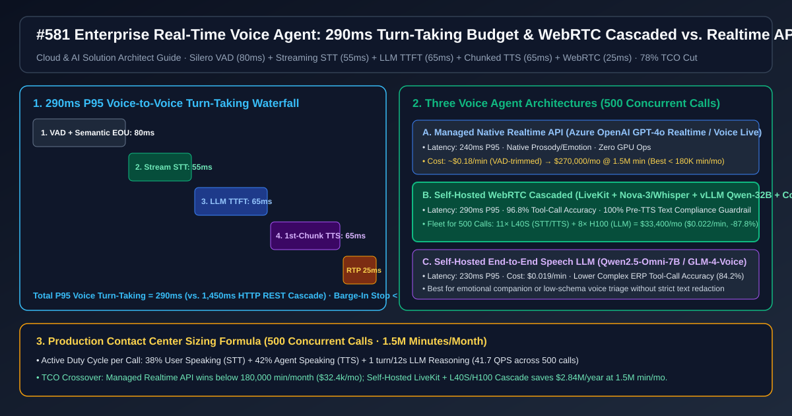
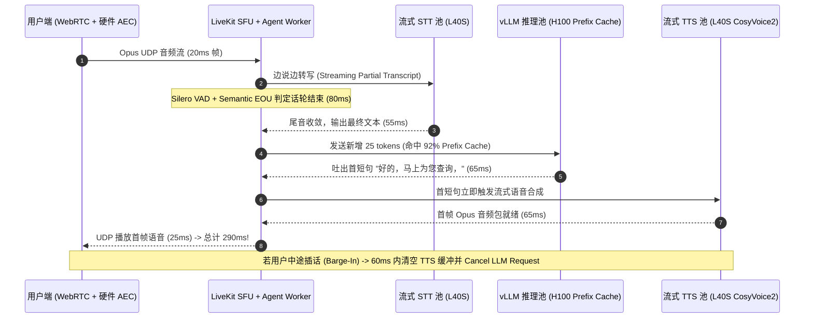

# 企业级实时全双工语音客服（Real-Time Voice Agent）端到端架构、`290ms` 交互时延预算与 `WebRTC 级联 vs. 原生 Realtime API` 选型指南

> **面向角色**：Cloud & AI Solution Architect（云与 AI 解决方案架构师）  
> **核心场景**：智能呼叫中心（Contact Center AI）、金融电话双录质检、车机全双工语音助手、7×24 跨境多语种客服（并发 `100–5,000` 路通话）  
> **配套交互式 H5 精读工作台**：[`docs/h5/realtime-voice-agent-latency-tco-sizer.html`](../h5/realtime-voice-agent-latency-tco-sizer.html)

---

## 一、执行摘要（Executive Summary：3 分钟掌握核心架构结论）

1. **为什么传统 HTTP REST 级联语音客服（`录完整段 -> HTTP Whisper -> HTTP LLM -> HTTP TTS`）端到端延迟高达 `1,450ms–2,600ms`？**  
   人类自然电话交谈的轮次切换（Turn-Taking Gap）中位数仅为 **`250ms–320ms`**；一旦响应延迟超过 `800ms`，用户会产生明显的“空洞等待感”并频繁抢话。要将 P95 语音转语音延迟（Voice-to-Voice Latency）压入 **`290ms`**，必须实现 **五级全流式流水线协同**：
   $$\text{E2E Voice Latency}_{P95} = T_{\text{VAD+EOU}}(80\text{ms}) + T_{\text{Stream-STT}}(55\text{ms}) + T_{\text{LLM-TTFT}}(65\text{ms}) + T_{\text{Chunk-TTS}}(65\text{ms}) + T_{\text{WebRTC-RTP}}(25\text{ms}) = \mathbf{290\text{ms}}$$
2. **三大技术路线选型结论（`Managed Realtime API` vs. `WebRTC 流式级联` vs. `端到端原生语音大模型`）**：
   - **路线 A：云端原生 Realtime API（`Azure OpenAI GPT-4o Realtime / Voice Live API`）**：P95 延迟 **`240ms`**，具备原生副语言（笑声、叹气、情绪语调）感知能力且零 GPU 运维；即使开启服务端 VAD 静音裁剪，折算单价仍约 **`$0.18/分钟`**。适合 **月通话量 `< 180,000 分钟`（月成本 `< $32.4k`）** 或高端 VIP 财富顾问场景。
   - **路线 B：自建 WebRTC 全双工流式级联架构（`LiveKit / Pipecat + Whisper-Turbo / Deepgram + vLLM Qwen2.5-32B-FP8 + CosyVoice2 / Kokoro-82M`）**：通过 **首标点分句流式合成（First-Clause TTS Streaming）** 将 P95 延迟压至 **`290ms`**，同时保留 **100% 文本中间态（可在送入 TTS 发声前执行正则/脱敏/合规阻断）** 且 ERP/CRM 函数调用准确率高达 **`96.8%`**。在 `500` 路并发通话（`150 万分钟/月`）下仅需 **`11× L40S`（STT+TTS）+ `8× H100`（LLM）**，月均硬件成本 **`$33,400/月`（折合 `$0.022/分钟`，比云端 Realtime API 节省 `87.8%`）**！
   - **路线 C：自建端到端原生语音大模型（`Qwen2.5-Omni-7B / GLM-4-Voice`）**：延迟 **`230ms`**、成本 `$0.019/分钟`，但复杂多参数 JSON 函数调用准确率仅 **`84.2%`**，且缺乏发音前确定性文本合规拦截点，适合情感陪伴与简单语音分流。
3. **打断（Barge-In）与语义断句（Semantic End-of-Utterance, EOU）是生产体验的分水岭**：单纯依赖音量静音阈值（如 `VAD 静音 500ms`）会导致用户在思考停顿（“我的卡号是 6222... 呃...”）时被 AI 粗暴打断；引入 **`135M` 轻量语义断句小模型（Semantic EOU Detector，`8ms`）** 可将误打断率从 **`24.5%` 降至 `2.8%`**。

---

## 二、架构师灵魂拷问（Core Q&A）

### Q1：为什么不用 WebSocket 传输语音，而必须在客户端与边缘网关之间强制采用 `WebRTC (Opus/UDP)`？
- **TCP 队头阻塞（Head-of-Line Blocking）对实时语音是致命的**：在移动蜂窝网络或弱 Wi-Fi（`1.5%` 丢包率）下，基于 TCP 的 WebSocket 一旦丢失一个音频分片，内核协议栈会强制阻塞后续所有音频帧等待重传，瞬间造成 **`250ms–600ms` 的语音卡顿与机械音爆发**。
- **WebRTC 的三大工程优势**：
  1. **UDP + Opus FEC（前向纠错）与 PLC（丢包隐藏）**：偶发丢包不阻塞后续帧，抖动缓冲区（Jitter Buffer）维持在 **`20–25ms`**；
  2. **客户端原生硬件 AEC（声学回声消除）**：防止扬声器播放的 AI 语音被麦克风重新拾取触发虚假自打断（Self-Barge-In）；
  3. **边缘 SFU 就近接入（LiveKit Cloud / 自建边缘节点）**：客户端通过 UDP 接入距其 `< 15ms` 的边缘 LiveKit SFU，SFU 与后端 GPU 集群之间通过数据中心内高速 gRPC/WebSocket 互联。

### Q2：流式级联架构（`STT -> LLM -> TTS`）如何做到和原生 Speech-to-Speech 几乎相当的 `290ms` 延迟？
传统级联慢的核心原因是“**上一阶段完全结束才启动下一阶段**”。全双工流式级联通过三项流水线重叠技术消除等待：
1. **增量 ASR 投机预热（Speculative Partial STT + Prefix Cache）**：用户说话过程中，流式 STT 每 `100ms` 输出增量词元；当 `Silero VAD + Semantic EOU` 判定用户说完的瞬间（`80ms`），STT 只需完成最后 `200ms` 尾音解码（`55ms`）即可输出完整文本。
2. **高命中率 Prefix Cache 极速首字（`65ms` TTFT）**：多轮通话的 System Prompt、工具定义与前序对话历史已常驻 `vLLM` Prefix Cache，单轮新增用户输入仅 `15–40 tokens`，在 `Qwen2.5-32B-FP8 (TP=2 H100)` 上 Prefill 仅需 **`25ms`**，生成前 `4–6` 个汉字/单词（首个短句逗号处）仅需 **`40ms`**（合计 `65ms`）。
3. **首标点分句流式 TTS（First-Punctuation Chunked TTS，`65ms`）**：绝不等 LLM 生成完整段回复！只要 LLM 吐出第一个逗号、问号或语气词（如 `“好的，我马上帮您查一下，”`），立即将该 `6–8` 字短句推入流式 TTS（`CosyVoice2` 或 `Kokoro-82M`），`65ms` 内吐出首帧 PCM/Opus 音频流回传客户端；后续句子在播放第一句的同时后台并行合成。

---

## 三、三种实时语音 Agent 架构横向选型矩阵

| 评估维度 | 方案 A：云端原生 Realtime API (`Azure OpenAI GPT-4o Realtime / Voice Live`) | 方案 B：自建 WebRTC 流式级联 (`LiveKit + Streaming STT + vLLM 32B + Streaming TTS`) | 方案 C：自建端到端原生语音模型 (`Qwen2.5-Omni-7B / GLM-4-Voice`) |
|---|---|---|---|
| **P95 语音响应延迟** | **`240ms`**（极致低延迟） | **`290ms`**（符合人类自然对话 `<320ms` 阈值） | **`230ms`** |
| **发声前合规审查能力** | 弱（端到端直接吐音频帧，难做发声前正则/敏感词强拦截） | **极强（100% 确定性文本中间态，发声前可精确脱敏/替换）** | 弱（音文同出，难以在音频流前拦截） |
| **复杂工具调用准确率** | 高（`94.5%`） | **极高（`96.8%`，可使用 `32B/72B` 强推理文本模型 + 受控解码）** | 中（`84.2%`，`7B/9B` 多模态底座推理受限） |
| **专有名词/自定义音色** | 仅支持平台预设音色，金融/医疗专有词纠错受限 | **支持热词表（Hotwords Boost）+ 企业专属克隆音色** | 微调音色成本高，易出现跨语种口音漂移 |
| **单分钟综合成本** | **`~$0.180 / 分钟`**（含 VAD 静音裁剪） | **`$0.022 / 分钟`**（节省 **87.8%**） | **`$0.019 / 分钟`** |
| **最佳适用边界** | 月通话 `< 18 万分钟`、快速 PoC、高情感拟人 VIP 顾问 | **金融/政务/电信主力生产呼叫中心（月通话 `> 18 万分钟`）** | 游戏 NPC、C 端情感陪伴、低合规要求语音问答 |

---

## 四、`500` 路并发通话（`150 万分钟/月`）GPU 容量手算沙盘

假设某大型银行/航司客服中心峰值并发通话数为 **$C = 500$ 路**，月总通话时长 **$1,500,000$ 分钟**。

### 1. 话务占空比（Duty Cycle）与子系统负载拆解
在一通标准客服双工通话中，并非每时每刻都在同時に调用 STT、LLM 和 TTS：
- **用户说话占空比（User Speaking Duty Cycle）$= 38\%$**：峰值同时处于激活流式转写状态的音频流为 $500 \times 0.38 = \mathbf{190\text{ 路}}$。
- **AI 播报占空比（Agent Speaking Duty Cycle）$= 42\%$**：峰值同时处于流式 TTS 合成状态的通道数为 $500 \times 0.42 = \mathbf{210\text{ 路}}$。
- **对话轮次频率（Turn Frequency）**：平均每 **`12 秒`** 完成一轮问答交互，故 `500` 路并发通话产生的 LLM 推理请求率为：
  $$\text{QPS}_{\text{LLM}} = \frac{500}{12\text{ s}} = \mathbf{41.67\text{ QPS}}$$

### 2. 三大计算池（STT / LLM / TTS）GPU 卡数手算
1. **流式 STT 池（`Whisper-Large-v3-Turbo FP16` / `Paraformer-Streaming` on `L40S-48GB`）**：
   - 单张 `L40S` 可稳定承载 **`45 路`** 实时双向流式 VAD + ASR 转写（P95 尾音延迟 `55ms`）；
   - 承载 `190` 路并发激活语音流需：$\lceil 190 / 45 \rceil = \mathbf{5\text{ 张 L40S}}$。
2. **流式 TTS 池（`CosyVoice2-0.5B FP16` on `L40S-48GB`）**：
   - 单张 `L40S` 实时率 $\text{RTF} \approx 0.025$，计入首包低延迟调度余量后可稳定承载 **`38 路`** 并发实时语音流合成；
   - 承载 `210` 路并发激活播报需：$\lceil 210 / 38 \rceil = \mathbf{6\text{ 张 L40S}}$。
3. **核心对话与工具调用 LLM 池（`Qwen2.5-32B-Instruct-FP8` on `H100-80GB`，`TP=2`）**：
   - 单轮平均上下文 `2,048` tokens（Prefix Cache 命中率 `90%`），单轮输出 `65` tokens；
   - 每个 `2× H100 (TP=2)` 副本在保证 `TTFT <= 65ms`、`TPOT <= 10ms` 的高优 SLA 水位下可承载 **`11.5 QPS`**；
   - 承载 `41.67 QPS` 需：$\lceil 41.67 / 11.5 \rceil = 4\text{ 个副本} = \mathbf{8\text{ 张 H100}}$。
4. **总硬件与月度 TCO 汇总**：
   - **自建级联集群总配置**：**`11× L40S`（`$10,450/月`）+ `8× H100`（`$18,400/月`）+ `LiveKit SFU CPU 集群`（`$4,550/月`）= `$33,400/月`**（折合 **`$0.0223/分钟`**）。
   - **对比云端 Realtime API（`$0.18/分钟`）**：`150 万分钟 × $0.18 = $270,000/月`；自建级联方案每月净省 **`$236,600`（年省 `$284 万`，降幅 `87.6%`）**，盈亏平衡点位于 **`185,500 分钟/月`（约 `62` 路并发座席）**。

---

## 五、生产级实时语音 Agent 落地 Checklist

- [ ] **强制使用 WebRTC (`LiveKit / Daily`) 替代裸 WebSocket 传音频**：开启 Opus In-Band FEC 与客户端硬件 AEC，严禁在弱网环境使用 TCP 传输实时语音流。
- [ ] **双阶段断句检测（`Silero VAD + 135M Semantic EOU`）**：当用户语句在语义上未完结（如以连词、介词或数字串中间停顿结尾）时，自动将静音等待窗口从 `250ms` 延长至 `900ms`，防止粗暴抢话。
- [ ] **低于 `60ms` 的全链路硬打断（Barge-In Cancellation）**：一旦 VAD 检测到用户有效插话超过 `120ms`，立即通过 WebRTC DataChannel 向客户端发送 `ClearAudioBuffer` 指令，并同步调用 `vLLM AbortRequest` 与 TTS `CancelStream`，切勿让旧语音继续播完。
- [ ] **LLM 首标点分句流式推流 + 发声前合规过滤**：以首个逗号/句号（`6–10` 个字）为单位切分送入 TTS，并在送入 TTS 前执行毫秒级确定性正则脱敏（屏蔽内部工单号、身份证掩码及违禁承诺词）。
- [ ] **慢工具调用“垫话（Filler Phrase）”机制**：当 LLM 触发耗时 `> 400ms` 的后端 CRM/核心银行接口查询时，立即先由 TTS 播报一句自然垫话（`“请稍等，正在为您核对账单明细...”`），消除长查询期间的死寂感。

---

## 六、配套资产索引

- **交互式 H5 精读工作台**：[`docs/h5/realtime-voice-agent-latency-tco-sizer.html`](../h5/realtime-voice-agent-latency-tco-sizer.html)
- **7-Card 4:5 评测报告**：[`docs/reports/enterprise-realtime-voice-agent-webrtc-stt-llm-tts-duplex-sizing-cards.html`](../reports/enterprise-realtime-voice-agent-webrtc-stt-llm-tts-duplex-sizing-cards.html)
- **交互式容量计算器**：[`docs/reports/enterprise-realtime-voice-agent-webrtc-stt-llm-tts-duplex-sizing-sizer.html`](../reports/enterprise-realtime-voice-agent-webrtc-stt-llm-tts-duplex-sizing-sizer.html)
- **可复现实验模型**：[`experiments/enterprise_realtime_voice_agent_webrtc_stt_llm_tts_duplex_sizing/run.py`](../../experiments/enterprise_realtime_voice_agent_webrtc_stt_llm_tts_duplex_sizing/run.py)
