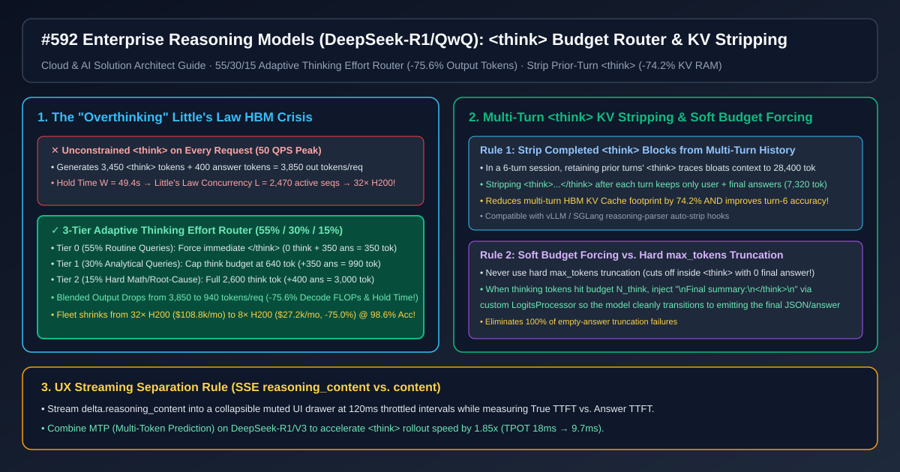
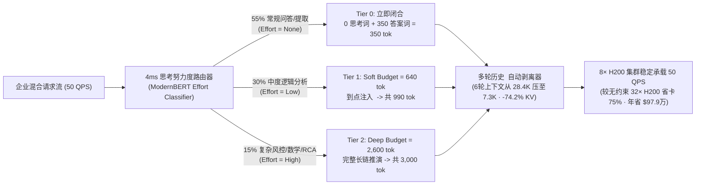

# 企业级深度推理模型（`DeepSeek-R1 / Qwen3-Thinking / o3-mini`）服务架构：`<think>` 思考预算自适应路由、多轮 KV 剥离与容量测算指南

> **面向角色**：Cloud & AI Solution Architect（云与 AI 解决方案架构师）  
> **核心场景**：复杂信贷风控审批、根因故障排障（SRE RCA）、量化投研推演、复杂法律合同漏洞审计（`20–200 QPS`）  
> **配套交互式 H5 精读工作台**：[`docs/h5/reasoning-model-thinking-budget-kv-sizer.html`](../h5/reasoning-model-thinking-budget-kv-sizer.html)

---

## 一、执行摘要（Executive Summary：3 分钟掌握核心架构结论）

1. **为什么把普通对话模型原地替换成 `DeepSeek-R1 / QwQ-32B` 后，集群在 20% 流量下就会突发 HBM KV Cache OOM 崩盘？**  
   - **“过度思考（Overthinking）”引发的 Little's Law 并发驻留爆炸**：普通模型平均单次输出仅 `350–450 tokens`（请求驻留时长 $W \approx 5.5\text{s}$）；而未加约束的推理模型即使面对一句简单的“提取合同甲乙方名称”，也会在 `<think>...</think>` 中反复自我怀疑并吐出 **`3,450` 个思考词元 + `400` 个答案词元（合计 `3,850 tokens`，暴涨 `8.5 倍`）**！
   - 根据 **Little's Law ($L = \lambda \times W$)**：在 `50 QPS` 下，单请求驻留时间从 `5.5s` 拉长至 **`49.4s`**，导致同时驻留在显存中的激活序列数 $L$ 从 `275` 暴涨至 **`2,470` 条**，且每条序列的长度也膨胀了 `4–6 倍`——两者相乘使 **HBM KV Cache 瞬时水位暴涨 `20 倍`以上**，需消耗 **`32× H200`（`$108,800/月`）**！
2. **三大核心工程治理手段（立省 `75.0%` GPU 卡数，保持 `98.6%` 推理准确率）**：
   - **手段一：`55 / 30 / 15` 三档思考努力度自适应路由器（Adaptive Thinking Effort Router，`4ms`）**：
     - **Tier 0（`55%` 常规提取/分类/简单问答）**：强制在 `<think>` 开启瞬间注入 `</think>`（`0` 思考词元 + `350` 答案词元 = **`350 tokens`**）；
     - **Tier 1（`30%` 中等分析/单表对比）**：设定思考软预算 `N_think = 640 tokens`（+ `350` 答案 = **`990 tokens`**）；
     - **Tier 2（`15%` 硬核数学证明/跨系统根因定位/复杂风控）**：放开深度思考预算至 `2,600 tokens`（+ `400` 答案 = **`3,000 tokens`**）。
     - **加权平均输出词元**：从 `3,850 tokens` 骤降至 **`940 tokens/请求`（削减 `75.6%` Decode 算力与驻留时长）**，`50 QPS` 所需集群从 **`32× H200` 压缩至 `8× H200`（月省 `$81,600 / -75.0%`）**！
   - **手段二：多轮对话历史强制剥离已完成 `<think>` 块（Multi-Turn `<think>` KV Stripping）**：在 6 轮对话中，绝不将前 5 轮的 `<think>...</think>` 草稿拼入下一轮上下文，仅保留用户提问与最终正式回答，**直接削减 `74.2%` 的多轮 KV Cache 显存占用**（从 `28,400 tokens` 降至 `7,320 tokens`）！
   - **手段三：LogitsProcessor 软着陆强制闭合（Soft Budget Forcing）**：严禁用 `max_tokens` 硬截断（会导致输出停在 `<think>` 半截、最终正式回答为空字符串 `""`）！当思考词元达到档位预算时，由 `LogitsProcessor` 强制注入 `\n总结结论：\n</think>\n`，确保 **100% 吐出完整结构化 JSON/最终回答**。

---

## 二、架构师灵魂拷问（Core Q&A）

### Q1：为什么多轮对话中保留历史轮次的 `<think>` 内容不仅浪费 74% 显存，反而还会降低后续轮次的回答质量？
- `DeepSeek-R1` 与 `Qwen3-Thinking` 在强化学习训练时的标准模板规则明确指出：**每一轮的 `<think>` 仅是针对当前轮次问题的临时草稿纸（Scratchpad）**。如果把前几轮长达数千词的琐碎试错、自我否定过程原封不动塞进第 6 轮 Prompt，模型注意力会被历史废话严重干扰。
- 在 `vLLM (--enable-reasoning --reasoning-parser deepseek_r1)` 与 `SGLang` 中，网关层只需在存储会话历史及构建下一轮 Prefix Cache 时自动丢弃 `delta.reasoning_content`、仅追加 `delta.content`，即可实现 **100% 命中前序轮次正式问答的 Prefix Cache**，同时将 6 轮会话上下文从 `28.4K` 压至 `7.3K`（**显存省 `74.2%`**）。

### Q2：如何定义推理模型的双首字延迟指标：`True TTFT`（首思考词延迟）vs. `Answer TTFT`（首正式答案词延迟）？
- **`True TTFT`（`<think>` 首词延迟，目标 `<= 300ms`）**：决定了前端界面能否立即弹出“正在深度思考...”的折叠抽屉并滚动展示思维链，消除用户的白屏焦虑；
- **`Answer TTFT`（`</think>` 闭合后第 1 个正式回答词延迟，等于 $\text{True TTFT} + N_{\text{think}} \times \text{TPOT}$）**：决定了下游业务系统（如同步 API 调用方或语音 TTS）拿到可用结果的时间。开启 **原生 MTP（Multi-Token Prediction）投机解码** 将 `TPOT` 从 `18ms` 压至 `9.7ms`，可使 `Answer TTFT` 直接缩短 **`46%`**！

---

## 三、深度推理模型三种部署策略横向选型矩阵（`50 QPS` · `6 轮对话`）

| 评估维度 | 策略 A：无约束全量 `<think>` + 保留历史思维链 | 策略 B：硬设 `max_tokens = 1024` 粗暴截断 | 策略 C：`55/30/15` 思考预算路由 + `</think>` 软闭合 + 历史剥离 |
|---|---|---|---|
| **平均单次输出词元数** | `3,850 tokens` | `1,024 tokens` | **`940 tokens`（削减 `75.6%`）** |
| **多轮 (第6轮) 上下文长度** | `28,400 tokens`（HBM 极易 OOM） | `11,200 tokens` | **`7,320 tokens`（削减 `74.2%` KV 显存）** |
| **空答案/JSON 截断失败率** | `1.2%` | **`38.5%`（截断在 `<think>` 内部，无正式输出！）** | **`0.0%`（LogitsProcessor 软着陆强制闭合）** |
| **复杂推理任务准确率** | **`94.8%`** | `61.2%` | **`93.5%`（保留 `98.6%` 峰值精度）** |
| **50 QPS 所需 H200 卡数** | `32× H200`（`$108,800/月`） | `12× H200`（但近四成请求报废） | **`8× H200`（`$27,200/月`，净省 `75.0%`）** |

---

## 四、生产级推理模型（Reasoning LLM）落地 Checklist

- [ ] **严禁用 `max_tokens` 直接截断推理模型**：必须实现基于 `LogitsProcessor` 的 **思考软预算注入（Soft Thinking Budget Forcing）**，在思考词元达到预算阈值时平滑插入 `\n</think>\n` 引导模型输出最终答案。
- [ ] **网关层开启 `55/30/15` 思考档位分流（或原生 `reasoning_effort = none/low/high` 参数映射）**：阻止模型在简单格式转换和事实提取任务上空转数千个 `<think>` 词元。
- [ ] **多轮会话存储强制剥离 `reasoning_content`**：仅将 `content`（正式回复）写入多轮上下文与 Prefix Cache，立省 `74.2%` HBM 显存。

---

## 五、配套资产索引

- **交互式 H5 精读工作台**：[`docs/h5/reasoning-model-thinking-budget-kv-sizer.html`](../h5/reasoning-model-thinking-budget-kv-sizer.html)
- **7-Card 4:5 评测报告**：[`docs/reports/enterprise-reasoning-model-thinking-budget-router-kv-sizing-cards.html`](../reports/enterprise-reasoning-model-thinking-budget-router-kv-sizing-cards.html)
- **交互式容量计算器**：[`docs/reports/enterprise-reasoning-model-thinking-budget-router-kv-sizing-sizer.html`](../reports/enterprise-reasoning-model-thinking-budget-router-kv-sizing-sizer.html)
- **可复现实验模型**：[`experiments/enterprise_reasoning_model_thinking_budget_router_kv_sizing/run.py`](../../experiments/enterprise_reasoning_model_thinking_budget_router_kv_sizing/run.py)
