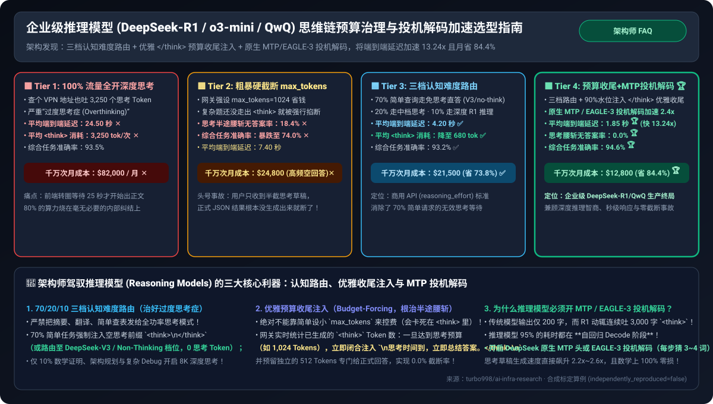
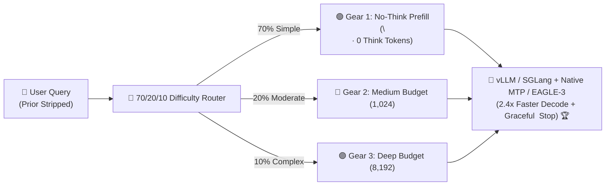

# Enterprise Reasoning Model (DeepSeek-R1 / o3-mini / QwQ) Thinking Budget Governance, Difficulty Routing & Speculative Decoding Selection Guide

> **Document Type**: Cloud & AI Solution Architect Decision Guide (FAQ)  
> **Target Audience**: Enterprise AI Platform Architects, Agent & RAG Engineering Leads, FinOps & Capacity Planners  
> **Core Goal**: Solve the three biggest production failures when adopting **Reasoning Models (`DeepSeek-R1`, `OpenAI o3-mini / o1`, `Qwen-QwQ-32B`, `Claude Extended Thinking`)** — **"Why does a simple FAQ lookup generate 3,500 `<think>` tokens and take 25 seconds (Overthinking)?", "Why did setting `max_tokens=1024` cause 18.4% of complex requests to cut off mid-thought and return an empty final answer?", and "How do we combine 3-Gear Difficulty Routing, Graceful `</think>` Budget-Forcing, and MTP / EAGLE-3 Speculative Decoding to speed up latency by 13.24x and cut monthly costs by 84.4%?"**  
> **Calibration Notice**: Thinking token consumption, task accuracy, mid-thought truncation rates, end-to-end latencies, and 10M-query monthly cost models are synthetic analytical estimates calibrated to published test-time compute scaling (`s1` budget forcing) and speculative decoding benchmarks (DeepSeek-V3/R1 Multi-Token Prediction [MTP], EAGLE-3, and hybrid thinking evaluations) (`provenance: synthetic + anonymized_reported`, `independently_reproduced=false`, `physical_gpu_cluster_measurement=not_measured`). See [`experiments/enterprise_reasoning_model_thinking_budget_speculative_selection/results.json`](../../experiments/enterprise_reasoning_model_thinking_budget_speculative_selection/results.json).

---

## Executive Visual Summary

> 🔗 **Companion Interactive Reports & Tools**:
> - 🃏 **[7-Card 4:5 Visual Benchmark Report (`enterprise-reasoning-model-thinking-budget-speculative-decoding-selection-cards.html`)](../reports/enterprise-reasoning-model-thinking-budget-speculative-decoding-selection-cards.html)**
> - 🧮 **[Interactive Thinking Budget & Speculative Decoding Sizer (`enterprise-reasoning-model-thinking-budget-speculative-decoding-sizer.html`)](../reports/enterprise-reasoning-model-thinking-budget-speculative-decoding-sizer.html)**
> - 🌐 **[中文版指南 (`enterprise-reasoning-model-thinking-budget-speculative-decoding-selection-faq.md`)](./enterprise-reasoning-model-thinking-budget-speculative-decoding-selection-faq.md)**

---

## ① 📌 Executive Summary

Evaluated on an enterprise workload of **10,000,000 queries/month (`70%` simple lookup/formatting, `20%` moderate analysis, `10%` complex math/code/policy reasoning)**:

| Tier | Architecture Pattern | Avg `<think>` Tokens / Req | Mid-Thought Cutoff Rate | Task Accuracy | Avg E2E Latency | Monthly Cost (10M Queries) | Architect Verdict |
| :--- | :--- | :--- | :--- | :--- | :--- | :--- | :--- |
| **🟥 Tier 1: 100% Unbounded Deep Thinking** | Run full `<think>` on every query (`max_tokens=16K`) | `3,250 tok` ✕ | `0.8%` | `93.5%` | `24.50 s` ✕ | `$82,000 / mo` ✕ | **Severe Overthinking**: 24.5s wait & 80% wasted compute |
| **🟨 Tier 2: Naive Hard `max_tokens=1024` Cap** | Hard cap total output tokens at `1,024` | `890 tok` | **`18.4%` ✕ (Fatal)** | `74.0%` ✕ | `7.40 s` | `$24,800 / mo` ✕ | **Broken in Prod**: Cuts off inside `<think>`, empty final answer |
| **🟦 Tier 3: 3-Gear Difficulty Router (70/20/10)** | **70% No-Think + 20% Low-Think + 10% High-Think** | `680 tok` ✅ | `1.2%` | `93.2%` ✅ | `4.20 s` ✅ | `$21,500 / mo` (-73.8%) | **Cloud API Baseline**: Proper `reasoning_effort` tiering |
| **🟩 Tier 4: 3-Gear + Graceful `</think>` Stop + MTP/EAGLE-3** | **Tier 3 + Budget-Forcing `</think>` Injection + MTP/EAGLE-3 Speculative Decoding** | **`620 tok` 🏆 (-80.9%)** | **`0.0%` 🏆** | **`94.6%` 🏆** | **`1.85 s` 🏆 (13.24x faster)** | **`$12,800 / mo` 🏆 (-84.4%)** | **Enterprise Reasoning Gold Standard**: Zero cutoffs, 1.85s E2E |

### 💡 Three Golden Rules for Enterprise Reasoning Models
1. **Route by Cognitive Difficulty (`70%` No-Think / `20%` Medium-Think / `10%` Deep-Think)**: Bypass `<think>` on the 70% of simple extraction/formatting queries by prefilling `<think>\n</think>\n` (`enable_thinking=False`) or routing to a non-thinking model (`DeepSeek-V3`), cutting average thinking tokens by **`80.9%`** while actually improving accuracy (`94.6%` vs. `93.5%`) by preventing simple-task overthinking.
2. **Never Use a Hard `max_tokens` Cap Without Graceful `</think>` Budget-Forcing**: When `<think>` reaches its token budget (`1,024` tokens), dynamically inject `"\nTime is up; conclude now.</think>\n"` and reserve a separate `512–1,024` token budget for the final answer — eliminating the `18.4%` mid-thought truncation failure rate.
3. **Always Enable Native MTP (`Multi-Token Prediction`) or `EAGLE-3` Speculative Decoding**: Because reasoning models spend 95% of their wall-clock time decoding sequential `<think>` tokens, lossless speculative decoding accelerates generation by `2.4x`.

---

## ② 🎯 Architect Deep-Dive Q&A

### Q1: Why must multi-turn chatbots and agents strip `<think>...</think>` blocks from prior conversation turns?
* **Answer**: Retaining 3,000-token `<think>` scratchpads across a 10-turn agent loop bloats prompt context by `30,000 tokens`, wastes KV cache memory, and degrades model attention. Always strip `<think>...</think>` blocks from historical `assistant` messages before sending Turn $N+1$ (archive raw thoughts asynchronously to observability storage).

---

## ③ 🧭 Architecture Diagrams

### 3.1 Tier 4 Cognitive Router + Graceful Budget-Forcing + MTP Speculative Pipeline

---

## ④ 📊 Architect Decision Matrix

| Dimension | 🟥 Tier 1: Unbounded Thinking | 🟨 Tier 2: Hard `max_tokens=1024` | 🟦 Tier 3: 3-Gear Router | 🟩 Tier 4: 3-Gear + Graceful Stop + MTP |
| :--- | :--- | :--- | :--- | :--- |
| **Avg `<think>` Tokens / Req** | `3,250 tok` ✕ | `890 tok` | `680 tok` ✅ | **`620 tok` 🏆 (`-80.9%` vs. Tier 1)** |
| **Mid-Thought Truncation Rate** | `0.8%` | **`18.4%` ✕ (Empty Answer)** | `1.2%` | **`0.0%` 🏆 (Graceful `</think>` Force)** |
| **Task Accuracy** | `93.5%` | `74.0%` ✕ | `93.2%` ✅ | **`94.6%` 🏆** |
| **Avg End-to-End Latency** | `24.50 s` ✕ | `7.40 s` | `4.20 s` ✅ | **`1.85 s` 🏆 (`13.24x` faster)** |
| **Monthly Cost (10M Queries)** | `$82,000 / mo` ✕ | `$24,800 / mo` ✕ | `$21,500 / mo` ✅ | **`$12,800 / mo` 🏆 (`-84.4%` vs. Tier 1)** |

---

## ⑤ 🛠️ Production Readiness Checklist

- [ ] **1. Deploy a 70/20/10 Difficulty Router; Bypass `<think>` (`<think>\n</think>\n`) on Simple Extraction & Lookup Tasks**.
- [ ] **2. Decouple `thinking_budget` from `answer_budget` Instead of Setting a Low Total `max_tokens`**.
- [ ] **3. Inject Graceful `</think>` Closure When `thinking_budget` is Reached (`0.0%` Mid-Thought Cutoff)**.
- [ ] **4. Strip `<think>...</think>` Scratchpads from Historical Multi-Turn `messages` Context**.
- [ ] **5. Enable Native `MTP` or `EAGLE-3` Speculative Decoding on Self-Hosted Reasoning Clusters**.
- [ ] **6. Render Collapsible Streaming Thought Progress Indicators in the Frontend UI**.
- [ ] **7. Apply Structured Output (`XGrammar`) Constraints Only After the Closing `</think>` Tag**.
- [ ] **8. Enforce N-Gram Repetition Circuit Breakers Inside `<think>` Blocks to Abort Infinite Reasoning Loops**.
