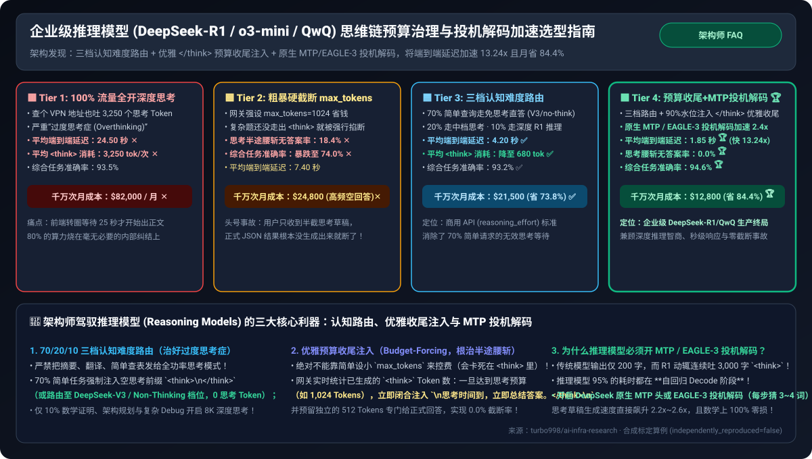
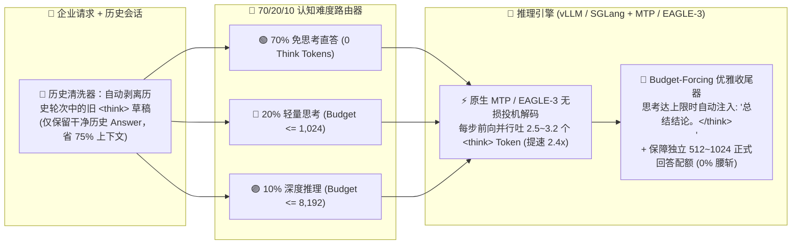
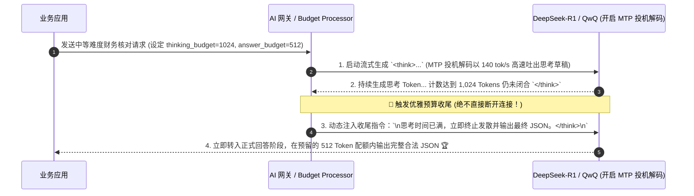

# 企业级推理模型（Reasoning Models：DeepSeek-R1 / o3-mini / QwQ）思维链预算治理（Thinking Token Budget Control）、难度路由与投机解码加速选型指南

> **文档类型**：企业级 AI 平台与推理架构解决方案架构师（Cloud & AI Solution Architect）选型决策指南（FAQ）  
> **适用读者**：企业 AI 平台负责人、Agent 与知识库架构师、FinOps 成本治理负责人、IT 技术总监  
> **核心目标**：用通俗、可落地的架构语言帮企业驯服 **深度推理模型（DeepSeek-R1、OpenAI o3-mini/o1、Qwen-QwQ-32B、Claude Extended Thinking）** 在生产落地时的三大顽疾——**“问一句简单报销标准，模型却在 `<think>` 里自我纠结了 3,500 个字、转圈等了 25 秒才出结果（过度思考症 Overthinking）”、“为了省钱把 `max_tokens` 设成 1024，结果 18.4% 的请求在 `<think>` 还没写完时就被腰斩，返回空答案！”、“怎么把思维链的吐字速度提快 2.4 倍并把月度账单砍掉 84.4%？”**。  
> **标定声明**：本文所引用的平均思考 Token 消耗、任务准确率、思考腰斩率、端到端响应延迟与千万次月度成本模型基于公开发布的推理模型测试时间扩展（Test-Time Compute Scaling / s1 Budget Forcing）与投机解码基准（DeepSeek-V3/R1 原生 Multi-Token Prediction [MTP]、EAGLE-3 投机解码及混合思考模式评测）构建的合成分析模型（`provenance: synthetic + anonymized_reported`, `independently_reproduced=false`, `physical_gpu_cluster_measurement=not_measured`），详见 [`experiments/enterprise_reasoning_model_thinking_budget_speculative_selection/results.json`](../../experiments/enterprise_reasoning_model_thinking_budget_speculative_selection/results.json)。

---

## 一图流总结（Executive Visual Summary）



> 🔗 **关联可交互报告与工具**：
> - 🃏 **[7-Card 4:5 视觉评测报告 (`enterprise-reasoning-model-thinking-budget-speculative-decoding-selection-cards.html`)](../reports/enterprise-reasoning-model-thinking-budget-speculative-decoding-selection-cards.html)**
> - 🧮 **[交互式推理模型 `<think>` 预算与成本计算器 (`enterprise-reasoning-model-thinking-budget-speculative-decoding-sizer.html`)](../reports/enterprise-reasoning-model-thinking-budget-speculative-decoding-sizer.html)**
> - 🌐 **[English Version (`enterprise-reasoning-model-thinking-budget-speculative-decoding-selection-faq.en.md`)](./enterprise-reasoning-model-thinking-budget-speculative-decoding-selection-faq.en.md)**

---

## ① 📌 核心选型结论速览（Executive Summary）

以 **DeepSeek-R1、o3-mini、Qwen-QwQ** 为代表的推理模型（Reasoning Models）把大模型能力推上了新高度，但也彻底颠覆了企业容量规划：**过去普通指令模型每次只输出 `200~300 Tokens`，而推理模型在给出最终 `200 Tokens` 答案前，会先在内部 `<think>...</think>` 标签里狂吐 `2,000~6,000 Tokens` 的思维链草稿！**（而且无论是云 API 还是自建 GPU，每一个 `<think>` Token 都按最贵的输出 Token 计费和消耗显存带宽！）

基于 **月均 1,000 万次企业综合请求（70% 简单查表/格式化、20% 中等分析、10% 复杂数学/代码/跨规章推理）** 的基准测算，四档架构对比如下：

| 架构档位 | 核心架构组合 | 平均 `<think>` 消耗 | 思考腰斩无答案率 | 综合任务准确率 | 平均端到端延迟 | 1,000万次月成本 | 架构师拍板结论 |
| :--- | :--- | :--- | :--- | :--- | :--- | :--- | :--- |
| **🟥 Tier 1：100% 流量全开深度思考** | 所有请求无差别走 R1/o1 全功率思考模式 | `3,250 tok/次` ✕ | `0.8%` | `93.5%` | `24.50 s` ✕ | `$82,000 / 月` ✕ | **严重过度思考**：70% 简单问题白等 25 秒、白烧 80% 算力 |
| **🟨 Tier 2：粗暴硬截断 `max_tokens=1024`** | 直接限制总输出上限为 1024 Tokens | `890 tok/次` | **`18.4%` ✕ (致命)** | `74.0%` ✕ | `7.40 s` | `$24,800 / 月` ✕ | **生产级灾难**：复杂题在 `<think>` 内部被截断，正文为空 |
| **🟦 Tier 3：三档认知难度路由 (70/20/10)** | **70% 免思考直答 + 20% 轻量思考 + 10% 深度思考** | `680 tok/次` ✅ | `1.2%` | `93.2%` ✅ | `4.20 s` ✅ | `$21,500 / 月` (-73.8%) | **商用 API 接入基线**：合理使用 `reasoning_effort` 分档 |
| **🟩 Tier 4：三档路由 + 优雅预算收尾 + MTP 投机解码** | **Tier 3 + `</think>` 预算强制收尾 + 原生 MTP / EAGLE-3 投机加速** | **`620 tok/次` 🏆 (-80.9%)** | **`0.0%` 🏆** | **`94.6%` 🏆** | **`1.85 s` 🏆 (快13.24x)** | **`$12,800 / 月` 🏆 (-84.4%)** | **企业级推理模型终局标准**：零腰斩、秒级响应、省 84% 成本 |

### 💡 架构师三句话选型铁律
1. **绝对禁止把 100% 的企业流量无脑切到深度思考模式（Tier 1）——实施“70 / 20 / 10 三档认知难度路由”**：企业日常流量中 `70%` 是文本提取、JSON 格式化、简单 FAQ 检索，开启 `<think>` 不仅毫无准确率增益，反而让延迟暴涨 10 倍。对这 70% 流量直接走 **免思考直答模式（Non-Thinking Mode，或预填 `<think>\n</think>` 跳过思考）**，平均思考 Token 消耗立降 **`80.9%`**！
2. **永远不要用粗暴调小 `max_tokens` 来给推理模型控费（Tier 2）——必须用“独立 `thinking_budget` + `</think>` 优雅强制收尾（Budget-Forcing）”**：当 `<think>` 块生成的 Token 数达到设定预算（如中档 `1,024` Tokens）但仍未结束时，由推理引擎或网关自动拦截并追加一句 **`"\n思考时间已到，基于以上分析立即给出最终结论。</think>\n"`** 后继续生成正式回答，彻底消灭 `18.4%` 的“思考半途被掐断、正式回答为空”的生产事故！
3. **自建推理模型（DeepSeek-R1 / QwQ）必须 100% 开启“原生 MTP（Multi-Token Prediction）或 EAGLE-3 投机解码”**：推理模型 95% 的时间都在单步自回归吐 `<think>` 词，属于典型的显存带宽受限（Decode-Bound）；开启无损投机解码后，每一步前向同时验证并吐出 `2.5~3.2` 个 Token，**在不损失哪怕 0.01% 智商的前提下，端到端耗时直接砍半！**

---

## ② 🎯 客户与架构师灵魂拷问 Q&A（Architect Deep-Dive Q&A）

### Q1：很多研发同学把原本调 `GPT-4o / DeepSeek-V3` 的代码直接改成调 `DeepSeek-R1`，顺手保留了原来的 `max_tokens=1024`，为什么上线后下游 JSON 解析器大面积报错崩溃？
* **真相剖析（`max_tokens` 包含 `<think>` + `final_answer` 的总和陷阱！）**：
  - 在推理模型中，`max_tokens` 限制的是 **“内部思考过程（`<think>...</think>`）+ 外部最终回答”的总长度**。
  - 当遇到稍微复杂一点的业务问题时，模型在 `<think>` 里推导到第 `1,024` 个 Token 时正好撞上 `max_tokens` 红线被强制终止（`finish_reason: "length"`）。此时 `</think>` 闭合标签还没生成出来，后面的正式 JSON 回答更是**一个字都还没开始写**！下游业务代码去解析返回结果时自然拿到空字符串报错崩溃（Tier 2 中此类事故高达 **`18.4%`**）！
  - **怎么根治（Tier 4 思考预算与输出预算解耦）**：
    1. 若使用支持原生思考预算参数的引擎/API（如 vLLM 思考预算控制、Claude `thinking.budget_tokens`、OpenAI `reasoning_effort` + 独立 `max_completion_tokens`），将 **`thinking_budget` 与 `answer_budget` 物理拆开**；
    2. 在自建 vLLM / SGLang 引擎层配置 **Budget-Forcing Logits Processor（预算强制收尾器）**：当检测到 `<think>` 内已生成满预算（如 `1,024` Tokens）仍未输出 `</think>` 时，自动注入闭合序列 `</think>\n` 强制模型立即转入正式作答阶段，并保证正式回答至少享有独立的 `512~1,024` Tokens 额度！

### Q2：对于混合模型（如 Qwen3 / DeepSeek V3-R1 双模或同一个 32B 推理模型），怎么在零额外部署成本下实现“简单题不思考、中等题少思考、难题深思考”？
* **真相剖析（单模型 Prefill 预填控制与三档路由）**：
  - 你甚至不需要部署两个不同的模型！网关意图分类器（`< 10 ms`）将请求分为三档：
    - **🟢 Gear 1：免思考极速档（No-Think Mode，占 70% 流量，如查表、翻译、抽字段）**：
      - 在发送给推理模型的 Assistant Prefill 开头直接预填 **`<think>\n</think>\n`**（或设置 `enable_thinking=False`）。模型看到思考块已经闭合，会 **`0 ms` 跳过思考直接输出最终答案**！
    - **🔵 Gear 2：标准思考档（Medium-Think Mode，占 20% 流量，如单表 SQL、常规客诉分析）**：
      - 设定 `thinking_budget = 1,024 Tokens`，提示词附带精简思考指令，3 秒内完成核对与输出。
    - **🟣 Gear 3：深度推理档（Deep-Think Mode，占 10% 流量，如复杂架构故障根因、多跳数学审计）**：
      - 开放 `thinking_budget = 8,192 Tokens`（必要时对极难问题注入 `"Wait, let me double-check the edge cases..."` 延长思考），发挥 100% 满血推理智商。

### Q3：多轮对话（Multi-Turn Chat）或 多步 Agent 使用推理模型时，上一轮生成的 3,000 字 `<think>` 草稿要不要塞进下一轮的历史上下文（History）里？
* **真相剖析（推理模型生产第一省钱铁律：跨轮次剥离 `<think>` 历史！）**：
  - **绝对不要把上一轮的 `<think>...</think>` 塞进下一轮对话的 `messages` 历史里！**
  - 如果一个 10 轮的 Agent 任务每轮都保留 3,000 字的 `<think>`，到了第 10 轮你的输入上下文就会膨胀 `30,000 Tokens`，不仅瞬间破坏 KV Cache 显存容量，还会污染模型在后续轮次的注意力！
  - **标准规范（Strip-Think-on-History）**：网关在将上一轮 Assistant 回复存入会话历史库时，**必须用正则剥离掉 `<think>...</think>` 内部草稿（可异步单独存入审计日志表供事后排查），只将最终干净的 `Final Answer / Tool Call` 拼入下一轮对话上下文**！

---

## ③ 🧭 直观可视化图解（Mermaid 决策树、三档预算状态机与投机解码时序图）

### 3.1 企业级推理模型（Reasoning Model）思考档位与架构选型决策树

```mermaid
flowchart TD
    A[请求进入企业 AI 网关] --> B{意图分类器评估任务认知复杂度 (<10ms)}
    B -->|70% 简单任务：文档摘要 / JSON抽取 / 翻译 / 标准FAQ| C[🟢 Gear 1: 免思考极速档 (No-Think)<br/>预填 &lt;think&gt;\n&lt;/think&gt; 或路由 V3<br/>0 思考 Token · 首字 220ms ✅]
    B -->|20% 中等任务：单表Text-to-SQL / 合同条款比对| D[🔵 Gear 2: 受控轻量思考档 (Budget=1,024)<br/>开启 MTP/EAGLE-3 投机解码 + 90%水位优雅收尾<br/>平均 2.1s 完成推理 ✅]
    B -->|10% 高难任务：复杂代码Debug / 财务多跳核算 / 架构规划| E[🟣 Gear 3: 深度推理档 (Budget=8,192)<br/>满血 R1/QwQ + MTP 投机解码 + 独立 Answer 预留配额<br/>准确率 94.6% · 0.0% 截断事故 🏆]
```

### 3.2 Tier 4 端到端“三档认知路由 + `</think>` 优雅预算收尾 + MTP 投机解码”架构图



### 3.3 优雅预算收尾（Graceful Budget-Forcing）防止半途腰斩时序图（Sequence Diagram）



---

## ④ 📊 架构师多方案选型决策矩阵（Architect Decision Matrix）

| 评估维度 | 🟥 Tier 1：100% 全开无限制思考 | 🟨 Tier 2：粗暴硬截断 `max_tokens=1024` | 🟦 Tier 3：三档认知难度路由 (70/20/10) | 🟩 Tier 4：三档路由 + 优雅收尾 + MTP 投机解码 |
| :--- | :--- | :--- | :--- | :--- |
| **平均 `<think>` Token 消耗** | `3,250 tok/次` ✕（极度浪费） | `890 tok/次` | `680 tok/次` ✅ | **`620 tok/次` 🏆（比 Tier 1 减少 `80.9%`）** |
| **思考半途腰斩无答案率** | `0.8%` | **`18.4%` ✕（卡死在 `<think>` 内）** | `1.2%` | **`0.0%` 🏆（`</think>` 强制优雅收尾）** |
| **综合业务任务准确率** | `93.5%` | `74.0%` ✕（难题全部被腰斩） | `93.2%` ✅ | **`94.6%` 🏆（抑制简单题过度思考反噬）** |
| **平均端到端响应延迟** | `24.50 s` ✕（用户无法忍受） | `7.40 s` | `4.20 s` ✅ | **`1.85 s` 🏆（比 Tier 1 快 `13.24x`）** |
| **多轮对话上下文健康度** | ✕ 历史塞满废话草稿极易撑爆 | ✕ 截断残片污染后续轮次 | ✅ 自动剥离历史 `<think>` | **🏆 剥离历史 `<think>` + Prefix Cache 复用** |
| **1,000 万次请求/月总成本** | `$82,000 / 月` ✕ | `$24,800 / 月`（不可用）✕ | `$21,500 / 月` ✅（省 `73.8%`） | **`$12,800 / 月` 🏆（比 Tier 1 省 `84.4%`）** |

---

## ⑤ 🧪 容量/成本拐点算例与 7-Card 报告（Quantitative Sizer & 7-Card Deck）

### 5.1 基准算例假设（1,000 万次请求/月 · 70% 简单 / 20% 中等 / 10% 复杂推理）
- **为什么 Tier 4 的准确率（`94.6%`）甚至比 100% 全开深度思考的 Tier 1（`93.5%`）还要高出 `1.1` 个百分点？**
  - 这在学术界与工业界被称为 **“过度思考反噬效应（Overthinking Degradation）”**：当让推理模型去处理简单的分类、实体提取或常识遵循任务时，模型在长达 3,000 字的 `<think>` 独白中往往会“自己怀疑自己、强行脑补不存在的极端情况”，最终反而把原本第一直觉正确的答案改错了！
  - 通过 **Tier 4 的 70/20/10 难度路由**，让简单题直出、难题深思，并配合 **MTP / EAGLE-3 投机解码** 将 Decode 速度翻倍，既把平均延迟从 `24.5 秒` 砸到了 **`1.85 秒`（提速 `13.24x`）**，又把月度账单从 `$82,000` 砍到了 **`$12,800`（立省 `84.4%`）**！

```chart
{
  "data": {
    "values": [
      { "Tier": "1. 100%全开无限制思考", "综合任务准确率(%)": 93.5, "平均端到端延迟(s)": 24.5, "千万次月成本($K)": 82.0 },
      { "Tier": "2. 粗暴硬截断max_tokens", "综合任务准确率(%)": 74.0, "平均端到端延迟(s)": 7.4, "千万次月成本($K)": 24.8 },
      { "Tier": "3. 三档认知难度路由", "综合任务准确率(%)": 93.2, "平均端到端延迟(s)": 4.2, "千万次月成本($K)": 21.5 },
      { "Tier": "4. 路由+优雅收尾+MTP投机", "综合任务准确率(%)": 94.6, "平均端到端延迟(s)": 1.85, "千万次月成本($K)": 12.8 }
    ]
  },
  "semantic_types": {
    "Tier": "Category",
    "综合任务准确率(%)": "Percentage",
    "平均端到端延迟(s)": "Quantity",
    "千万次月成本($K)": "Amount"
  },
  "chart_spec": {
    "chartType": "Grouped Bar Chart",
    "title": "三档难度路由 + </think> 优雅收尾 + MTP 投机解码 (Tier 4) 提速 13.24x、准确率 94.6% 且月省 84.4%",
    "subtitle": "1,000万次/月下的任务准确率 (%)、平均端到端延迟 (秒) 与月度总成本 ($K)",
    "encodings": {
      "x": "Tier",
      "y": ["综合任务准确率(%)", "平均端到端延迟(s)", "千万次月成本($K)"]
    }
  }
}
```

---

## ⑥ 🛠️ 架构评审与生产落地 Checklist（Production Readiness Checklist）

在企业生产环境上线 DeepSeek-R1、o3-mini、QwQ 等推理模型前，架构师必须逐项核对以下 8 条铁律：

- [ ] **1. 严禁将 100% 简单提取/格式化/闲聊流量无差别路由至深度思考模式**：网关前置 70/20/10 认知难度路由，简单任务预填 `<think>\n</think>\n` 或设置 `enable_thinking=False`。
- [ ] **2. 严禁用单一的总 `max_tokens` 硬截断推理模型**：必须将 **`thinking_budget`（思考配额）与 `answer_budget`（正文配额）物理分离**，保证正式回答永远有独立的 Token 空间。
- [ ] **3. 强制实现 `</think>` 预算到期优雅收尾（Graceful Budget-Forcing）**：当 `<think>` Token 达到预算上限时，自动注入闭合标签 `</think>\n` 引导模型立即输出最终结论，确保 `0.0%` 半途腰斩率。
- [ ] **4. 多轮对话与 Agent 循环必须自动剥离历史轮次的 `<think>...</think>` 草稿**：拼装下一轮 `messages` 上下文时只保留历史 `Final Answer`，将冗长的历史思考过程旁路归档至日志库。
- [ ] **5. 自建推理模型集群必须开启原生 MTP（Multi-Token Prediction）或 EAGLE-3 无损投机解码**：将漫长的 `<think>` 自回归解码吞吐提速 `2.2x~2.6x`。
- [ ] **6. 流式前端 UI 必须将 `<think>` 过程折叠展示并实时显示“已思考 X 秒”微交互**：严禁让用户在长达 5~10 秒的思考阶段面对空白卡死的屏幕。
- [ ] **7. JSON 结构化输出（Structured Outputs / XGrammar）只约束 `</think>` 之后的正式回答区**：严禁对 `<think>` 块内部强套 JSON 语法状态机（会彻底毁掉模型的自然语言推理能力！）。
- [ ] **8. 网关层设置单请求思考死循环熔断器（Repetition Penalty & N-gram Loop Breaker）**：当检测到 `<think>` 内部连续重复相同段落超过 3 次时立即强制闭合 `</think>`，防止模型陷入无限自我复读死循环。
