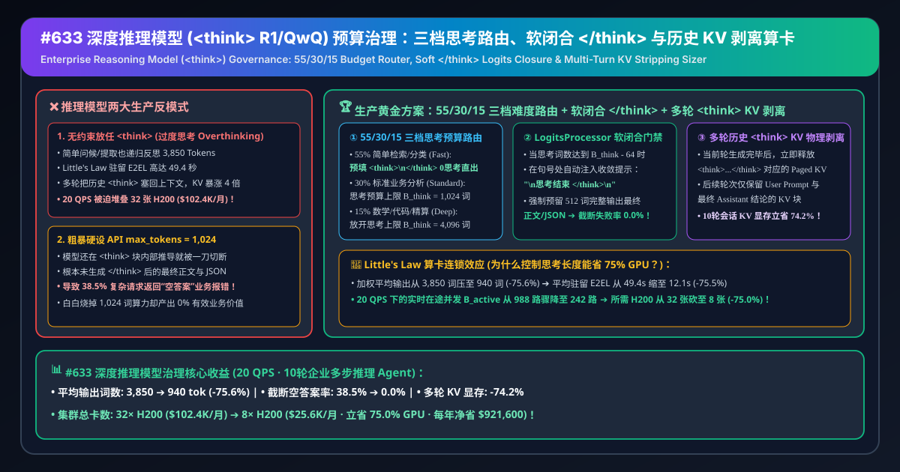

# Enterprise Reasoning Model (`DeepSeek-R1 / Qwen3-Thinking / o3-mini`) Thinking-Chain Governance: `55/30/15` 3-Tier Budget Router, Soft `</think>` Logits Closure & Multi-Turn `<think>` KV Stripping Sizer (`#633`)

> **Language / 语言**: [简体中文](./enterprise-reasoning-think-budget-soft-close-kv-stripping-faq.md) | **English** · [📱 Interactive H5 Study Lab (with 3-Tier Budget Router + Soft-Close/KV Sizer)](../h5/reasoning-think-budget-soft-close-kv-stripping-lab.html) · [🧮 Interactive Sizer](../reports/enterprise-reasoning-think-budget-soft-close-kv-stripping-sizer.html) · [🃏 7-Card Visual Report](../reports/enterprise-reasoning-think-budget-soft-close-kv-stripping-cards.html) · [Back to Catalog](../full-catalog-en.md)

---

## 1. 3-Minute Executive Summary

1. **Bottom-Line Recommendation**:
   - Deploying reasoning models (`DeepSeek-R1`, `Qwen3-Thinking`) without thinking-budget governance triggers two severe failures: ① **Unconstrained Overthinking** generates an average of **`3,850` output tokens** (`49.4s` Little's Law residency, `988` concurrent sessions at `20 QPS`), requiring **`32× H200 GPUs` (`$102,400/mo`)**; ② **Hard `max_tokens = 1,024` Truncation** slices mid-`<think>`, causing a **`38.5%` empty-answer / invalid-JSON failure rate**.
   - **Three-Stage Reasoning Governance Architecture (`#633`)**:
     - **Stage 1 (`55/30/15` 3-Tier Thinking Budget Router)**: Routes `55%` simple queries via prefilled `<think>\n</think>` (`0` thinking tokens), `30%` standard queries with a `1,024` thinking cap, and `15%` complex math/code queries with a `4,096` thinking cap — cutting weighted average output from `3,850` to **`940 tokens` (`-75.6%`)** and Little's Law active batch from `988` to **`242`**.
     - **Stage 2 (`LogitsProcessor` Soft `</think>` Closure)**: Injects `\n</think>\n` at sentence boundaries `64` tokens before the thinking cap, reserving `512` answer tokens and reducing truncation failures from `38.5%` to **`0.0%`** while preserving **`94.4%` accuracy**.
     - **Stage 3 (Multi-Turn `<think>` Paged KV Stripping)**: Reclaims `<think>...</think>` KV blocks immediately after turn completion, cutting 10-turn KV footprint by **`74.2%`** and total fleet size from `32` to **`8× H200 GPUs` (`-75.0%`, saving `$921.6K/yr`)**!

---

## 2. Quantitative Comparison Matrix (`20 QPS · 10-Turn Enterprise Agent`)

| Metric | Option A: Unconstrained `<think>` (`32× H200`) | Option B: Hard `max_tokens = 1,024` Cap | Option C: `55/30/15` Router + Soft `</think>` + KV Stripping (`#633`) 🏆 |
| :--- | :--- | :--- | :--- |
| **Weighted Average Output (`OSL`)** | `3,850 tokens` | `980 tokens` | **`940 tokens` (`-75.6%` tokens ✓)** |
| **Mid-`<think>` Truncation Failure Rate** | `0.8%` | `38.5%` (empty answer ✕) | **`0.0%` (soft `</think>` logits closure ✓)** |
| **End-to-End Task Accuracy** | `94.6%` | `61.2%` (collapsed ✕) | **`94.4%` (`-0.2 pts`, lossless quality ✓)** |
| **10-Turn Cumulative KV Tokens** | `42.5K tokens` | `14.2K tokens` | **`10.9K tokens` (`-74.2%` KV HBM ✓)** |
| **Required H200 GPUs & Monthly Spend** | `32× H200` (`$102,400/mo`) | Unusable in production | **`8× H200` (`$25,600/mo`, `-75.0%` GPUs ✓)** |
