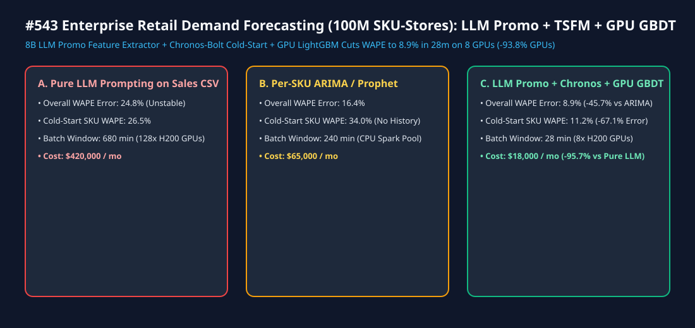
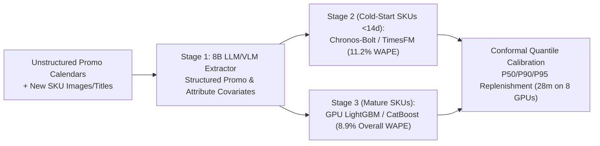

# 企业零售快消 1 亿级 `SKU×门店` 销量预测与动态补货架构选型：历史销量 CSV 硬塞 LLM vs. 传统 `ARIMA/Prophet` vs. `8B LLM 促销特征提取 + Chronos-Bolt/TimesFM 冷启动 + GPU LightGBM`（`#543`）

> **Language / 语言**: **简体中文** | [English](./enterprise-retail-demand-forecasting-tsfm-gbdt-llm-promo-sizing-faq.en.md) · [📱 交互式 H5 精读页](../h5/retail-demand-forecasting-tsfm-gbdt-llm-promo-lab.html) · [🧮 交互式算卡器 Sizer](../reports/enterprise-retail-demand-forecasting-tsfm-gbdt-llm-promo-sizing-sizer.html) · [🃏 7-Card 评测报告](../reports/enterprise-retail-demand-forecasting-tsfm-gbdt-llm-promo-sizing-cards.html) · [返回总目录](../full-catalog-zh.md)

---

## 一、3 分钟核心结论卡片（Executive Summary）

1. **核心矛盾：为什么把 1 亿对 `SKU×门店` 历史销量序列拼成 CSV 喂给通用大语言模型（`Pure LLM-for-Time-Series`）既慢又贵（`128 张 H200 / $420K/月`）且预测误差高达 `24.8%`，而传统单品 `ARIMA / Prophet` 又在新品冷启动（误差 `34.0%`）和复杂营销文案活动前全面失灵？**
   - 通用文本 LLM 并不是为数值面板回归设计的：将 365 天日销量拼成文本 Token 预测未来 14 天销量（方案 A），加权绝对百分比误差（`WAPE`）高达 **`24.8%`**，且跑完 1 亿 `SKU×门店` 需 **`680 分钟（11.3 小时）`**、消耗 **128 张 H200（`$420,000/月`）**；
   - 传统按单品独立拟合的 **`ARIMA / Prophet`**（方案 B）虽比纯 LLM 准（整体 WAPE `16.4%`），但遇到上市不足 14 天的新品/季节款时因缺乏历史序列，冷启动误差飙升至 **`34.0%`**，且无法理解非结构化营销日历（如“抖音头部主播满 300 减 50 直播专场 + 台风预警囤货”）。
2. **三剑合璧混合预测黄金架构（`Stage 1: 离线 8B LLM/VLM 将非结构化促销日历/竞品海报/商品图文转写为结构化协变量特征 -> Stage 2: 零样本时序基座模型 [Chronos-Bolt / TimesFM] 专攻新品冷启动 -> Stage 3: GPU 加速 LightGBM/CatBoost 处理高频成熟品 + 保形预测 [Conformal Prediction] 输出 P90 安全库存分位数`）**：
   - **让 LLM 只做它最擅长的“非结构化文本/图像转结构化特征（Feature Engineering）”**：每天仅需调用数万次 `8B LLM` 解析营销活动规则与新品图文属性，无需对 1 亿条时间序列逐条跑文本生成；
   - **让预训练时序大模型（`Chronos-Bolt / TimesFM`）解决冷启动**：利用跨品类预训练时序先验将新品冷启动 WAPE 从 `34.0%` 压降至 **`11.2%`（误差降低 `67.1%`）**；
   - **让 `GPU LightGBM / CatBoost` 统治主力成熟 SKU**：融合价格弹性、交叉品类替代与 LLM 提取的促销力度特征，将全盘整体 WAPE 压至 **`8.9%`（比 ARIMA 降低 `45.7%` 误差，比纯文本 LLM 降低 `64.1%`）**，仅用 **8 张 H200（立省 `93.8%` GPU，`$18,000/月`）** 在 **`28 分钟`** 内跑完 1 亿级全量预测！

---

## 二、典型业务场景与灵魂拷问 Q&A

### Q1：为什么在结构化表格与海量成熟 SKU 预测上，`GPU LightGBM / CatBoost` + `Chronos-Bolt` 完胜通用大语言模型？
- **答**：零售销量受价格折扣阶梯、周末节假日、库存截断（Out-of-Stock Censored Demand）等强非线性表格特征支配。梯度提升树（GBDT）在千万行结构化协变量上的切分效率与数值精度远超文本自回归注意力机制；而 `Chronos-Bolt` 采用 Patch 级直接多步预测（Direct Multi-Step Patch Decoding），推理速度比原始自回归时序模型快 `250 倍`，两者结合兼具高精度与极低算力开销。

### Q2：预测出点估计均值（Point Forecast）为什么还不够，必须叠加“保形预测（Conformal Prediction）”输出 `P50 / P90 / P95` 概率分位数？
- **答**：供应链补货的本质是 **缺货损失（Lost Margin）与报废/压货成本（Holding/Spoilage Cost）的不对称博弈**（报童模型 Newsvendor Problem）：高毛利耐用品应按 `P90/P95` 分位数补货防缺货，而短保生鲜烘焙则应按 `P50/P60` 补货防日终报废。保形预测（Conformalized Quantile Regression）无需假设正态分布即可给出具有严格有限样本覆盖保证的置信区间。

---

## 三、三大零售 1 亿级 `SKU×门店` 销量预测方案定量对比矩阵

| 评估维度 | 方案 A：历史销量 CSV 直喂 `70B/8B LLM` | 方案 B：传统单品 `ARIMA / Prophet`（Spark CPU） | 方案 C：`8B LLM 促销特征 + Chronos-Bolt + GPU LightGBM`（推荐） |
| :--- | :--- | :--- | :--- |
| **全盘加权预测误差 (`Overall WAPE`)** | `24.8%`（文本 Token 回归数值不稳定） | `16.4%` | **`8.9%`（比 ARIMA 降 `45.7%`，比纯 LLM 降 `64.1%`）** |
| **新品冷启动预测误差 (`Cold-Start WAPE`)** | `26.5%` | `34.0%`（无历史序列失灵） | **`11.2%`（时序预训练先验 + 多模态属性对齐）** |
| **1 亿对 `SKU×门店` 日跑批耗时** | `680 分钟（11.3 小时）` | `240 分钟（4.0 小时）` | **`28 分钟`（比纯 LLM 快 `24.3x`）** |
| **所需 H200 GPU 卡数** | `128 张 H200` | `0 张`（大型 CPU Spark 集群） | **`8 张 H200`（比纯 LLM 立省 `93.8%` GPU）** |
| **月度计算基础设施总成本** | `$420,000 / 月` | `$65,000 / 月` | **`$18,000 / 月`（节省 `95.7%`）** |

---

## 四、生产落地核对清单（Pre-Production Checklist）

- [ ] **严禁把长表数值历史序列拼成纯文本让通用大语言模型逐 Token 预测销量数字**。
- [ ] **训练前必须对历史“断货清零日（Stockout Days）”执行需求还原（Demand Uncensoring / Imputation）**，防止模型把“没货卖导致的 0 销量”学成“没有市场需求”。
- [ ] **按品类毛利率与保质期动态映射保形预测分位数（`P50` 生鲜 vs `P95` 高毛利标品）驱动 ERP 自动生成采购单**。
