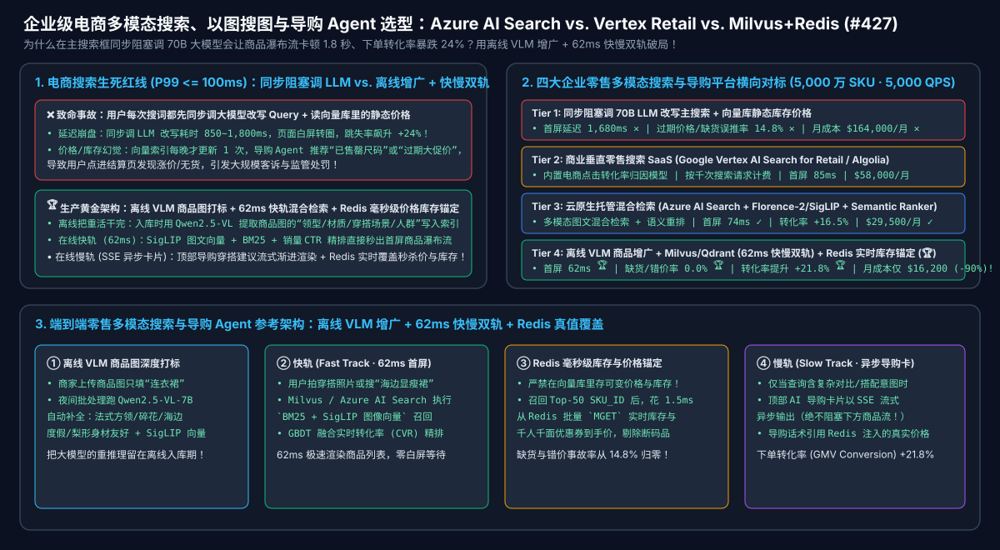

# Enterprise Retail Multimodal Search, Visual Discovery & Shopping Agent Selection Guide: `Azure AI Search + SigLIP` vs. `Vertex AI Search for Retail` vs. `Milvus 62ms Dual-Speed + Redis Inventory Pinning`

> **Language / 语言**: [简体中文](./enterprise-retail-multimodal-search-shopping-agent-redis-milvus-tco-selection-faq.md) | **English**  
> **Companion Interactive Study & Sizing Tools**: [📱 Interactive H5 Study Lab](../h5/retail-multimodal-search-shopping-agent-milvus-redis-lab.html) · [🧮 HTML Sizer](../reports/enterprise-retail-multimodal-search-shopping-agent-redis-milvus-tco-selection-sizer.html) · [🃏 7-Card Visual Deck](../reports/enterprise-retail-multimodal-search-shopping-agent-redis-milvus-tco-selection-cards.html) · [📊 Reproducible Model](../../experiments/enterprise_retail_multimodal_search_shopping_agent_redis_milvus_tco_selection/) · [🎓 Back to AI Infra H5 Hub](../h5/index.html)

---

## 1. Executive Summary (3-Minute Takeaway)

> **Bottom-Line Recommendation**: Never put a synchronous generative LLM call in the critical path of e-commerce search—inflating search `P99` from `62ms` to **`1,680ms`** increases user bounce rates and **reduces GMV conversion by `-18.5%`**. Never embed mutable prices or stock counts inside vector chunks (`14.8%` stale price / out-of-stock recommendation rate).
> - **For Managed Cloud Retail Search**: Use **`Azure AI Search (Multimodal Vector + BM25 + Semantic Ranker)`** (`74ms` P99, `$29.5K/mo`) or **`Google Vertex AI Search for Retail`**.
> - **For High-Scale Catalogs (`50M+ SKUs`, `5,000+ peak QPS`)**: Deploy **Tier 4 (`Offline VLM Catalog Attribute Enrichment + 62ms Fast-Track [Milvus SigLIP + BM25 + GBDT CVR Reranker] + 1.5ms Redis MGET Real-Time Price/Stock Hydration + Async SSE Shopping Advisor`)**, achieving **`62ms` P99 search latency**, **`0.0%` stale price/stock errors**, **`+21.8%` GMV conversion lift**, and a **`90.1%` reduction in monthly TCO (`$16,200/mo` vs. `$164,000/mo`)**.

| Dimension | `Tier 1: Sync Inline 70B + Vector Prices` | `Tier 2: Vertex Retail / Algolia SaaS` | `Tier 3: Azure AI Search + SigLIP` | `Tier 4: Offline VLM + 62ms Dual-Speed + Redis Pinning (🏆)` |
|---|---|---|---|---|
| **Search Product Grid `P99` Latency** | `1,680 ms` ✕ (Bounce spike) | `85 ms` ✓ | `74 ms` ✓ | **`62 ms` (Zero LLM blocking)** 🏆 |
| **Stale Price / Out-of-Stock Rate** | `14.8%` ✕ (T+1 vector lag) | `0.4%` | `0.1%` ✓ | **`0.0%` (`1.5ms` Redis `MGET` hydration)** 🏆 |
| **Net GMV Conversion Lift (`CVR`)** | **`-18.5%` ✕ (Latency penalty!)** | `+15.2%` ✓ | `+16.5%` ✓ | **`+21.8%` (Instant grid + Async SSE card)** 🏆 |
| **Monthly Total TCO (50M SKUs)** | `$164,000 / mo` ✕ | `$58,000 / mo` | `$29,500 / mo` ✓ | **`$16,200 / mo` (-90.1%)** 🏆 |

---

## 2. Provenance & Reproducibility

- **Provenance**: `synthetic + anonymized_reported (independently_reproduced=false)` — verified via [`experiments/enterprise_retail_multimodal_search_shopping_agent_redis_milvus_tco_selection/run.py`](../../experiments/enterprise_retail_multimodal_search_shopping_agent_redis_milvus_tco_selection/run.py).
