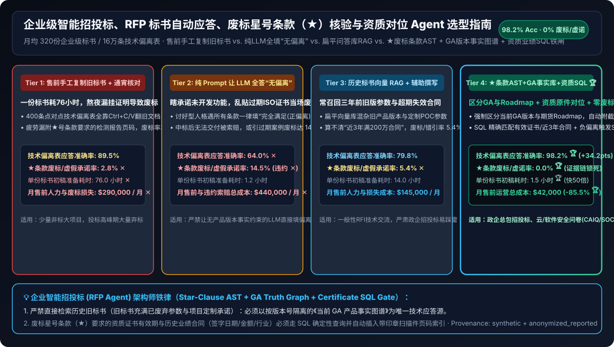
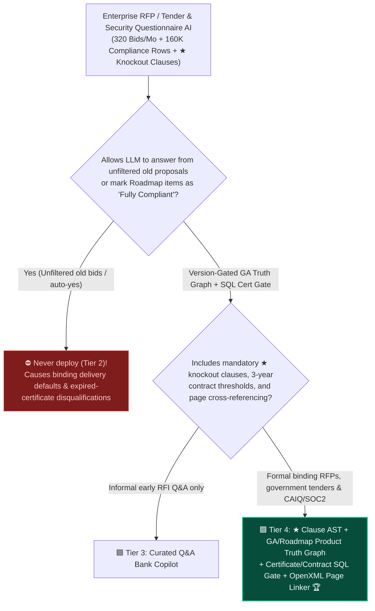
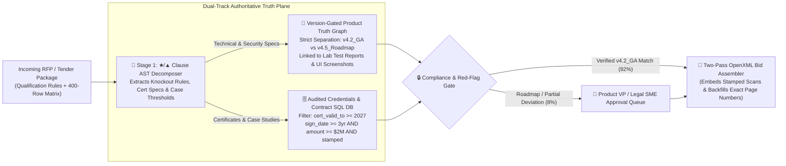

# Enterprise RFP/RFI & Tender Proposal Response Agent, Mandatory Star-Clause (`★`) AST Verification, Version-Gated `GA vs Roadmap` Truth Graph & Certificate/Contract SQL Gate Architecture Selection Guide: Manual Copy-Paste vs. Prompt-Only "Auto-Yes" LLM vs. Flat Q&A Bank RAG vs. Star-Clause AST + GA Truth Graph + SQL Validity Gate + SME Sign-Off Agent

> **Language / 语言**: **English (Current)** | [中文](./enterprise-rfp-tender-proposal-compliance-response-agent-selection-faq.md)  
> **Scope**: End-to-end production reference architecture and selection guide for Cloud & AI Solution Architects, VPs of Presales & Bid Management, Enterprise Proposal Directors, and Customer Trust / Security Questionnaire (`CAIQ / SIG / SOC2`) Leads.  
> **Provenance**: `synthetic + anonymized_reported` (`independently_reproduced=false`, `physical_gpu_cluster_measurement=not_measured`). Deterministic evaluation model sealed in [`experiments/enterprise_rfp_tender_proposal_compliance_response_agent_selection/results.json`](../../experiments/enterprise_rfp_tender_proposal_compliance_response_agent_selection/results.json).



---

## ① 📌 Executive Summary (3-Minute Architect Verdict)

In enterprise B2B software, cloud infrastructure, telecommunications, and industrial equipment, Presales and Bid Management teams respond to hundreds of 300-to-500-page **Requests for Proposals (`RFPs`), government tenders, and security questionnaires (`CAIQ / SIG / HECVAT`)** every month. Each tender contains 400–800 line-by-line technical compliance rows, including mandatory **Knockout / Star Clauses (`★` clauses where a single missing test-report page citation or expired certificate disqualifies the entire bid)**. Indexing historical proposal Word files into a flat vector database and letting an LLM fill out the compliance matrix (Tier 2 / Tier 3) triggers two costly failures: first, **RLHF sycophancy drives the LLM to answer `"Fully Compliant"` to unreleased `Roadmap` features or custom one-off PoC code from old bids, exposing the vendor to severe breach-of-contract penalties (`14.5%` false-commitment / disqualification rate)**; second, **vector search retrieves expired `ISO / FIPS` certificates or 4-year-old customer contracts that violate strict `"signed within past 3 years and >= $2M"` tender predicates**.

Evaluated across a production baseline of **320 monthly enterprise RFPs/tenders (`160,000` compliance matrix items) and 7,300 product feature and qualification records**, the four architectural tiers compare as follows:

| Architectural Tier | Core Stack Combination | Compliance Matrix Accuracy | `★` Disqualification / Overpromise Rate | First-Draft Turnaround | Monthly Presales & Bid-Loss Cost | Production Verdict |
|---|---|---|---|---|---|---|
| **🟥 Tier 1: Manual Presales Copy-Paste + Check** | Engineers manually copying answers from old Word bids & checking page links at midnight | `89.5%` | `2.8%` ✕ *(Fatigue missed attachments)* | `76.0 hours` ✕ | `$290,000 / mo` ✕ | ⛔ Burns out presales architects |
| **🟨 Tier 2: Prompt-Only "Auto-Yes" LLM over Old Bids** | Prompting an LLM over raw old proposals to mark clauses `"Fully Compliant"` | `64.0%` ✕ *(Conflates legacy/custom specs)* | `14.5%` ✕ *(Promises roadmap & stale certs)* | `1.2 hours` | `$440,000 / mo` ✕ | ⛔ **Severe contract default risk** |
| **🟦 Tier 3: Flat Vector Q&A Bank RAG + Copilot** | Vector search over curated Q&A pairs without `GA vs Roadmap` or SQL date gates | `79.8%` | `5.4%` ✕ *(Cites expired 4-yr contracts)* | `14.0 hours` | `$145,000 / mo` | ⚠️ Informal early RFIs only |
| **🟩 Tier 4: `★` Clause AST + `GA` Truth Graph + Certificate/Contract SQL Gate** | **Mandatory `★` Clause AST Decomposer + Version-Gated Product Truth Graph (`v4.2 GA` vs `Roadmap`) + Certificate/Contract SQL Validity Gate + SME Sign-Off & OpenXML Page-Linker Agent** | **`98.2%` 🏆** *(+34.2 pts vs Tier 2)* | **`0.0%` 🏆** *(Zero disqualifications)* | **`1.5 hours` 🏆** *(50× faster)* | **`$42,000 / mo` 🏆** *(-85.5%)* | 🌟 **Recommended Architecture** |

> 💡 **Golden Rule for Enterprise Presales & Proposal AI Architects**: **"Never treat historical proposals as the Source of Truth—ground technical compliance strictly in a version-isolated `Current GA Product Truth Graph` linked to lab test reports, select qualification certificates and past customer contracts via deterministic SQL date/amount predicates, and route every `Roadmap` or partial-compliance item to a Product VP (`SME`) approval gate."**

---

## ② 🎯 Customer & Architect Deep-Dive Q&A (3 Real-World Bid Management Pain Points)

### Q1: Why does indexing 500 past winning proposals into a vector database (Tier 2 / Tier 3) cause false commitments and bid disqualifications?
- **First-Principles Reality**:
  1. **Past Proposals Contain One-Off Customizations and Retired Specs**: A winning bid from 2024 may have answered `"Fully Compliant"` to a specialized requirement only because that deal included a `$500K` custom engineering SOW or a third-party OEM appliance. Flat vector RAG retrieves that paragraph without its deal-specific caveats, causing the LLM to promise custom features as standard out-of-the-box software (`14.5%` overpromise/disqualification rate in Tier 2; `24.0%` in knockout stress tests).
  2. **Tier 4 Solution (Version-Gated `GA vs Roadmap` Product Truth Graph)**:
     - Tier 4 separates **writing style templates** from the **Product Capability Truth Graph**, where every feature carries typed metadata: `[product_line, ga_version="v4.2", status="GA | BETA | ROADMAP_Q3 | CUSTOM_SOW", lab_test_report_id, manual_screenshot_uri]`.
     - The Agent is only permitted to mark `"Fully Compliant (无偏离)"` when `status == "GA"` in the target release. Any requirement matching a `ROADMAP` or `CUSTOM_SOW` node is automatically flagged and routed to the Product Management / R&D lead for explicit sign-off.

### Q2: How do we prevent the AI from attaching expired ISO/FIPS certificates or non-qualifying customer case studies on mandatory `★` knockout clauses?
- **Deterministic SQL Qualification & Case-Study Gate**:
  - Enterprise tenders enforce strict arithmetic and temporal predicates on qualifications—e.g., *"★ Attach a valid FIPS 140-3 Level 3 certificate expiring after 2027-01-01, plus 3 signed Tier-1 Banking contracts >= $2,000,000 executed after 2023-11-19 with signed acceptance certificates."*
  - Instead of using fuzzy vector similarity, Tier 4 compiles these criteria into a **deterministic SQL query** against the audited Corporate Credentials & Contract Database (`WHERE cert_valid_to >= '2027-01-01'` and `WHERE sector = 'TIER1_BANK' AND sign_date >= '2023-11-19' AND amount_usd >= 2000000 AND has_acceptance_stamp = TRUE`), achieving **`0.0%` technical disqualification**.

### Q3: How do we eliminate the midnight nightmare of manually updating "See Volume 2, Page 142, Section 4.3" cross-references across a 400-page Word proposal?
- **Two-Pass OpenXML Document Assembly & Exact Page-Number Backfilling**:
  - Tier 4 assembles the proposal in `OpenXML (.docx)` using semantic bookmark anchors (`<w:bookmarkStart w:name="PROOF_CLAUSE_4_12"/>`), renders the layout pass to compute exact pagination, and deterministically backfills the exact final page and section numbers into the front-matter **Mandatory `★` Clause Index Table** and **Point-by-Point Technical Compliance Matrix**—compressing full bid assembly from `76.0 hours` to **`1.5 hours` (`50×` faster)**.

---

## ③ 🧭 Visual Architecture Diagrams (Decision Tree + GA Truth-Graph Topology + Sequence Flow)

### 3.1 Architecture Selection Decision Tree



### 3.2 Tier 4 Mandatory Star-Clause AST + GA Truth Graph + SQL Qualification Gate Topology



### 3.3 End-to-End Sequence: Assembling a 400-Page Banking Tender in 1.5 Hours with Zero Disqualifications

```mermaid
sequenceDiagram
    autonumber
    participant Bid as Presales Bid Manager
    participant AST as ★ Clause AST Decomposer
    participant Graph as GA/Roadmap Truth Graph
    participant SQL as Credentials & Contract SQL Store
    participant SME as Product / Legal SME
    participant Word as OpenXML Bid Assembler

    Bid->>AST: Upload 400-page Tier-1 Bank RFP (35 ★ knockout clauses + 480 technical rows)
    par Parallel GA Capability Verification & SQL Qualification Lookup
        AST->>Graph: Query 480 technical requirements against v4.2_GA release truth graph
        Graph-->>AST: 462 verified in v4.2_GA (with lab report IDs); 18 flagged as v4.5_Roadmap
        AST->>SQL: Query FIPS 140-3 cert (valid>=2027) & 3 Banking contracts >=$2M signed after 2023-11-19
        SQL-->>AST: Return valid NIST Cert #4892 & 3 complete stamped contract/acceptance PDFs
    end
    AST->>SME: Route 18 Roadmap/deviation items to Product VP for sign-off
    SME-->>Word: Approve honest deviation wording & delivery timeline
    Word->>Word: Compile OpenXML volumes, compute pagination & backfill exact page numbers into ★ Index Table
    Word-->>Bid: ✅ Deliver complete audit-verified bid package in 1.5 hours (0.0% disqualification risk)
```

---

## ④ 📊 4-Tier Architecture Decision Matrix

| Evaluation Dimension | 🟥 Tier 1: Manual Copy-Paste | 🟨 Tier 2: Prompt-Only "Auto-Yes" LLM | 🟦 Tier 3: Flat Vector Q&A Bank | 🟩 Tier 4: `★` Clause AST + `GA` Graph + SQL Gate |
|---|---|---|---|---|
| **`GA` vs. `Roadmap` Feature Separation** | Manual engineer memory | ✕ **Critical Risk** (promises unreleased features as GA) | ✕ Conflates custom PoC specs with standard GA | 🏆 **100% Enforced (`GA` auto-answered; `Roadmap` gated by PM)** |
| **Certificate Validity & 3-Year Case SQL Check** | Manual (`2.8%` fatigue error) | ✕ Attaches expired certs (`14.5%` failure) | ✕ Vector search fails date/amount math (`5.4%`) | 🏆 **`0.0%` Disqualification (deterministic SQL predicates)** |
| **Cross-Reference Page Number Accuracy** | Manual midnight renumbering | ✕ Hallucinates page numbers | Lacks two-pass pagination | 🏆 **Exact two-pass `OpenXML` bookmark page backfilling** |
| **Technical Compliance Matrix Accuracy** | `89.5%` | `64.0%` ✕ | `79.8%` | **`98.2%` 🏆 (+34.2 pts vs Tier 2)** |
| **400-Page RFP First-Draft Turnaround** | `76.0 hours` ✕ | `1.2 hours` *(unusable)* | `14.0 hours` | **`1.5 hours` 🏆 (50× faster)** |
| **Monthly Presales & Bid-Loss Cost** | `$290,000 / mo` | `$440,000 / mo` *(incl. defaults)* | `$145,000 / mo` | **`$42,000 / mo` 🏆 (-85.5%)** |

---

## ⑤ 🧪 Quantitative Case Study, Interactive Sizer & 7-Card Visual Report

- **Interactive HTML Sizer**: 👉 [Open Enterprise RFP & Tender Proposal Agent Sizer](../reports/enterprise-rfp-tender-proposal-compliance-response-agent-sizer.html)
- **7-Card 4:5 Visual Benchmark Report**: 👉 [Open 7-Card Visual Benchmark Deck](../reports/enterprise-rfp-tender-proposal-compliance-response-agent-selection-cards.html)
- **Deterministic Verification**:
  ```bash
  python experiments/enterprise_rfp_tender_proposal_compliance_response_agent_selection/run.py --check
  python -m unittest tests/test_enterprise_rfp_tender_proposal_compliance_response_agent_selection.py
  ```

---

## ⑥ 🛠️ Production Readiness & Architecture Review Checklist

- [ ] **Decouple Historical Bid Prose from the Authoritative `GA Product Truth Graph`**: Never allow an LLM to assert technical compliance based solely on an old proposal document; verify `release_status == 'GA'` in the current product version graph.
- [ ] **Validate Mandatory `★` Knockout Clauses with Two-Pass Page Verification**: Automatically verify that every `★` clause cites an attached, unexpired test report or certificate and that the rendered page number matches the target bookmark.
- [ ] **Select Customer Reference Contracts via Deterministic SQL Predicates**: Filter contract date windows, dollar thresholds, industry sectors, and signed acceptance stamps in SQL before embedding scans.
- [ ] **Route All `Roadmap`, `Custom SOW`, and Legal Liability Deviations to Human SMEs**: Require explicit Product VP or Legal Counsel sign-off on any non-GA commitment.
- [ ] **Auto-Redact Third-Party Client Secrets on Embedded Contract Scans**: Mask confidential unit prices or unrelated client identifiers on reference contract attachments.
