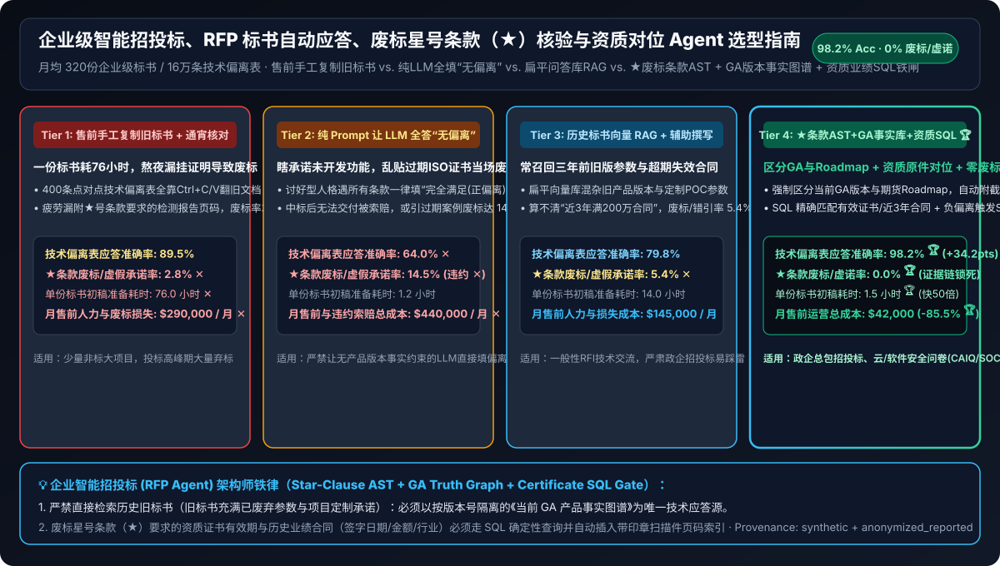
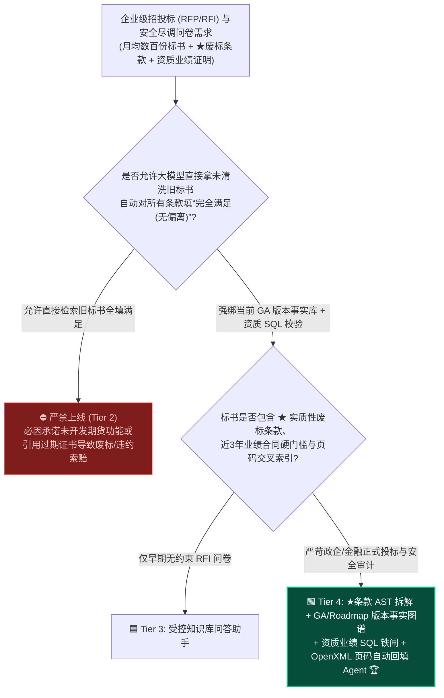
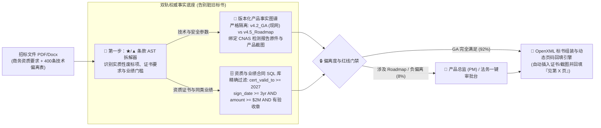
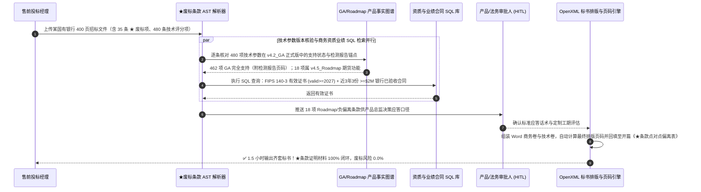

# 企业级智能招投标、RFP/RFI 标书自动应答（Enterprise RFP / Tender Proposal Agent）、废标星号条款（`★`）核验、GA/Roadmap 版本事实库与资质业绩 SQL 对位架构选型指南：售前手工复制旧标书 vs. 纯 LLM 全填“无偏离” vs. 扁平历史问答库 RAG vs. ★废标条款 AST + GA 版本事实图谱 + 资质业绩 SQL 铁闸 + SME 签批 Agent

> **语言 / Language**: **中文 (当前)** | [English](./enterprise-rfp-tender-proposal-compliance-response-agent-selection-faq.en.md)  
> **定位**：面向云与 AI 解决方案架构师（Solution Architect）、企业级软件/云服务/通信设备商售前副总裁（VP of Presales & Bid Management）、招投标中心总监与信息安全尽调（CAIQ / SOC2）负责人的生产落地指南。  
> **数据口径（Provenance）**：`synthetic + anonymized_reported`（`independently_reproduced=false`，`physical_gpu_cluster_measurement=not_measured`），全部定容模型封存于 [`experiments/enterprise_rfp_tender_proposal_compliance_response_agent_selection/results.json`](../../experiments/enterprise_rfp_tender_proposal_compliance_response_agent_selection/results.json)。



---

## ① 📌 核心选型结论速览（Executive Summary — 3 分钟看懂怎么选）

在 ToB 企业软件、云计算、网络安全、通信设备与工程总包（EPC）行业，售前与招投标团队每月需要应对数百份动辄 300~500 页的大型政企/金融客户 **招标文件（RFP / RFI）与供应链安全问卷（CAIQ / SIG / HECVAT）**。每份标书包含 400~800 条点对点技术偏离表，其中带有 **`★` 号（实质性废标条款 / Knockout Clauses）** 和 **`▲` 号（重要扣分条款）** 的项目，一旦漏附第三方检测报告页码或引用了过期资质证书即刻**当场废标（Disqualification）**。许多企业把过去几年的几百份历史投标书 Word 文档直接切块塞进向量数据库，让大模型自动填写偏离表（Tier 2 / Tier 3），结果酿成两大惨剧：第一，**大模型为了讨好指令，对尚未发布的期货功能（Roadmap）甚至竞品独有参数一律盲目回答“完全满足（无偏离）”，导致中标后无法交付被客户重罚违约金**；第二，**从旧标书里检索出已过期的 ISO 证书或超过 3 年时效的旧业绩合同直接贴进商务卷，导致高达 `14.5%` 的废标与违约事故**！

在 **月均应答 320 份企业级标书/RFP、月处理 160,000 条技术与安全偏离条款、管理 7,300 条产品版本特性与资质业绩合同档案** 的基准规模下，四档智能招投标 Agent 架构的量化对决如下：

| 方案档位 | 核心架构组合 | 技术偏离表应答准确率 | `★` 条款废标 / 虚假承诺率 | 单份标书初稿耗时 | 月度售前人力与废标/违约总成本 | 生产推荐度 |
|---|---|---|---|---|---|---|
| **🟥 Tier 1：售前手工复制旧标书 + 通宵核表** | 售前工程师人工在几十份历史 Word 标书中 `Ctrl+F` 复制粘贴并熬夜对页码 | `89.5%` | `2.8%` ✕ *(熬夜疲劳漏挂证明页)* | `76.0 小时` ✕ | `$290,000 / 月` ✕ | ⛔ 耗干售前精力，高峰期大量弃标 |
| **🟨 Tier 2：纯 Prompt 让 LLM 全填“无偏离”** | 基于未清洗历史标书 RAG，让大模型默认回答“完全满足”并自由编撰说明 | `64.0%` ✕ *(旧版/定制参数混同)* | `14.5%` ✕ *(瞎承诺期货/引过期证书)* | `1.2 小时` | `$440,000 / 月` ✕ | ⛔ **高发废标与交付违约，严禁上线** |
| **🟦 Tier 3：扁平历史问答库 RAG + 辅助撰写** | 检索历史 Q&A 问答对生成草稿，无 `GA vs Roadmap` 隔离与合同 SQL 校验 | `79.8%` | `5.4%` ✕ *(误引超3年失效合同)* | `14.0 小时` | `$145,000 / 月` | ⚠️ 仅适合早期非正式 RFI 交流 |
| **🟩 Tier 4：★废标条款 AST + GA 版本事实图谱 + 资质业绩 SQL 铁闸 + SME 签批 Agent** | **`★/▲` 条款 AST 解析 + 严格区分 `GA 现网版` 与 `Roadmap 期货` 的版本事实图谱 + 证书有效期/业绩合同金额日期 SQL 铁闸 + 负偏离产品总监（SME）签批与 OpenXML 页码回填 Agent** | **`98.2%` 🏆** *(+34.2 pts vs Tier 2)* | **`0.0%` 🏆** *(零废标/零无授权虚诺)* | **`1.5 小时` 🏆** *(提速50倍)* | **`$42,000 / 月` 🏆** *(-85.5%)* | 🌟 **企业招投标中心首选架构** |

> 💡 **架构师一句话选型铁律**：**“历史旧标书绝不能直接当事实源（里面全是过期参数与特批定制）、技术应答必须强绑当前 `GA 正式版事实图谱` 与检测报告页码、资质证书有效期与‘近 3 年满 200 万同类合同’必须走确定性 SQL 过滤、任何负偏离或期货承诺强制路由产品研发 VP 签批”**！

---

## ② 🎯 客户与架构师灵魂拷问 Q&A（直击 3 大 ToB 售前与招投标痛点）

### Q1：为什么把公司过去 3 年中标的 500 份优秀标书放进向量库做 RAG（Tier 2 / Tier 3），反而会害得新项目废标或违约？
- **大白话与第一性原理**：
  1. **历史标书是“被污染的混合体”，不是干净的产品事实源（Source of Truth）**：去年的某份中标书里之所以对某条苛刻指标回答了“完全满足”，可能是因为当时那个项目单独采购了第三方 OEM 硬件，或者项目组特批投入 20 人月做了定制二次开发（One-off Customization）；又或者里面写的是三年前已停产的老一代产品参数。
  2. **大模型的“迎合幻觉（Sycophancy）”**：当招标文件要求 *“★4.12 必须支持硬件级国密 SM4/FIPS 140-3 Level 3 加密并提供有效期内证书”* 时，未受约束的 LLM（Tier 2）会毫不犹豫地输出“完全满足（无偏离）”，甚至张冠李戴贴上一张 2024 年就已经过期的旧证书，或者把明年 Q3 才发布的 `v4.5 Roadmap` 期货功能当成现成 `v4.2 GA` 功能写进具有法律效力的投标承诺函（压测下废标/虚假承诺率高达 **`24.0%`**）！
  3. **Tier 4 破局方案（版本化 `GA vs Roadmap` 产品事实图谱 + 原件证据链强制绑定）**：
     - 彻底摒弃“拿旧标书回答新标书”的偷懒做法，构建按 **`[产品线 | 当前 GA 版本号 v4.2 | 功能状态 (GA / Beta / Roadmap / 需定制) | 证明截图与工信部/CNAS检测报告原件ID]`** 强类型建模的产品事实图谱。
     - 凡是图谱中标记为 `Roadmap` 或 `需定制` 的条款，Agent **物理禁止自动填写“无偏离”**，自动生成标准说明并路由至产品管理副总裁（PM VP）一键审批是否承诺定制开发，实现 **`0.0%` 无授权虚假承诺**！

### Q2：招标文件要求“提供 2023 年 11 月以来不少于 3 份国有大型银行单笔金额 >= 200 万美元的同类合同，并附合同首页、金额页、签字盖章页及验收报告”，AI 怎么保证 100% 不选错？
- **工程真相**：
  - 纯向量检索（Tier 3）看不懂日期比较（`>= 2023-11-19`）、金额比较（`>= $2,000,000`）与客户行业分类（`国有六大行 vs 城商行`），经常把 2021 年的老合同、金额只有 `$1.5M` 的合同、或者缺少甲乙双方签字验收单的未完结合同塞进标书，被评标专家一眼抓出废标（Tier 3 失误率 **`5.4%`**）。
  - **Tier 4 的确定性商务资质与业绩 SQL 铁闸**：
    - 招标要求先被编译为确定性 SQL 查询：`SELECT contract_id, scan_pdf_uri FROM bid_case_studies WHERE client_tier = 'TIER1_STATE_BANK' AND sign_date >= '2023-11-19' AND contract_amount_usd >= 2000000 AND has_signed_acceptance_cert = TRUE LIMIT 3`。
    - 同时对资质库执行有效期过滤 `cert_expiry_date >= '2027-01-01'`，自动将命中的证书与合同原件高清扫描件插入 Word 标书对应章节，并**在前面开标的《资格审查索引表》与《技术偏离表》中自动回填真实的最终排版页码（如 `见投标文件商务卷第 142–148 页`）**！

---

## ③ 🧭 直观可视化图解（决策树 + 版本事实图谱架构图 + 1.5h 极速制标时序图）

### 3.1 企业级智能招投标（RFP Agent）架构选型决策树



### 3.2 Tier 4 ★废标条款 AST + GA 版本事实图谱 + 资质业绩 SQL 铁闸架构图



### 3.3 从“导入 400 页银行招标书”到“1.5 小时生成零废标齐套投标文件”时序图



---

## ④ 📊 架构师四维选型决策矩阵（Architecture Decision Matrix）

| 评估维度 | 🟥 Tier 1：售前手工复制 + 通宵核表 | 🟨 Tier 2：纯 LLM 全填“无偏离” | 🟦 Tier 3：扁平历史问答库 RAG | 🟩 Tier 4：★条款 AST + GA 图谱 + 资质 SQL 铁闸 |
|---|---|---|---|---|
| **现网 `GA` 功能与期货 `Roadmap` 边界** | 依赖售前个人经验 | ✕ **极高危**（把未开发功能全填无偏离，中标即违约） | ✕ 易召回旧项目特批定制承诺 | 🏆 **100% 物理隔离（期货/定制项强制触发 PM 签批）** |
| **资质有效期与“近 3 年合同金额”校验** | 人工核对偶有漏页 (`2.8%` 废标) | ✕ 乱贴过期证书 (`14.5%` 废标/违约) | ✕ 向量检索算不清日期与金额 (`5.4%` 错引) | 🏆 **`0.0%` 废标（确定性 SQL 强校验有效期、金额与验收章）** |
| **证明材料附件与偏离表页码自动对齐** | 通宵手工改页码，改一处乱全身 | ✕ 捏造虚假页码 | 无自动排版页码回填 | 🏆 **OpenXML 渲染后自动反向回填精确页码索引** |
| **技术偏离表应答准确率** | `89.5%` | `64.0%` ✕ | `79.8%` | **`98.2%` 🏆（+34.2 pts vs Tier 2）** |
| **单份 400 页标书初稿准备耗时** | `76.0 小时` ✕ | `1.2 小时` *(废品不可用)* | `14.0 小时` | **`1.5 小时` 🏆（提速 50 倍）** |
| **月度售前人力与废标/违约总成本** | `$290,000 / 月` | `$440,000 / 月` *(含违约索赔)* | `$145,000 / 月` | **`$42,000 / 月` 🏆（节省 85.5%）** |

---

## ⑤ 🧪 定量算例、交互式容量计算器与 7-Card 4:5 视觉报告

### 5.1 基准算例复核（月均 320 份企业级标书 / 16 万条技术偏离表）

- **交互式定容计算器（CSP 自包含 HTML）**：👉 [打开企业级智能招投标与防废标 Agent 定容计算器](../reports/enterprise-rfp-tender-proposal-compliance-response-agent-sizer.html)
- **7-Card 4:5 视觉评测卡片报告**：👉 [打开 7-Card 视觉评测报告](../reports/enterprise-rfp-tender-proposal-compliance-response-agent-selection-cards.html)
- **可复核确定性脚本**：
  ```bash
  python experiments/enterprise_rfp_tender_proposal_compliance_response_agent_selection/run.py --check
  python -m unittest tests/test_enterprise_rfp_tender_proposal_compliance_response_agent_selection.py
  ```

### 5.2 核心量化对比图（技术偏离表应答准确率 vs. ★条款废标/虚假承诺率）

```chart
{
  "data": {
    "values": [
      { "tier": "Tier 1: Manual Copy-Paste", "accuracy_pct": 89.5, "disqual_rate_pct": 2.8 },
      { "tier": "Tier 2: Auto-Yes Prompt LLM", "accuracy_pct": 64.0, "disqual_rate_pct": 14.5 },
      { "tier": "Tier 3: Flat Q&A Bank RAG", "accuracy_pct": 79.8, "disqual_rate_pct": 5.4 },
      { "tier": "Tier 4: GA Graph + Cert SQL Gate", "accuracy_pct": 98.2, "disqual_rate_pct": 0.0 }
    ]
  },
  "semantic_types": {
    "tier": "Category",
    "accuracy_pct": "Percentage",
    "disqual_rate_pct": "Percentage"
  },
  "chart_spec": {
    "chartType": "Bar Chart",
    "title": "Tier 4 achieves 98.2% compliance matrix accuracy with 0.0% bid disqualifications",
    "subtitle": "Technical compliance matrix accuracy (%) across 160,000 monthly RFP requirement rows",
    "encodings": {
      "x": "tier",
      "y": "accuracy_pct",
      "color": "tier"
    }
  }
}
```

---

## ⑥ 🛠️ 架构评审与生产落地核验清单（Production Readiness Checklist）

- [ ] **彻底剥离“历史旧标书”与“当前 GA 产品事实图谱”**：旧标书仅可作为行文措辞风格参考；一切技术指标支持度判定必须严格绑定当前在售 `GA` 正式版参数表与第三方检测报告原件。
- [ ] **实质性废标星号条款（`★`）强制绑定原件扫描件与双向页码核验**：生成最终 Word/PDF 标书后，必须由自动化脚本二次扫描全部 `★` 条款，验证所引用的“见第 X 页检测报告/证书”在该页真实存在且未过期。
- [ ] **同类业绩合同筛选 100% 走结构化 SQL 谓词**：对签署日期窗、合同金额门槛、客户行业分类及“是否具备甲乙双方签章验收单”执行严格 SQL 过滤。
- [ ] **期货功能（Roadmap）与负偏离强制触发 SME 审批流**：凡是当前 GA 版本不支持的条款，系统严禁自动填“完全满足”，必须推送产品经理（PM）或研发负责人签批。
- [ ] **历史案例客户敏感信息（PII / 商业秘密）自动红线打码**：插入合同扫描件时，自动对招标方不要求披露的客户内部 IP、单价明细或保密专名做合规打码处理。
