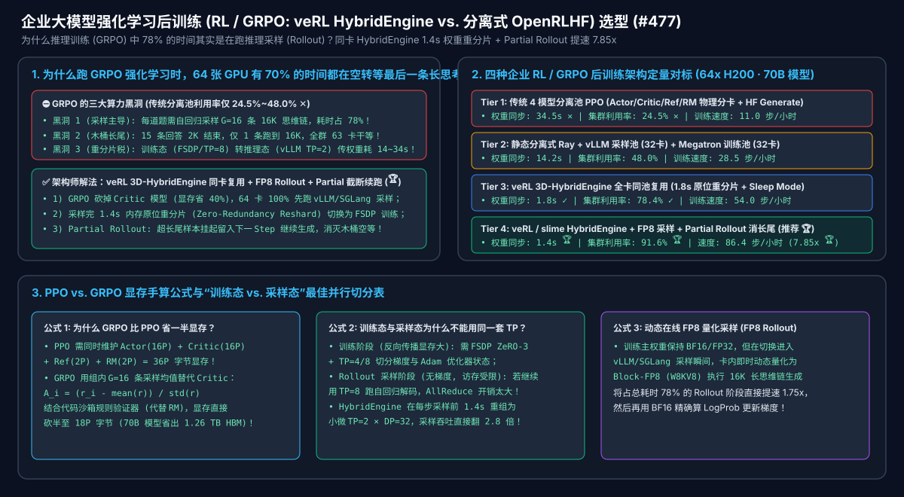

# Enterprise Post-Training RL / GRPO Infrastructure (`veRL 3D-HybridEngine`, `FP8 Rollout` & Long-Tail Straggler Mitigation) Selection Guide (#477)

> **Executive Summary**:
> In reasoning post-training (`GRPO / RFT` with group size $G=16$ and `16K–32K` Chain-of-Thought rollouts), **autoregressive rollout generation consumes 78% of total step time**. Static disaggregated clusters that dedicate half their GPUs to `vLLM` rollout and half to `FSDP/Megatron` training suffer **`24.5%–48.0%` GPU utilization** due to mutual idle waiting, `14.2–34.5s` weight broadcast overhead, and long-tail sequence stragglers. For **Cloud & AI Solution Architects**, the production standard combines **`veRL / slime` Co-Located `3D-HybridEngine` (`1.4s` zero-redundancy in-memory weight resharding between `FSDP` training and `TP=2 vLLM/SGLang` rollout via `Sleep Mode`) + On-the-Fly `FP8 Rollout` Quantization + `Partial Rollout` Straggler Streaming**. This raises cluster GPU utilization to **`91.6%`** and accelerates GRPO throughput on `64x H200` from `11.0 steps/hr` to **`86.4 steps/hr` ($7.85\times$)**.
>
> **⚡ Interactive H5 Study Lab**: [**Open the RL/GRPO Rollout Bottleneck & veRL HybridEngine Sizer (`docs/h5/rl-grpo-post-training-verl-rollout-sizer-lab.html`)**](../h5/rl-grpo-post-training-verl-rollout-sizer-lab.html)

---

## 1. Core Q&A: Solving the 78% Rollout Bottleneck and Parallelism Mismatch in GRPO

### Q1: Why does GRPO cut static HBM consumption in half compared to PPO, and why must TP shrink during Rollout?
- PPO requires **Actor ($16P$) + Critic ($16P$) + Reference ($2P$) + Reward ($2P$) = $36P$ bytes**, whereas GRPO eliminates the Critic model via group-relative advantage $A_i = (r_i - \mu_r)/\sigma_r$, cutting static memory by **50% ($18P$ bytes)**.
- Training requires high shard degree (`FSDP / TP=8`) to fit gradients and optimizer states, while autoregressive decoding requires small tensor parallelism (`TP=2 × DP=32`) to minimize per-token AllReduce latency. `3D-HybridEngine` reshards weights in-memory across NVLink in **`1.4 seconds`**.

---

## 2. Quantitative Decision Matrix (`64x H200 GPUs · 70B Reasoning RL`)

| RL / GRPO Post-Training Architecture | Rollout Time Share (%) | Weight Reshard / Sync (s) | Cluster GPU Utilization (%) | GRPO Steps / Hour (64 GPUs) |
| :--- | :--- | :--- | :--- | :--- |
| **Tier 1: 4-Model Disjoint PPO + HF Generate** | `84.0%` ✕ | `34.5 s` ✕ | `24.5%` ✕ | `11.0 steps/hr` |
| **Tier 2: Static Disaggregated `OpenRLHF` (32 Rollout + 32 Train)** | `76.0%` | `14.2 s` | `48.0%` | `28.5 steps/hr` |
| **Tier 3: Co-Located `veRL 3D-HybridEngine` (`1.8s` Reshard + Sleep)** | `64.0%` ✓ | `1.8 s` ✓ | `78.4%` ✓ | `54.0 steps/hr` |
| **Tier 4: `veRL / slime HybridEngine` + `FP8` + `Partial Rollout` 🏆** | **`46.5%` 🏆** | **`1.4 s` 🏆** | **`91.6%` 🏆** | **`86.4 steps/hr` (7.85x 🏆)** |
