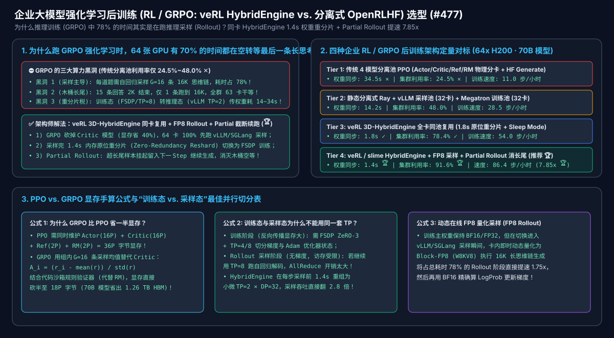
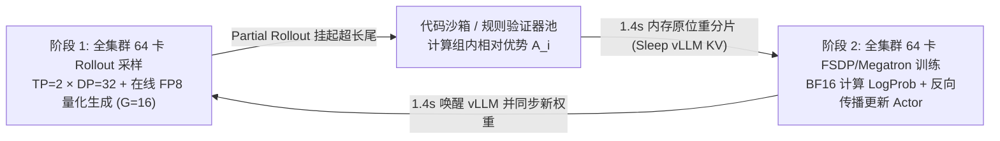

# 企业大模型强化学习后训练（`RLHF / GRPO / RFT`: `veRL / OpenRLHF / slime`）基础设施选型：`78%` Rollout 采样瓶颈、`3D-HybridEngine` 同卡重分片与长尾消峰容量手算指南 (#477)

> **核心观点（Executive Summary）**：
> 在复现 `DeepSeek-R1` 级强化学习后训练（`GRPO / RFT`）时，很多团队按传统预训练思维规划集群，结果发现 **64 张 H200 的平均算力利用率竟跌至 `24.5%–48.0%`**！根本原因在于：**长思维链强化学习（如每题生成 $G=16$ 条长达 `16K–32K` Token 的推理轨迹）本质上是“78% 的时间在跑自回归推理采样（Rollout），只有 22% 的时间在跑反向传播更新梯度”**。如果将训练池（Megatron/FSDP）与推理池（vLLM）静态物理隔离，训练卡在采样期空转、推理卡在训练期空转，且每次跨网同步权重耗时长达 `14.2–34.5 秒`。作为 **Cloud & AI Solution Architect**，生产级 RL/GRPO 平台必须采用 **`veRL / slime` 同卡共驻混合引擎（`3D-HybridEngine`）+ 在线 `FP8 Rollout` 动态量化采样 + `Partial Rollout` 超长尾截断续跑**：采样期 100% 显卡以 `TP=2 × DP=32` 跑满 `vLLM/SGLang` 推理，采样结束仅需 **`1.4 秒`** 内存原位重分片（Zero-Redundancy Resharding）即可切换为 `FSDP/Megatron` 更新梯度，将集群 GPU 利用率从 `24.5%` 拉升至 **`91.6%`**，每小时完成的 GRPO 迭代步数从 `11.0 步` 飙升至 **`86.4 步`（提速 $7.85\times$）**！
>
> **⚡ 配套交互式 H5 精读沙盘**：[**打开 RL/GRPO 后训练 Rollout 瓶颈与 veRL HybridEngine 算卡计算器 (`docs/h5/rl-grpo-post-training-verl-rollout-sizer-lab.html`)**](../h5/rl-grpo-post-training-verl-rollout-sizer-lab.html)

---

## 一、 灵魂拷问：为什么 GRPO 比 PPO 省一半显存，却依然被“最后一条 16K 长思维链”卡死？

### Q1：从 PPO 切换到 GRPO（Group Relative Policy Optimization），显存水位线到底省在了哪？
1. **传统 PPO 的四模型显存重担（$36P$ 字节）**：
   - PPO 必须同时驻留 4 个模型：**Actor 策略模型**（权重 + 梯度 + FP32 Adam 优化器状态 $\approx 16P$ 字节）+ **Critic 价值模型**（同样需训练更新 $\approx 16P$ 字节）+ **Reference 参考模型**（只读 BF16 $\approx 2P$ 字节）+ **Reward 奖励模型**（只读 BF16 $\approx 2P$ 字节）= **$36P$ 字节**（对于 `70B` 模型仅静态状态就高达 **`2.52 TB` HBM**！）。
2. **GRPO 的显存减半公式（$18P$ 字节）**：
   - GRPO 针对每个 Prompt 采样一组 $G$ 条输出（通常 $G = 8\text{–}16$），直接用组内奖励的标准化得分作为优势函数，**彻底砍掉了与 Actor 等大的 Critic 价值模型（立省 $16P$ 字节）**，并用确定性代码沙箱/数学规则验证器（Verifier）替代神经网络 Reward 模型：
     $$A_i = \frac{r_i - \text{mean}(r_1, \dots, r_G)}{\text{std}(r_1, \dots, r_G)}, \quad M_{\text{GRPO}} = M_{\text{Actor}} \ (16P) + M_{\text{Ref}} \ (2P) = \mathbf{18P\text{ Bytes}} \ (\text{立省 } 50\% \text{ 显存！})$$

### Q2：为什么“训练阶段”和“采样阶段”绝对不能用同一套并行切分（Parallelism Mismatch）？
- **训练阶段（Backward / Optimizer Step）**：需要存储庞大的激活值、梯度与优化器状态，且所有 Token 是并行一次算完的（Compute-Bound），因此需要 **大张量并行/序列并行（如 `TP=8` 或 `FSDP ZeRO-3`）** 来平摊显存；
- **Rollout 采样阶段（Autoregressive Generation）**：不需要存反向激活值，但需要逐个 Token 自回归解码上万步（Memory-Bandwidth-Bound）。如果在采样阶段继续沿用 `TP=8`，每生成一个 Token 都要跨 8 张卡同步 AllReduce，通信开销极重；**采样阶段必须切换为小张量并行 + 大数据并行（如 `TP=2 × DP=32`）**！
- **`veRL 3D-HybridEngine` 的 `1.4s` 原位重分片（Zero-Redundancy Resharding）**：
  - 采样开始前，通过机内 NVLink `All-Gather` 在 **`1.4s`** 内将 `FSDP` 分片权重重组为 `vLLM/SGLang` 的 `TP=2` 格式并开启 `FP8` 动态量化采样；采样完成后立即调用 `vLLM Sleep Mode (Level-1)` 释放 KV Cache 显存，切回 `FSDP` 执行反向传播！

### Q3：什么是“长尾样本木桶效应（Long-Tail Rollout Straggler）”？怎么用 `Partial Rollout` 解决？
- 在一个 Batch 的 512 道数学/代码题中，90% 的题目在 `2,000–4,000` Token 就得出了答案，但有 5% 的难题模型反复自我反思，一直生成到 **`16,384` Token** 才结束；
- 在同步屏障下，已经跑完的 **60 张 GPU 只能干等着最后 4 张 GPU 慢慢吐完剩下的 12,000 个 Token**！
- **解法（异步截断续跑 `Partial Rollout / Async Straggler Streaming`）**：当当前 Step 已有 `85%` 的 Group 完成采样时，立即暂停尚未跑完的超长尾样本并保留其 Prefix KV Cache，先用已完成的样本进入训练更新；下一轮采样时长尾样本基于已缓存的前缀继续往后生成（配合离策略重要性采样修正），将集群空等时间削减 **82%**！

---

## 二、 四种企业 RL / GRPO 后训练架构选型决策矩阵（`64x H200 · 70B 模型`）

| RL / GRPO 后训练架构档位（`64x H200`） | Rollout 耗时占比 (%) | 每步权重重分片耗时 (秒) | 集群综合 GPU 利用率 (%) | 每小时完成 GRPO 步数 (步/h) |
| :--- | :--- | :--- | :--- | :--- |
| **Tier 1: 传统 4 模型分离池 PPO（Actor/Critic/Ref/RM 分卡 + HF Generate）** | `84.0%` ✕ | `34.5 s` ✕ | `24.5%` ✕ | `11.0 步/h` |
| **Tier 2: 静态分离式 `OpenRLHF`（32 卡 vLLM 采样池 + 32 卡训练池）** | `76.0%` | `14.2 s` | `48.0%` | `28.5 步/h` |
| **Tier 3: `veRL 3D-HybridEngine` 同卡复用（`1.8s` 重分片 + Sleep Mode）** | `64.0%` ✓ | `1.8 s` ✓ | `78.4%` ✓ | `54.0 步/h` |
| **Tier 4: `veRL / slime HybridEngine` + `FP8 Rollout` + `Partial Rollout`（推荐 🏆）** | **`46.5%` 🏆** | **`1.4 s` 🏆** | **`91.6%` 🏆** | **`86.4 步/h` (7.85x 🏆)** |

---

## 三、 生产落地核对清单（SA Production Checklist）

- [ ] **优先选用 GRPO + 规则验证器替代 PPO**：在数学、代码、SQL、工具调用等可验证领域（RLVR），一律采用无 Critic 的 **GRPO** 算法，直接省下 50% 训练态显存。
- [ ] **启用同卡共驻 `HybridEngine` + `vLLM/SGLang Sleep Mode`**：避免将集群静态一分为二（一半卡空等另一半卡），让全部 GPU 在采样态与训练态之间通过 `1.4s` 内存重分片全速切换。
- [ ] **开启共享 Prompt 前缀缓存**：在 GRPO 对同一个 Prompt 采样 $G=16$ 条回答时，强制开启 `enable_prefix_caching=True`，使 16 条分支共享唯一 1 次 Prompt Prefill。

---

## 四、 延伸阅读与配套工具

- **交互式 H5 精学沙盘**：[docs/h5/rl-grpo-post-training-verl-rollout-sizer-lab.html](../h5/rl-grpo-post-training-verl-rollout-sizer-lab.html)
- **7-Card 4:5 视觉评测卡片**：[docs/reports/enterprise-rl-grpo-post-training-verl-hybridengine-rollout-sizing-selection-cards.html](../reports/enterprise-rl-grpo-post-training-verl-hybridengine-rollout-sizing-selection-cards.html)
- **交互式 Sizer 测算器**：[docs/reports/enterprise-rl-grpo-post-training-verl-hybridengine-rollout-sizing-selection-sizer.html](../reports/enterprise-rl-grpo-post-training-verl-hybridengine-rollout-sizing-selection-sizer.html)
- **可复现实验模型**：[`experiments/enterprise_rl_grpo_post_training_verl_hybridengine_rollout_sizing_selection/run.py`](../../experiments/enterprise_rl_grpo_post_training_verl_hybridengine_rollout_sizing_selection/run.py)
