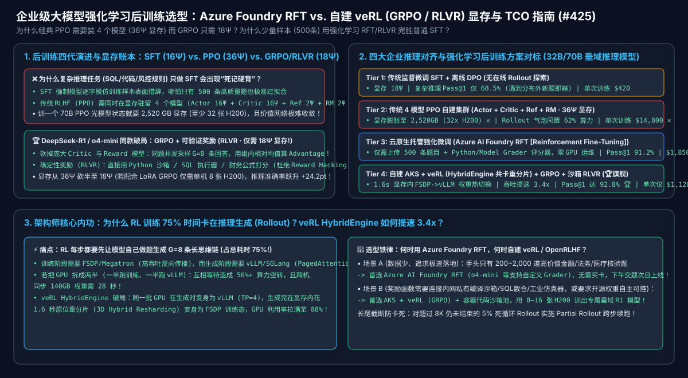

# Enterprise LLM Reinforcement Learning Post-Training (`RLVR / GRPO / RFT`) Selection Guide: `Azure AI Foundry RFT` vs. `Self-Hosted veRL HybridEngine`

> **Language / 语言**: [简体中文](./enterprise-rl-post-training-foundry-rft-vs-verl-grpo-dpo-aks-tco-selection-faq.md) | **English**  
> **Companion Interactive Study & Sizing Tools**: [📱 Interactive H5 Study Lab](../h5/rl-post-training-foundry-rft-vs-verl-grpo-aks-tco-lab.html) · [🧮 HTML Sizer](../reports/enterprise-rl-post-training-foundry-rft-vs-verl-grpo-dpo-aks-tco-selection-sizer.html) · [🃏 7-Card Visual Deck](../reports/enterprise-rl-post-training-foundry-rft-vs-verl-grpo-dpo-aks-tco-selection-cards.html) · [📊 Reproducible Model](../../experiments/enterprise_rl_post_training_foundry_rft_vs_verl_grpo_dpo_aks_tco_selection/) · [🎓 Back to AI Infra H5 Hub](../h5/index.html)

---

## 1. Executive Summary (3-Minute Takeaway)

> **Bottom-Line Recommendation**: For complex enterprise reasoning tasks (Text-to-SQL, code synthesis, quantitative risk rules), offline `SFT + DPO` memorizes surface phrasing and stalls at **`68.5%` Pass@1**, whereas legacy 4-model `PPO` requires **`36Ψ` VRAM (`2,520 GB` for 70B = 32x H200 GPUs, `$14,800/run`)**.
> - **For Teams with `200–2,000` Gradable Problems Seeking Zero GPU Ops**: Use **`Azure AI Foundry RFT (Reinforcement Fine-Tuning)`** with custom Python/Model Graders—lifting domain reasoning `Pass@1` to **`91.2%`** for **`$1,850/run`** with zero infrastructure management.
> - **For Open-Weight Sovereignty or Reward Verifiers Connected to Private Internal Sandboxes**: Deploy **Tier 4 (`Self-Hosted AKS + veRL HybridEngine + GRPO [18Ψ] + Deterministic Sandbox RLVR`)**, cutting model state VRAM in half (`2,520 GB -> 1,260 GB`, `16x H200` or `8x H200` with LoRA), shrinking `FSDP -> vLLM` weight resharding from **`28.0s` to `1.6s`**, and achieving **`92.8%` Pass@1** at **`$1,120/run` (`-92.4%` vs. PPO)**.

| Dimension | `Tier 1: Offline SFT + Static DPO` | `Tier 2: Legacy 4-Model PPO (36Ψ)` | `Tier 3: Azure AI Foundry RFT (Managed)` | `Tier 4: AKS + veRL HybridEngine GRPO + RLVR (🏆)` |
|---|---|---|---|---|
| **Model State VRAM Multiplier** | `18 Ψ` (`1,260 GB`) | **`36 Ψ` (`2,520 GB` · 4 models) ✕** | `0` (Serverless Managed) | **`18 Ψ` (`1,260 GB` · No Critic/RM)** 🏆 |
| **Min `H200` GPUs (70B Full-Weight)** | `16 GPUs` | `32 GPUs` ✕ | `0 GPUs` | **`16 GPUs` (`8 GPUs` with LoRA GRPO)** 🏆 |
| **FSDP $\to$ vLLM Weight Sync Time** | N/A | `28.0 s` ✕ | Managed | **`1.6 s` (In-HBM 3D Resharding)** 🏆 |
| **Complex Domain Reasoning `Pass@1`** | `68.5%` ✕ | `87.4%` ✓ | `91.2%` ✓ | **`92.8%` (Private Sandbox RLVR)** 🏆 |
| **Cost per Alignment Run** | `$420` | `$14,800` ✕ | `$1,850` ✓ | **`$1,120` (-92.4% vs. PPO)** 🏆 |

---

## 2. Provenance & Reproducibility

- **Provenance**: `synthetic + anonymized_reported (independently_reproduced=false)` — verified via [`experiments/enterprise_rl_post_training_foundry_rft_vs_verl_grpo_dpo_aks_tco_selection/run.py`](../../experiments/enterprise_rl_post_training_foundry_rft_vs_verl_grpo_dpo_aks_tco_selection/run.py).
