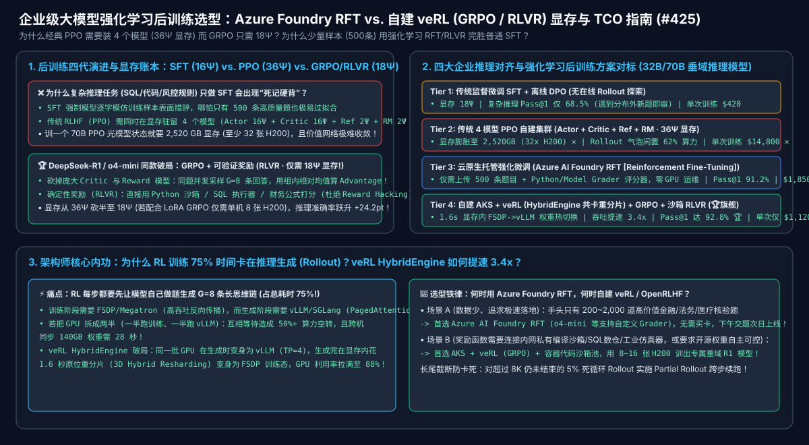
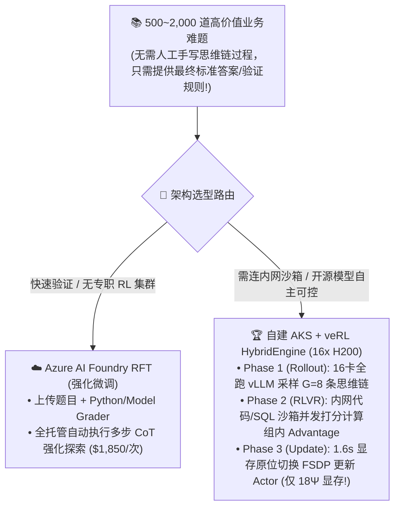

# 企业级大模型强化学习后训练（RLVR / GRPO / RFT）与推理对齐平台选型：`Azure AI Foundry RFT` vs. `自建 AKS + veRL (HybridEngine) / OpenRLHF` 显存手算与 TCO 指南

> **语言 / Language**: **简体中文** | [English](./enterprise-rl-post-training-foundry-rft-vs-verl-grpo-dpo-aks-tco-selection-faq.en.md)  
> **配套交互式学习与精算工具**: [📱 交互式 H5 精读页 (RL 后训练 36Ψ vs 18Ψ 显存与 TCO 沙盘)](../h5/rl-post-training-foundry-rft-vs-verl-grpo-aks-tco-lab.html) · [🧮 HTML 交互式计算器](../reports/enterprise-rl-post-training-foundry-rft-vs-verl-grpo-dpo-aks-tco-selection-sizer.html) · [🃏 7-Card 4:5 视觉评测卡](../reports/enterprise-rl-post-training-foundry-rft-vs-verl-grpo-dpo-aks-tco-selection-cards.html) · [📊 可复核模型](../../experiments/enterprise_rl_post_training_foundry_rft_vs_verl_grpo_dpo_aks_tco_selection/) · [🎓 返回 AI Infra 全景精学馆](../h5/index.html)

---

## 一、3 分钟看懂核心结论（Executive Summary）

> **一句话决策结论**：当企业希望提升大模型在**复杂逻辑推理场景（如多表 Text-to-SQL、量化交易策略、医药分子规则核验、复杂代码修复）**的准确率时，传统的监督微调（`SFT`）只会让模型“死记硬背训练样本表面句式”（遇到新题 `Pass@1` 仅 **`68.5%`**）；而传统的四模型强化学习（`PPO`）又要求在显存中同时驻留 `Actor + Critic + Reference + Reward` 四个模型（**总显存高达 `36Ψ`，训 70B 需 `2,520 GB` 显存、至少 `32 张 H200`，单次烧掉 `$14,800`**）！
> - **手里只有 `200 ~ 2,000` 道高价值标准答案题、无专职分布式 RL 训练团队**：无脑首选 **`Azure AI Foundry RFT (Reinforcement Fine-Tuning，强化微调)`**。只需上传题目 JSONL 并配置自定义评分器（Python 代码判分器或多维度 Grader），平台自动在云端完成在线思维链探索与强化更新，`Pass@1` 直接从 `68.5%` 飙升至 **`91.2%`**，单次仅需 **`$1,850`（零 GPU 运维）**！
> - **奖励函数必须调用内网私有系统（如连内网数仓跑 `EXPLAIN/SELECT`、调内网代码编译沙箱、跑工业仿真器）或要求 100% 开源权重自主可控**：采用 **`自建 AKS + veRL (HybridEngine) + GRPO (Group Relative Policy Optimization) + 可验证奖励沙箱 (RLVR)`**：
>   1. **显存从 `36Ψ` 直接砍半至 `18Ψ`**：`GRPO` 用同题并发采样 $G=8$ 条回答的组内相对均值替代庞大的 `Critic` 价值网络，配合確定性代码验证器省去 `Reward Model`，**16 张 H200（或配合 LoRA 仅需单机 8 张 H200）即可跑通 70B 强化学习**；
>   2. **`veRL HybridEngine` 显存内 `1.6s` 原位重分片**：消除训练（FSDP）与生成（vLLM）分离部署导致的 `28s` 跨机权重拷贝与 `50%` 算力气泡，训练吞吐提速 **`3.4x`**，单次成本压至 **`$1,120`**，垂域 `Pass@1` 高达 **`92.8%`**！

| 核心选型维度 | `Tier 1: 传统 SFT + 静态离线 DPO` | `Tier 2: 传统四模型 PPO 自建集群 (36Ψ 显存)` | `Tier 3: 云原生托管强化微调 (Azure AI Foundry RFT)` | `Tier 4: 自建 AKS + veRL (HybridEngine) + GRPO/RLVR (🏆)` |
|---|---|---|---|---|
| **模型状态显存乘数 ($\Psi$ 为参数量)** | `18 Ψ` (`1,260 GB`) | **`36 Ψ` (`2,520 GB` · 4 个模型同驻) ✕** | `0` (Serverless 全托管) | **`18 Ψ` (`1,260 GB` · 砍掉 Critic 与 RM)** 🏆 |
| **70B 模型最低所需 H200 卡数** | `16 张` | `32 张` ✕ | `0 张` (按训练课时计费) | **`16 张` (若开 LoRA GRPO 仅需 `8 张`!)** 🏆 |
| **每步 FSDP $\to$ vLLM 权重同步耗时** | 不适用 | `28.0 秒` ✕ (跨机网络拷贝) | 云端自动托管 | **`1.6 秒` (显存内 3D 原位重分片)** 🏆 |
| **复杂垂域推理准确率 (`Pass@1`)** | `68.5%` ✕ (死记硬背过拟合) | `87.4%` ✓ | `91.2%` ✓ (仅需数百条样本) | **`92.8%` (对接内网真实沙箱验证器)** 🏆 |
| **单次完整对齐训练总成本 (`Cost/Run`)** | `$420` | `$14,800` ✕ | `$1,850` ✓ | **`$1,120` (-92.4% vs. PPO)** 🏆 |

---

## 二、核心技术原理与架构师灵魂拷问（Q&A）

### Q1：为什么训一个 70B 模型的经典 `PPO` 需要惊人的 `2,520 GB`（`36Ψ`）显存？`DeepSeek-R1` 采用的 `GRPO + RLVR` 是如何砍掉一半显存（降至 `18Ψ`）的？
1. **经典 `PPO` 的 `36Ψ` 四模型显存账本（以 $\Psi = 70\times 10^9$ 为例）**：
   - **① Actor 策略模型（正在训练）**：`BF16` 权重 $2\Psi$ + 梯度 $2\Psi$ + `FP32` AdamW 优化器状态 $12\Psi = \mathbf{16\Psi}$（`1,120 GB`）；
   - **② Critic 价值模型（同样需要全参训练预测每个 Token 的未来收益）**：同样占 $\mathbf{16\Psi}$（`1,120 GB`）；
   - **③ Reference 参考模型（冻结，防 KL 散度跑偏）**：`BF16` 推理态占 $\mathbf{2\Psi}$（`140 GB`）；
   - **④ Reward 奖励模型（冻结，给回答打分）**：`BF16` 推理态占 $\mathbf{2\Psi}$（`140 GB`）；
   - **总计**：$16\Psi + 16\Psi + 2\Psi + 2\Psi = \mathbf{36\Psi} = \mathbf{2,520\text{ GB}}$（光放模型状态就要 18 张 141GB H200，算上激活值与 KV Cache 至少需要 **32 张 H200**）！
2. **`GRPO + RLVR` 的 `18Ψ` 腰斩魔法**：
   - **砍掉 `16Ψ` 的 Critic 模型**：不再训练一个和主模型一样大的价值网络！而是让 Actor 对同一个问题并发生成 $G=8$ 个候选回答 $\{o_1, \dots, o_8\}$，得到奖励 $\{r_1, \dots, r_8\}$ 后，直接用**组内标准化相对得分**作为优势函数（Advantage）：
     $$A_i = \frac{r_i - \text{mean}(r_1, \dots, r_8)}{\text{std}(r_1, \dots, r_8)}$$
   - **用确定性代码验证器（`RLVR`）砍掉 `2Ψ` 的神经网络 Reward Model**：在 SQL、代码、数学、结构化合规抽取场景中，神经网络打分器极易被模型写出“看似通顺实则全错的废话”骗高分（Reward Hacking）；改用确定性的 Python 单元测试沙箱、SQLGlot/数据库执行器或正则公式直接给出 $r_i \in \{0, 1\}$ 硬核真值奖励，**既省掉 `140 GB` 显存，又实现了 0% 奖励作弊**！
   - **最终显存**：仅剩 $\text{Actor } (16\Psi) + \text{Ref } (2\Psi) = \mathbf{18\Psi}$（`1,260 GB`），整整省下一半 GPU！

### Q2：为什么强化学习训练时，GPU 有 `75%` 的时间不是在算反向传播，而是在跑 `vLLM` 生成题目答案（Rollout）？`veRL HybridEngine` 是怎么消灭气泡的？
- **在线 RL 的“推理瓶颈”**：每训练 1 个 Step，模型必须先针对 512 道题各生成 $G=8$ 条长达 `4,096 Tokens` 的 `<think>` 推理链（共 `1,677 万个输出 Token`！）。如果用普通 PyTorch `model.generate()` 生成，要跑几个小时；必须借助 `vLLM / SGLang` 的 `PagedAttention + Continuous Batching` 加速。
- **分离部署 vs. `veRL HybridEngine` 共卡原位重分片**：
  - 若把 16 张卡拆成“8 卡跑 FSDP 训练 + 8 卡跑 vLLM 生成”，当生成阶段在进行时训练卡空转，且每步更新完权重还要通过网络把 `140 GB` 权重同步给 vLLM（耗时 `28 秒`）；
  - **`veRL HybridEngine`** 让全部 16 张卡在 Rollout 阶段以 **`TP=4, DP=4` 运行 vLLM** 全速生成思维链；生成完毕的一瞬间，直接在 GPU HBM 显存内部通过 NVLink 执行 **3D 张量原位重分片（耗时仅 `1.6 秒`）**，无缝切换为 **`FSDP ZeRO-3` 训练布局**——**GPU 算力利用率从 `38%` 跃升至 `88%`，整体训练速度暴增 `3.4 倍`**！

---

## 三、生产落地 Checklist（Pre-Production Checklist）

- [ ] **优先用 `200~500` 条难题试水 `Azure AI Foundry RFT`**：验证业务任务是否具备清晰的“可验证奖励信号（Gradable Signal）”，再决定是否扩建自建 `veRL` 集群。
- [ ] **奖励函数实施“格式分（`0.1`）+ 结果真值分（`1.0`）+ 长度惩罚”组合**：防止模型为了拿格式分而输出无限循环的 `<think>` 废话。
- [ ] **开启长尾截断与异步跨步续跑（`Partial Rollout`）**：在生成 $G=8$ 条轨迹时，最慢的 `5%` 超长轨迹会让整批 GPU 干等；配置超过 `8,192 Tokens` 自动截断或转入下一 Step 异步池。

---

## 四、来源与方法论溯源（Provenance）

- **数据来源声明**：本指南实验数据来自可复核解析模型 [`experiments/enterprise_rl_post_training_foundry_rft_vs_verl_grpo_dpo_aks_tco_selection/run.py`](../../experiments/enterprise_rl_post_training_foundry_rft_vs_verl_grpo_dpo_aks_tco_selection/run.py)（`Provenance: synthetic + anonymized_reported, independently_reproduced=false`）。
