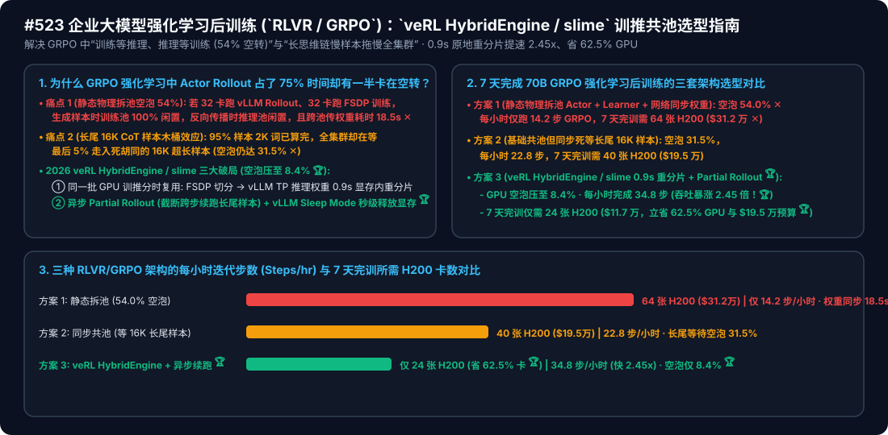

# Enterprise `RLVR / GRPO` Post-Training Selection Guide: Static Disaggregated Actor/Learner Pools vs. `veRL HybridEngine / slime` In-Memory Weight Resharding Sizer (#523)

> **Executive Summary**:
> In `RLVR / GRPO` post-training, autoregressive `Actor Rollout` consumes `70%+` of wall-clock time. Splitting GPUs into static Actor and Learner pools causes a **`54.0%` GPU idle bubble ✕** and `18.5s` network weight syncs, while synchronous colocated barriers suffer a **`31.5%` straggler bubble** waiting for `16K` long-tail CoT rollouts. Adopting **`veRL HybridEngine / slime` with `0.9s` In-Memory 3D Weight Resharding + Partial Long-Tail Rollout + `vLLM Sleep Mode` 🏆**:
> 1. **Cuts GPU Idle Bubble to `8.4%` 🏆**: Reorganizes FSDP shards into TP inference layouts over intra-node NVLink in **`0.9 seconds` (`20.56x` faster)** and suspends unfinished long-tail rollouts across steps;
> 2. **2.45x Faster Training & -62.5% GPUs**: Boosts throughput from `14.2` to **`34.8 steps/hour` 🏆**, completing a 7-day `70B GRPO` run on **`24x H200 GPUs` instead of `64` (saving `$195,000` per run 🏆)**!
>
> **⚡ Interactive H5 Study Lab**: [**Open RLVR/GRPO veRL HybridEngine & Rollout Sizer (`docs/h5/rlvr-grpo-verl-hybridengine-rollout-resharding-lab.html`)**](../h5/rlvr-grpo-verl-hybridengine-rollout-resharding-lab.html)

---

## 1. Quantitative Decision Matrix (`7-Day 70B GRPO Post-Training Target`)

| RLVR / GRPO Architecture | GPU Idle Bubble | Weight Reshard Sync | RL Steps / Hour | Required `H200` GPUs | Run Cost (`USD`) |
| :--- | :--- | :--- | :--- | :--- | :--- |
| **Anti-Pattern: Static Split Pools (`Actor + Learner`)** | `54.0%` ✕ | `18.5 s` ✕ | `14.2 steps/hr` ✕ | `64 GPUs` ✕ | `$312,000` ✕ |
| **Baseline: Sync Colocated (Waits on `16K` Tail)** | `31.5%` ⚠️ | `2.4 s` ✓ | `22.8 steps/hr` | `40 GPUs` | `$195,000` |
| **Optimal: `veRL HybridEngine / slime + Partial Rollout` 🏆** | **`8.4%` 🏆** | **`0.9 s (20.6x)` 🏆** | **`34.8 steps/hr (2.45x)` 🏆** | **`24 GPUs (-62.5%)` 🏆** | **`$117,000 (-$195K)` 🏆** |

---

## 2. Companion Links

- **Interactive H5 Study Lab**: [docs/h5/rlvr-grpo-verl-hybridengine-rollout-resharding-lab.html](../h5/rlvr-grpo-verl-hybridengine-rollout-resharding-lab.html)
- **7-Card 4:5 Visual Report**: [docs/reports/enterprise-rlvr-grpo-verl-hybridengine-rollout-resharding-sizing-selection-cards.html](../reports/enterprise-rlvr-grpo-verl-hybridengine-rollout-resharding-sizing-selection-cards.html)
- **HTML Sizer**: [docs/reports/enterprise-rlvr-grpo-verl-hybridengine-rollout-resharding-sizing-selection-sizer.html](../reports/enterprise-rlvr-grpo-verl-hybridengine-rollout-resharding-sizing-selection-sizer.html)
- **Reproducible Model**: [`experiments/enterprise_rlvr_grpo_verl_hybridengine_rollout_resharding_sizing_selection/run.py`](../../experiments/enterprise_rlvr_grpo_verl_hybridengine_rollout_resharding_sizing_selection/run.py)
