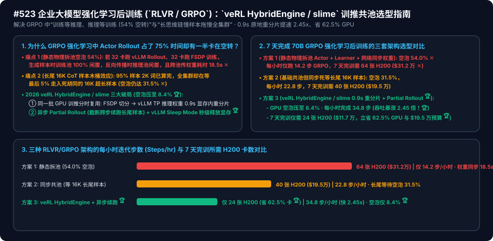

# 企业大模型强化学习后训练（`RLVR / GRPO`）训推共池架构选型：传统 `Actor/Learner` 静态物理拆池（`54%` 空泡）vs. `veRL HybridEngine / slime` 显存原地重分片（`0.9s Resharding` + 长尾样本截断续跑）算卡指南 (#523)

> **核心观点（Executive Summary）**：
> 企业使用可验证奖励强化学习（`RLVR / DeepSeek GRPO`）训练垂域代码、数学或工具调用大模型时，每个迭代步包含两大截然不同的阶段：**① `Actor Rollout`（自回归生成每题 8–16 条长思维链样本，占 70%+ 时间，显存带宽受限）** 与 **② `Learner Update`（FSDP2/Megatron 前反向传播更新权重，算力受限）**。本专题量化对比三套训推架构：
> 1. **淘汰静态物理拆池（`54.0%` GPU 空转 ✕）与同步死等 `16K` 长尾样本（`31.5%` 空转 ✕）**；
> 2. **采用 `veRL HybridEngine / slime` 训推共池 + `0.9s 3D 权重原地重分片` + `Partial Rollout 长尾跨步续跑` + `vLLM Sleep Mode` 🏆**：
>    - 同一批 GPU 在 Rollout 阶段将 FSDP 分片权重通过机内 NVLink `AllGather` 原地重组为 `vLLM / SGLang TP=4` 推理布局（耗时从跨网传输的 `18.5s` 压至 **`0.9s` 🏆**）；
>    - 当 `90%` 样本已完成生成时，将未完成的 `10%` 超长思维链样本挂起放入下一轮续跑，彻底消灭木桶等待，使 GPU 空泡从 `54.0%` 压至 **`8.4%` 🏆**，每小时迭代步数翻 **`2.45 倍`（`14.2 -> 34.8 steps/hr`）**，7 天完训所需 H200 从 `64 张` 降至 **`24 张`（立省 `62.5%` GPU 与 `$19.5 万` 成本 🏆）**！
>
> **⚡ 配套交互式 H5 精读沙盘**：[**打开 RLVR/GRPO 强化学习训推共池 (veRL HybridEngine) 算卡计算器 (`docs/h5/rlvr-grpo-verl-hybridengine-rollout-resharding-lab.html`)**](../h5/rlvr-grpo-verl-hybridengine-rollout-resharding-lab.html)

---

## 一、 灵魂拷问：为什么 `veRL HybridEngine` 能把权重切换从 18.5 秒压到 0.9 秒？

### Q1：训练态（`FSDP2 ZeRO-3`）与推理态（`vLLM/SGLang TP`）切换时，显存里发生了什么？
- **零磁盘/零 TCP 的显存内张量重排（In-Memory 3D Tensor Resharding）**：结合 **`vLLM Sleep Mode / SGLang Release-Memory`**，在进入训练步前一键释放推理 KV Cache 显存池（保留 CUDA 上下文），训练完成后在 `NVLink 900 GB/s` 域内直接将 FSDP 分片重组为 TP 推理权重，切换仅需 **`0.9 秒`**！

---

## 二、 70B 大模型 GRPO 强化学习后训练三套架构选型决策矩阵（`7 天完训目标`）

| RLVR / GRPO 训推架构方案 | GPU 空转气泡占比 | 权重同步/重分片耗时 | 每小时迭代步数 | 7天完训所需 `H200` | 单次完训总成本 |
| :--- | :--- | :--- | :--- | :--- | :--- |
| **反模式：静态物理拆池 (`Actor + Learner 分离`)** | `54.0%` ✕ | `18.5 s` ✕ | `14.2 步/h` ✕ | `64 张 H200` ✕ | `$312,000` ✕ |
| **基线：同池混跑但同步死等 `16K` 长尾样本** | `31.5%` ⚠️ | `2.4 s` ✓ | `22.8 步/h` | `40 张 H200` | `$195,000` |
| **最佳：`veRL HybridEngine / slime` + 长尾续跑 🏆** | **`8.4%` 🏆** | **`0.9 s (快20.6x)` 🏆** | **`34.8 步/h (2.45x)` 🏆** | **`24 张 H200 (-62.5%)` 🏆** | **`$117,000 (省$19.5万)` 🏆** |

---

## 三、 延伸阅读与配套工具

- **交互式 H5 精学沙盘**：[docs/h5/rlvr-grpo-verl-hybridengine-rollout-resharding-lab.html](../h5/rlvr-grpo-verl-hybridengine-rollout-resharding-lab.html)
- **7-Card 4:5 视觉评测卡片**：[docs/reports/enterprise-rlvr-grpo-verl-hybridengine-rollout-resharding-sizing-selection-cards.html](../reports/enterprise-rlvr-grpo-verl-hybridengine-rollout-resharding-sizing-selection-cards.html)
- **交互式 Sizer 测算器**：[docs/reports/enterprise-rlvr-grpo-verl-hybridengine-rollout-resharding-sizing-selection-sizer.html](../reports/enterprise-rlvr-grpo-verl-hybridengine-rollout-resharding-sizing-selection-sizer.html)
- **可复现实验模型**：[`experiments/enterprise_rlvr_grpo_verl_hybridengine_rollout_resharding_sizing_selection/run.py`](../../experiments/enterprise_rlvr_grpo_verl_hybridengine_rollout_resharding_sizing_selection/run.py)
