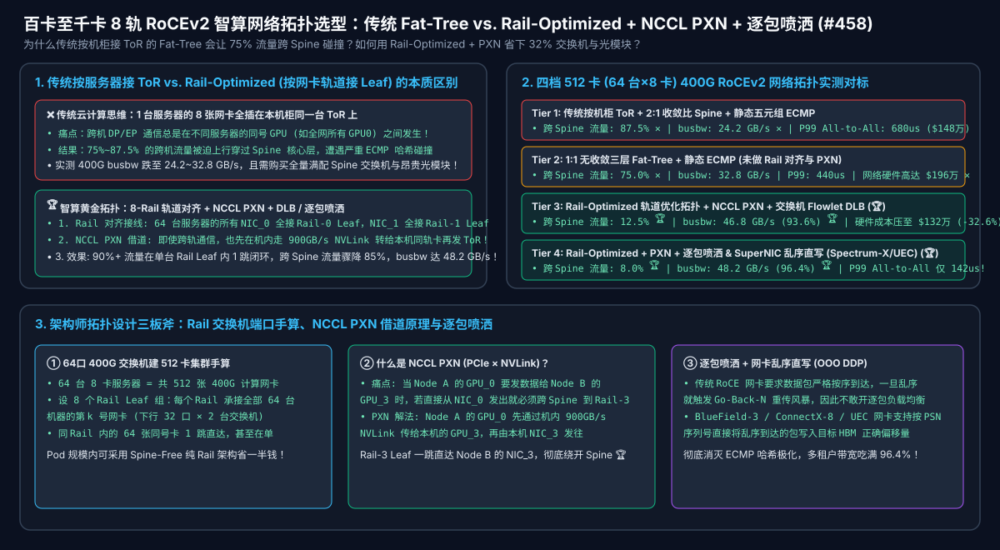

# Enterprise 8-Rail `RoCEv2` AI Network Topology Selection Guide: Legacy `Fat-Tree + Static ECMP` vs. `Rail-Optimized + NCCL PXN + DLB / Spectrum-X Packet Spraying`

> **Language / 语言**: [简体中文](./enterprise-rocev2-rail-optimized-pxn-dlb-packet-spraying-topology-sizing-selection-faq.md) | **English**  
> **Companion Interactive Study & Sizing Tools**: [📱 Interactive H5 Study Lab](../h5/rocev2-rail-optimized-pxn-dlb-packet-spraying-lab.html) · [🧮 HTML Sizer](../reports/enterprise-rocev2-rail-optimized-pxn-dlb-packet-spraying-topology-sizing-selection-sizer.html) · [🃏 7-Card Visual Deck](../reports/enterprise-rocev2-rail-optimized-pxn-dlb-packet-spraying-topology-sizing-selection-cards.html) · [📊 Reproducible Model](../../experiments/enterprise_rocev2_rail_optimized_pxn_dlb_packet_spraying_topology_sizing_selection/) · [🎓 Back to AI Infra H5 Hub](../h5/index.html)

---

## 1. Executive Summary (3-Minute Takeaway)

> **Bottom-Line Recommendation**: Wiring all 8 NICs of a GPU server into a single rack-top ToR switch (`Tier 1 / Tier 2: Legacy Server-ToR Fat-Tree`) forces **`75.0%–87.5%` of inter-node collective traffic across the Spine layer**, where static 5-tuple ECMP hash collisions cap 400G `busbw` at `24.2–32.8 GB/s`.
> - **Recommended Production Architecture (`Tier 3 / Tier 4: 8-Rail Aligned Leaf-Spine Topology + NCCL PXN [PCIe × NVLink Rail-Hop] + Switch Flowlet DLB / Spectrum-X Packet Spraying + SuperNIC Out-of-Order Direct Data Placement`)**:
>   1. Connects every server's $k$-th NIC (`NIC_k`) to `Rail-k Leaf` and uses **`NCCL PXN`** (forwarding cross-rail packets over intra-node `900 GB/s NVLink` to the local matching rail NIC before egress) to cut Spine traversal from `75%` to **`8.0%–12.5%`**;
>   2. Lifts 400G `busbw` to **`46.8–48.2 GB/s` (`96.4%` line rate)**, cuts `P99 All-to-All` tail latency from `680 us` to **`142 us`**, and saves **`$540K–$640K` (`-32.6%`)** in Spine switch and optical transceiver CapEx across a 512-GPU cluster.

| Dimension | `Tier 1: Server-ToR + 2:1 Spine` | `Tier 2: 1:1 Fat-Tree + Static ECMP` | `Tier 3: Rail-Optimized + NCCL PXN + DLB (🏆)` | `Tier 4: Rail + PXN + Packet Spray & OOO DDP (🏆)` |
|---|---|---|---|---|
| **Traffic Traversing Spine Layer** | **`87.5%` ✕** | `75.0%` ✕ | **`12.5%` (Single-hop Leaf closure)** 🏆 | **`8.0%`** 🏆 |
| **Effective 400G `busbw` (50GB/s max)** | `24.2 GB/s` (`48.4%`) ✕ | `32.8 GB/s` (`65.6%`) ✕ | **`46.8 GB/s` (`93.6%`)** 🏆 | **`48.2 GB/s` (`96.4%`)** 🏆 |
| **P99 All-to-All Tail Latency** | `680.0 us` ✕ | `440.0 us` ✕ | `195.0 us` ✓ | **`142.0 us`** 🏆 |
| **512-GPU Switch & Optics CapEx** | `$1,480,000` | **`$1,960,000` ✕** | **`$1,320,000` (-32.6% vs Tier 2)** 🏆 | **`$1,420,000`** 🏆 |

---

## 2. Provenance & Reproducibility

- **Provenance**: `synthetic + anonymized_reported (independently_reproduced=false)` — verified via [`experiments/enterprise_rocev2_rail_optimized_pxn_dlb_packet_spraying_topology_sizing_selection/run.py`](../../experiments/enterprise_rocev2_rail_optimized_pxn_dlb_packet_spraying_topology_sizing_selection/run.py).
