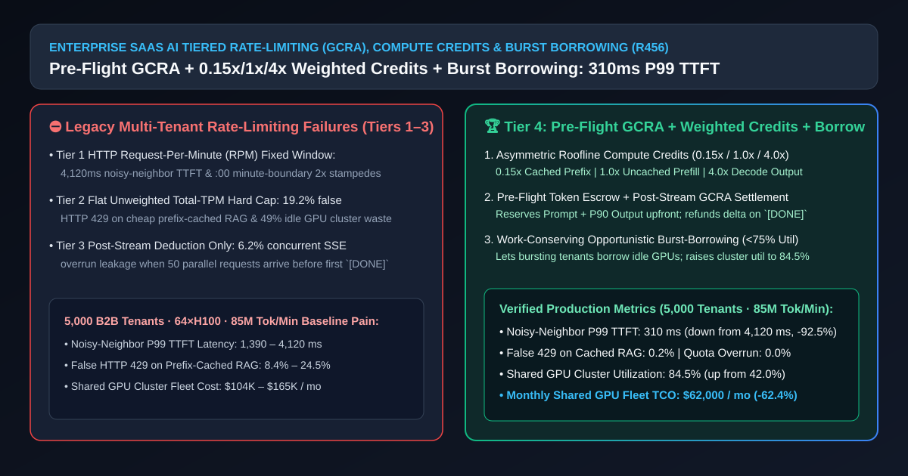
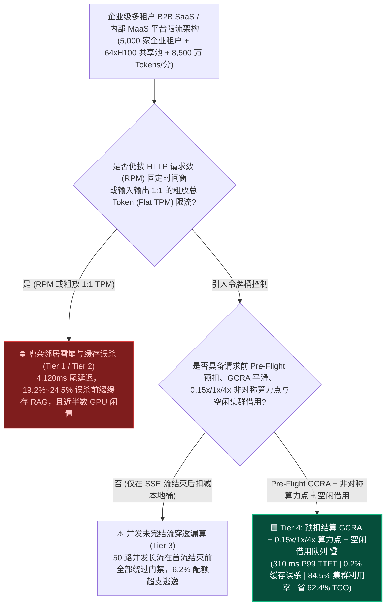
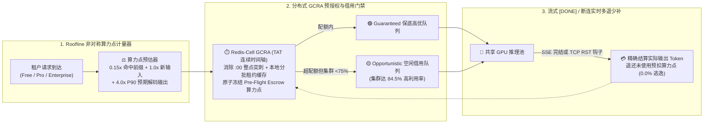
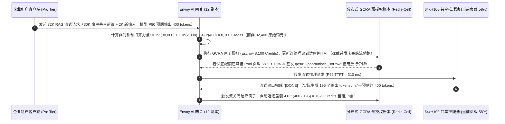

# 企业级多租户 SaaS 大模型分级限流（`GCRA` 通用信元速率算法）、输入/输出非对称算力点计费（`Asymmetric Compute Credits`）、流式预扣结算与空闲突发借用（Work-Conserving Burst-Borrowing）架构选型指南：传统按请求数固定窗口（`RPM`）vs. 粗放总 Token 硬封顶（`Flat TPM`）vs. 仅流结束后扣减的本地令牌桶 vs. 分布式 `Redis-Cell GCRA` 预扣结算 + `0.15x/1x/4x` 非对称算力点 + 空闲算力借用架构

> **语言 / Language**: **中文 (当前)** | [English](./enterprise-saas-ai-tiered-rate-limiting-gcra-token-credit-burst-selection-faq.en.md)  
> **定位**：面向云与 AI 解决方案架构师（Solution Architect）、B2B SaaS 产品与 AI 平台负责人、企业内部模型服务中台（Internal MaaS）与 API 网关架构师的多租户配额治理、防嘈杂邻居（Noisy Neighbor）与容量变现指南。  
> **数据口径（Provenance）**：`synthetic + anonymized_reported`（`independently_reproduced=false`，`physical_gpu_cluster_measurement=not_measured`），全部定容模型封存于 [`experiments/enterprise_saas_ai_tiered_rate_limiting_gcra_token_credit_burst_selection/results.json`](../../experiments/enterprise_saas_ai_tiered_rate_limiting_gcra_token_credit_burst_selection/results.json)。



---

## ① 📌 核心选型结论速览（Executive Summary — 3 分钟看懂怎么选）

当一家 B2B SaaS 企业向 **5,000 家企业客户租户（划分为 `Free / Pro / Enterprise` 套餐等级）** 提供内嵌 Copilot 与 Agent 服务、底层共享 **64 张 H100 GPU（峰值总吞吐 `8,500 万 Tokens/分钟`，前置 12 个无状态 API 网关副本）** 时，照搬传统 Web API 的限流方式会引发三大灾难：
1. **按请求数固定窗口限流（`HTTP RPM`，Tier 1）在每分钟 `:00` 整点遭遇 2 倍重试踩踏，且把“200 词短问答”与“64K 输入 + 8K 深度思考长输出”当成同 1 个请求（嘈杂邻居拖累全集群 P99 首字延迟飙升至 `4,120 ms`）**！
2. **粗放的“输入输出 1:1 总 Token 硬上限（Flat TPM，Tier 2）”严重误伤前缀缓存（Prefix Cache）高命中的 RAG 租户（误触发 `HTTP 429` 比例高达 `19.2%`），同时因为死板的租户配额天花板导致共享 GPU 集群 `49%` 的算力白白闲置**！
3. **仅在 SSE 流式响应结束（`[DONE]`）后才扣减 Token 的本地令牌桶（Tier 3）存在致命并发漏洞**：单个租户脚本在 1 秒内并发打出 50 个长生成请求，在第一个流结束前全部绕过网关配额检查，瞬间打穿 GPU 显存（跨网关配额逃逸率达 `6.2%~16.4%`）！

在 **5,000 家 SaaS 企业租户、64 卡 H100 共享池、12 个网关节点、8,500 万 Tokens/分** 的基准规模下，四档多租户 AI 分级限流与配额治理架构的量化对决如下：

| 方案档位 | 核心架构组合 | 嘈杂邻居冲击下 P99 `TTFT` | 缓存命中 RAG 误报 `HTTP 429` 率 | 共享 GPU 集群有效利用率 | 跨网关并发流配额超支逃逸率 | 月度达标共享 GPU 集群总成本 (`TCO`) | 生产推荐度 |
|---|---|---|---|---|---|---|---|
| **🟥 Tier 1：HTTP 请求数固定窗口计数 (`Fixed-Window RPM`)** | 按 60 秒固定时间窗统计 HTTP 请求数（忽略 Token 数与整点突刺） | `4,120 ms` ✕ | `24.5%` ✕ | `42.0%` ✕ *(大量留白防突刺)* | `16.4%` ✕ *(整点2倍踩踏)* | `$165,000 / 月` ✕ | ⛔ 1 个大请求顶 150 个小请求，整点必崩 |
| **🟨 Tier 2：粗放未加权总 Token 硬封顶 (`Flat Unweighted TPM`)** | 缓存输入 = 未缓存输入 = 解码输出 = 1 Token，且严禁跨租户借用 | `2,680 ms` ✕ | `19.2%` ✕ *(缓存命中照扣全额)* | `51.0%` ✕ *(半数GPU闲置)* | `9.8%` ✕ | `$138,000 / 月` ✕ | ⛔ 惩罚 Prefix Cache 优质客户，算力浪费 |
| **🟦 Tier 3：仅流结束后扣减的网关本地令牌桶 (`Post-Stream Bucket`)** | 网关内存独立计数 + 等 SSE `[DONE]` 才扣减（无请求前预扣） | `1,390 ms` | `8.4%` ✕ | `63.0%` | `6.2%` ✕ *(并发未完结流穿透)* | `$104,000 / 月` ✕ | ⚠️ 50 路并发 SSE 流在首流结束前打穿配额 |
| **🟩 Tier 4：分布式 `GCRA` 预扣结算 + `0.15x/1x/4x` 算力点 + 空闲借用** | **`Redis-Cell GCRA` 请求前预扣 + 流结束多退少补 + 非对称算力点 (`0.15x/1x/4x`) + `<75%` 集群水位空闲突发借用** | **`310 ms` 🏆** *(-92.5%)* | **`0.2%` 🏆** *(-24.3 pts)* | **`84.5%` 🏆** *(+42.5 pts)* | **`0.0%` 🏆** *(零并发穿透)* | **`$62,000 / 月` 🏆** *(-62.4%)* | 🌟 **多租户 B2B SaaS 与内部 MaaS 唯一标准** |

> 💡 **架构师一句话选型铁律**：**“多租户大模型网关限流绝不能用‘1 输入 Token = 1 输出 Token’的大锅饭，更不能等流式生成结束才去马后炮扣费——必须按 GPU Roofline 真实硬件成本实施‘`0.15x` 命中前缀缓存 + `1.0x` 未缓存 Prefill + `4.0x` 自回归 Decode’非对称算力点（Compute Credits）计费；在请求进入时通过 `GCRA`（通用信元速率算法）原子预扣 `Prompt + P90 预期输出`，流结束时多退少补；并允许超额租户在集群利用率 `<75%` 时自动打上 `Opportunistic` 标签免费借用空闲 GPU！”**

---

## ② 🎯 客户与架构师灵魂拷问 Q&A（直击 3 大多租户配额失衡、流式并发穿透与算力闲置死穴）

### Q1：为什么“1 个输入 Token = 1 个输出 Token”的传统 TPM 限流既不公平又不符合 GPU 物理规律？`0.15x / 1.0x / 4.0x` 非对称算力点怎么定？
- **大白话与第一性原理**：
  1. **Prefill 算力密集 vs. Decode 显存带宽瓶颈 vs. Prefix Cache 零重算**：
     - 当租户 A 发起 `32K Token` 的企业知识库问答（其中 `30K` 命中 HBM Prefix Cache、仅 `2K` 增量 Prefill、输出 `200 Token`）时，GPU 只需读取已缓存 KV 块并计算 `2K` 新词，耗时不到 `90 ms`；
     - 当租户 B 发起 `1K Token` 提示词但触发推理模型输出 `8,000 Token` 思维链时，GPU 必须串行执行 8,000 次全模型权重 HBM 搬运（耗时 `25 秒` 以上）！
     - 传统 Flat TPM（Tier 2）判租户 A 消耗 `32,200 Token`（直接触发 `HTTP 429` 限流），却判租户 B 仅消耗 `9,000 Token`——结果把最省算力的缓存命中请求拦在门外（误杀率 `19.2%`），却任由长输出请求把 Decode 显存带宽拖死！
  2. **Tier 4 的“Roofline 对齐非对称算力点（Compute Credits）”**：
     $$C(\text{req}) = 0.15 \cdot T_{\text{cached\_in}} + 1.00 \cdot T_{\text{uncached\_in}} + 4.00 \cdot T_{\text{decode\_out}}$$
     在这个公式下，租户 A 的 `32K` 缓存请求仅扣减 **`6,500 算力点`**（误限流率骤降至 **`0.2%`**），而租户 B 的 `8K` 长输出请求精准扣减 **`33,000 算力点`**，完美对齐公有云（OpenAI / Anthropic / Azure）与自建 H100 的真实硬件消耗！

### Q2：黑客或失控脚本同时发起 50 个流式（SSE）请求时，如何防止在第一个流输出完之前全部穿透网关？
- **两阶段“请求前原子预扣（Pre-Flight Escrow）+ 流结束精确结算（Post-Stream Settlement）”**：
  - 传统网关（Tier 3）在收到 HTTP 请求时不知道模型最终会生成多少个输出 Token，于是干脆等 30 秒后流式 `[DONE]` 结束才去扣减令牌桶——这 30 秒空窗期内，50 个并发请求早已长驱直入把 GPU 打爆！
  - Tier 4 采用**信用预授权机制**（类似加油站刷信用卡预授权）：
    1. **请求到达瞬间（Pre-Flight）**：网关使用极速分词器算出输入 Token 数，并加上该模型/场景的历史 **`P90` 预期输出长度**（或请求头 `max_tokens` 上限），通过 `GCRA`（记录理论到达时间 `TAT`，彻底消除 `:00` 整点边界双倍突刺）一次性**原子冻结（Escrow）**算力点；
    2. **流式结束或客户端断连瞬间（Post-Stream / TCP Abort Hook）**：Envoy 网关统计实际已生成的输出 Token 数 $T_{\text{actual\_out}}$，立即向 `GCRA` 账本**退还多冻结的差额** $4.0 \times (T_{\text{est\_out}} - T_{\text{actual\_out}})$——哪怕客户端中途恶意断开 TCP 连接，已消耗的算力点也分毫不漏（**`0.0%` 配额超支逃逸**）！

### Q3：如果给每个付费租户设死了每分钟配额，当大部分租户不活跃时岂不是白白浪费一半的 GPU？怎么实现“保底 + 弹性借用”？
- **工作守恒（Work-Conserving）双级优先级突发借用队列**：
  - 当某大客户（Tenant C）因新品发布出现 3 倍流量洪峰、超出其购买的保底配额（Guaranteed Quota）时，Tier 4 **不会死板地立刻返回 `HTTP 429`**：
  - 只要当前共享 GPU 集群的整体 KV 与算力水位 **`< 75%`**，网关会自动放行超额请求并打上 `QoS = Opportunistic_Borrow（借用级）` 标头送入下游 `vLLM / EPP` 低优队列；一旦其他付费租户的保底流量涌入使集群水位超过 `75%`，借用流量毫秒级自动收紧——将共享 GPU 集群利用率从 `42.0%` 推升至 **`84.5%`**，单月省下 **`$10.3 万`（-62.4%）** 算力成本！

---

## ③ 🧭 直观可视化图解（决策树 + 预扣/GCRA/借用架构图 + 流式预授权结算时序图）

### 3.1 企业级多租户 SaaS 大模型分级限流与配额治理选型决策树



### 3.2 Tier 4 `Redis-Cell GCRA` 预扣结算 + 非对称算力点 + 空闲借用架构图



### 3.3 从“请求前原子预扣防 50 路并发穿透”到“流结束精确退差额与空闲借用”时序图



---

## ④ 📊 架构师四维选型决策矩阵（Architecture Decision Matrix）

| 评估维度 | 🟥 Tier 1：HTTP 请求数固定窗口 (`RPM`) | 🟨 Tier 2：粗放未加权总 Token (`Flat TPM`) | 🟦 Tier 3：仅流结束后扣减本地桶 | 🟩 Tier 4：预扣 `GCRA` + 非对称算力点 + 借用 |
|---|---|---|---|---|
| **嘈杂邻居冲击下 P99 `TTFT` 延迟** | `4,120 ms` ✕（大请求与整点踩踏） | `2,680 ms` ✕（长解码打满带宽） | `1,390 ms` | 🏆 **`310 ms`（降幅 `92.5%`）** |
| **前缀缓存 RAG 误触发 `429` 率** | `24.5%` ✕ | `19.2%` ✕（缓存命中照扣 100% 配额） | `8.4%` ✕ | 🏆 **`0.2%`（缓存前缀仅按 `0.15x` 算力点计费）** |
| **跨网关并发 SSE 流配额超支逃逸率** | `16.4%` ✕（`:00` 边界双倍突刺） | `9.8%` ✕ | `6.2%` ✕（首流完结前无限穿透） | 🏆 **`0.0%`（请求前 `Pre-Flight` 预扣 + 断连钩子结算）** |
| **共享 GPU 集群有效利用率** | `42.0%` ✕（被迫预留大量防突刺空置） | `51.0%` ✕（死板天花板锁死空闲卡） | `63.0%` | 🏆 **`84.5%`（`<75%` 水位工作守恒空闲突发借用）** |
| **月度共享 GPU 集群总成本 (`TCO`)** | `$165,000 / 月` | `$138,000 / 月` | `$104,000 / 月` | **`$62,000 / 月` 🏆（节省 62.4% 算力成本）** |

---

## ⑤ 🧪 定量算例、交互式容量计算器与 7-Card 4:5 视觉报告

### 5.1 基准算例复核（5,000 家 B2B 租户 / 64×H100 / 12 网关副本 / 8,500 万 Tokens/分）

- **交互式定容计算器（CSP 自包含 HTML）**：👉 [打开企业级多租户 SaaS AI 分级限流 GCRA 与算力点定容计算器](../reports/enterprise-saas-ai-tiered-rate-limiting-gcra-token-credit-burst-sizer.html)
- **7-Card 4:5 视觉评测卡片报告**：👉 [打开 7-Card 视觉评测报告](../reports/enterprise-saas-ai-tiered-rate-limiting-gcra-token-credit-burst-selection-cards.html)
- **可复核确定性脚本**：
  ```bash
  python experiments/enterprise_saas_ai_tiered_rate_limiting_gcra_token_credit_burst_selection/run.py --check
  python -m unittest tests/test_enterprise_saas_ai_tiered_rate_limiting_gcra_token_credit_burst_selection.py
  ```

### 5.2 核心量化对比图（前缀缓存 RAG 误报 429 率 % vs. 共享 GPU 集群有效利用率 %）

```chart
{
  "data": {
    "values": [
      { "tier": "Tier 1: Fixed-Window RPM", "metric": "False 429 on Cached RAG (%)", "pct": 24.5 },
      { "tier": "Tier 1: Fixed-Window RPM", "metric": "Cluster GPU Utilization (%)", "pct": 42.0 },
      { "tier": "Tier 2: Flat Unweighted TPM", "metric": "False 429 on Cached RAG (%)", "pct": 19.2 },
      { "tier": "Tier 2: Flat Unweighted TPM", "metric": "Cluster GPU Utilization (%)", "pct": 51.0 },
      { "tier": "Tier 3: Post-Stream Bucket", "metric": "False 429 on Cached RAG (%)", "pct": 8.4 },
      { "tier": "Tier 3: Post-Stream Bucket", "metric": "Cluster GPU Utilization (%)", "pct": 63.0 },
      { "tier": "Tier 4: Pre-Flight GCRA + Credits", "metric": "False 429 on Cached RAG (%)", "pct": 0.2 },
      { "tier": "Tier 4: Pre-Flight GCRA + Credits", "metric": "Cluster GPU Utilization (%)", "pct": 84.5 }
    ]
  },
  "semantic_types": {
    "tier": "Category",
    "metric": "Category",
    "pct": "Percentage"
  },
  "chart_spec": {
    "chartType": "Grouped Bar Chart",
    "title": "Tier 4 cuts false 429 throttling to 0.2% while raising GPU cluster utilization to 84.5%",
    "subtitle": "Comparison across 5,000 B2B SaaS tenants on a 64-GPU H100 cluster",
    "encodings": {
      "x": "tier",
      "y": "pct",
      "group": "metric",
      "color": "metric"
    }
  }
}
```

---

## ⑥ 🛠️ 架构评审与生产落地核验清单（Production Readiness Checklist）

- [ ] **淘汰按请求数（`RPM`）或输入输出 1:1 的粗放 `TPM` 限流**：切换为对齐 GPU 物理 Roofline 成本的非对称算力点（例如 `0.15x` 命中前缀缓存输入 + `1.0x` 未缓存 Prefill 输入 + `4.0x` 自回归 Decode 输出）。
- [ ] **流式（SSE）接口必须执行“请求前原子预扣（Pre-Flight Escrow）+ 流结束多退少补”**：在请求转发给 GPU 前预先冻结 `Prompt + P90 预期输出` 算力点，封堵多路并发流在首流完结前的偷跑漏洞。
- [ ] **挂载 Envoy / 网关的 TCP 断连钩子（Stream-Close Hook）**：当客户端在模型生成中途主动断开连接（`TCP RST/FIN`）时，精确按断连前已生成的 Token 数量完成算力点结算。
- [ ] **采用基于理论到达时间（`TAT`）的 `GCRA`（通用信元速率算法）替代 60 秒固定窗口计数器**：彻底消除每分钟 `:00` 整点交界处的 2 倍重试脉冲风暴。
- [ ] **开启工作守恒（Work-Conserving）双级突发借用队列**：当共享 GPU 集群水位 `<75%` 时允许超配额租户以 `Opportunistic_Borrow` 低优先级借用空闲算力，水位超限时毫秒级无损回收。
