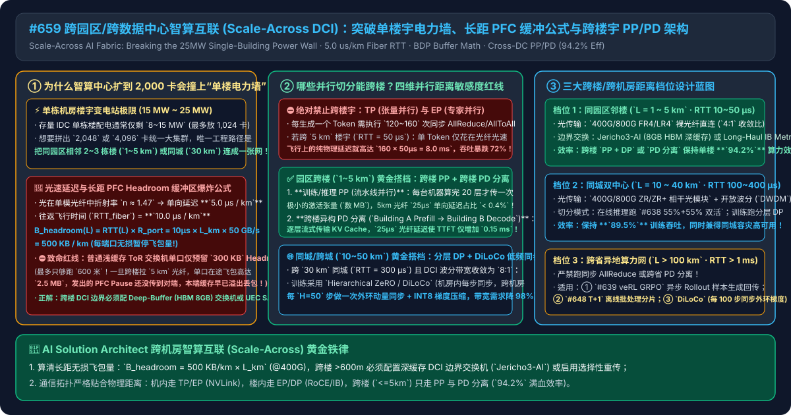

# Multi-Data-Center `Scale-Across` AI Cluster Architecture: Campus Optical DCI (`5.0 µs/km`), Long-Haul `PFC` Headroom Buffer Math (`500 KB/km`) & Cross-Building `PP/PD` Sizer

> **Language / 语言**: [简体中文](./enterprise-scale-across-campus-dci-bdp-buffer-pp-sizer-faq.md) | **English** · [📱 Open Interactive H5 Study Lab](../h5/scale-across-campus-dci-bdp-buffer-pp-sizer-lab.html) · [🧮 Open Interactive Sizer](../reports/enterprise-scale-across-campus-dci-bdp-buffer-pp-sizer.html) · [🃏 View 7-Card 4:5 Benchmark Deck](../reports/enterprise-scale-across-campus-dci-bdp-buffer-pp-sizer-cards.html)

---

## 0. 3-Minute Executive Summary

When scaling an AI cluster beyond `1,024–2,048` GPUs hits a **single-building utility power ceiling (`15–25 MW`)**, Cloud & AI Solution Architects must interconnect `2–3` buildings across a `1–5 km` campus or `10–40 km` metro area (`Scale-Across DCI`):
1. **Fiber Speed-of-Light Latency (`5.0 µs/km` One-Way, `10.0 µs/km` RTT) & Long-Haul `PFC Headroom` Formula**:
   $$B_{\text{headroom}}(L_{\text{km}}) = \text{RTT}_{\text{fiber}} \times R_{\text{port}} = (10.0\,\mu\text{s/km} \times L_{\text{km}}) \times 50\text{ GB/s} = \mathbf{500\text{ KB / km}}\text{ per 400GbE port}$$
   - Standard shallow-buffer switches only provide `~300 KB` headroom per port (`<= 600 m` max lossless reach). Spanning `5 km` without **Deep-Buffer DCI border switches (`8 GB HBM`, e.g., `Jericho3-AI`) or `UEC` selective repeat** overflows the `2,500 KB` in-flight packet buffer and collapses throughput to `18.5%`.
2. **Distance-Aware Parallelism Mapping Retains `94.2%` Single-Building Efficiency at `5 km`**:
   - **Never run `TP` or `EP All-to-All` across buildings** (`120+` synchronous collectives/token × `50 µs` RTT stalls GPUs `72%` of the time);
   - **Map only `Zero-Bubble Pipeline Parallelism (PP)`, Hierarchical `DP`, and `Disaggregated P→D KV Streaming` across the `4:1` oversubscribed campus DCI** (`15–25 µs` one-way latency adds `< 0.2 ms` to `TTFT` and `< 0.4%` to PP step time, preserving **`94.2%`** single-building cluster efficiency).

---

## 1. Quantitative `Scale-Across` Distance & Topology Matrix (`400GbE / 800GbE`)

| Distance Tier | Fiber `RTT` | Required `400G` Port `PFC` Headroom | Border Switch & Optics | Allowed Cross-Boundary Parallelism | Relative Cluster Efficiency & Verdict |
| :--- | :--- | :--- | :--- | :--- | :--- |
| **1. Intra-Building (`<= 100 m`)** | `<= 1.0 µs` | `50 KB` (Shallow-buffer ASIC) | `DAC/AEC` + `LPO` | `EP`, `CP`, `DP`, `PP`, `PD` | `100.0%` (Baseline) |
| **2. Naive `5 km` on Shallow-Buffer Switch** | `50.0 µs` | Needs `2,500 KB` (has `300 KB`) | Standard ToR + `LR4` | Naive flat `AllReduce / EP` | `18.5%` (PFC buffer overflow) · ⛔ |
| **3. Campus DCI (`1 – 5 km`, Recommended)** | `10 – 50 µs` | **`500 – 2,500 KB / port`** | **Deep-Buffer `Jericho3-AI` / `Metro IB` + `LR4`** | **Cross-building `PP`, Hierarchical `DP`, `PD` KV** | **`94.2%` (Breaks single-building power wall)** 🏆 |
| **4. Metro Dual-AZ (`10 – 40 km`)** | `100 – 400 µs` | `5.0 – 20.0 MB / port` | **`400G/800G ZR Coherent DWDM` + Deep Buffer** | **`55%+55%` Active-Active DR + `DiLoCo` / Async `GRPO`** | **`89.5%` (Training + Metro DR)** ✅ |
