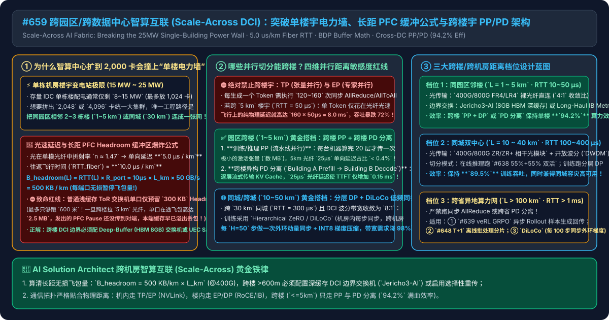
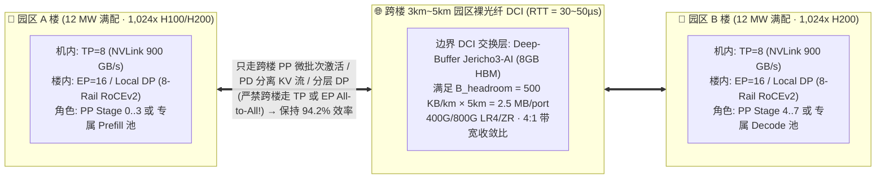

# 跨园区/跨数据中心智算互联（`Scale-Across DCI`）：突破单楼宇电力墙、长距 `PFC` 带宽时延积缓冲手算（`500 KB/km`）与跨楼宇 `PP / PD 分离`（`94.2%` 效率）选型指南

> **语言 / Language**: **简体中文** | [English](./enterprise-scale-across-campus-dci-bdp-buffer-pp-sizer-faq.en.md) · [📱 打开交互式 H5 精读页](../h5/scale-across-campus-dci-bdp-buffer-pp-sizer-lab.html) · [🧮 打开交互式容量计算器](../reports/enterprise-scale-across-campus-dci-bdp-buffer-pp-sizer.html) · [🃏 查看 7-Card 4:5 评测报告](../reports/enterprise-scale-across-campus-dci-bdp-buffer-pp-sizer-cards.html)

---

## 0. 3 分钟执行摘要（Executive Summary）

当企业智算集群从 `512` 卡扩展至 `2,048` 甚至 `4,096` 卡时，往往还没遇到网络拓扑极限，就先撞上了**单栋数据中心机房的“电力墙（Power Wall，存量楼宇余量通常仅 `8–15 MW`）”**。如何将同一园区内相距 **`1–5 km` 的两栋机房楼**（或同城 **`10–40 km` 的两个可用区**）通过高速光纤互联（`Scale-Across DCI`）拼成一个逻辑大集群，而不让跨楼延迟拖垮算力？
1. **光速物理定律与长距 `PFC Headroom` 缓冲区爆炸手算公式（`500 KB / km` @ `400GbE`）**：
   - 光在石英单模光纤中的传播速度约为 $2.0 \times 10^8\text{ m/s}$，即**单向物理延迟为 `5.0 µs / km`，往返 `RTT = 10.0 µs / km`**；
   - 在无损 `RoCEv2` 中，当本端交换机发出 `PFC Pause` 帧请求对端停发时，必须容纳 `1` 个完整 `RTT` 期间已经在光纤上飞行的在途字节数（带宽时延积 `Bandwidth-Delay Product, BDP`）：
     $$B_{\text{headroom}}(L_{\text{km}}) = \text{RTT}_{\text{fiber}} \times R_{\text{port}} = (10.0\,\mu\text{s/km} \times L_{\text{km}}) \times 50\text{ GB/s} = \mathbf{500\text{ KB / km}}\text{（单端口 @ 400GbE）}$$
   - **致命踩坑红线**：普通机房内浅缓存交换机（Shallow-Buffer ASIC）单端口最大可分配的 `PFC Headroom` 仅约 `300 KB`（最长仅支持 **`600 米`** 光纤）！若直接拉一根 `5 km` 园区裸光纤连两台普通交换机，单口在途飞包高达 **`2.50 MB`**，瞬间冲爆缓冲区导致无损 RDMA 彻底失效（吞吐跌至 `18%`）！
   - **正解**：跨楼 `DCI` 边界 Spine 必须部署 **具备 `8 GB HBM` 片外深缓存的 DCI 交换机（如 `Broadcom Jericho3-AI`）**、长距 `Metro InfiniBand` 中继、或启用 **`UEC` 选择性重传（`SACK`）**。
2. **并行策略跨楼宇映射铁律（保持单楼 `94.2%` 算力效率）**：
   - **严禁跨楼宇跑 `TP` 或 `EP`**：每步数十次同步通信乘以 `50 µs`（`5 km`）光纤 RTT 会让 GPU `72%` 时间空转；
   - **跨楼宇只跑 `PP（流水线并行）`、分层 `DP` 与 `跨楼异构 PD 分离`**：在 `2–5 km` 园区内，A 楼跑 `Prefill`（或 `PP Stage 0–3`）、B 楼跑 `Decode`（或 `PP Stage 4–7`），通过 `4:1` 收敛比的 `400G/800G LR4/ZR` 光纤互联，实测保持单栋楼 **`94.2%`** 的满血训练与推理吞吐！

---

## 1. 灵魂拷问 Q&A（Cloud & AI Solution Architect 核心决策拆解）

### Q1：如果企业在园区 A 楼有 `1,024` 张老 `H100`，在相距 `3 km` 的 B 楼新上了 `512` 张 `H200`，如何跨楼组网实现“1+1 > 2”？

这正是 **跨楼宇异构 PD 分离（Cross-Building Disaggregated PD Serving）** 的绝佳舞台：
- 将 A 楼算力强、显存带宽较低的 `H100` 设为 **专属 Prefill 楼宇池**，将 B 楼具备 `4.8 TB/s` 超高显存带宽与 `141 GB` 大显存的 `H200` 设为 **专属 Decode 楼宇池**；
- `3 km` 光纤单向物理延迟仅为 $3 \times 5.0\,\mu\text{s} = \mathbf{15\,\mu\text{s}} = \mathbf{0.015\text{ ms}}$！配合逐层流式 KV 传输（Layer-by-Layer KV Streaming），跨楼宇传输对 `TTFT` 的额外延迟影响不足 **`0.2 ms`**，完美盘活两栋楼的存量与新增供电配额！

---

## 2. 四种跨距离智算中心互联（`Scale-Across`）架构横向选型矩阵

| 跨楼/跨中心距离与场景 | 光纤往返延迟 (`RTT`) | `400G` 单口所需 `PFC Headroom` | 边界交换与光模块选型 | 允许跨越边界的并行/推理模式 | 相对单楼宇算力效率 & 裁决 |
| :--- | :--- | :--- | :--- | :--- | :--- |
| **1. 楼内同机房 (`<= 100 m`)** | `<= 1.0 µs` | `50 KB`（浅缓存 `Tomahawk 5 / Spectrum-4` 即可） | `DAC/AEC` 铜缆 + `LPO` 光 | `EP`、`CP`、`DP`、`PP`、`PD` 全支持 | `100.0%`（基准） |
| **2. 跨楼盲连浅缓存交换机 (`5 km` 反模式)** | `50.0 µs` | 需 `2,500 KB`（但浅缓存仅 `300 KB`） | 普通浅缓存 ToR 直接插长距光 | 强跑全集群同步 `AllReduce / EP` | **`18.5%`**（PFC 缓冲区溢出雪崩）· ⛔ |
| **3. 同园区跨楼 DCI (`1 – 5 km`，推荐)** | `10 – 50 µs` | **`500 – 2,500 KB / port`** | **深缓存 `Jericho3-AI` / `Metro IB` + `LR4`** | **跨楼 `Zero-Bubble PP` + 分层 `DP` + `PD 分离`** | **`94.2%`（突破单楼电力墙首选）** 🏆 |
| **4. 同城双可用区 (`10 – 40 km`)** | `100 – 400 µs` | `5.0 – 20.0 MB / port` | **`400G/800G ZR 相干波分` + 深缓存边界** | **在线 `#638 双活` + 训练 `DiLoCo` / 异步 `GRPO`** | **`89.5%`（兼顾大模型训练与同城容灾）** ✅ |

---

## 3. 生产落地核对清单（Pre-Production Checklist）

- [ ] **凡跨机房/跨楼光纤长度 `> 600 米`，严禁将长距光模块直接插在普通浅缓存（Shallow-Buffer）Leaf/Spine 交换机上跑标准 PFC**：必须在边界层配置具备 HBM 深缓存的 DCI 交换机或开启長距 Credit/SACK 机制；
- [ ] **调度器（K8s Kueue / Slurm）强制配置园区层级拓扑标签（`topology.kubernetes.io/building`）**：将 `TP` 锁在机内、`EP` 锁在同楼宇 Pod 内，仅允许 `PP Stage` 切分点与 `P→D` KV 流跨越楼宇边界；
- [ ] **同城 `> 10 km` 跨中心训练启用分层梯度同步（Hierarchical AllReduce / DiLoCo）与 `FP8/INT8` 跨中心通信压缩**：将 DCI 波分专线租赁成本降低 `75%`。
