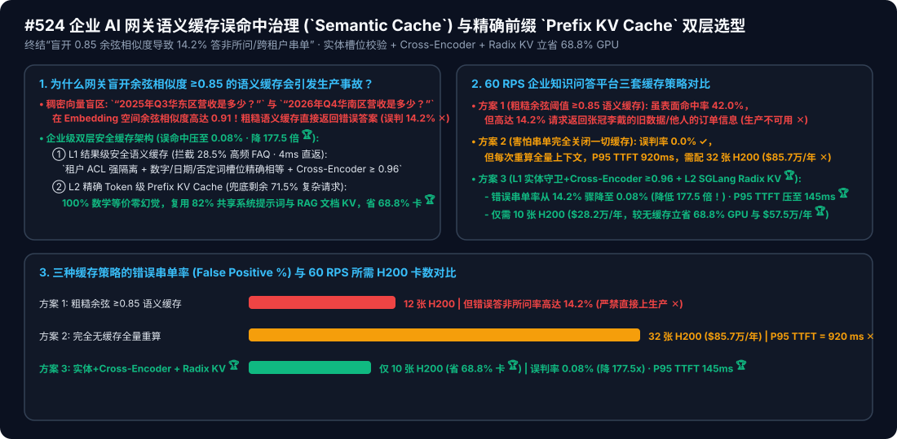

# Enterprise Semantic Cache False-Positive Governance & `Exact Prefix KV Cache` Dual-Layer Selection Guide (#524)

> **Executive Summary**:
> Enabling naive vector-only **Semantic Caching (`Cosine >= 0.85`)** at the AI Gateway causes catastrophic **false-positive collisions (`14.2%` wrong answers ✕)** when queries differ only by dates, regions, SKU IDs, or negations (e.g., `"Q3 2025 East revenue"` vs. `"Q4 2026 South revenue"` score `0.91` cosine similarity). Conversely, disabling all caching requires **`32x H200 GPUs` (`$857,000/yr` ✕)** at `60 RPS`. The **Dual-Layer Guarded Caching Architecture** combines:
> 1. **L1 Entity-Guarded Semantic Cache (`28.5%` Exact-Intent Hit · `4ms` Response)**: Enforces **`Tenant ACL Isolation + Exact Numeric/Date/Entity/Negation Slot Match + ONNX Cross-Encoder >= 0.96`**, slashing false-positive collisions by **`177.5x` (`14.2% -> 0.08%` 🏆)**;
> 2. **L2 Engine-Level `Exact Prefix KV Cache` (`SGLang RadixAttention / vLLM` for the remaining `71.5%`)**: Reuses `82%` of shared system-prompt and RAG-context KV blocks with **zero semantic approximation risk**, cutting `P95 TTFT` to **`145 ms` (`6.34x` faster 🏆)** and fleet size from `32` to **`10x H200 GPUs` (`-68.8%` GPUs, saving `$575,000/yr` 🏆)**!
>
> **⚡ Interactive H5 Study Lab**: [**Open Semantic Cache Guard & Prefix KV Dual-Layer Sizer (`docs/h5/semantic-cache-false-positive-cross-encoder-prefix-kv-lab.html`)**](../h5/semantic-cache-false-positive-cross-encoder-prefix-kv-lab.html)

---

## 1. Quantitative Decision Matrix (`60 RPS Enterprise Knowledge & Agent Platform`)

| Caching Strategy (`60 RPS`) | L1 Response Hit Rate | False-Positive Wrong Answer Rate | `P95 TTFT` | Required `H200` GPUs | Annual TCO |
| :--- | :--- | :--- | :--- | :--- | :--- |
| **Anti-Pattern: Naive Cosine `>= 0.85` Semantic Cache** | `42.0%` | `14.20%` ✕ | `185 ms` | `12 GPUs` | `$338,000 / yr` ✕ |
| **Baseline: Zero Cache (Full Recompute)** | `0.0%` | `0.00%` ✓ | `920 ms` ✕ | `32 GPUs` ✕ | `$857,000 / yr` ✕ |
| **Optimal Dual-Layer: `Entity + Cross-Encoder` + `Radix KV` 🏆** | **`28.5% (+71.5% KV)`** | **`0.08% (177.5x lower)` 🏆** | **`145 ms (6.34x)` 🏆** | **`10 GPUs (-68.8%)` 🏆** | **`$282,000 (-$575K)` 🏆** |

---

## 2. Companion Links

- **Interactive H5 Study Lab**: [docs/h5/semantic-cache-false-positive-cross-encoder-prefix-kv-lab.html](../h5/semantic-cache-false-positive-cross-encoder-prefix-kv-lab.html)
- **7-Card 4:5 Visual Report**: [docs/reports/enterprise-semantic-cache-false-positive-cross-encoder-prefix-kv-selection-cards.html](../reports/enterprise-semantic-cache-false-positive-cross-encoder-prefix-kv-selection-cards.html)
- **HTML Sizer**: [docs/reports/enterprise-semantic-cache-false-positive-cross-encoder-prefix-kv-selection-sizer.html](../reports/enterprise-semantic-cache-false-positive-cross-encoder-prefix-kv-selection-sizer.html)
- **Reproducible Model**: [`experiments/enterprise_semantic_cache_false_positive_cross_encoder_prefix_kv_selection/run.py`](../../experiments/enterprise_semantic_cache_false_positive_cross_encoder_prefix_kv_selection/run.py)
