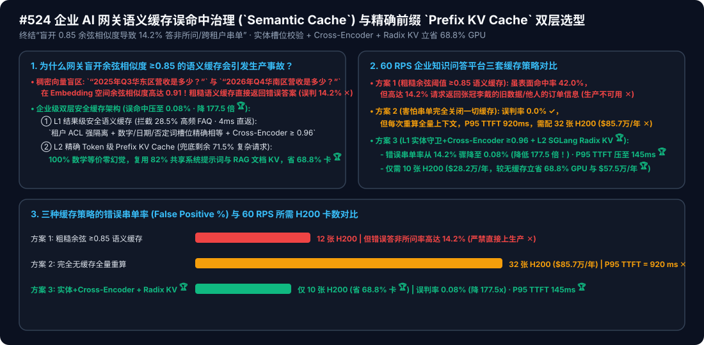

# 企业 AI 网关语义缓存误命中治理（`Semantic Cache`）与精确前缀缓存（`Exact Prefix KV Cache`）双层选型：盲开粗糙余弦阈值（`0.85` 导致 `14.2%` 串单）vs. `实体槽位守卫 + Cross-Encoder >= 0.96 + Radix KV 兜底` 算卡指南 (#524)

> **核心观点（Executive Summary）**：
> 许多企业在 AI Gateway（如 `APIM / Kong / LiteLLM + Redis Vector`）上开启“语义缓存（Semantic Cache，设置余弦相似度 `>= 0.85` 直接返回历史回答）”后，上线第一天就会遭遇严重的 **“张冠李戴串单事故”**：用户问 `“2025年Q3华东区营收？”` 却命中了缓存里的 `“2026年Q4华南区营收？”`（两句话的稠密 Embedding 余弦相似度高达 `0.91`，导致 **`14.2%` 的请求返回错误答案 ✕**）！若因噎废食彻底关闭一切缓存，又需要 `32 张 H200`（年费 `$85.7万`）。本专题给出 **双层安全缓存架构（Dual-Layer Guarded Caching）**：
> 1. **L1 结果级安全语义缓存（拦截 `28.5%` 高频标准问答 · `4ms` 直返）**：强制开启 **`租户/权限命名空间隔离 + 数字/日期/专有名词/否定词正则槽位 100% 精确相等 + 轻量 ONNX Cross-Encoder 二次精排得分 >= 0.96`**，将误命中率从 `14.2%` 压至 **`0.08%`（降低 `177.5 倍` 🏆）**；
> 2. **L2 引擎层精确 Token 级 `Prefix KV Cache`（兜底剩余 `71.5%` 含参复杂请求）**：未命中 L1 的请求绝不强行凑近似答案，而是送入 `SGLang RadixAttention / vLLM Prefix Cache`——**100% 数学等价零错答** 地复用 `82%` 的共享系统提示词与 RAG 知识块 KV，将全平台 `P95 TTFT` 从 `920ms` 压至 **`145ms`（提速 `6.34 倍` 🏆）**，支撑 `60 RPS` 所需 H200 从 `32 张` 降至 **`10 张`（立省 `68.8%` GPU 与 `$57.5 万/年` 🏆）**！
>
> **⚡ 配套交互式 H5 精读沙盘**：[**打开语义缓存误命中治理与 Prefix KV 双层缓存算卡计算器 (`docs/h5/semantic-cache-false-positive-cross-encoder-prefix-kv-lab.html`)**](../h5/semantic-cache-false-positive-cross-encoder-prefix-kv-lab.html)

---

## 一、 灵魂拷问：为什么语义缓存不能替代 Prefix KV Cache？两者边界在哪？

### Q1：结果级 `Semantic Cache` 与引擎级 `Exact Prefix KV Cache` 的本质区别是什么？
- **结果级 `Semantic Cache`（网关层 Redis/Milvus）**：直接跳过整个 LLM 推理（省 `100%` Input + Output Token），但本质是“有损近似”，**严禁用于含单号、日期、金额、代码的个性化请求**；
- **引擎级 `Exact Prefix KV Cache`（推理层 SGLang Radix / vLLM Hash）**：要求前缀 Token 完全一致，但后缀问题交给大模型全新推理（**`0.0%` 串单风险，100% 数学无损**），是企业 Agent 与 RAG 生产降本的主力军！

---

## 二、 60 RPS 企业知识平台三套缓存架构选型决策矩阵

| 缓存架构方案（`60 RPS 企业问答与 Agent`） | L1 结果缓存命中率 | 错误答非所问率 (`FPR`) | `P95 TTFT` 首字延迟 | 支撑 60 RPS 所需 H200 | 年化总成本 (`TCO`) |
| :--- | :--- | :--- | :--- | :--- | :--- |
| **反模式：盲开粗糙余弦 `>= 0.85` 语义缓存** | `42.0%` | `14.20%` ✕ (严重串单) | `185 ms` | `12 张 H200` | `$338,000 / 年` ✕ |
| **保守基线：关闭一切缓存全量重算** | `0.0%` | `0.00%` ✓ | `920 ms` ✕ | `32 张 H200` ✕ | `$857,000 / 年` ✕ |
| **最佳双层架构：`实体守卫+Cross-Encoder` + `Radix KV` 🏆** | **`28.5% (+71.5%走KV)`** | **`0.08% (降177.5x)` 🏆** | **`145 ms (快6.34x)` 🏆** | **`10 张 H200 (-68.8%)` 🏆** | **`$282,000 (省$57.5万)` 🏆** |

---

## 三、 延伸阅读与配套工具

- **交互式 H5 精学沙盘**：[docs/h5/semantic-cache-false-positive-cross-encoder-prefix-kv-lab.html](../h5/semantic-cache-false-positive-cross-encoder-prefix-kv-lab.html)
- **7-Card 4:5 视觉评测卡片**：[docs/reports/enterprise-semantic-cache-false-positive-cross-encoder-prefix-kv-selection-cards.html](../reports/enterprise-semantic-cache-false-positive-cross-encoder-prefix-kv-selection-cards.html)
- **交互式 Sizer 测算器**：[docs/reports/enterprise-semantic-cache-false-positive-cross-encoder-prefix-kv-selection-sizer.html](../reports/enterprise-semantic-cache-false-positive-cross-encoder-prefix-kv-selection-sizer.html)
- **可复现实验模型**：[`experiments/enterprise_semantic_cache_false_positive_cross_encoder_prefix_kv_selection/run.py`](../../experiments/enterprise_semantic_cache_false_positive_cross_encoder_prefix_kv_selection/run.py)
