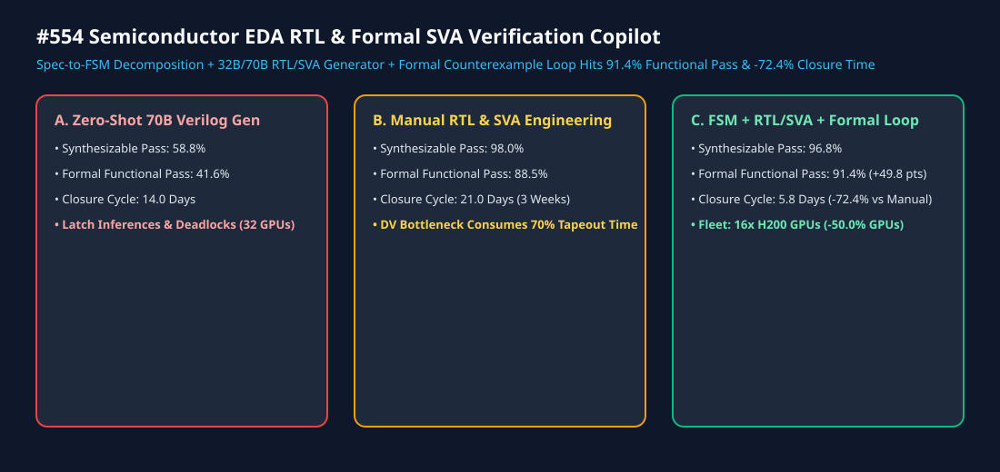

# 企业半导体芯片设计 EDA 智能助手（`Verilog/SystemVerilog RTL 生成 + SVA 形式化断言合成 + 仿真反例闭环修复`）架构选型（`#554`）

> **Language / 语言**: **简体中文** | [English](./enterprise-semiconductor-eda-rtl-sva-formal-verification-loop-sizing-faq.en.md) · [📱 交互式 H5 精读页](../h5/semiconductor-eda-rtl-sva-formal-verification-loop-lab.html) · [🧮 交互式算卡器 Sizer](../reports/enterprise-semiconductor-eda-rtl-sva-formal-verification-loop-sizing-sizer.html) · [🃏 7-Card 评测报告](../reports/enterprise-semiconductor-eda-rtl-sva-formal-verification-loop-sizing-cards.html) · [返回总目录](../full-catalog-zh.md)

---

## 一、3 分钟核心结论卡片（Executive Summary）

1. **核心矛盾：为什么让通用 `70B LLM` 直接零样本生成 `SystemVerilog RTL` 代码有 `41.2%` 无法通过逻辑综合（Latch 锁存器意外推断/多驱动冲突）、`58.4%` 通不过时序功能仿真，而纯靠人类芯片验证工程师（DV）手写 `SVA` 断言验证一个 IP 模块又要花掉 `21 天（3 周）`？**
   - 芯片数字前端设计中，**验证（Design Verification, DV）占整个流片周期 `70%` 以上工作量**。通用大模型预训练语料中高质量可综合（Synthesizable）Verilog 占比不到 Python 的 `0.5%`，零样本直出代码功能通过率仅 **`41.6%`**。
2. **形式化状态机拆解 + 双独立角色生成（`RTL + SVA`）+ 编译器/形式化证明反例闭环（`Verilator / Yosys / SymbiYosys Counterexample Loop`）黄金架构**：
   - **第一阶段（自然语言 Spec -> 显式有限状态机 `FSM JSON` 与时序握手契约）**：先将 AXI/PCIe 接口规范拆解为无歧义的状态转移表；
   - **第二阶段（双盲解耦：一个 Agent 生成 `SystemVerilog RTL`，另一个独立 Agent 根据 Spec 生成形式化断言 `SVA Properties`）**：严禁让同一个上下文根据已经写错的 RTL 去生成测试断言（避免“按错代码写错测试”的自欺欺人）；
   - **第三阶段（`Verilator / Yosys / SymbiYosys` 形式化模型检验反例波形回灌闭环）**：当形式化求解器在第 `k` 个时钟周期发现死锁或握手违例时，将精确的周期级反例波形（Counterexample Trace）转写为紧凑符号表喂回模型自修复——可综合通过率达 **`96.8%`**，形式化功能通过率从 `41.6%` 飙升至 **`91.4%`（`+49.8 pts`）**，单个 IP 模块验证收敛周期从 `21.0 天` 缩短至 **`5.8 天`（缩短 `72.4%`）**，仅需 **16 张 H200**！

---

## 二、三大半导体芯片设计 EDA RTL 与验证架构定量对比矩阵

| 评估维度 | 方案 A：`70B LLM` 零样本直接生成 Verilog | 方案 B：传统纯人工编写 RTL + 手写 SVA 验证 | 方案 C：`FSM 拆解 + 双盲 RTL/SVA + 形式化反例闭环`（推荐） |
| :--- | :--- | :--- | :--- |
| **逻辑综合通过率 (`Synthesizable Pass`)** | `58.8%`（常报意外锁存器与位宽错配） | `98.0%` | **`96.8%`（经 `Yosys / SpyGlass` 门禁自修复）** |
| **形式化功能验证通过率 (`Formal Pass`)** | `41.6%`（状态机死锁/流控握手错误） | `88.5%` | **`91.4%`（比零样本提升 `+49.8 pts`）** |
| **单 IP 模块设计与验证收敛周期** | `14.0 天`（大量人工修 AI Bug） | `21.0 天（3 周）` | **`5.8 天`（比纯人工缩短 `72.4%`）** |
| **所需 H200 GPU 卡数** | `32 张 H200` | `0 张` | **`16 张 H200`（立省 `50.0%` GPU）** |

---

## 三、生产落地核对清单（Pre-Production Checklist）

- [ ] **实行“设计生成（RTL Agent）”与“验证断言生成（SVA Agent）”上下文物理隔离**，SVA Agent 只能读取原始架构规范（Spec），绝不能偷看生成的 RTL 源码。
- [ ] **将形式化验证器（`SymbiYosys / JasperGold`）输出的 `VCD` 反例波形转换为每个时钟上升沿的信号跳变表格再注入修复 Prompt**。
