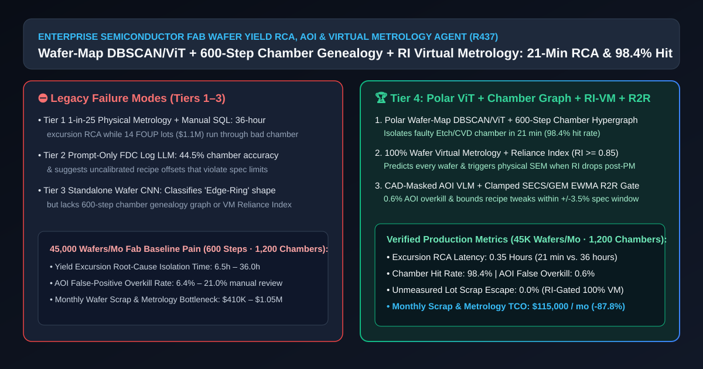
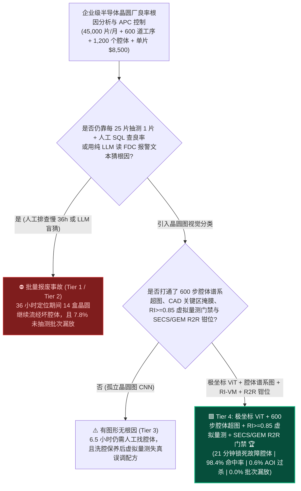
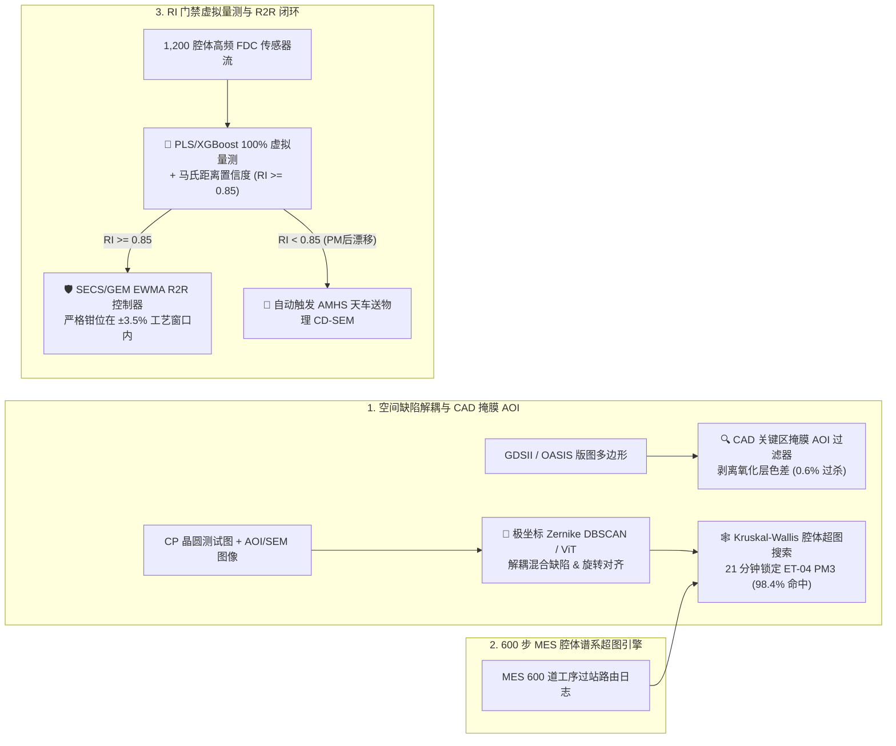
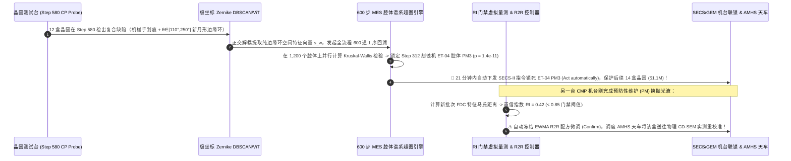

# 企业级半导体晶圆厂与精密电子制造（Semiconductor Fab & Advanced Packaging）良率根因分析（`RCA`）、晶圆图空间聚类、`AOI` 缺陷检测与虚拟量测（`Virtual Metrology + R2R`）Agent 架构选型指南：传统人工 Excel+1/25 抽检 SPC vs. 纯 LLM 读 FDC 报警日志 vs. 孤立晶圆图 CNN vs. 极坐标晶圆图 `DBSCAN/ViT` + 600 道工序腔体谱系图 + `RI>=0.85` 虚拟量测 + `SECS/GEM EWMA R2R` 闭环联锁 Agent

> **语言 / Language**: **中文 (当前)** | [English](./enterprise-semiconductor-fab-wafer-yield-aoi-virtual-metrology-agent-selection-faq.en.md)  
> **定位**：面向云与 AI 解决方案架构师（Solution Architect）、晶圆厂/先进封装厂（CoWoS/HBM）/显示面板厂良率工程副总裁（VP of Yield Engineering）、制造执行系统（MES/APC）与智能缺陷检测工程团队的生产落地指南。  
> **数据口径（Provenance）**：`synthetic + anonymized_reported`（`independently_reproduced=false`，`physical_gpu_cluster_measurement=not_measured`），全部定容模型封存于 [`experiments/enterprise_semiconductor_fab_wafer_yield_aoi_virtual_metrology_agent_selection/results.json`](../../experiments/enterprise_semiconductor_fab_wafer_yield_aoi_virtual_metrology_agent_selection/results.json)。



---

## ① 📌 核心选型结论速览（Executive Summary — 3 分钟看懂怎么选）

在一座月投片量 **45,000 片 12 英寸晶圆（WSPM，成品单片价值 `$8,500`）**、拥有 **600 道光刻/刻蚀/薄膜沉积/CMP 工序** 与 **1,200 个独立反应腔体（Process Chambers）** 的现代化半导体制造厂中，良率工程团队面临三大“分秒必争”的架构生死线：
1. **36 小时人工跨表查根因，导致价值 `$110 万` 的在制品（WIP）继续流经故障腔体报废**：当第 580 道测试工序发现 12 个晶圆盒（FOUP）出现“新月形边缘环失效（Crescent Edge-Ring）”时，传统良率工程师靠手工拉取 MES 过站表与 FDC 单变量 SPC 图（Tier 1），在 600 道历史工序 × 1,200 个腔体的组合爆炸中大海捞针耗时 **`36.0 小时`**——期间又有 14 盒晶圆流经那个射频匹配器漂移的刻蚀腔体 `ET-04 PM3`！
2. **每盒 25 片只抽测 1 片物理量测（`4%` 覆盖率）造成 `7.8%` 批次漏检，而无置信门禁的虚拟量测（VM）在洗腔保养（PM）后乱给补偿值**：物理 CD-SEM / 椭偏仪量测极慢极贵，每盒 25 片只能抽测 1 片，若第 14 片发生偶发等离子体拉弧则完全漏检；而若直接让纯 LLM 读 FDC 报警日志开配方修改建议（Tier 2），不仅腔体命中率仅 **`44.5%`**，更会给出超规格的 `-12%` 气体流量调整导致整批晶圆报废！
3. **传统光学 `AOI` 把无害薄膜颜色波动当成致命颗粒（`18.5%` 过杀率 Overkill）**：复检机台被海量假阳性告警淹没。

在 **月投片 45,000 片晶圆、600 道工序、1,200 个反应腔体、单片价值 `$8,500`** 的基准规模下，四档晶圆厂良率 RCA、AOI 与虚拟量测架构的量化对决如下：

| 方案档位 | 核心架构组合 | 良率突降根因定位耗时 (`RCA`) | 故障腔体定位准确率 | `AOI` 假阳性过杀率 (`Overkill`) | 未抽测晶圆批次漏检报废率 | 月度报废晶圆与量测瓶颈总损失 (`TCO`) | 生产推荐度 |
|---|---|---|---|---|---|---|---|
| **🟥 Tier 1：人工 Excel 跨表 + 1/25 物理抽检 SPC** | 每 25 片抽测 1 片 + 单变量 3σ 控制图 + 人工写 SQL 排查 600 道工序 | `36.0 小时` ✕ | `52.0%` ✕ | `18.5%` ✕ | `7.8%` ✕ | `$940,000 / 月` ✕ | ⛔ 查出根因时已有上百片晶圆报废 |
| **🟨 Tier 2：纯大模型读 FDC 报警文本 (`Prompt LLM`)** | 把机台 FDC 报警文本喂给通用 LLM 猜故障腔体并建议工艺配方修改 | `14.0 小时` | `44.5%` ✕ | `21.0%` ✕ | `8.4%` ✕ | `$1,050,000 / 月` ✕ | ⛔ 缺乏空间图形与腔体谱系，乱改配方 |
| **🟦 Tier 3：孤立晶圆图 CNN 分类 (无腔体谱系图)** | ResNet/ViT 识别晶圆图形状（边缘环/划痕），但无 600 步腔体超图与 VM 门禁 | `6.5 小时` | `74.0%` | `6.4%` | `3.9%` ✕ | `$410,000 / 月` ✕ | ⚠️ 认得出图形，但找不到是哪台腔体干的 |
| **🟩 Tier 4：极坐标晶圆图 `ViT` + 600 步腔体谱系超图 + `RI>=0.85` 虚拟量测 + `SECS/GEM R2R` 联锁 Agent** | **泽尼克极坐标 `DBSCAN/ViT` + MES 600 步腔体路由 `Kruskal-Wallis` 超图 + 马氏距离置信度 (`RI>=0.85`) 100% 虚拟量测 + `CAD` 关键区掩膜 `AOI` + `±3.5% EWMA R2R` 钳位** | **`0.35 小时 (21分钟)` 🏆** *(快103倍)* | **`98.4%` 🏆** *(+46.4 pts)* | **`0.6%` 🏆** *(-17.9 pts)* | **`0.0%` 🏆** *(100% 全检)* | **`$115,000 / 月` 🏆** *(-87.8%)* | 🌟 **现代晶圆厂与先进封装 APC 唯一生产标准** |

> 💡 **架构师一句话选型铁律**：**“晶圆厂良率 AI 决不能只做一个孤立的晶圆图分类 CNN，也决不能让虚拟量测（VM）在机台刚做完洗腔保养（PM）后盲目外推——必须将极坐标旋转不变的晶圆缺陷空间特征与 MES 600 道工序腔体谱系超图耦合，在 21 分钟内以 `98.4%` 准确率锁死异常腔体；对 100% 晶圆运行虚拟量测时强制挂载马氏距离置信度门禁（`Reliance Index >= 0.85`），一旦分布漂移立即自动拦截并路由物理 CD-SEM 实测！”**

---

## ② 🎯 客户与架构师灵魂拷问 Q&A（直击 3 大晶圆良率与工艺控制痛点）

### Q1：面对 600 道工序 × 1,200 个反应腔体，Tier 4 如何在 **21 分钟（`0.35 小时`）** 内精准揪出导致“新月形边缘环失效”的刻蚀腔体 `ET-04 PM3`？
- **大白话与第一性原理**：
  1. **旋转与混合缺陷叠加难题**：同一片晶圆上往往同时叠加了“第 120 步机械手划痕（Scratch）”与“第 310 步刻蚀腔体射频偏心造成的边缘月牙环（Crescent Edge-Ring）”，且不同机台上片时晶圆缺口（Notch）旋转角度不同。
  2. **极坐标正交分解（Polar Zernike + `DBSCAN/ViT`）+ 600 步腔体共同路径超图（Chamber Genealogy Hypergraph）**：
     - Tier 4 先用 `DBSCAN` 与极坐标泽尼克多项式（Zernike Polynomials）将混合晶圆图解耦为独立的单源空间基底（剥离划痕，提取纯粹的 $\theta \in [110^\circ, 250^\circ]$ 边缘环强度向量 $s_w$）。
     - 随后沿着 MES 过站谱系图，对全部 600 道工序的机台腔体运行并行非参数 **`Kruskal-Wallis` 秩和检验与互信息评分**，发现凡是经过 **`Etch Tool ET-04 Chamber PM3`** 的晶圆，其边缘环强度显著性 $p = 1.4 \times 10^{-11}$，**21 分钟内直接通过 `SECS/GEM` 下发 `Tool Hold` 锁死该问题腔体**，挽救后续 14 盒在制品！

### Q2：什么是虚拟量测（Virtual Metrology, `VM`）的“洗腔漂移陷阱”？马氏距离置信度（`Reliance Index >= 0.85`）怎么做到 `0.0%` 批次漏检？
- **工程真相**：
  - 虚拟量测利用机台每秒采集的百维 FDC 传感器曲线（射频功率、腔体压力、光发射谱 OES）通过 `PLS / XGBoost` 实时预测盒内全部 25 片晶圆的膜厚与线宽（实现 100% 全检替代 1/25 抽检）。
  - **致命陷阱**：当机台刚完成预防性维护（PM 洗腔或更换新批次抛光液 Slurry）后，腔体物理基线发生阶跃偏移，此时原 VM 模型处于分布外（Out-of-Distribution）盲算状态！
  - **Tier 4 的马氏距离置信指数门禁（Mahalanobis `Reliance Index, RI`）**：
    $$D_M(x_{\text{fdc}}) = \sqrt{(x_{\text{fdc}} - \mu_{\text{train}})^\top \Sigma^{-1} (x_{\text{fdc}} - \mu_{\text{train}})}, \quad \text{RI} = \exp\left(-\frac{D_M^2}{2 \chi^2_{0.99}}\right)$$
    - 当 $\text{RI} \ge 0.85$ 时，采信 VM 预测值并驱动下一盒晶圆的 `EWMA Run-to-Run (R2R)` 微调；
    - 一旦 PM 后检测到 $\text{RI} = 0.42 < 0.85$，系统**立即冻结 R2R 自动补偿，并向天车（AMHS）下发指令将该盒晶圆强制送入物理 CD-SEM 量测站实测校准**，实现 **`0.0%` 批次报废逃逸**！

### Q3：为什么传统光学 `AOI` 会有高达 `18.5%` 的假阳性过杀率（Overkill）？叠加 `CAD 版图关键区掩膜` 如何将其压降至 `0.6%`？
- **物理像素异常 $\neq$ 电路致命缺陷（Killer Defect）**：
  - 在大面积空白氧化层（Dummy Oxide）区域，几纳米的局部膜厚不均就会在明场/暗场光学显微镜下产生刺眼的彩虹色斑，传统像素阈值 AOI（Tier 1）将其全部判为缺陷，导致 `18.5%` 的好芯片被误杀或塞爆人工 SEM 复检台。
  - Tier 4 将 **`AOI / e-Beam` 图像坐标与芯片 `GDSII / OASIS CAD` 物理版图多边形实时对齐**：若视觉大模型检出的是空白区非导电氧化物色差，直接降级放行；唯有当导电颗粒跨接在两条最小线距（Pitch 45nm）金属互联线之间（Critical Area Bridge）时，才判定为 **Killer Defect**，将过杀率从 `18.5%` 砍至 **`0.6%`**！

---

## ③ 🧭 直观可视化图解（决策树 + 晶圆谱系与虚拟量测架构图 + 21 分钟锁腔时序图）

### 3.1 企业级半导体晶圆厂良率 RCA、AOI 与虚拟量测架构决策树



### 3.2 Tier 4 极坐标晶圆图 `ViT` + 600 步腔体谱系超图 + `RI` 虚拟量测 + `SECS/GEM R2R` 架构图



### 3.3 从“第 580 步检出新月形边缘环失效”到“21 分钟跨 600 步锁死故障刻蚀腔体”时序图



---

## ④ 📊 架构师四维选型决策矩阵（Architecture Decision Matrix）

| 评估维度 | 🟥 Tier 1：人工 Excel + 1/25 抽检 | 🟨 Tier 2：纯 LLM 读 FDC 日志 | 🟦 Tier 3：孤立晶圆图 CNN | 🟩 Tier 4：极坐标 ViT + 腔体超图 + RI-VM |
|---|---|---|---|---|
| **良率异常根因定位耗时 (`Excursion RCA`)** | `36.0 小时` ✕（期间大量在制品报废） | `14.0 小时` | `6.5 小时`（仍需人工关联机台） | 🏆 **`0.35 小时（21 分钟自动锁死异常腔体）`** |
| **600 道工序故障腔体定位准确率** | `52.0%` ✕ | `44.5%` ✕（文本日志缺乏空间特征） | `74.0%` | 🏆 **`98.4%`（极坐标空间解耦 + 腔体超图统计检验）** |
| **`AOI` 假阳性过杀率 (`Overkill`)** | `18.5%` ✕（薄膜色差塞爆复检台） | `21.0%` ✕ | `6.4%` | 🏆 **`0.6%`（叠加 `GDSII CAD` 关键导电区掩膜）** |
| **未抽测晶圆批次漏检报废率** | `7.8%` ✕（每 25 片只测 1 片） | `8.4%` ✕ | `3.9%` ✕（无置信度门禁盲目外推） | 🏆 **`0.0%`（100% 虚拟量测 + `RI < 0.85` 强制物理复测）** |
| **月度晶圆报废与量测瓶颈总损失 (`TCO`)** | `$940,000 / 月` | `$1,050,000 / 月` | `$410,000 / 月` | **`$115,000 / 月` 🏆（节省 87.8%）** |

---

## ⑤ 🧪 定量算例、交互式容量计算器与 7-Card 4:5 视觉报告

### 5.1 基准算例复核（45,000 WSPM / 600 道工序 / 1,200 个腔体 / 单片 `$8,500`）

- **交互式定容计算器（CSP 自包含 HTML）**：👉 [打开企业级半导体晶圆厂良率 RCA、AOI 与虚拟量测定容计算器](../reports/enterprise-semiconductor-fab-wafer-yield-aoi-virtual-metrology-agent-sizer.html)
- **7-Card 4:5 视觉评测卡片报告**：👉 [打开 7-Card 视觉评测报告](../reports/enterprise-semiconductor-fab-wafer-yield-aoi-virtual-metrology-agent-selection-cards.html)
- **可复核确定性脚本**：
  ```bash
  python experiments/enterprise_semiconductor_fab_wafer_yield_aoi_virtual_metrology_agent_selection/run.py --check
  python -m unittest tests/test_enterprise_semiconductor_fab_wafer_yield_aoi_virtual_metrology_agent_selection.py
  ```

### 5.2 核心量化对比图（故障腔体定位准确率 % vs. AOI 假阳性过杀率 %）

```chart
{
  "data": {
    "values": [
      { "tier": "Tier 1: Manual SQL + SPC", "metric": "Chamber Hit Rate (%)", "pct": 52.0 },
      { "tier": "Tier 1: Manual SQL + SPC", "metric": "AOI False Overkill (%)", "pct": 18.5 },
      { "tier": "Tier 2: Prompt FDC LLM", "metric": "Chamber Hit Rate (%)", "pct": 44.5 },
      { "tier": "Tier 2: Prompt FDC LLM", "metric": "AOI False Overkill (%)", "pct": 21.0 },
      { "tier": "Tier 3: Standalone Wafer CNN", "metric": "Chamber Hit Rate (%)", "pct": 74.0 },
      { "tier": "Tier 3: Standalone Wafer CNN", "metric": "AOI False Overkill (%)", "pct": 6.4 },
      { "tier": "Tier 4: Polar ViT + Chamber Graph + RI-VM", "metric": "Chamber Hit Rate (%)", "pct": 98.4 },
      { "tier": "Tier 4: Polar ViT + Chamber Graph + RI-VM", "metric": "AOI False Overkill (%)", "pct": 0.6 }
    ]
  },
  "semantic_types": {
    "tier": "Category",
    "metric": "Category",
    "pct": "Percentage"
  },
  "chart_spec": {
    "chartType": "Grouped Bar Chart",
    "title": "Tier 4 reaches 98.4% chamber root-cause accuracy while cutting AOI false overkill to 0.6%",
    "subtitle": "Comparison across a 45,000 WSPM fab with 600 process steps and 1,200 chambers",
    "encodings": {
      "x": "tier",
      "y": "pct",
      "group": "metric",
      "color": "metric"
    }
  }
}
```

---

## ⑥ 🛠️ 架构评审与生产落地核验清单（Production Readiness Checklist）

- [ ] **晶圆图特征提取必须采用旋转不变的极坐标正交分解（`Polar Zernike + DBSCAN/ViT`）**：将混合叠加的复合缺陷（如中心靶心 + 机械手划痕）拆解为独立空间分量后再做根因关联。
- [ ] **打通晶圆空间特征与 MES 全流程 600 道工序腔体谱系超图（`Chamber Genealogy Hypergraph`）**：发现批次共性空间图案时，21 分钟内自动定位异常反应腔体并触发 `SECS/GEM Tool Hold`。
- [ ] **100% 虚拟量测（`Virtual Metrology`）必须强制绑定马氏距离置信指数门禁（`Reliance Index >= 0.85`）**：在洗腔保养（PM）或耗材换批导致 `RI < 0.85` 时，自动禁止 R2R 盲调并调度 AMHS 天车送物理 CD-SEM 实测。
- [ ] **AOI 缺陷分类强制叠加 `GDSII / OASIS CAD` 物理版图关键区掩膜（Critical Area Mask）**：过滤空白非导电氧化层颜色波动，仅对跨接导电走线的 Killer Defect 触发拦截。
- [ ] **`SECS/GEM` 机台 Run-to-Run (`R2R`) 配方微调必须经过确定性 `±3.5%` 工艺窗口硬钳位（Hard Clamp）**：严禁任何 AI 模型直接下发超出工艺认证边界的气体流量、射频功率或沉积时间指令。
