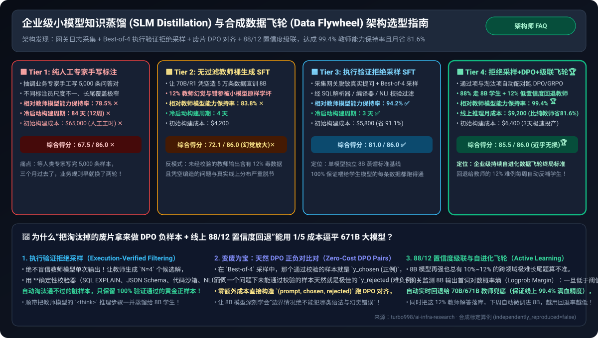
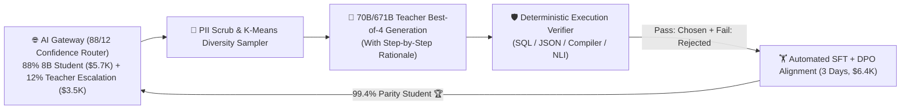

# Enterprise Small Language Model (SLM) Knowledge Distillation & Synthetic Data Flywheel Selection Guide: Manual Human Annotation vs. Unfiltered Teacher Synthetic SFT vs. Execution-Verified Rejection Sampling vs. Rejection SFT + Hard-Negative DPO + 88/12 Confidence Cascade Flywheel

> **Document Type**: Cloud & AI Solution Architect Decision Guide (FAQ)  
> **Target Audience**: Enterprise AI Platform Leads, LLM Customization & Fine-Tuning Architects, Data Engineering Leads, FinOps Directors  
> **Core Goal**: Show enterprise architects how to replace a **`$50,000/month`** 70B/671B Frontier Teacher Model (`DeepSeek-R1 / GPT-4o / Qwen-72B`, baseline score `86.0`) with a fast, specialized **`8B` Student SLM** in **3 days for `$6,400`** — answering: **"Why does spending 12 weeks and $65,000 on manual human SME annotation (Tier 1) reach only 78.5% teacher parity?", "Why does training an 8B model on unfiltered teacher generations (Tier 2) amplify hallucinations?", and "How does combining Gateway Log Harvesting, Execution-Verified Rejection Sampling, Zero-Cost DPO Hard Negatives, and an 88/12 Confidence Cascade Flywheel achieve 99.4% teacher parity while cutting monthly serving bills by 81.6%?"**  
> **Calibration Notice**: Teacher parity percentages, time-to-production, upfront build costs, and monthly serving costs are synthetic analytical estimates calibrated to published distillation and data flywheel benchmarks (Llama-3 / DeepSeek-R1 distillation studies, Execution-Verified Rejection Sampling, DPO hard-negative alignment, and NVIDIA Data Flywheel reference architectures) (`provenance: synthetic + anonymized_reported`, `independently_reproduced=false`, `physical_gpu_cluster_measurement=not_measured`). See [`experiments/enterprise_slm_distillation_synthetic_data_flywheel_selection/results.json`](../../experiments/enterprise_slm_distillation_synthetic_data_flywheel_selection/results.json).

---

## Executive Visual Summary

> 🔗 **Companion Interactive Reports & Tools**:
> - 🃏 **[7-Card 4:5 Visual Benchmark Report (`enterprise-slm-distillation-synthetic-data-flywheel-architecture-selection-cards.html`)](../reports/enterprise-slm-distillation-synthetic-data-flywheel-architecture-selection-cards.html)**
> - 🧮 **[Interactive SLM Distillation ROI & Flywheel Sizer (`enterprise-slm-distillation-synthetic-data-flywheel-architecture-sizer.html`)](../reports/enterprise-slm-distillation-synthetic-data-flywheel-architecture-sizer.html)**
> - 🌐 **[中文版指南 (`enterprise-slm-distillation-synthetic-data-flywheel-architecture-selection-faq.md`)](./enterprise-slm-distillation-synthetic-data-flywheel-architecture-selection-faq.md)**

---

## ① 📌 Executive Summary

Evaluated on distilling a **70B/671B Frontier Teacher (`86.0` composite score, `$50,000/month` 100%-teacher serving cost at `15,000,000` requests/month) into an `8B` Student SLM**:

| Tier | Distillation & Data Pipeline | Composite Score (Teacher Parity %) | Time to Prod | Upfront Build Cost | Monthly Serving Cost (15M Reqs) | Architect Verdict |
| :--- | :--- | :--- | :--- | :--- | :--- | :--- |
| **⬜ Baseline: 100% Frontier Teacher** | Serve all 15M requests on 70B/671B Teacher | `86.0` (`100.0%`) | `1 Day` | `$0` | **`$50,000 / mo` ✕** | **Day-1 Launch Baseline**: Unsustainable at high QPS |
| **🟥 Tier 1: Manual Human SME SFT** | 5,000 hand-written Q&A pairs by human SMEs | `67.5` (`78.5%` ✕) | `84 Days` (12 wks) ✕ | `$65,000` (Labor) ✕ | `$6,500 / mo` | **Slow & Inconsistent**: 12-week bottleneck, narrow coverage |
| **🟨 Tier 2: Unfiltered Teacher SFT** | 50,000 raw synthetic Teacher outputs | `72.1` (`83.8%` ✕) | `4 Days` | `$4,200` | `$6,500 / mo` | **Hallucination Poisoning**: Student learns Teacher's 12% errors |
| **🟦 Tier 3: Verified Rejection Sampling SFT** | **Real gateway logs + Best-of-4 filtered by compiler/NLI** | `81.0` (`94.2%` ✅) | `3 Days` ✅ | `$5,800` (-91.1%) | `$6,500 / mo` (-87.0%) | **Standalone 8B Baseline**: 100% verified training examples |
| **🟩 Tier 4: Rejection SFT + DPO + 88/12 Cascade Flywheel** | **Tier 3 + Rejected-Sample DPO + 88% Student / 12% Teacher Cascade** | **`85.5` (`99.4%` 🏆)** | **`3 Days` 🏆 (28x faster)** | **`$6,400` 🏆 (-90.2%)** | **`$9,200 / mo` 🏆 (-81.6% vs Teacher)** | **Enterprise Flywheel Gold Standard**: 4.7-day payback, 99.4% parity |

### 💡 Three Golden Rules for Enterprise SLM Distillation
1. **Never Hand-Write 5,000 SFT Examples (Tier 1) and Never Train on Unfiltered Teacher Outputs (Tier 2)**: Harvest real PII-scrubbed production prompts from your AI Gateway, sample `N=4` Teacher completions per prompt (including concise step-by-step rationales), and filter them through **Deterministic Execution Verifiers (`SQL EXPLAIN`, `JSON Schema`, `Code Sandbox`, `NLI Groundedness >= 0.92`)**.
2. **Recycle Failed Rejection-Sampling Candidates as Free `DPO` Hard Negatives**: When `Cand_1` passes the verifier and `Cand_3` fails on the exact same prompt, pair them as `(prompt, chosen=Cand_1, rejected=Cand_3)` for **Direct Preference Optimization (DPO)** — teaching the 8B student exact boundary conditions at zero extra generation cost.
3. **Pair the 8B Student with an `88/12` Logprob Confidence Cascade to the Teacher**: Let the 8B student serve the `88%` high-confidence traffic while escalating the `12%` lowest-confidence edge cases to the 70B/671B Teacher — achieving **`99.4%` Teacher parity (`85.5 / 86.0`)** at **`$9,200/mo` (`-81.6%` savings, paying back the `$6,400` build cost in just `4.7 days`)** while continuously harvesting new hard examples!

---

## ② 🎯 Architect Deep-Dive Q&A

### Q1: How do we prevent data contamination between our synthetic training set and our offline Golden Evaluation Suite?
* **Answer**: Always run a **MinHash LSH + Dense Embedding De-duplication Gate (`cosine < 0.85`)** against your 500-case Golden Evaluation Suite before training. Any harvested gateway prompt that closely matches an evaluation test case is quarantined from the SFT/DPO training pool.

---

## ③ 🧭 Architecture Diagrams

### 3.1 Tier 4 Closed-Loop Synthetic Data Flywheel & 88/12 Confidence Cascade

---

## ④ 📊 Architect Decision Matrix

| Dimension | 🟥 Tier 1: Manual SME SFT | 🟨 Tier 2: Unfiltered Teacher SFT | 🟦 Tier 3: Verified Rejection SFT | 🟩 Tier 4: Rejection SFT + DPO + Cascade |
| :--- | :--- | :--- | :--- | :--- |
| **Teacher Parity % (`86.0` = 100%)** | `78.5%` ✕ (`67.5`) | `83.8%` ✕ (`72.1`) | `94.2%` ✅ (`81.0`) | **`99.4%` 🏆 (`85.5`, `+20.9 pts` vs. Tier 1)** |
| **Time to Production** | `84 Days` (12 wks) ✕ | `4 Days` | `3 Days` ✅ | **`3 Days` 🏆 (`28x` faster than Tier 1)** |
| **Upfront Build Cost** | `$65,000` ✕ | `$4,200` | `$5,800` ✅ | **`$6,400` 🏆 (`-90.2%` vs. Tier 1 · 4.7-day ROI)** |
| **Monthly Serving Cost (15M Reqs)** | `$6,500 / mo` | `$6,500 / mo` | `$6,500 / mo` ✅ | **`$9,200 / mo` 🏆 (`-81.6%` vs. `$50K` Teacher)** |

---

## ⑤ 🛠️ Production Readiness Checklist

- [ ] **1. Invest Human SME Time in Building Verifiers and a 500-Case Eval Gate, Not Hand-Writing 5,000 SFT Rows**.
- [ ] **2. Harvest Real PII-Scrubbed Gateway Prompts and Apply K-Means Clustering for Diverse Topic Coverage**.
- [ ] **3. Filter All Teacher Generations (`Best-of-4`) Through Deterministic Execution Verifiers Before SFT**.
- [ ] **4. Distill Concise Step-by-Step Rationales Alongside Final Answers (`Distilling Step-by-Step`)**.
- [ ] **5. Pair Verified Completions (`chosen`) with Verifier-Rejected Completions (`rejected`) for DPO Alignment**.
- [ ] **6. Run MinHash + Embedding Decontamination Against Your Offline Golden Test Set**.
- [ ] **7. Deploy a Logprob-Margin Confidence Router (`88%` 8B Student / `12%` Teacher Escalation)**.
- [ ] **8. Automate Weekly Incremental Retraining on Newly Escalated Teacher-Solved Hard Cases**.
