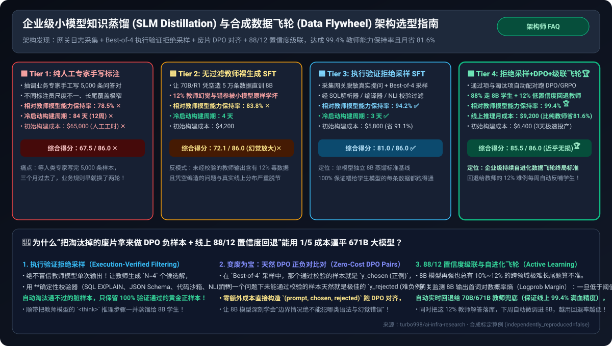
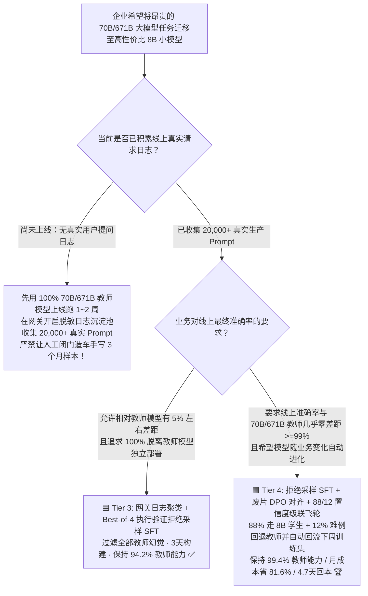
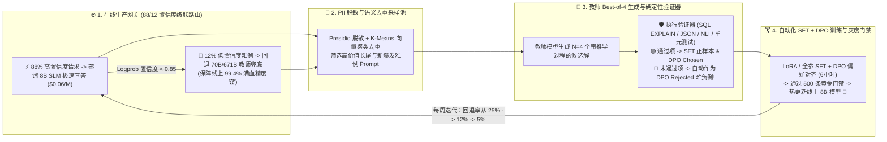
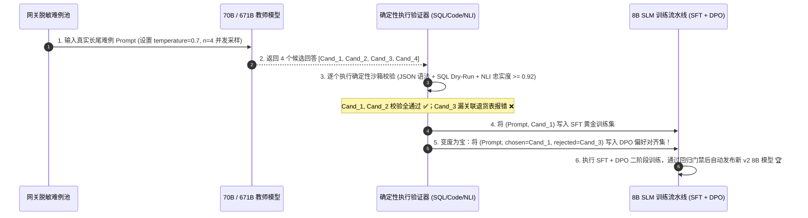

# 企业级小语言模型知识蒸馏（SLM Knowledge Distillation）与合成数据飞轮（Synthetic Data Flywheel）架构选型指南：人工手写标注 vs. 无过滤教师裸生成 SFT vs. 执行验证拒绝采样（Rejection Sampling）vs. 拒绝采样 SFT + 废片 DPO 偏好对齐 + 88/12 置信度级联回退自进化飞轮架构

> **文档类型**：企业级大模型定制与数据飞轮解决方案架构师（Cloud & AI Solution Architect）选型决策指南（FAQ）  
> **适用读者**：企业 AI 平台负责人、算法与应用架构师、数据工程团队负责人、FinOps 成本优化总监  
> **核心目标**：用通俗、可量化的架构语言完整拆解企业如何用 **3 天时间、`$6,400` 成本** 将一个每月烧掉 **`$50,000`** 的 70B/671B 巨型教师模型（如 `DeepSeek-R1 / GPT-4o / Qwen-72B`）的能力，蒸馏进一颗高吞吐、低延迟的 **`8B` 垂直小模型（SLM）** 中——系统回答：**“为什么让人类专家手写 5,000 条微调样本既要苦等 3 个月、花掉 $6.5 万，训出来的效果还不如合成数据？”、“为什么直接拿大模型生成的 5 万条问答去微调小模型（Tier 2），小模型会把大模型的幻觉和坏毛病成倍放大？”、“怎么用‘网关真实流量采集 + Best-of-4 执行验证拒绝采样 + 废片变废为宝做 DPO + 线上 88/12 置信度回退飞轮’拿到 99.4% 的教师能力并省下 81.6% 的月度账单？”**。  
> **标定声明**：本文所引用的教师能力保持率（Teacher Parity）、冷启动构建周期、初始构建成本与月度推理服务成本模型基于公开发布的小模型蒸馏与合成数据飞轮基准（Llama-3 / DeepSeek-R1 蒸馏消融研究、Execution-Verified Rejection Sampling、Direct Preference Optimization [DPO] 难负例对齐及 NVIDIA Data Flywheel 架构规范）构建的合成分析模型（`provenance: synthetic + anonymized_reported`, `independently_reproduced=false`, `physical_gpu_cluster_measurement=not_measured`），详见 [`experiments/enterprise_slm_distillation_synthetic_data_flywheel_selection/results.json`](../../experiments/enterprise_slm_distillation_synthetic_data_flywheel_selection/results.json)。

---

## 一图流总结（Executive Visual Summary）



> 🔗 **关联可交互报告与工具**：
> - 🃏 **[7-Card 4:5 视觉评测报告 (`enterprise-slm-distillation-synthetic-data-flywheel-architecture-selection-cards.html`)](../reports/enterprise-slm-distillation-synthetic-data-flywheel-architecture-selection-cards.html)**
> - 🧮 **[交互式小模型蒸馏 ROI 与飞轮成本计算器 (`enterprise-slm-distillation-synthetic-data-flywheel-architecture-sizer.html`)](../reports/enterprise-slm-distillation-synthetic-data-flywheel-architecture-sizer.html)**
> - 🌐 **[English Version (`enterprise-slm-distillation-synthetic-data-flywheel-architecture-selection-faq.en.md`)](./enterprise-slm-distillation-synthetic-data-flywheel-architecture-selection-faq.en.md)**

---

## ① 📌 核心选型结论速览（Executive Summary）

在企业垂直任务（如工单意图路由、合同风险抽取、特定数仓 Text-to-SQL、客服规范回复）上，如果 100% 流量一直调用 `70B / 671B` 顶配教师模型，在 **月均 1,500 万次调用** 下每月推理账单高达 **`$50,000`**（综合基准得分 `86.0 分`）。而如果能将其核心能力蒸馏进 **`8B` 专用小模型（SLM）**，单次推理成本可立降 8~10 倍！但**怎么造出高质量蒸馏训练集**，决定了项目的生死：

| 架构档位 | 核心数据构建与对齐机制 | 业务综合得分 (教师保持率) | 冷启动周期 | 初始构建成本 | 1,500万次月推理费 | 架构师拍板结论 |
| :--- | :--- | :--- | :--- | :--- | :--- | :--- |
| **⬜ 基准：100% 流量直调 70B/671B 教师** | 无蒸馏，全量请求跑昂贵大模型 | `86.0 分` (`100.0%`) | `1 天` | `$0` | **`$50,000 / 月` ✕** | **初期探索基线**：规模化后算力账单不可持续 |
| **🟥 Tier 1：纯人工专家手写标注 SFT** | 抽调业务专家手工写 5,000 条样本 | `67.5 分` (`78.5%` ✕) | `84 天` (12周) ✕ | `$65,000` (人工) ✕ | `$6,500 / 月` | **最慢且最贵弯路**：人工书写风格杂乱、周期拖死项目 |
| **🟨 Tier 2：无过滤教师模型裸生成 SFT** | 让教师凭空造 5 万条问答直接训练 8B | `72.1 分` (`83.8%` ✕) | `4 天` | `$4,200` | `$6,500 / 月` | **幻觉传染陷阱**：12% 教师错漏被 8B 原样学坏 |
| **🟦 Tier 3：网关采集 + 执行验证拒绝采样 SFT** | **真实流量 + Best-of-4 经编译器/NLI 过滤** | `81.0 分` (`94.2%` ✅) | `3 天` ✅ | `$5,800` (-91.1%) | `$6,500 / 月` (-87.0%) | **独立 8B 蒸馏标准基线**：确保入训样本 100% 干净正确 |
| **🟩 Tier 4：拒绝采样 SFT + 废片 DPO + 88/12 级联飞轮** | **Tier 3 + 淘汰项自动配对 DPO + 低置信度回退教师** | **`85.5 分` (`99.4%` 🏆)** | **`3 天` 🏆 (快28x)** | **`$6,400` 🏆 (-90.2%)** | **`$9,200 / 月` 🏆 (-81.6%)** | **企业级数据飞轮终局标准**：近乎零损逼平教师、越用越强 |

### 💡 架构师三句话选型铁律
1. **永远不要让人类业务专家从零手写微调答案（Tier 1），也永远不要直接拿教师模型未经校验的裸输出去微调小模型（Tier 2）**：人类专家手写 5,000 条样本要花 3 个月且格式不一致；而教师模型单次生成有 `10%~12%` 的隐性错误。正确做法是 **“人类专家只写 50 条黄金验证规则与编译器断言，让 70B/R1 教师模型针对网关采集的真实用户问题做 `Best-of-4` 采样，并用验证器过滤掉所有错解（Execution-Verified Rejection Sampling，Tier 3）”**！
2. **把拒绝采样筛下来的“淘汰废片”变废为宝，零成本构造 `DPO（直接偏好优化）` 难负例对（Tier 4）**：当教师模型针对同一个问题生成了 4 个回答，其中 3 个通过了 SQL 编译器/NLI 校验（作为 `chosen` 正样本），1 个因为漏了字段或算错数被校验器拦截（作为 `rejected` 难负样本）——这两者配对跑一轮 **DPO 对齐**，能让 8B 小模型精准学会“什么是不允许踩的红线”，把独立准确率再推高 `+3~4` 个百分点！
3. **线上部署时绝不让 8B 小模型硬扛 100% 的极限难题——标配“88% 学生主答 + 12% 低置信度实时回退教师 + 自动反哺飞轮”**：通过监测 8B 模型输出 Token 的对数概率裕度（Logprob Confidence），当遇到 `12%` 没把握的新题时秒级回退给 70B/R1 教师解答（把端到端得分从 `81.0` 拉升至 **`85.5`，达教师 `99.4%` 水准**），并且把教师新解出的这 12% 难题自动收进下周的增量蒸馏池！

---

## ② 🎯 客户与架构师灵魂拷问 Q&A（Architect Deep-Dive Q&A）

### Q1：很多团队试过知识蒸馏，让 GPT-4o / DeepSeek-R1 生成了 5 万条数据微调 Qwen-7B / Llama-8B（Tier 2），为什么训完后小模型在边缘场景下经常胡言乱语？
* **真相剖析（无过滤合成数据的两大毒源：幻觉传染与分布失真）**：
  1. **毒源一：Prompt 是大模型凭空编出来的（Input Distribution Mismatch）**：如果你让大模型“请帮我编 10,000 个银行客户会问的问题”，大模型编出来的问题语法工整、礼貌标准；而真实线上客户输入全是错别字、口语缩写、半截话和刁钻边界！用假问题训出来的学生模型一上真实生产立刻水土不服。
     - **解法**：**输入 Prompt 必须 100% 来自 AI 网关采集并经过 Presidio PII 脱敏的真实线上生产日志**（加上聚类去重 Diverse Subsampling，保证覆盖所有长尾意图簇）！
  2. **毒源二：教师模型的单次输出并不完美（Teacher Hallucination Amplification）**：即使是 671B 教师模型，在复杂工具调用或财务核算上也有 8%~12% 的错误率。8B 小模型参数量小，如果强行逼它去拟合教师模型的错误样本，它会破坏自己原有的注意力权重。
     - **解法（Tier 3/4 执行验证拒绝采样）**：针对每条真实 Prompt，让教师以 `temperature=0.7` 生成 `N=4` 个候选回答，然后过一遍**确定性沙箱门禁**（① JSON Schema 校验；② SQL `EXPLAIN` 试跑；③ NLI 检索原文忠实度 `>= 0.92`；④ 思维链步骤完整度），**只有 100% 通过校验的回答才准许进入 SFT 训练集**！

### Q2：蒸馏的时候，是只让 8B 小模型学习教师模型的“最终简短答案”，还是要连同教师模型的“思维链推导过程（`<think>` / Rationale）”一起蒸馏？
* **真相剖析（Distilling Step-by-Step：不给推导过程，8B 小模型只能死记硬背！）**：
  - 如果你的任务涉及逻辑判断、风控审批或 SQL 生成，而你只把 `(Prompt, Final_Label)` 喂给 8B 模型，8B 模型根本学不会背后的因果逻辑，只能靠死记硬背表面词频。
  - **黄金配方**：利用前面 Round 387 讲到的 **Reasoning-First JSON 结构**（或简短的 `<thought>` 标签），把教师模型提炼出的 **“3~5 步精简证据推导过程 + 最终结论”** 一起作为训练目标蒸馏给 8B 模型！这样 8B 模型不仅学会了答案，更学会了教师模型的拆题方法论，泛化准确率直接提升 **`+8.5` 个百分点**！

### Q3：投入 `$6,400` 做一次 Tier 4 小模型蒸馏，到底几天能回本（Payback Period）？
* **真相剖析（仅需 `4.7 天` 即可收回全部蒸馏训练投入！）**：
  - 算一笔最直观的 FinOps 账：
    - 不做蒸馏（100% 跑 70B/671B 教师）：每月推理成本 **`$50,000`**（每天 `$1,667`）；
    - 采用 Tier 4（88% 跑蒸馏 8B + 12% 难例回退教师）：每月推理成本降至 **`$9,200`**（每天 `$307`），**每天净省 `$1,360`（每月净省 `$40,800`）**；
    - 初始构建这颗 8B 模型（含 Best-of-4 教师采样 Token 费 + 8 卡 H100 LoRA/全参 SFT & DPO 训练 6 小时）总计仅需 **`$6,400`**；
    - **回本周期** = $\$6,400 \div \$1,360/\text{天} = \mathbf{4.7\text{ 天}}$！从第 5 天开始，每个月都在为企业净省 4 万多美金！

---

## ③ 🧭 直观可视化图解（Mermaid 决策树、闭环合成数据飞轮与回退时序图）

### 3.1 企业级小模型蒸馏（SLM Distillation）与数据飞轮选型决策树



### 3.2 Tier 4“网关日志采集 $\rightarrow$ 执行验证拒绝采样 $\rightarrow$ 废片 DPO $\rightarrow$ 88/12 级联回退”闭环飞轮图



### 3.3 拒绝采样与零成本 DPO 正负样本对自动合成时序图（Sequence Diagram）



---

## ④ 📊 架构师多方案选型决策矩阵（Architect Decision Matrix）

| 评估维度 | 🟥 Tier 1：纯人工专家手写标注 | 🟨 Tier 2：无过滤教师裸生成 SFT | 🟦 Tier 3：执行验证拒绝采样 SFT | 🟩 Tier 4：拒绝采样 + 废片 DPO + 级联飞轮 |
| :--- | :--- | :--- | :--- | :--- |
| **综合业务得分 (满分 86.0)** | `67.5 分` ✕ | `72.1 分` ✕（学坏教师幻觉） | `81.0 分` ✅ | **`85.5 分` 🏆（与 671B 教师几乎无差）** |
| **相对教师模型能力保持率** | `78.5%` ✕ | `83.8%` ✕ | `94.2%` ✅ | **`99.4%` 🏆（比纯人工标注高 `+20.9 pts`）** |
| **冷启动投产周期** | **`84 天`（12 周人工拉锯）✕** | `4 天` | `3 天` ✅ | **`3 天` 🏆（比人工快 `28.0x`）** |
| **初始构建总成本** | **`$65,000`（昂贵专家工时）✕** | `$4,200` | `$5,800` ✅ | **`$6,400` 🏆（比人工省 `90.2%`，4.7天回本）** |
| **1,500 万次/月线上推理费** | `$6,500 / 月`（不可用） | `$6,500 / 月`（高错率） | `$6,500 / 月` ✅ | **`$9,200 / 月` 🏆（比纯教师 `$50K` 省 `81.6%`）** |

---

## ⑤ 🧪 容量/成本拐点算例与 7-Card 报告（Quantitative Sizer & 7-Card Deck）

### 5.1 基准算例假设（月均 1,500 万次请求 · 70B/671B 教师基准成本 `$50,000/月`）
- **为什么 Tier 4 是所有垂直领域大模型落地的“最佳经济学范式”？**
  - **第一周（Day 1~7）**：先用 100% 70B/671B 教师模型快速上线验证业务价值，同时网关自动沉淀 3 万条真实用户 Prompt；
  - **第二周（Day 8~10）**：花费 `$6,400` 跑通 Tier 4（Best-of-4 拒绝采样 + DPO），将 8B 学生模型上线承接 `88%` 流量，仅将 `12%` 低置信度请求回退给教师模型；
  - **长期收益**：线上体验保持 `99.4%` 的满血教师水准，而每月推理账单从 `$50,000` 永久降为 **`$9,200/月`（年省 `$48.96 万`）**！

```chart
{
  "data": {
    "values": [
      { "Tier": "1. 纯人工手写标注", "教师能力保持率(%)": 78.5, "初始构建成本($K)": 65.0, "月度推理成本($K)": 6.5 },
      { "Tier": "2. 无过滤教师裸生成", "教师能力保持率(%)": 83.8, "初始构建成本($K)": 4.2, "月度推理成本($K)": 6.5 },
      { "Tier": "3. 执行验证拒绝采样SFT", "教师能力保持率(%)": 94.2, "初始构建成本($K)": 5.8, "月度推理成本($K)": 6.5 },
      { "Tier": "4. 拒绝采样+DPO+级联飞轮", "教师能力保持率(%)": 99.4, "初始构建成本($K)": 6.4, "月度推理成本($K)": 9.2 }
    ]
  },
  "semantic_types": {
    "Tier": "Category",
    "教师能力保持率(%)": "Percentage",
    "初始构建成本($K)": "Amount",
    "月度推理成本($K)": "Amount"
  },
  "chart_spec": {
    "chartType": "Grouped Bar Chart",
    "title": "拒绝采样 SFT + 废片 DPO + 88/12 级联飞轮 (Tier 4) 达 99.4% 教师能力，构建省 90.2% 且月推理省 81.6%",
    "subtitle": "1,500万次/月 (对比 $50K/月纯教师) 下的教师能力保持率 (%)、初始构建费 ($K) 与月推理费 ($K)",
    "encodings": {
      "x": "Tier",
      "y": ["教师能力保持率(%)", "初始构建成本($K)", "月度推理成本($K)"]
    }
  }
}
```

---

## ⑥ 🛠️ 架构评审与生产落地 Checklist（Production Readiness Checklist）

在企业启动小模型知识蒸馏（SLM Distillation）与数据飞轮工程前，架构师必须逐项核对以下 8 条铁律：

- [ ] **1. 严禁立项第一天就组织几十名业务专家手写几千条问答对**：先把人力资源花在构建 **500 条黄金评测集与确定性校验规则（Verifiers）** 上，训练数据交给教师模型合成。
- [ ] **2. 蒸馏数据的输入 Prompt 必须优先采集自网关脱敏后的真实线上流量**：用向量聚类（K-Means / Core-Set Selection）对海量重复日常提问去重，确保训练集均匀覆盖所有长尾意图簇。
- [ ] **3. 严禁把教师模型未经检验的单次生成结果直接塞进 SFT 训练集**：必须采用 `Best-of-N` 采样并经过确定性校验器（语法解析、SQL 试跑、NLI 忠实度、代码断言）过滤。
- [ ] **4. 连同教师模型的“精简分步推导过程（Step-by-Step Rationale）”一起蒸馏**：禁止只蒸馏干瘪的最终标签，让 8B 模型学会因果推导链条。
- [ ] **5. 将拒绝采样中被验证器淘汰的错误生成结果自动保存为 DPO / GRPO 的 `rejected` 难负例**：零额外采样成本完成二阶段偏好对齐，精准消除格式违规与幻觉。
- [ ] **6. 严禁数据污染（Data Contamination Check）**：在生成合成训练集前，必须用 MinHash / 向量相似度严格剔除与 500 条离线黄金测试集高度重合的样本，防止“背题作弊”。
- [ ] **7. 线上网关配置基于对数概率熵（Logprob Margin）的“88/12 学生-教师置信度级联路由”**：8B 学生没把握的 12% 难例自动无缝回退 70B/671B 教师兜底。
- [ ] **8. 建立“每周难例自动回流微调”定时流水线**：将每周触发回退由教师解决的 12% 真实难例自动并入训练集，使学生模型的独立覆盖率随时间持续爬升。
