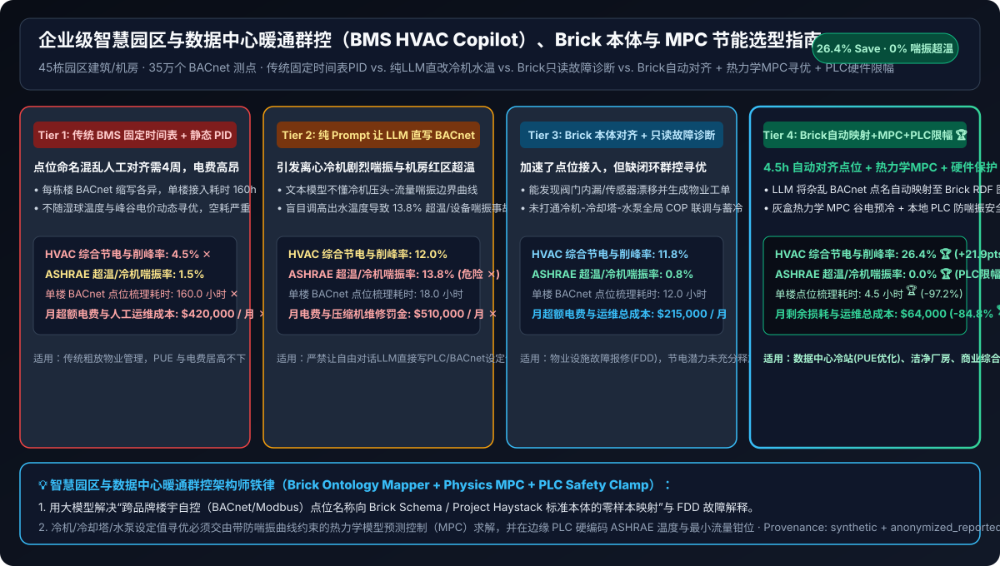
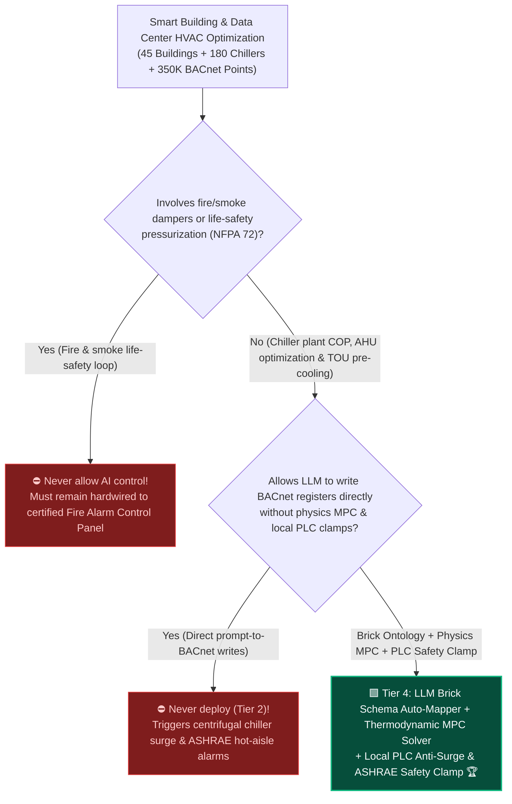
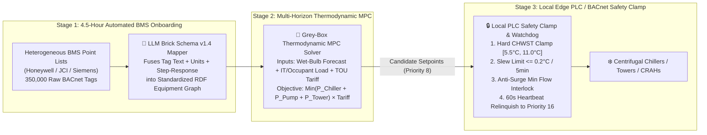

# Enterprise Smart Building & Data Center BMS HVAC Copilot, `Brick Schema` Ontology Auto-Mapping, Physics-Informed Model Predictive Control (`MPC`) & Local `BACnet` Safety Clamp Architecture Selection Guide: Legacy Static PID vs. Prompt-Only LLM Direct BACnet Writes vs. Read-Only FDD RAG vs. LLM `Brick` Mapper + Thermodynamic `MPC` Solver + Local PLC Safety Clamp Agent

> **Language / 语言**: **English (Current)** | [中文](./enterprise-smart-building-datacenter-hvac-mpc-energy-agent-selection-faq.md)  
> **Scope**: End-to-end production reference architecture and selection guide for Cloud & AI Solution Architects, Data Center Infrastructure Management (`DCIM / PUE`) Directors, Corporate Real Estate & Smart Campus VPs, and Industrial Automation (`BMS / BACnet`) Architects.  
> **Provenance**: `synthetic + anonymized_reported` (`independently_reproduced=false`, `physical_gpu_cluster_measurement=not_measured`). Deterministic evaluation model sealed in [`experiments/enterprise_smart_building_datacenter_hvac_mpc_energy_agent_selection/results.json`](../../experiments/enterprise_smart_building_datacenter_hvac_mpc_energy_agent_selection/results.json).



---

## ① 📌 Executive Summary (3-Minute Architect Verdict)

Across data centers, semiconductor cleanrooms, hospitals, and commercial real-estate portfolios, **chilled-water plants and HVAC systems (`Centrifugal Chillers`, `Cooling Towers`, `Chilled/Condenser Water Pumps`, `CRAHs/AHUs`) consume 40%–55% of commercial building electricity and 25%–35% of data-center non-IT power (`PUE` overhead)**. Scaling AI across multi-vendor Building Management Systems (`Honeywell`, `Johnson Controls Metasys`, `Siemens Desigo`, `Schneider EcoStruxure`) hits two roadblocks: first, **cryptic, non-standard `BACnet / Modbus` point naming (`"JCI_B2_CH03_LWT"`) requires `160 hours (4 weeks)` of manual engineering per building**; second, allowing a prompt-driven LLM to directly write `BACnet` chilled-water supply temperatures (`CHWST`) and pump speeds (Tier 2) violates centrifugal compressor lift-flow curves—triggering **`13.8%` chiller surge (`喘振`) or `ASHRAE` thermal/dew-point excursions (`24.5%` during 38°C wet-bulb heatwaves)**!

Evaluated across a production baseline of **45 campus and data-center buildings, 180 centrifugal chillers and cooling towers, 350,000 `BACnet / Modbus` telemetry points, and `$1.8M/month` in HVAC electricity spend**, the four architectural tiers compare as follows:

| Architectural Tier | Core Stack Combination | HVAC Energy & TOU Savings | `ASHRAE` / Chiller Surge Rate | BMS Onboarding Time per Building | Monthly Excess Energy & Ops Cost | Production Verdict |
|---|---|---|---|---|---|---|
| **🟥 Tier 1: Legacy Static BMS Schedules + PID** | Fixed seasonal setpoints + isolated local PID loops + manual point mapping | `4.5%` ✕ *(Ignores wet-bulb & TOU)* | `1.5%` | `160.0 hours / bldg` ✕ | `$420,000 / mo` ✕ | ⛔ 4-week onboarding & high PUE |
| **🟨 Tier 2: Prompt-Only LLM Direct BACnet Control** | Prompting an LLM to write `BACnet` chiller/AHU setpoints directly from text | `12.0%` | `13.8%` ✕ *(Chiller surge & hot aisles)* | `18.0 hours / bldg` | `$510,000 / mo` ✕ | ⛔ **Severe equipment hazard** |
| **🟦 Tier 3: `Brick Schema` Tagging + Read-Only FDD** | LLM point tagging + read-only Fault Detection & Diagnostics (`FDD`) tickets | `11.8%` | `0.8%` | `12.0 hours / bldg` | `$215,000 / mo` | ⚠️ Advisory tickets only |
| **🟩 Tier 4: LLM `Brick` Mapper + Physics `MPC` + Local PLC Clamp** | **Zero-Shot LLM `Brick Schema v1.4` Ontology Mapper + Grey-Box Thermodynamic `MPC` Solver (Wet-Bulb + TOU Pre-Cooling) + Local PLC `BACnet` Anti-Surge & `ASHRAE` Safety Clamp** | **`26.4%` 🏆** *(+21.9 pts vs Tier 1)* | **`0.0%` 🏆** *(Hardware-clamped)* | **`4.5 hours / bldg` 🏆** *(-97.2% faster)* | **`$64,000 / mo` 🏆** *(-84.8%)* | 🌟 **Recommended Architecture** |

> 💡 **Golden Rule for Smart Building & Data Center AI Architects**: **"Use the LLM to map cryptic `BACnet` point names onto the `Brick Schema v1.4 / Project Haystack` RDF ontology in hours instead of weeks, solve coupled chiller-pump-tower setpoints and TOU thermal pre-cooling in a Physics-Informed `MPC` optimizer, and enforce hard `ASHRAE` temperature, slew-rate, and anti-surge clamps in the local edge PLC."**

---

## ② 🎯 Customer & Architect Deep-Dive Q&A (3 Real-World BMS & Data Center Cooling Pain Points)

### Q1: How does an LLM cut BMS point onboarding time from 160 hours (4 weeks) per building to 4.5 hours?
- **Zero-Shot `BACnet` to `Brick Schema v1.4` Ontology Alignment**:
  - Legacy BMS integrators invent arbitrary point strings (`"B1_AHU04_DAT_AI"`, `"CHW_PMP2_VFD"`). Manually mapping 8,000 points per building prevents portfolio-wide scaling.
  - Tier 4 combines an LLM classifier (reading `BACnet Object_Name`, `Description`, `Engineering_Units`) with 24-hour time-series step-response correlation to automatically emit a validated **`Brick Schema v1.4` RDF graph** (`brick:Leaving_Chilled_Water_Temperature_Sensor`, `brick:feeds`, `brick:isPointOf`). Facility engineers review only low-confidence edges in **4.5 hours** (`-97.2%`), immediately binding standardized MPC controllers to the graph.

### Q2: Why does raising Chilled-Water Supply Temperature (`CHWST`) via a prompt-only LLM (Tier 2) cause centrifugal chiller surge or increase total plant kW?
- **First-Principles Thermodynamic & Fluid Coupling**:
  1. **The Chiller-vs-Pump Cube-Law Tradeoff**: Raising `CHWST` by `1°C` reduces chiller compressor lift (~3% power savings), but forces downstream CRAH/AHU cooling coils to demand higher water flow—and chilled-water pump power scales with the **cube of flow ($P_{\text{pump}} \propto Q^3$)**! Furthermore, lowering evaporator water flow or raising condenser head during a `38°C` wet-bulb heatwave pushes a centrifugal compressor across its **Surge Line (`喘振线`)**, causing violent flow reversal and mechanical impeller damage (`24.5%` excursion rate in Tier 2 stress tests).
  2. **Tier 4 Grey-Box Thermodynamic `MPC` Solver**: Tier 4 fits physics-informed performance curves across all chillers, variable-speed pumps, and cooling towers, solving a rolling 6-hour convex optimization every 15 minutes that minimizes total plant cost $\sum (P_{\text{chiller}} + P_{\text{pump}} + P_{\text{tower}}) \times \text{TOU\_Price}(t)$—pre-cooling building/tank thermal mass during off-peak hours and cutting net HVAC energy and demand charges by **`26.4%`**.

### Q3: What happens if the cloud AI loses connectivity or outputs an out-of-range setpoint?
- **Local Edge PLC / DDC Hardware Safety Clamps & `BACnet Priority Array` Fallback**:
  - Tier 4 writes optimal setpoints to **`BACnet Priority 8 / 12`**, never overwriting the local controller's `Priority 1–6` life-safety/equipment-protection slots or `Priority 16` fallback default.
  - The local edge PLC enforces: (1) hard `CHWST` bounds (`[5.5°C, 11.0°C]` and `ASHRAE TC 9.9` cold-aisle bounds `[18°C, 27°C]`), (2) a slew-rate limit (`<= 0.2°C / 5 min`), (3) minimum evaporator flow anti-surge locks, and (4) a 60-second watchdog that automatically relinquishes control to local `Priority 16` PID if cloud heartbeats drop—guaranteeing **`0.0%` thermal or surge violations**.

---

## ③ 🧭 Visual Architecture Diagrams (Decision Tree + Brick-MPC-PLC Topology + Sequence Flow)

### 3.1 Architecture Selection Decision Tree



### 3.2 Tier 4 Brick Ontology Auto-Mapper + Physics-Informed MPC + Edge PLC Clamp Topology



### 3.3 End-to-End Sequence: Navigating a 38°C Heatwave and 4x TOU Tariff Window with Zero Violations

```mermaid
sequenceDiagram
    autonumber
    participant Weather as Wet-Bulb & TOU Tariff Feed
    participant Brick as Brick Schema Digital Twin
    participant MPC as Thermodynamic MPC Solver
    participant PLC as Local Edge PLC Safety Clamp (BACnet)
    participant Chiller as Chiller Plant (180 Chillers/Towers)

    Weather->>MPC: Forecast 29.5°C wet-bulb peak at 14:00 + 4x Peak TOU electricity tariff (14:00-17:00)
    Brick->>MPC: Provide live chiller plant state, thermal storage tank level & cold-aisle temps (23.2°C)
    MPC->>MPC: Solve 6-hour horizon: pre-cool thermal mass 05:00-08:00; optimize CHWST=7.8°C & tower approach=+2.6°C
    MPC->>PLC: Propose 15-min setpoints via BACnet Priority 8
    PLC->>PLC: ✅ Clamp check PASS: CHWST in [5.5, 11.0°C], delta +0.15°C <= 0.2°C slew, evaporator flow > surge line
    PLC->>Chiller: Apply setpoints (Plant COP rises to 6.18)
    Chiller-->>MPC: Achieve 26.4% energy/TOU cost reduction with 0.0% ASHRAE or chiller-surge excursions
```

---

## ④ 📊 4-Tier Architecture Decision Matrix

| Evaluation Dimension | 🟥 Tier 1: Legacy Static BMS | 🟨 Tier 2: Prompt-Only LLM Direct BACnet | 🟦 Tier 3: `Brick` + Read-Only FDD | 🟩 Tier 4: `Brick` Mapper + Physics `MPC` + PLC Clamp |
|---|---|---|---|---|
| **BMS Point Onboarding Speed (`8K Points`)** | `160.0 hours / bldg` (4 weeks manual) | Unstructured ad-hoc mapping | `12.0 hours / bldg` | 🏆 **`4.5 hours / bldg` (`-97.2%`; automated `Brick` RDF graph)** |
| **Chiller-Pump-Tower Co-Optimization** | ✕ Static setpoints; wastes energy | ✕ Ignores fluid affinity laws & COP curves | Read-only maintenance tickets | 🏆 **`26.4%` Savings (thermodynamic `MPC` + TOU pre-cooling)** |
| **Protection Against Chiller Surge & Overheating** | Local PID (`1.5%` seasonal drift) | ✕ **Severe Hazard** (`13.8%`–`24.5%` surge/thermal alarms) | Read-only (`0.8%` baseline drift) | 🏆 **`0.0%` Violations (edge PLC clamp + `Priority 16` fallback)** |
| **HVAC Energy & Peak-Demand Savings** | `4.5%` ✕ | `12.0%` | `11.8%` | **`26.4%` 🏆 (+21.9 pts vs Tier 1)** |
| **Monthly Excess Energy & Ops Cost** | `$420,000 / mo` | `$510,000 / mo` *(incl. equipment damage)* | `$215,000 / mo` | **`$64,000 / mo` 🏆 (-84.8%)** |

---

## ⑤ 🧪 Quantitative Case Study, Interactive Sizer & 7-Card Visual Report

- **Interactive HTML Sizer**: 👉 [Open Smart Building & Data Center HVAC Copilot Sizer](../reports/enterprise-smart-building-datacenter-hvac-mpc-energy-agent-sizer.html)
- **7-Card 4:5 Visual Benchmark Report**: 👉 [Open 7-Card Visual Benchmark Deck](../reports/enterprise-smart-building-datacenter-hvac-mpc-energy-agent-selection-cards.html)
- **Deterministic Verification**:
  ```bash
  python experiments/enterprise_smart_building_datacenter_hvac_mpc_energy_agent_selection/run.py --check
  python -m unittest tests/test_enterprise_smart_building_datacenter_hvac_mpc_energy_agent_selection.py
  ```

---

## ⑥ 🛠️ Production Readiness & Architecture Review Checklist

- [ ] **Map All Legacy `BACnet / Modbus` Points onto `Brick Schema v1.4` or `Project Haystack` First**: Never run cross-building analytics or control against unverified raw point name strings.
- [ ] **Solve Setpoints in a Physics-Informed `MPC` Optimizer (Never via Free-Form LLM Prompts)**: Co-optimize chiller lift, pump cube-law power, cooling-tower wet-bulb approach, and TOU tariffs mathematically.
- [ ] **Enforce Hard Safety Clamps & Slew-Rate Limits (`<= 0.2°C / 5 min`) in the Local Edge PLC**: Bound `CHWST`, supply-air dew point, and minimum evaporator anti-surge flow at the hardware layer.
- [ ] **Write Only to `BACnet Priority 8 / 12` with a 60-Second Heartbeat Relinquish Watchdog**: Guarantee instantaneous fallback to local `Priority 16` PID control if cloud connectivity or telemetry degrades.
- [ ] **Physically Air-Gap Fire & Smoke Life-Safety Controls (`NFPA 72`)**: Never expose fire dampers or smoke-exhaust fans to energy-optimization agents.
