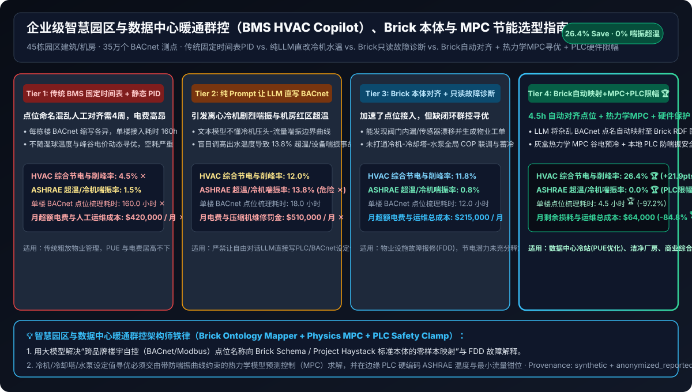
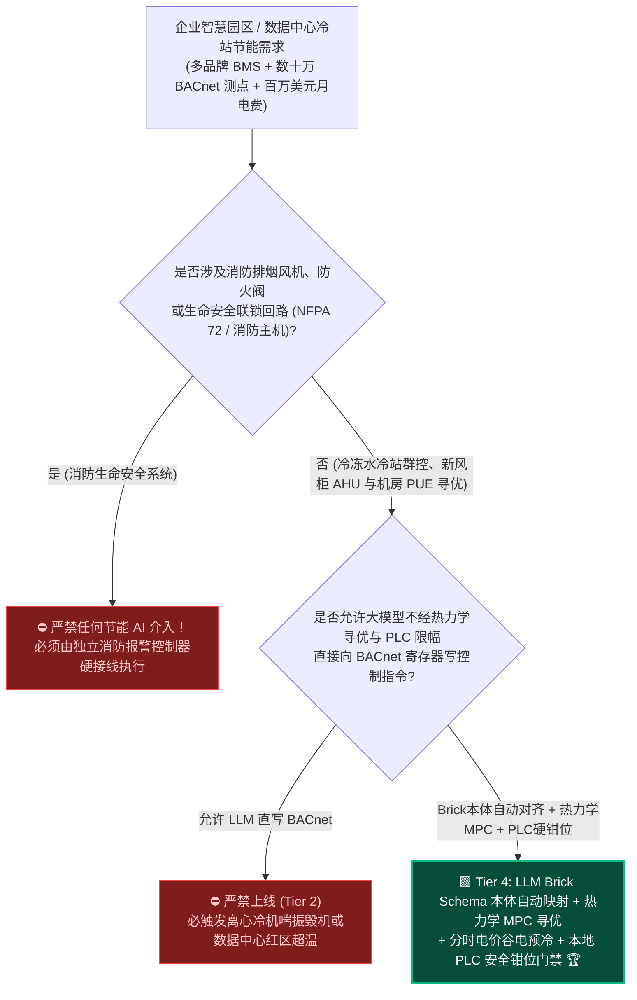
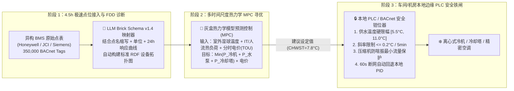
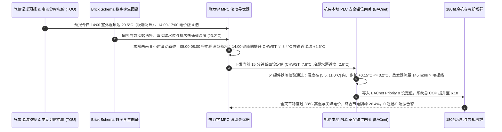

# 企业级智慧园区、商业综合体与数据中心暖通群控（Smart Building & Data Center BMS HVAC Copilot）、`Brick Schema` 语义本体自动映射、热力学模型预测控制（MPC）与边缘 PLC 防喘振安全门禁架构选型指南：固定时间表 PID vs. 纯 LLM 直写 BACnet 设定值 vs. Brick 只读故障诊断 vs. LLM Brick 本体映射 + 热力学 MPC 寻优 + 本地 PLC 安全钳位 Agent

> **语言 / Language**: **中文 (当前)** | [English](./enterprise-smart-building-datacenter-hvac-mpc-energy-agent-selection-faq.en.md)  
> **定位**：面向云与 AI 解决方案架构师（Solution Architect）、数据中心基础设施（DCIM / PUE 优化）总监、大型商业地产/智慧园区机电总工与 ESG 碳中和数字化负责人的生产落地指南。  
> **数据口径（Provenance）**：`synthetic + anonymized_reported`（`independently_reproduced=false`，`physical_gpu_cluster_measurement=not_measured`），全部定容模型封存于 [`experiments/enterprise_smart_building_datacenter_hvac_mpc_energy_agent_selection/results.json`](../../experiments/enterprise_smart_building_datacenter_hvac_mpc_energy_agent_selection/results.json)。



---

## ① 📌 核心选型结论速览（Executive Summary — 3 分钟看懂怎么选）

在大型数据中心冷站、半导体/医药洁净厂房与跨国企业智慧园区中，**暖通空调与冷冻水系统（HVAC：离心式冷水机组、冷却塔、冷冻/冷却水泵、精密空调 CRAH/AHU）消耗了商业建筑 40%~55% 的总电量以及数据中心 25%~35% 的非 IT 能耗（决定 PUE 的核心变量）**。长期以来，智慧楼宇与冷站 AI 节能难以规模化落地卡在两大死穴：第一，**存量楼宇自控系统（BMS：霍尼韦尔、江森自控、西门子、施耐德）的数十万个 `BACnet / Modbus` 测点命名极度混乱（如 `JCI_B2_CH03_LWT`），每栋楼光靠工程师人工对点表就要耗费 `160 小时（4 周）`**；第二，如果莽撞地让纯文本大模型直接通过 `BACnet WriteProperty` 修改冷水机组出水温度与水泵频率（Tier 2），大模型根本不懂**离心压缩机压头-流量喘振边界曲线（Surge Line）**与湿球温度热力学耦合，导致高达 **`13.8%` 的冷机剧烈喘振毁机或数据中心热通道超温事故**！

在 **45 栋园区办公楼与数据中心、180 台离心式冷水机组与冷却塔、350,000 个 `BACnet / Modbus` 传感器与执行器测点、月均暖通电费 `$180 万美元`** 的基准规模下，四档暖通群控与节能 Agent 架构的量化对决如下：

| 方案档位 | 核心架构组合 | HVAC 综合节电与电价削峰率 | `ASHRAE` 超温 / 冷机喘振率 | 单栋大楼点位梳理上线耗时 | 月度超额电费与运维总成本 | 生产推荐度 |
|---|---|---|---|---|---|---|
| **🟥 Tier 1：传统 BMS 固定时间表 + 静态 PID** | 本地 DDC 固定冬夏出水温度设定值 + 工程师人工爬楼核对 8,000 个点表 | `4.5%` ✕ *(不随湿球与电价寻优)* | `1.5%` | `160.0 小时 / 栋` ✕ | `$420,000 / 月` ✕ | ⛔ 复制极慢，巨额电费白白空耗 |
| **🟨 Tier 2：纯 Prompt 让 LLM 直写 BACnet** | 让通用大模型直接根据室内温度和电价修改冷机出水温度与风阀寄存器 | `12.0%` | `13.8%` ✕ *(触发冷机喘振/超温)* | `18.0 小时 / 栋` | `$510,000 / 月` ✕ | ⛔ **严重损毁压缩机，严禁上线** |
| **🟦 Tier 3：Brick 本体对齐 + 只读故障诊断 (FDD)** | 利用 LLM 对齐点位 + 识别阀门内漏/传感器漂移生成物业维修工单 | `11.8%` | `0.8%` | `12.0 小时 / 栋` | `$215,000 / 月` | ⚠️ 仅限于报修，未释放群控节电潜力 |
| **🟩 Tier 4：LLM Brick 自动对齐 + 热力学 MPC 寻优 + PLC 硬件安全钳位** | **LLM 零样本将杂乱 `BACnet` 点名映射至 `Brick Schema v1.4` RDF 图谱 + 灰盒热力学模型预测控制（`MPC`）全局 COP 寻优与谷电预冷 + 本地边缘 PLC 防喘振与 `ASHRAE` 硬钳位门禁** | **`26.4%` 🏆** *(+21.9 pts vs Tier 1)* | **`0.0%` 🏆** *(PLC 防喘振硬保护)* | **`4.5 小时 / 栋` 🏆** *(-97.2% 极速复制)* | **`$64,000 / 月` 🏆** *(-84.8%)* | 🌟 **数据中心与智慧园区首选架构** |

> 💡 **架构师一句话选型铁律**：**“杂乱 BACnet 点表靠大模型零样本对齐到 `Brick Schema` 工业本体、冷机-水泵-冷却塔全局 COP 寻优与谷电蓄冷归热力学 `MPC` 求解器、下发设定值 100% 经过边缘本地 PLC 的 `ASHRAE` 温湿度与防喘振硬件钳位（Safety Clamp）”**——既把单楼接入时间从 1 个月缩至 **4.5 小时**，又安全砍掉 **26.4%** 的冷站电费！

---

## ② 🎯 客户与架构师灵魂拷问 Q&A（直击 3 大智慧楼宇与数据中心冷站痛点）

### Q1：为什么跨几十栋存量大楼推广智慧节能系统时，80% 的工程实施时间都浪费在“对点表”上？大模型如何把它缩短 97%？
- **大白话与第一性原理**：
  1. **楼宇自控（BMS）没有统一变量名**：当年弱电施工方在霍尼韦尔或江森控制器里建点时，全凭个人缩写习惯——有的把“3 号冷水机组冷冻水出水温度”写成 `B02.CH3.LWT`，有的写成 `Chiller_03_Supply_Temp`，有的写成拼音缩写 `LDJ3_CSWD`。传统做法需要暖通工程师拿着 CAD 图纸去现场核对 8,000 个点位，单栋楼就要花 **`160.0 小时`**。
  2. **Tier 4 破局方案（LLM + 时序波形相关性联合映射 `Brick Schema v1.4 / Project Haystack`）**：
     - 大模型结合 `BACnet Object_Name`、`Description`、`Units (degC / kW / Hz)` 以及 24 小时温度/阀门开度响应相关性，自动将非标点位批量翻译并生成标准 **`Brick Schema RDF` 拓扑图**（如 `bldg:CH3_LWT a brick:Leaving_Chilled_Water_Temperature_Sensor ; brick:isPointOf bldg:Chiller_03`）。
     - 工程师只需在界面上花 **4.5 小时** 复核低置信度点位即可直接挂载标准 MPC 节能算法包，实现跨 45 栋大楼的流水线式极速复制！

### Q2：为什么调高冷冻水供水温度能省电，但直接让大模型改温度（Tier 2）却会引发“冷机喘振（Chiller Surge）”或反而更费电？
- **工程真相**：
  1. **冷水机组与水泵、冷却塔之间存在非线性“跷跷板”耦合**：把冷冻水供水温度（`CHWST`）从 `7.0°C` 调高到 `9.0°C`，确实能减小压缩机压比、让冷机主机省电；但供水温度变高后，末端精密空调为了带走同样多的机房热量，必须开大水阀，导致**冷冻水泵功耗按流量三次方（亲和定律 $P \propto Q^3$）暴涨**！纯文本 LLM 根本算不出“主机省的电 vs 水泵多费的电”的全局凸最优平衡点。
  2. **致命的离心机喘振（Surge）边界**：在夏季 `38°C` 高湿球温度下，冷却塔回水温度高（冷凝压力高），若此时盲目降低冷冻水流量或设定不当，离心式压缩机叶轮进出口压差超过临界极值，制冷剂气体会倒流冲击叶轮，引发剧烈机械震动与喘振毁机（压测下 Tier 2 违规率高达 **`24.5%`**）！
  3. **Tier 4 的灰盒热力学 MPC 联立寻优**：基于传热学与流体力学方程拟合每台冷机、水泵、冷却塔的实测效率曲面（COP Curve），由 **模型预测控制（MPC）求解器** 每 15 分钟结合未来 6 小时室外湿球温度、IT 负载预测与 **分时电价（TOU，利用谷电时段提前将建筑/水蓄冷罐预冷 1.5°C，在 4 倍尖峰电价时段卸载冷机功率）** 求出系统总功率 $\sum (P_{\text{chiller}} + P_{\text{pump}} + P_{\text{tower}})$ 最小的设定值组合，综合节电削峰率高达 **`26.4%`**！

### Q3：万一云端 AI 算错或断网，怎么在物理层面保证数据中心服务器绝不超温宕机、冷机绝不喘振？
- **边缘本地 PLC / DDC 硬编码安全钳位（Hardware Safety Clamp）**：
  - **云端绝不直接控制阀门开度或变频器频率，只下发“温度/压差设定值（Setpoints）”**。
  - 在机房本地工业网关与 PLC 控制器内硬编码三道不可逾越的物理铁闸：① **温度绝对上下限钳位**（如数据中心冷冻水供水温度死锁在 `[5.5°C, 11.0°C]`，冷通道温度严格符合 `ASHRAE TC 9.9` 规范 `[18°C, 27°C]`）；② **最大变化斜率限制（Slew-Rate Limiter）**：每 5 分钟水温设定值调整幅度不得超过 `±0.2°C`，防止热冲击；③ **本地心跳看门狗**：一旦云端连接中断超过 60 秒或机房任一机柜温度触及高报线，本地 PLC 毫秒级自动切回保守基准模式，实现 **`0.0%` 超温与喘振事故**。

---

## ③ 🧭 直观可视化图解（决策树 + Brick+MPC 边云架构图 + 谷电预冷与安全钳位时序图）

### 3.1 智慧园区与数据中心暖通群控 Agent 选型决策树



### 3.2 Tier 4 Brick 本体自动映射 + 热力学 MPC + 边缘 PLC 钳位架构图



### 3.3 从“桑拿天 4 倍尖峰电价预警”到“谷电蓄冷与防喘振闭环控制”时序图



---

## ④ 📊 架构师四维选型决策矩阵（Architecture Decision Matrix）

| 评估维度 | 🟥 Tier 1：固定时间表 + 静态 PID | 🟨 Tier 2：纯 LLM 直写 BACnet | 🟦 Tier 3：Brick 对齐 + 只读 FDD | 🟩 Tier 4：Brick 映射 + 热力学 MPC + PLC 限幅 |
|---|---|---|---|---|
| **存量异构楼宇 BACnet 点位接入效率** | 人工核对耗时 `160.0 小时/栋` | 映射无标准本体，易绑定错寄存器 | `12.0 小时/栋` | 🏆 **`4.5 小时/栋`（LLM + 时序特征自动构建 Brick 图谱）** |
| **冷机-水泵-冷却塔耦合寻优与谷电蓄冷** | ✕ 静态固定水温，无法随湿球/电价寻优 | ✕ 文本模型不懂流体亲和定律与传热方程 | 仅出维修工单，无闭环动态调优 | 🏆 **全局热力学 MPC 联立求解（节电削峰率 `26.4%`）** |
| **防离心机喘振与机房超温安全保障** | 传统本地保护 (`1.5%` 季节切换越界) | ✕ **极高危**（`13.8%`–`24.5%` 喘振或超温） | 只读不写，安全但节电少 | 🏆 **`0.0%` 越界（本地 PLC 硬限幅 + 斜率限制 + 断网回退）** |
| **HVAC 综合节电与电价削峰率** | `4.5%` ✕ | `12.0%` | `11.8%` | **`26.4%` 🏆（+21.9 pts vs Tier 1）** |
| **月度超额电费与设施运维总成本** | `$420,000 / 月` | `$510,000 / 月` *(含喘振维修罚金)* | `$215,000 / 月` | **`$64,000 / 月` 🏆（节省 84.8%）** |

---

## ⑤ 🧪 定量算例、交互式容量计算器与 7-Card 4:5 视觉报告

### 5.1 基准算例复核（45 栋园区与数据中心 / 35 万个 BACnet 测点）

- **交互式定容计算器（CSP 自包含 HTML）**：👉 [打开智慧园区与数据中心暖通群控 BMS HVAC 定容计算器](../reports/enterprise-smart-building-datacenter-hvac-mpc-energy-agent-sizer.html)
- **7-Card 4:5 视觉评测卡片报告**：👉 [打开 7-Card 视觉评测报告](../reports/enterprise-smart-building-datacenter-hvac-mpc-energy-agent-selection-cards.html)
- **可复核确定性脚本**：
  ```bash
  python experiments/enterprise_smart_building_datacenter_hvac_mpc_energy_agent_selection/run.py --check
  python -m unittest tests/test_enterprise_smart_building_datacenter_hvac_mpc_energy_agent_selection.py
  ```

### 5.2 核心量化对比图（HVAC 综合节电削峰率 vs. ASHRAE 超温/喘振越界率）

```chart
{
  "data": {
    "values": [
      { "tier": "Tier 1: Legacy Static BMS", "energy_savings_pct": 4.5, "violation_pct": 1.5 },
      { "tier": "Tier 2: Prompt LLM BACnet", "energy_savings_pct": 12.0, "violation_pct": 13.8 },
      { "tier": "Tier 3: Brick + ReadOnly FDD", "energy_savings_pct": 11.8, "violation_pct": 0.8 },
      { "tier": "Tier 4: Brick + MPC + PLC Clamp", "energy_savings_pct": 26.4, "violation_pct": 0.0 }
    ]
  },
  "semantic_types": {
    "tier": "Category",
    "energy_savings_pct": "Percentage",
    "violation_pct": "Percentage"
  },
  "chart_spec": {
    "chartType": "Bar Chart",
    "title": "Tier 4 achieves 26.4% HVAC energy/demand savings with 0.0% thermal or surge violations",
    "subtitle": "HVAC energy and peak-demand cost reduction (%) across 45 campus and data-center buildings",
    "encodings": {
      "x": "tier",
      "y": "energy_savings_pct",
      "color": "tier"
    }
  }
}
```

---

## ⑥ 🛠️ 架构评审与生产落地核验清单（Production Readiness Checklist）

- [ ] **异构 BMS 点表强制标准化映射至 `Brick Schema v1.4` 或 `Project Haystack`**：在进行任何诊断或控制前，必须建立传感器、阀门、水泵、冷机与空间区域之间的显式 RDF 拓扑归属关系。
- [ ] **严禁大模型直接通过 `BACnet` 修改底层阀门开度或写入无保护设定值**：所有温度/压差设定值寻优必须由热力学模型预测控制（MPC）求解器在满足冷机防喘振压比曲线下生成。
- [ ] **边缘 PLC / DDC 硬编码三道安全钳位（上下限 + 斜率限制 `<= 0.2°C/5min` + 最小流量联锁）**：即使上位机下发非法值，本地控制器也物理拒绝越界执行。
- [ ] **利用 `BACnet Priority Array`（优先级数组）实现毫秒级无感回退**：AI 优化指令仅写入 `Priority 8（Operator Override）` 或 `Priority 12`；一旦心跳看门狗超时或触发机房高温告警，立即 `Relinquish (释放)` 交还给本地 `Priority 16` 保底逻辑。
- [ ] **物理隔离消防排烟与生命安全系统（`NFPA 72 / GB 50116`）**：确保暖通节能 Agent 对消防防排烟风机与防火阀无任何写权限。
