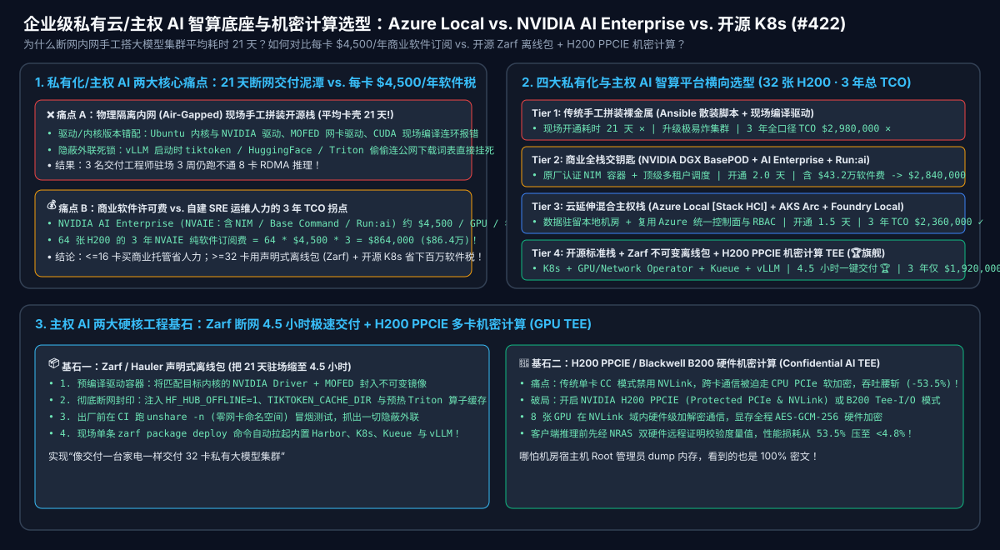
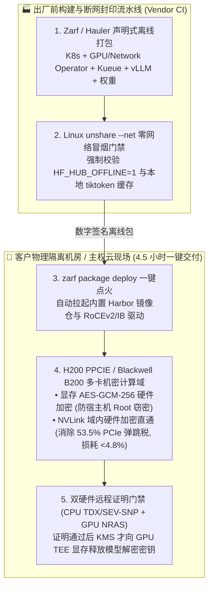

# 企业级私有云与主权 AI（Sovereign AI）智算底座及机密计算选型：`Azure Local (Azure Stack HCI)` vs. `NVIDIA AI Enterprise (BasePOD + Run:ai)` vs. `开源 K8s + Zarf 离线包 + H200 PPCIE 机密计算` 架构与 3 年 TCO 指南

> **语言 / Language**: **简体中文** | [English](./enterprise-sovereign-ai-appliance-azure-local-nvidia-aie-k8s-confidential-tco-selection-faq.en.md)  
> **配套交互式学习与精算工具**: [📱 交互式 H5 精读页 (主权 AI 一体机与机密计算 TCO 沙盘)](../h5/sovereign-ai-azure-local-nvidia-aie-k8s-confidential-tco-lab.html) · [🧮 HTML 交互式计算器](../reports/enterprise-sovereign-ai-appliance-azure-local-nvidia-aie-k8s-confidential-tco-selection-sizer.html) · [🃏 7-Card 4:5 视觉评测卡](../reports/enterprise-sovereign-ai-appliance-azure-local-nvidia-aie-k8s-confidential-tco-selection-cards.html) · [📊 可复核模型](../../experiments/enterprise_sovereign_ai_appliance_azure_local_nvidia_aie_k8s_confidential_tco_selection/) · [🎓 返回 AI Infra 全景精学馆](../h5/index.html)



---

## 一、3 分钟看懂核心结论（Executive Summary）

> **一句话决策结论**：金融核心、国防军工、政务内网与跨国药企在落地**数据不出本地机房的私有云/主权 AI（Sovereign AI）**时，面临两大极端陷阱：一是**手工拿散装脚本进物理隔离内网（Air-Gapped）现场拼装开源栈，因内核驱动错配与 `tiktoken / HuggingFace` 隐蔽外联死锁，平均驻场卡壳 `21 天（504 小时）`**；二是**盲目为上百张 GPU 全量采购 `$4,500/卡/年` 的商业软件许可（32 张卡 3 年纯软件税高达 `$43.2 万`，64 张卡高达 `$86.4 万`）**！
> - **≤ 16 张 GPU 或无专职 Linux/K8s 内核团队的金融/制造分支机构**：首选 **`Azure Local (原 Azure Stack HCI) + AKS Arc`**（若企业已用 Azure，可把云端控制面、RBAC 与 Foundry 模型目录无缝延伸到本地机房，`36 小时` 开通）或 **`NVIDIA DGX BasePOD + AI Enterprise (NIM + Run:ai)`**（原厂兜底 SLA）。
> - **≥ 32 张 GPU 或完全断网物理隔离内网（Air-Gapped）**：必须采用 **`Tier 4 开源标准栈 + Zarf/Hauler 声明式不可变离线包 + H200 PPCIE / Blackwell B200 多卡机密计算（Confidential GPU TEE）`**：
>   1. **现场交付从 `21 天` 压至 `4.5 小时`**：将预编译驱动容器（`GPU Operator + Network Operator`）、`Kueue` 调度器、`vLLM` 引擎及离线词表/算子缓存打包为单一数字签名 `Zarf` 镜像包，并在出厂前通过 `unshare -n` 断网 CI 验收；
>   2. **开启 `H200 PPCIE` 多卡机密计算消除 `53.5%` PCIe 加密税**：通过 NVLink 域内硬件级保护（`Protected PCIe & NVLink`）与双硬件远程证明（`NRAS`），将机密计算推理吞吐损耗从传统单卡模式的 **`53.5%` 压降至 `4.8%`**，同时省下 **`$43.2 万~$92 万` 的 3 年商业软件税（32 卡 3 年总 TCO 降至 `$192 万`，立省 `35.6%`）**！

| 核心选型维度 | `Tier 1: 手工散装脚本驻场 + 旧版单卡机密计算` | `Tier 2: 商业全栈交钥匙 (NVIDIA BasePOD + NVAIE $4,500/卡/年)` | `Tier 3: 云延伸混合主权栈 (Azure Local + AKS Arc)` | `Tier 4: 开源 K8s + Zarf 不可变离线包 + H200 PPCIE 机密计算 (🏆)` |
|---|---|---|---|---|
| **物理断网机房现场开通耗时** | `504 小时` (`21 天` ✕) | `48.0 小时` (`2.0 天`) ✓ | `36.0 小时` (`1.5 天`) ✓ | **`4.5 小时` (`zarf package deploy` 一键拉起)** 🏆 |
| **多卡机密计算 (`GPU TEE`) 吞吐损耗** | `-53.5%` ✕ (禁用 NVLink 走 CPU 软加密) | `-6.2%` ✓ (`H200 PPCIE`) | `-5.5%` ✓ | **`-4.8%` (`H200 PPCIE / B200 Tee-I/O` 硬件内联)** 🏆 |
| **32 张 H200 3 年纯软件订阅费** | `$0` (但驻场人力极贵) | `$432,000` (`$4,500/卡/年`) | `$192,000` (Arc 主机管理费) | **`$0` (100% CNCF/Apache 开源标准栈)** 🏆 |
| **宿主机 Root 管理员防窃密能力** | 仅单卡受保护，跨卡明文 ✕ | 硬件级显存与总线加密 ✓ | 硬件级显存与总线加密 ✓ | **显存 AES-GCM-256 + `NRAS` 双远程证明** 🏆 |
| **32 卡集群 3 年全口径总 TCO** | `$2,980,000` ✕ | `$2,840,000` | `$2,360,000` ✓ | **`$1,920,000` (-35.6% · 净省 `$106万`)** 🏆 |

---

## 二、核心技术原理与架构师灵魂拷问（Q&A）

### Q1：为什么进物理隔离内网（Air-Gapped）交付大模型时，哪怕提前拷好了 Docker 镜像和模型权重，现场启动 `vLLM / SGLang` 还是会100% 挂死？
1. **三大“隐蔽公网外联刺客（Hidden Egress Bombs）”**：
   - **刺客一（`tiktoken` 分词器词表实时下载）**：OpenAI / Qwen / Llama 的分词器在首次初始化时，若未检测到本地 SHA-1 命名的 `.tiktoken` 缓存文件，会尝试访问 `openaipublic.blob.core.windows.net` 下载词表，在内网无 DNS/无外网环境下直接卡死超时！
   - **刺客二（`HuggingFace Hub` 版本元数据校验）**：即便权重已在本地路径，`transformers` 默认仍会向 `huggingface.co` 发起 `HEAD` 请求核对 `config.json` 最新 commit hash！
   - **刺客三（`Triton / FlashInfer` 运行时 JIT 编译缓存与 PyTorch Hub）**：首次启动特定 Batch Size 时触发在线拉取或编译。
2. **根治铁律（`Zarf 不可变离线包 + unshare -n 断网门禁`）**：
   - 在容器构建阶段显式写入环境变量：`ENV HF_HUB_OFFLINE=1 TRANSFORMERS_OFFLINE=1 TIKTOKEN_CACHE_DIR=/opt/tiktoken_cache`；
   - 出厂前在 CI 流水线中强制使用 Linux 网络命名空间隔离命令运行端到端推理测试：
     ```bash
     unshare --net -- python -m vllm.entrypoints.openai.api_server --model /models/DeepSeek-R1-Distill-Qwen-32B
     ```
   - 只有在**连 loopback 以外任何网卡都不存在**的沙箱里成功吐出 Token，才允许打包进 `Zarf` 离线包发往客户现场！

### Q2：什么是大模型机密计算（`Confidential AI / GPU TEE`）？为什么在 `H100` 单卡 CC 模式下跑 70B 多卡推理会慢一半（`-53.5%`），而 `H200 PPCIE / Blackwell B200` 仅慢 `4.8%`？
1. **为什么主权 AI 需要 GPU 机密计算？**
   - 在政务云、联营算力中心或跨国银行托管机房中，业务部门不仅要防黑客，还要防**机房底层虚拟化管理员（Host Root / Hypervisor Admin）通过 `cuda-gdb` 或物理冷启动直接 Dump 显存中的百亿模型权重与明文客户 Prompt**！
2. **第一代单卡 CC 的“PCIe 加密弹跳税（Bounce Buffer Tax）”**：
   - 在早期单卡机密计算模式中，为了安全起见，硬件直接切断了卡间高速 `NVLink`；当 4 张或 8 张卡跑 `70B TP=4/8` 每层做 `AllReduce` 时，GPU 必须先把张量用 AES 加密 -> 经慢速 PCIe 传给 CPU 安全内存（AMD SEV-SNP / Intel TDX Bounce Buffer）-> 再加密发给下一张 GPU，**通信延迟暴增 12 倍，整体推理吞吐直接腰斩（`-53.5%`）**！
3. **`H200 PPCIE (Protected PCIe & NVLink)` 与 `Blackwell B200 Tee-I/O` 破局**：
   - 将整个 8 卡 `HGX` 节点（或 72 卡 `NVL72` 机柜）纳入统一的硬件信任域，**允许 GPU 之间通过硬件级认证加密的 `NVLink` 直接高速通信，完全绕开 CPU PCIe 弹跳缓冲**；
   - 配合 **`NVIDIA NRAS（Remote Attestation Service）`**，客户端网关在发送敏感 Prompt 前，先同时验证 `CPU SEV-SNP/TDX` 与 `GPU SPDM` 硬件签名证书，**在 `< 4.8%` 的极微性能损耗下实现显存、总线、权重与 Prompt 全链路硬件级密文保护**！



---

## 三、横向选型决策矩阵：`Azure Local` vs. `NVIDIA AI Enterprise` vs. `开源 K8s + Zarf`

| 评估维度 | `Azure Local (Azure Stack HCI) + AKS Arc` | `NVIDIA DGX BasePOD + AI Enterprise (NVAIE)` | `开源 K8s + Zarf 离线包 + GPU Operator + Kueue` |
|---|---|---|---|
| **核心定位** | **把 Azure 云原生控制面延伸至企业本地机房** | **NVIDIA 原厂软硬一体交钥匙商业栈** | **零软件许可税、100% 自主可控的云原生标准底座** |
| **软件授权费用** | 按物理核/Arc 订阅计费（对 Azure EA 客户有大幅折扣） | **`$4,500 / GPU / 年`**（含 NIM 微服务、Run:ai 与原厂工单支持） | **`$0 / GPU / 年`**（100% 开源组件组合） |
| **断网隔离支持** | 支持断网运行，但最佳体验需定期同步 Azure Arc 元数据 | 原生支持完全物理隔离机房（Air-Gapped NIM） | **通过 `Zarf / Hauler` 原生为军工/金融全断网环境量身定制** 🏆 |
| **最佳适用场景** | **已重度使用 Azure、需在本地工厂/医院保留数据驻留的混合云企业** | 预算充足、缺乏底层 K8s/GPU 运维团队、要求原厂兜底的金融机构 | **≥ 32 卡规模、追求极致 3 年 TCO 与完全自主可控的智算中心** 🏆 |

---

## 四、生产落地 Checklist（Pre-Production Checklist）

- [ ] **出厂前强制通过 `unshare --net` 零网络冒烟测试**：确保容器内预置全套 `tiktoken`、HuggingFace `tokenizer.json` 与预编译 `Triton / FlashInfer` 算子缓存。
- [ ] **使用 `GPU Operator` 预编译驱动容器替代宿主机手工装驱动**：确保节点扩容或重装系统时驱动版本 `100%` 比特级一致。
- [ ] **多卡机密计算强制开启 `H200 PPCIE`（而非单卡 CC 模式）**：保留 `NVLink` 高速互联，将机密推理损耗控制在 `5%` 以内。
- [ ] **密钥释放与硬件远程证明（`NRAS`）强绑定**：模型权重落盘保持加密态，仅当 GPU TEE 通过硬件远程证明后，由内网 KMS 将解密密钥直接注入 TEE 安全内存。

---

## 五、来源与方法论溯源（Provenance）

- **数据来源声明**：本指南实验数据来自可复核解析模型 [`experiments/enterprise_sovereign_ai_appliance_azure_local_nvidia_aie_k8s_confidential_tco_selection/run.py`](../../experiments/enterprise_sovereign_ai_appliance_azure_local_nvidia_aie_k8s_confidential_tco_selection/run.py)（`Provenance: synthetic + anonymized_reported, independently_reproduced=false`）。
