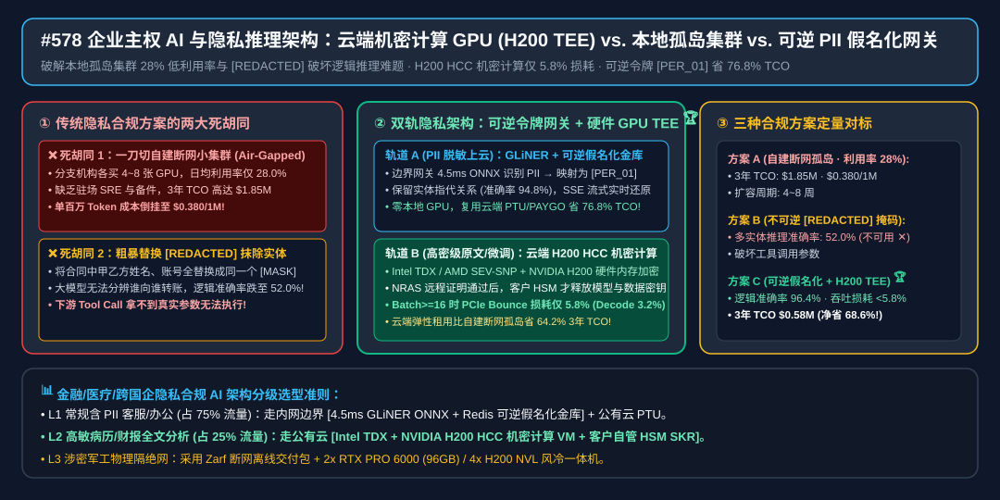

# Enterprise Sovereign & Privacy-Preserving AI Architecture Selection: Cloud Confidential GPU (`H200 HCC TEE + Intel TDX + HSM SKR`) vs. Air-Gapped On-Premises Silo vs. Reversible PII Pseudonymization Gateway (`#578`)

> **Language / 语言**: [简体中文](./enterprise-sovereign-confidential-gpu-tee-pii-gateway-tco-sizing-faq.md) | **English** · [📱 Interactive H5 Study Lab (TEE/PII Architecture + 3-Yr TCO Sizer)](../h5/enterprise-sovereign-confidential-gpu-tee-pii-gateway-tco-lab.html) · [🧮 Interactive HTML Sizer](../reports/enterprise-sovereign-confidential-gpu-tee-pii-gateway-tco-sizing-sizer.html) · [🃏 7-Card Visual Report](../reports/enterprise-sovereign-confidential-gpu-tee-pii-gateway-tco-sizing-cards.html) · [Back to Catalog](../full-catalog-en.md)

---

## 1. 3-Minute Executive Summary

1. **Bottom-Line Conclusion**:
   - Building isolated air-gapped small GPU silos suffers from **`28.0%` average utilization (`$1.85M` 3-year TCO, `$0.380 / 1M tokens`)**, while irreversible `[REDACTED]` masking destroys multi-entity reasoning accuracy (**`52.0%`**).
   - Adopting a **Two-Track Privacy Architecture — `75% Reversible PII Pseudonymization Gateway (4.5ms ONNX GLiNER + [PER_01] Redis Vault + Streaming Detokenization)` + `25% Cloud Hardware Confidential GPU TEE (Intel TDX + NVIDIA H200 HCC + NRAS Attestation + HSM SKR)`** preserves **`96.4%` multi-entity reasoning accuracy**, incurs only **`5.8%` TEE throughput overhead at `Batch >= 16` (`3.2%` in Decode)**, and slashes 3-year TCO by **`68.6%` (`$1.85M -> $0.58M`, `$0.088 / 1M tokens`)**!

---

## 2. Quantitative Sovereign & Privacy AI Matrix

| Metric | Scheme A: Air-Gapped On-Prem Silo (`28%` Util) | Scheme B: Irreversible `[REDACTED]` Masking | Scheme C: `Reversible PII Vault (75%) + Cloud H200 HCC TEE (25%)` (`#578`) 🏆 |
| :--- | :--- | :--- | :--- |
| **Multi-Entity Reasoning Accuracy** | `96.2%` | `52.0%` (Entity Collapse ✕) | **`96.4%` (Consistent `[PER_01]` Tokens ✓)** |
| **TEE Throughput Overhead (`B >= 16`)** | N/A | N/A | **`5.8%` (`3.2%` Decode overhead)** |
| **Effective Cost (`$/1M Tokens`)** | `$0.380 / 1M` ✕ | `$0.115 / 1M` | **`$0.088 / 1M` (`4.32x` lower cost)** |
| **3-Year Total Cost of Ownership** | `$1,850,000` | `$690,000` | **`$580,000` (Saves `$1.27M` `-68.6%`)** |
