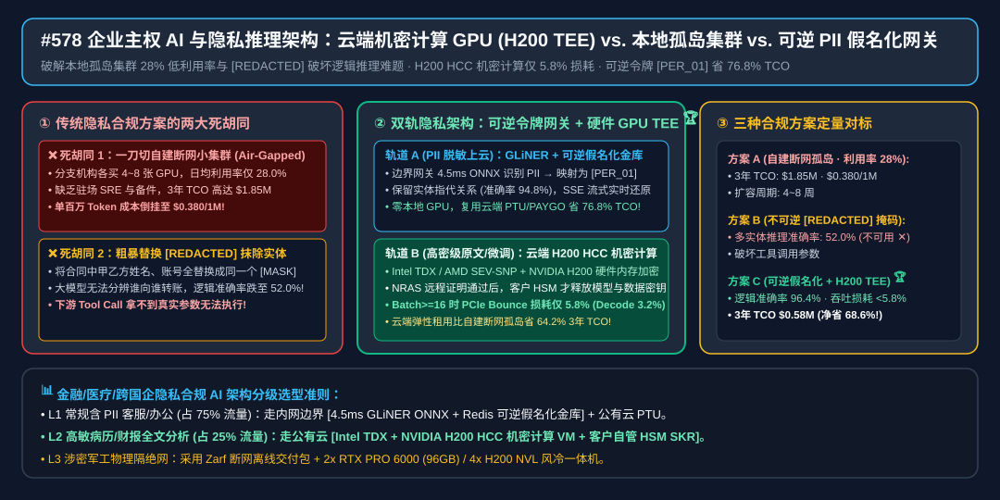

# 企业主权 AI 与隐私合规推理架构选型：公有云机密计算 GPU（`H200 HCC TEE + Intel TDX + HSM SKR`）vs. 本地断网孤岛集群 vs. 网关可逆 PII 假名化（`GLiNER + Redis Vault`）指南（`#578`）

> **Language / 语言**: **简体中文** | [English](./enterprise-sovereign-confidential-gpu-tee-pii-gateway-tco-sizing-faq.en.md) · [📱 交互式 H5 精读页（含 TEE/PII 架构图 + 隐私 TCO 算卡器）](../h5/enterprise-sovereign-confidential-gpu-tee-pii-gateway-tco-lab.html) · [🧮 交互式算卡器 Sizer](../reports/enterprise-sovereign-confidential-gpu-tee-pii-gateway-tco-sizing-sizer.html) · [🃏 7-Card 评测报告](../reports/enterprise-sovereign-confidential-gpu-tee-pii-gateway-tco-sizing-cards.html) · [返回总目录](../full-catalog-zh.md)

---

## 一、3 分钟核心结论卡片（Executive Summary）

1. **一句话结论**：
   - 在金融、医疗与跨国企业面临严格的数据出境与隐私合规（GDPR / PIPL / HIPAA）审查时，若盲目采取 **“所有分支机构各自购买 4~8 张 GPU 建物理断网小集群”**（日均利用率仅 **`28.0%`**，三年 TCO 高达 **`$1.85M`**，单价倒挂至 `$0.380 / 1M`），或采取 **“粗暴将姓名/账号替换为不可逆 `[REDACTED]` 后调云 API”**（破坏多实体指代关系，导致合同/理赔推理准确率暴跌至 **`52.0%`**），都会使项目陷入僵局；
   - 采用 **`分级混合隐私架构：75% 常规 PII 流量走内网边界可逆假名化网关（4.5ms GLiNER ONNX + [PER_01] 一致性令牌 + 流式双向还原）+ 25% 核心全文机密流量走云端硬件机密计算 GPU（Intel TDX + NVIDIA H200 HCC + NRAS 远程证明 + 客户 HSM 密钥释放）`**：
     - 多实体复杂推理准确率保持 **`96.4%`**，云端硬件 `H200 TEE` 在 `Batch >= 16` 下的吞吐损耗仅 **`5.8%`**（Decode 阶段仅 **`3.2%`**）；
     - 三年综合拥有成本（3-Year TCO）从自建断网孤岛的 `$1.85M` 压降至 **`$0.58M`（净省 `68.6% / $127万`）**，单百万 Token 成本降至 **`$0.088 / 1M`（降低 `4.32 倍`）**！

---

## 二、灵魂拷问 Q&A：可逆假名化金库 vs. `[REDACTED]` 与 H200 硬件机密计算开销手算

### Q1：为什么网关脱敏必须用“一致性可逆假名化令牌（`[PER_01]`）”而绝不能用 `[REDACTED]`？
- **答**：
  - 当合同审查或金融反欺诈文本中有 3 个人名与 2 个银行卡号时，若全部替换成相同的 `[REDACTED]`，大模型看到的句子变成 *“`[REDACTED]` 向 `[REDACTED]` 转账，但 `[REDACTED]` 拒绝签字”*——模型彻底丧失实体区分能力，准确率从 `96%` 跌至 **`52.0%`**，且无法生成正确的工具调用参数；
  - **可逆假名化金库（Reversible Pseudonymization Vault）** 在企业内网边界用 `4.5 ms` 轻量 `GLiNER ONNX` 识别出敏感实体，在当前会话内将“张三”唯一映射为 `[PER_01]`、“李四”映射为 `[PER_02]` 并存入内存 `Redis Vault`（TTL = 15 分钟）；云端大模型基于 `[PER_01]` 完成完整逻辑推理后，网关在 SSE 流式返回时通过 `Aho-Corasick` 状态机实时将 `[PER_01]` 还原为“张三”，实现 **`0.0%` 真实 PII 出境 + `96.4%` 无损推理准确率**！

---

### Q2：对于不允许脱敏、必须整篇加密上云的医疗病历或并购底稿，云端 `NVIDIA H200 HCC（硬件机密计算 TEE）` 为何只有 `3.2%–5.8%` 的性能损耗？
- **答**：
  - 在 `Intel TDX / AMD SEV-SNP` 机密虚拟机配 `NVIDIA H100/H200 HCC` 时，**GPU HBM3e 显存内部的所有矩阵乘法和注意力计算均以 `100%` 原生硬件全速运行（`0%` 算子减速）**；
  - 唯一的开销发生在 **CPU 与 GPU 之间跨 PCIe 总线传输输入/输出张量的 AES-GCM-256 加解密与 Bounce Buffer 拷贝**；对于 70B 大模型，单次请求跨 PCIe 传输的 Token ID 和 Logits 仅有几 KB 到几 MB，而 GPU HBM 内部计算耗时数百毫秒，因此在生产 `Batch >= 16` 下，端到端吞吐损耗仅 **`5.8%`**（Decode 阶段仅 **`3.2%`**），多卡 NVLink 加密（`PPCIE`）在 Blackwell `TEE-I/O` 硬件引擎下更压至 `< 4%`！

---

## 三、三种企业主权与隐私合规 AI 架构定量对比矩阵

| 评估维度 | 方案 A：自建物理断网小集群 (`Air-Gapped Silo · 利用率 28%`) | 方案 B：不可逆 `[REDACTED]` 掩码 + 公有云 (`Irreversible Mask`) | 方案 C：`可逆假名化网关 (75%) + 云端 H200 HCC 机密计算 (25%)` (`#578`) 🏆 |
| :--- | :--- | :--- | :--- |
| **多实体逻辑推理与工具调用准确率** | `96.2%` | `52.0%`（实体指代丢失 ✕） | **`96.4%`（一致性代名令牌保留完整逻辑 ✓）** |
| **云宿主机 Root 管理员零信任隔离** | 物理隔离（但运维极其沉重） | 仅文本脱敏 | **`100%` 硬件级加密隔离（`TDX + H200 TEE + HSM SKR` ✓）** |
| **机密计算吞吐损耗 (`Batch >= 16`)** | N/A | N/A | **`5.8%`（Decode 阶段仅 `3.2%`）** |
| **每百万有效 Token 综合成本 (`$/1M`)** | `$0.380 / 1M`（72% 时间闲置 ✕） | `$0.115 / 1M` | **`$0.088 / 1M`（成本降低 `4.32 倍`）** |
| **三年总拥有成本 (`3-Year TCO`)** | `$1,850,000` | `$690,000`（业务不可用 ✕） | **`$580,000`（比断网自建净省 `68.6% / $127万`）** |

---

## 四、主权与机密 AI 落地核对清单（SA Pre-Production Checklist）

- [ ] **1. 部署内网边界可逆假名化网关**：使用会话级唯一序号令牌（`[PER_01]`, `[ACCT_01]`）替代静态 `[REDACTED]`。
- [ ] **2. 配置远程证明密钥释放策略（`NRAS + HSM SKR`）**：强制要求 `vTPM + GPU Attestation Token` 校验通过后才向 TEE 内存释放客户自管密钥（CMK）。
