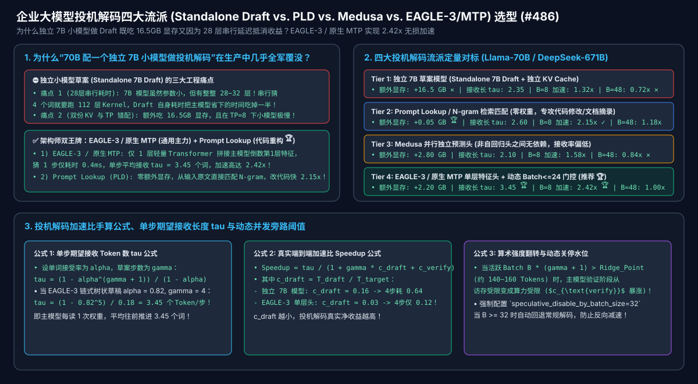

# Enterprise Speculative Decoding Selection Guide: `Standalone Draft` vs. `Prompt Lookup (PLD)` vs. `Medusa` vs. `EAGLE-3 / Native MTP` (#486)

> **Executive Summary**:
> Pairing a `70B` LLM with a standalone `7B` draft model (`Tier 1`) consumes **`+16.5 GB` of extra VRAM** (separate weights and KV Cache), suffers high draft latency across 28–32 serial layers ($c_{\text{draft}} \approx 0.16$), yields only `1.32x` speedup at `Batch = 8`, and degrades throughput to `0.72x` at `Batch = 48`. For **Cloud & AI Solution Architects**, production speculative decoding relies on two paradigms:
> 1. **General Chat & Reasoning Flagships (Recommended Tier 4)**: **`EAGLE-3` or Native Multi-Token Prediction (`MTP`)** attaches a single autoregressive feature layer to the target model's penultimate hidden states ($c_{\text{draft}} \approx 0.03$, acceptance $\alpha = 0.82$, $\tau = \mathbf{3.45}$ tokens/step), delivering a **`2.42x` lossless speedup** at `Batch <= 24` with automatic dynamic bypass above `Batch = 32`;
> 2. **Code Refactoring & Grounded RAG (Recommended Tier 2)**: **Prompt Lookup Decoding (`PLD / N-gram`)** matches token spans directly from the input prompt with **`0 GB` extra weights**, achieving a **`2.15x` speedup**.
>
> **⚡ Interactive H5 Study Lab**: [**Open the Speculative Decoding Acceptance ($\tau$), Speedup & Batch Cutoff Calculator (`docs/h5/speculative-decoding-draft-pld-eagle3-mtp-lab.html`)**](../h5/speculative-decoding-draft-pld-eagle3-mtp-lab.html)

---

## 1. Core Q&A: Hand-Calculating Expected Accepted Tokens ($\tau$) and Net Speedup

### Q1: What is the exact closed-form equation for speculative decoding speedup?
With per-token acceptance rate $\alpha$, draft lookahead steps $\gamma$, relative single-step draft cost $c_{\text{draft}}$, and batch-dependent verification overhead $c_{\text{verify}}(B)$:

$$\tau(\alpha, \gamma) = \frac{1 - \alpha^{\gamma + 1}}{1 - \alpha}, \qquad \text{Speedup}(B) = \frac{\tau(\alpha, \gamma)}{1 + \gamma \cdot c_{\text{draft}} + c_{\text{verify}}(B)}$$

Always configure `speculative_disable_by_batch_size = 24–32` so the engine bypasses draft generation when $B \cdot (\gamma + 1)$ crosses the GPU Roofline ridge point.

---

## 2. Quantitative Decision Matrix

| Speculative Decoding Paradigm | Extra VRAM (GB) | Mean Accepted Tokens ($\tau$) | Speedup (`Batch=8`) | Speedup (`Batch=48`) |
| :--- | :--- | :--- | :--- | :--- |
| **Tier 1: Standalone `7B` Draft Model + Separate KV** | `+16.50 GB` ✕ | `2.35 tok/step` | `1.32x` | `0.72x` (Slowdown ✕) |
| **Tier 2: `Prompt Lookup (PLD / N-gram)` Zero-Weight Match** | **`+0.05 GB` 🏆** | `2.60 tok/step` | `2.15x` ✓ | `1.18x` ✓ |
| **Tier 3: `Medusa` Parallel Independent Heads** | `+2.80 GB` | `2.10 tok/step` | `1.58x` | `0.84x` (Slowdown ✕) |
| **Tier 4: `EAGLE-3 / Native MTP` + Dynamic Batch Gate 🏆** | `+2.20 GB` ✓ | **`3.45 tok/step` 🏆** | **`2.42x` 🏆** | **`1.00x` (Auto-Bypass 🏆)** |
