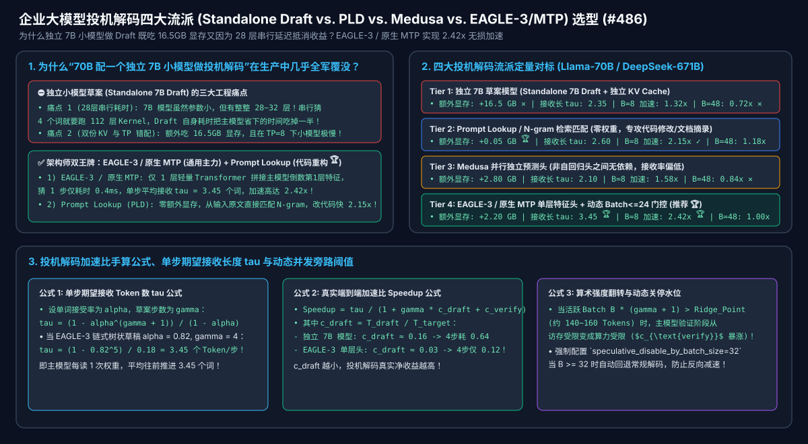
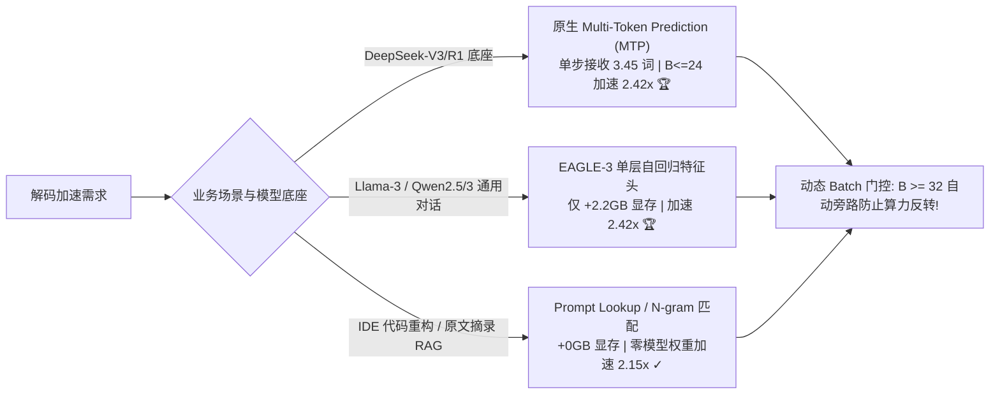

# 企业大模型投机解码四大流派（`Standalone Draft` vs. `Prompt Lookup PLD` vs. `Medusa` vs. `EAGLE-3 / 原生 MTP`）选型与手算指南 (#486)

> **核心观点（Executive Summary）**：
> 投机解码（`Speculative Decoding`）是攻克单请求吐字延迟（`TPOT <= 8ms`）的核心武器，但在企业生产落地时，选错投机流派会导致 **“花了 16.5GB 显存，加速不到 1.3 倍，高并发下还倒退 28%”**！最典型的踩坑是沿用早期教科书方案 **“给 70B 主模型配一颗独立的 7B 小模型做 Draft（Tier 1）”**——因为 7B 模型自身也有 28~32 层 Transformer，串行猜 4 个词就要启动 112 层 Kernel，Draft 自身延迟吃掉了大半收益。作为 **Cloud & AI Solution Architect**，现代生产环境投机解码必须认准两大主力：
> 1. **通用对话与深度推理主力（推荐 Tier 4）**：采用 **`EAGLE-3`（针对 Llama/Qwen）或模型原生多词预测头 `Native MTP`（如 DeepSeek-V3/R1 14B MTP 头）**，仅需 **1 层** 轻量级自回归特征层，猜 1 步仅耗 `0.4ms`，单步平均接收长度高达 **`3.45` 个 Token**，在中低并发（$B \le 24$）下实现 **`2.42x` 数学完全无损加速**，并配置 `speculative_disable_by_batch_size = 32` 自动旁路高并发；
> 2. **代码编辑/重构与 RAG 原文摘录场景（推荐 Tier 2）**：开启 **零权重检索式投机（`Prompt Lookup Decoding / N-gram Match`）**，额外显存开销为 **`0 GB`**，直接从输入上下文拷贝匹配代码行，加速比达 **`2.15x`**！
>
> **⚡ 配套交互式 H5 精读沙盘**：[**打开投机解码四大流派接收率 $\tau$、加速比与动态 Batch 关停水位计算器 (`docs/h5/speculative-decoding-draft-pld-eagle3-mtp-lab.html`)**](../h5/speculative-decoding-draft-pld-eagle3-mtp-lab.html)

---

## 一、 灵魂拷问：为什么 `EAGLE-3 / MTP` 只有 1 层却比 28 层的独立 `7B` 小模型猜得既快又准？

### Q1：怎样用数学公式手算投机解码的“单步期望接收 Token 数 $\tau$”与“真实端到端加速比”？
1. **单步期望接收长度 $\tau$ 公式**：
   设草案模型每步预测的 Token 被主模型验证通过的平均概率为 $\alpha \in (0, 1)$，连续前瞻猜测步数为 $\gamma$（通常 $\gamma = 3\text{–}5$），由于验证阶段最后总会白送 1 个由主模型直接采样修正的 Bonus Token，单次主模型前向传播平均产出的有效 Token 数为：
   $$\tau(\alpha, \gamma) = \frac{1 - \alpha^{\gamma + 1}}{1 - \alpha}$$
   - 当 $\alpha = 0.82, \gamma = 4$ 时：$\tau = \frac{1 - 0.82^5}{1 - 0.82} \approx \mathbf{3.45\text{ Tokens / Step}}$！
2. **计入草案开销 $c_{\text{draft}}$ 与验证膨胀 $c_{\text{verify}}(B)$ 的真实加速比公式**：
   $$\text{Speedup}(B) = \frac{\tau(\alpha, \gamma)}{1 + \gamma \cdot c_{\text{draft}} + c_{\text{verify}}(B)}, \quad \text{其中 } c_{\text{draft}} = \frac{T_{\text{draft\_step}}}{T_{\text{target\_step}}}$$
   - **为什么独立 7B 草案模型（Tier 1）跑不快？**
     7B 模型跑 28 层的单步延迟 $c_{\text{draft}} \approx 0.16$（猜 4 步就要花掉 $4 \times 0.16 = 0.64$ 个主模型周期！），且由于只看词表 Embedding 缺乏主模型高层语义特征，$\alpha \approx 0.68$（$\tau = 2.35$），代入得 $\text{Speedup} = 2.35 / (1 + 0.64 + 0.14) = \mathbf{1.32\times}$；
   - **为什么 `EAGLE-3 / 原生 MTP`（Tier 4）能飙到 `2.42x`？**
     `EAGLE-3 / MTP` 直接把主模型倒数第一层的丰富隐藏状态特征（Hidden States $f_{t}$）与词向量拼接，只用 **1 层** Transformer 即可实现高达 $\alpha = 0.82$（$\tau = 3.45$）的命中率，且 1 层耗时仅 $c_{\text{draft}} \approx 0.03$（4 步仅耗 $0.12$）：
     $$\text{Speedup}_{\text{EAGLE-3}} = \frac{3.45}{1 + 4 \times 0.03 + 0.30} = \mathbf{2.42\times}$$

### Q2：为什么在代码重写（Code Edit）和文档问答（RAG Grounded QA）里，零权重的 `Prompt Lookup (PLD)` 是性价比之神？
- 在 IDE 代码修改（如“把这 200 行代码里的某一个函数加上异常处理，其余保持不变”）或 RAG 摘录场景中，**模型输出的 70% 以上代码片段其实原封不动地出现在输入 Prompt 里**！
- `Prompt Lookup Decoding (PLD / N-gram)` 直接在输入 Prompt 中查找与当前已生成末尾 3 个 Token 匹配的子串，把后面的 5~10 个词直接零成本复制出来当草案送给主模型验证（$c_{\text{draft}} = 0$，额外显存 **`0 GB`**），直接获得 **`2.15x` 免费加速**！

---

## 二、 投机解码四大流派选型决策矩阵（`Llama-70B / DeepSeek-671B`）

| 投机解码技术流派 | 额外显存开销 (GB) | 单步平均接收长度 $\tau$ | 低并发 (`B=8`) 加速比 | 高并发 (`B=48`) 加速比 |
| :--- | :--- | :--- | :--- | :--- |
| **Tier 1: 独立 7B 小草案模型（`Standalone 7B Draft` + 独立 KV）** | `+16.50 GB` ✕ | `2.35 tok/step` | `1.32x` | `0.72x`（反向减速 ✕） |
| **Tier 2: `Prompt Lookup (PLD / N-gram)` 零权重原文检索匹配** | **`+0.05 GB` 🏆** | `2.60 tok/step` | `2.15x` ✓ | `1.18x` ✓ |
| **Tier 3: `Medusa` 并行独立预测头（头间无自回归依赖）** | `+2.80 GB` | `2.10 tok/step` | `1.58x` | `0.84x`（反向减速 ✕） |
| **Tier 4: `EAGLE-3 / 原生 MTP` 单层特征头 + 动态 Batch 门控（推荐 🏆）** | `+2.20 GB` ✓ | **`3.45 tok/step` 🏆** | **`2.42x` 🏆** | **`1.00x`（自动旁路保底 🏆）** |

---

## 三、 生产落地核对清单（SA Production Checklist）

- [ ] **淘汰独立多卡 7B/8B Draft 模型**：新上线 `70B` 推理集群一律采用单层 **`EAGLE-3`** 权重头，`DeepSeek-V3/R1` 一律开启原生 **`MTP`** 头。
- [ ] **强制配置动态 Batch 自动关停阈值**：在 `vLLM / SGLang` 中设置 `--speculative-disable-by-batch-size 24`（或 `32`），防止高峰期 $B \times (\gamma + 1)$ 突破 GPU Roofline 算术强度拐点导致全站 `TPOT` 劣化。
- [ ] **代码补全与修改集群开启 `ngram / PLD`**：对于无现成 EAGLE-3 权重的垂直微调代码模型，直接开启 `--speculative-model [ngram]` 零成本获取 2 倍加速。

---

## 四、 延伸阅读与配套工具

- **交互式 H5 精学沙盘**：[docs/h5/speculative-decoding-draft-pld-eagle3-mtp-lab.html](../h5/speculative-decoding-draft-pld-eagle3-mtp-lab.html)
- **7-Card 4:5 视觉评测卡片**：[docs/reports/enterprise-speculative-decoding-draft-pld-eagle3-mtp-acceptance-selection-cards.html](../reports/enterprise-speculative-decoding-draft-pld-eagle3-mtp-acceptance-selection-cards.html)
- **交互式 Sizer 测算器**：[docs/reports/enterprise-speculative-decoding-draft-pld-eagle3-mtp-acceptance-selection-sizer.html](../reports/enterprise-speculative-decoding-draft-pld-eagle3-mtp-acceptance-selection-sizer.html)
- **可复现实验模型**：[`experiments/enterprise_speculative_decoding_draft_pld_eagle3_mtp_acceptance_selection/run.py`](../../experiments/enterprise_speculative_decoding_draft_pld_eagle3_mtp_acceptance_selection/run.py)
