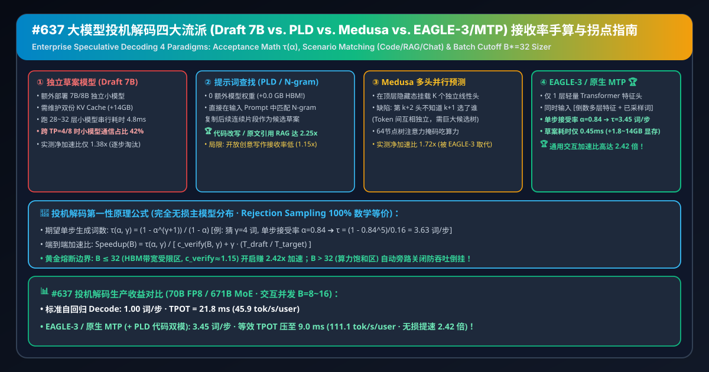

# Enterprise Speculative Decoding 4 Paradigms (`Standalone Draft 7B` vs. `Prompt Lookup PLD` vs. `Medusa` vs. `EAGLE-3 / Native MTP`): Acceptance Math $\tau(\alpha)$, Scenario Matching & Batch Cutoff ($B^*=32$) Sizer (`#637`)

> **Language / 语言**: [简体中文](./enterprise-speculative-decoding-pld-medusa-eagle3-mtp-batch-sizing-faq.md) | **English** · [📱 Interactive H5 Study Lab (with τ(α) Calculator + 4-Paradigm Sandbox)](../h5/speculative-decoding-pld-medusa-eagle3-mtp-batch-lab.html) · [🧮 Interactive Sizer](../reports/enterprise-speculative-decoding-pld-medusa-eagle3-mtp-batch-sizing-sizer.html) · [🃏 7-Card Visual Report](../reports/enterprise-speculative-decoding-pld-medusa-eagle3-mtp-batch-sizing-cards.html) · [Back to Catalog](../full-catalog-en.md)

---

## 1. 3-Minute Executive Summary

1. **Bottom-Line Recommendation**:
   - Autoregressive decode is strictly HBM-bandwidth-bound at interactive batch sizes ($B \le 32$), leaving `85%–92%` of GPU Tensor Core FLOPS idle. **Speculative Decoding** harvests those idle FLOPS to verify $\gamma+1$ tokens in a single weight read with **100% mathematically lossless output distribution**.
   - **Four-Paradigm Selection Verdict**:
     - **Retire `Standalone Draft 7B` models** (`1.38×` speedup): Running a 28-layer draft model across `TP=4/8` incurs `4.8 ms` draft overhead and dual KV Cache maintenance.
     - **Use `PLD (Prompt Lookup Decoding)` for Code Edits & Extractive RAG (`2.25×` speedup at `+0.0 GB` HBM)**: Zero draft weights; copies N-gram spans directly from input context.
     - **Use `EAGLE-3 / Native MTP` as the Universal Production Standard (`2.42×` speedup, `3.45 tok/step`, `21.8ms → 9.0ms` effective TPOT)**: Uses a single lightweight Transformer feature layer (`0.45 ms` draft latency), paired with an automatic **`B > 32` batch bypass gate** to prevent compute saturation at high concurrency!

---

## 2. Four-Paradigm Comparison Matrix (`70B FP8 / 671B MoE · Interactive Batch B=8–16`)

| Metric | ① `Standalone Draft 7B` | ② `Prompt Lookup (PLD)` 🏆 | ③ `Medusa Multi-Head` | ④ `EAGLE-3 / Native MTP` 🏆 |
| :--- | :--- | :--- | :--- | :--- |
| **Extra HBM Footprint** | `+14 GB` + separate KV | **`+0.0 GB` (zero weights!)** | `+1.5 – 2.5 GB` | `+1.8 GB` (`EAGLE-3`) / `+14 GB` (`671B MTP`) |
| **Draft Step Latency ($\gamma=4$)** | `4.80 ms` (28 layers ✕) | **`0.05 ms` (N-gram match)** | `0.35 ms` | **`0.45 ms` (1 feature layer ✓)** |
| **Mean Accepted Tokens ($\tau$)** | `2.40 tok/step` | `3.10` (Code/RAG) | `2.35 tok/step` | **`3.45 tok/step` ($\alpha \approx 0.84$ ✓)** |
| **Net Speedup ($B \le 16$)** | `1.38×` | **`2.25×` (Code/RAG)** | `1.72×` | **`2.42×` (`21.8ms → 9.0ms` TPOT ✓)** |
