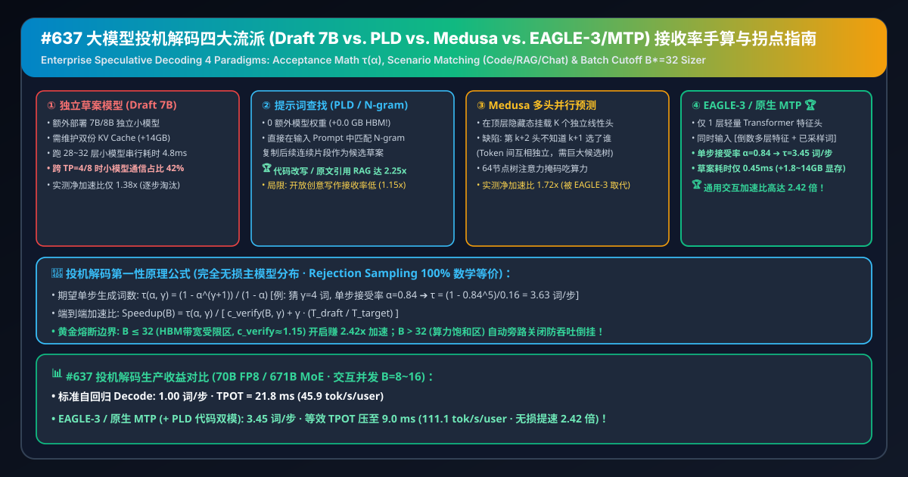

# 企业大模型投机解码四大流派（`独立 Draft 7B` vs. `提示词查找 PLD` vs. `Medusa` vs. `EAGLE-3 / 原生 MTP`）接收步长 $\tau(\alpha)$ 手算、场景选型与高并发 $B^*=32$ 自动熔断指南（`#637`）

> **Language / 语言**: **简体中文** | [English](./enterprise-speculative-decoding-pld-medusa-eagle3-mtp-batch-sizing-faq.en.md) · [📱 交互式 H5 精读页（含 τ(α) 接收步长计算器 + 四大流派对比沙盘）](../h5/speculative-decoding-pld-medusa-eagle3-mtp-batch-lab.html) · [🧮 交互式容量计算器 Sizer](../reports/enterprise-speculative-decoding-pld-medusa-eagle3-mtp-batch-sizing-sizer.html) · [🃏 7-Card 评测报告](../reports/enterprise-speculative-decoding-pld-medusa-eagle3-mtp-batch-sizing-cards.html) · [返回总目录](../full-catalog-zh.md)

---

## 一、3 分钟核心结论卡片（Executive Summary）

1. **一句话结论**：
   - 自回归大模型 Decode 阶段之所以慢，是因为每生成 `1` 个 Token 都要把几十甚至几百 GB 的模型权重从 HBM 读一遍，而 GPU Tensor Core 算力有 **`85%–92%` 处于闲置饥饿状态**。**投机解码（Speculative Decoding）**利用这片免费的空闲算力，先用极轻量的机制快速猜出 $\gamma = 3\text{--}5$ 个候选词，再让主模型**只读 `1` 次权重就并行验证全部 $\gamma+1$ 个词**，且通过拒绝采样（Rejection Sampling）保证输出分布与主模型 **100% 数学无损等价**！
   - **四大流派终极选型结论**：
     1. **彻底淘汰“独立 `7B/8B Draft` 小模型”**：需维护双份 KV Cache，且 28–32 层小模型串行推理耗时达 `4.8 ms`（在 `TP=4/8` 下通信开销占比 `42%`），实测净加速仅 **`1.38 倍`**；
     2. **代码改写与原文引用 RAG 首选 `PLD（Prompt Lookup Decoding）`**：**`0` 字节额外显存、无需任何草案权重**，直接在输入上下文里匹配 N-gram 复制后续片段，在代码重写（Fast-Apply）与合同原文摘录场景无损提速 **`2.25 倍`**；
     3. **通用对话、Agent 与深度推理首选 `EAGLE-3 / 原生 MTP（Multi-Token Prediction）`**：仅用 **`1` 层轻量 Transformer 特征头**（绑定主模型特征与最新采样 Token），草案耗时仅 **`0.45 ms`**，单步平均接收 **`3.45 个词`**，在中低并发（$B \le 32$）下将等效 `TPOT` 从 `21.8 ms` 压降至 **`9.0 ms`（无损提速 `2.42 倍`，达 `111.1 tok/s/user`）**，并在高并发 $B > 32$ 时自动旁路关断以保最高集群总吞吐！

2. **投机解码两大核心手算公式（架构师白板必背）**：
   - **公式 ①：单步期望生成词数 $\tau(\alpha, \gamma)$（Geometric Acceptance Series）**
     - 设草案每次向前猜 $\gamma$ 步，主模型对每个候选词的条件接受概率为 $\alpha \in [0, 1]$，则主模型一次前向验证平均产出的有效 Token 数为（哪怕第 1 个词就被拒，主模型自己也会保底产出 1 个正确词）：
       $$\tau(\alpha, \gamma) = \sum_{i=0}^{\gamma} \alpha^i = \frac{1 - \alpha^{\gamma + 1}}{1 - \alpha}$$
     - **算例**：对 `EAGLE-3 / 原生 MTP`（在代码/JSON/分析任务上 $\alpha \approx 0.84$，猜 $\gamma = 4$ 步），理论 $\tau = (1 - 0.84^5) / 0.16 = \mathbf{3.63\text{ 词/步}}$（工程实测含树验证均值约 **`3.45 词/步`**）。
   - **公式 ②：考虑批大小膨胀系数 $c(B, \gamma)$ 的真实加速比公式**
     $$\text{Speedup}(B) = \frac{\tau(\alpha, \gamma)}{c(B, \gamma) + \gamma \cdot \frac{T_{\text{draft}}}{T_{\text{target}}}}$$
     - 当 $B \le 16$（纯粹受限于 HBM 权重搬运）：一次验证 $(\gamma+1)B$ 个 Token 与验证 $B$ 个 Token 的主模型耗时几乎相同（$c(B, \gamma) \approx 1.15$），而 1 层 `EAGLE-3/MTP` 的 $T_{\text{draft}} / T_{\text{target}} \approx 0.02$，故 $\text{Speedup} = 3.45 / (1.15 + 4 \times 0.02) \approx \mathbf{2.42\times}$！
     - 当 $B > 32$（验证 Token 总数 $(\gamma+1)B > 160$ 撞上 Roofline 算力拐点）：$c(B, \gamma)$ 飙升至 `2.8–3.5`，此时 $\text{Speedup} < 1.0\times$，必须由引擎自动旁路关闭！

---

## 二、四大投机解码流派全维度对比矩阵

| 评估维度 | ① 独立小模型 (`Standalone Draft 7B`) | ② 提示词查找 (`PLD / N-gram Lookup`) 🏆 | ③ 多头预测 (`Medusa Heads`) | ④ 特征回归头 (`EAGLE-3 / 原生 MTP`) 🏆 |
| :--- | :--- | :--- | :--- | :--- |
| **额外显存开销 (`HBM Overhead`)** | `+14 GB` 权重 + 独立 KV 池 | **`+0.0 GB`（零权重！）** | `+1.5 – 2.5 GB` | `+1.8 GB` (70B EAGLE-3) `+14 GB` (671B 原生 MTP) |
| **草案生成延迟 ($\gamma=4$ 步)** | `4.8 ms`（跑 28 层小模型慢 ✕） | **`0.05 ms`（CPU/GPU 字符串匹配）** | `0.35 ms`（1步出多层但无条件依赖） | **`0.45 ms`（仅 1 层自回归特征头 ✓）** |
| **单步平均接收词数 ($\tau$)** | `2.40 词/步` | 原文改写 `3.10` / 闲聊 `1.20` | `2.35 词/步` | **`3.45 词/步`（特征对齐度最高 ✓）** |
| **交互并发 ($B=8\text{--}16$) 实测加速比** | `1.38x`（TP 通信抵消收益） | **代码改写/RAG `2.25x`** | `1.72x` | **`2.42x`（等效 TPOT `21.8ms → 9.0ms` ✓）** |
| **架构师最佳适用场景** | 不推荐新建采用 | **IDE 代码修改 (Fast-Apply)、合同原文摘录、文档总结** | 早期实验过渡 | **DeepSeek 671B (`原生 MTP`) 与 70B/32B (`EAGLE-3`) 生产标配** |

---

## 三、生产环境投机解码配置核对清单（SA Pre-Production Checklist）

- [ ] **1. 按模型与任务开启双模投机策略**：`DeepSeek-V3/R1` 开启原生 `MTP`（`--speculative-algorithm NEXTN`），`Llama/Qwen` 通用池开启 `EAGLE-3`，代码改写池开启 `PLD`（`--speculative-algorithm NGRAM`）；
- [ ] **2. 强制配置高并发自动熔断阈值（`speculative_max_batch_size = 32`）**：确保夜间跑大 Batch 批处理或高峰期队列打满时自动退回标准自回归，防止算力过载倒挂。
