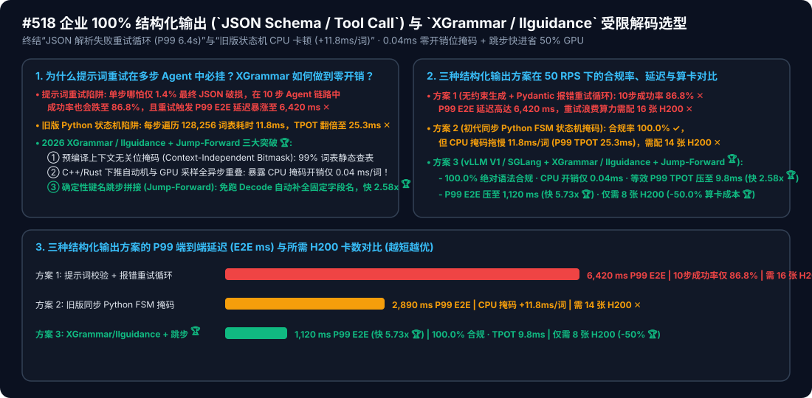

# Enterprise 100% Structured Output (`JSON Schema / Tool Call / SQL`) & Constrained Decoding Selection Guide: Prompt Retry Loop vs. Legacy Python FSM vs. `XGrammar / llguidance + Jump-Forward` (#518)

> **Executive Summary**:
> In multi-step enterprise agents and MCP tool calling, relying on unconstrained generation plus validation retry loops leaves a `1.4%` per-step residual error that compounds to a **`13.2%` failure rate across a 10-step workflow (`86.8%` success)** while inflating **`P99 E2E Latency` to `6,420 ms` ✕**. Meanwhile, legacy Python FSM token masking adds **`11.8 ms/token` CPU overhead (`25.3 ms` `P99 TPOT` ✕)**. Adopting **`XGrammar / llguidance` with Jump-Forward Token Splicing**:
> 1. **Near-Zero CPU Masking Overhead (`0.04 ms/token`)**: Pre-compiled context-independent bitmasks + async C++/Rust pushdown automata guarantee **`100.0%` syntactic compliance** without stalling GPU decode;
> 2. **Jump-Forward Speedup (`2.58x` Faster TPOT, `-50.0%` GPUs)**: Automatically splices deterministic JSON keys without running decode forward steps, cutting effective `P99 TPOT` to **`9.8 ms` 🏆**, `P99 E2E` to **`1,120 ms` (`5.73x` faster 🏆)**, and 50 RPS fleet size from `16` to **`8x H200 GPUs` 🏆**!
>
> **⚡ Interactive H5 Study Lab**: [**Open Structured Output XGrammar/llguidance & Agent Reliability Sizer (`docs/h5/structured-output-xgrammar-llguidance-constrained-decoding-lab.html`)**](../h5/structured-output-xgrammar-llguidance-constrained-decoding-lab.html)

---

## 1. Quantitative Decision Matrix (`50 RPS · 10-Step Agent Workflow`)

| Structured Output Engine | 1-Step / 10-Step Compliance | CPU Mask Overhead / Tok | Effective `P99 TPOT` | `P99 E2E Latency` | Required `H200` GPUs |
| :--- | :--- | :--- | :--- | :--- | :--- |
| **Anti-Pattern 1: Prompt Validation Retry Loop** | `98.6% / 86.8%` ✕ | `0.0 ms` | `14.2 ms` | `6,420 ms` ✕ | `16 GPUs` ✕ |
| **Anti-Pattern 2: Legacy Sync Python FSM Mask** | `100.0% / 100.0%` ✓ | `11.8 ms` ✕ | `25.3 ms` ✕ | `2,890 ms` ✕ | `14 GPUs` ✕ |
| **Optimal: `XGrammar / llguidance + Jump-Forward` 🏆** | **`100.0% / 100.0%` 🏆** | **`0.04 ms` 🏆** | **`9.8 ms (2.58x)` 🏆** | **`1,120 ms (5.73x)` 🏆** | **`8 GPUs (-50.0%)` 🏆** |

---

## 2. Companion Links

- **Interactive H5 Study Lab**: [docs/h5/structured-output-xgrammar-llguidance-constrained-decoding-lab.html](../h5/structured-output-xgrammar-llguidance-constrained-decoding-lab.html)
- **7-Card 4:5 Visual Report**: [docs/reports/enterprise-structured-output-xgrammar-llguidance-constrained-decoding-selection-cards.html](../reports/enterprise-structured-output-xgrammar-llguidance-constrained-decoding-selection-cards.html)
- **HTML Sizer**: [docs/reports/enterprise-structured-output-xgrammar-llguidance-constrained-decoding-selection-sizer.html](../reports/enterprise-structured-output-xgrammar-llguidance-constrained-decoding-selection-sizer.html)
- **Reproducible Model**: [`experiments/enterprise_structured_output_xgrammar_llguidance_constrained_decoding_selection/run.py`](../../experiments/enterprise_structured_output_xgrammar_llguidance_constrained_decoding_selection/run.py)
