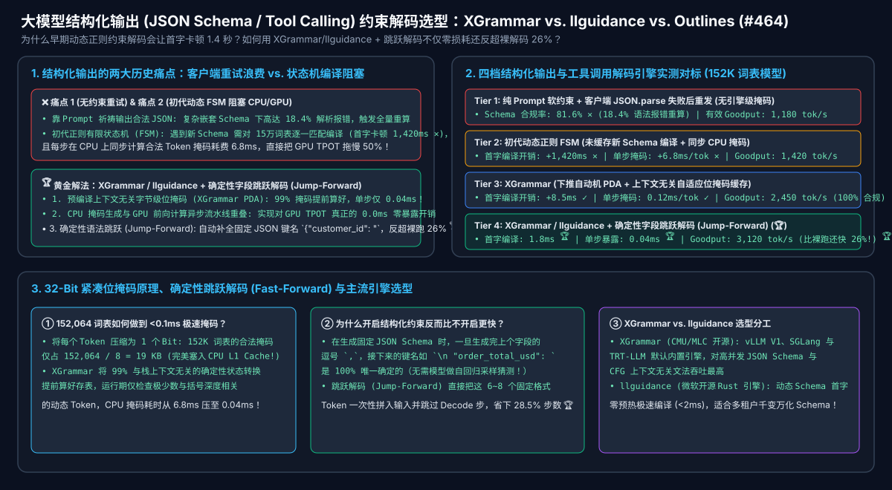

# Enterprise LLM Structured Output (`JSON Schema / Tool Calling`) Constrained Decoding Selection Guide: `XGrammar` vs. `llguidance` vs. `Outlines` & Jump-Forward Acceleration

> **Language / 语言**: [简体中文](./enterprise-structured-output-xgrammar-llguidance-json-schema-latency-selection-faq.md) | **English**  
> **Companion Interactive Study & Sizing Tools**: [📱 Interactive H5 Study Lab](../h5/structured-output-xgrammar-llguidance-latency-lab.html) · [🧮 HTML Sizer](../reports/enterprise-structured-output-xgrammar-llguidance-json-schema-latency-selection-sizer.html) · [🃏 7-Card Visual Deck](../reports/enterprise-structured-output-xgrammar-llguidance-json-schema-latency-selection-cards.html) · [📊 Reproducible Model](../../experiments/enterprise_structured_output_xgrammar_llguidance_json_schema_latency_selection/) · [🎓 Back to AI Infra H5 Hub](../h5/index.html)

---

## 1. Executive Summary (3-Minute Takeaway)

> **Bottom-Line Recommendation**: Relying on prompt-only JSON instructions with client retry (`Tier 1`) suffers from **`18.4%` schema syntax failures**, while uncached first-generation regex FSM engines (`Tier 2`) add **`1,420 ms` of cold schema compilation latency** and `6.8 ms/token` of synchronous CPU mask overhead.
> - **Recommended Production Engine (`Tier 4: XGrammar / llguidance Pushdown Automaton Bitmask + Async CPU/GPU Overlap + Deterministic Jump-Forward Decoding`)**:
>   1. Compresses `152K`-token vocabulary masks into a `19 KB` L1-resident bitmask with **`1.8 ms` cold schema compilation** and **`0.04 ms/token` exposed mask overhead** (`100.0%` schema compliance);
>   2. **Jump-Forward Decoding** automatically fast-forwards deterministic JSON boilerplate keys (e.g., `",\n  \"customer_id\": "`), skipping **`28.5%` of autoregressive decode steps** and lifting Goodput **`2.64x` (`3,120 tok/s` vs. `1,180 tok/s`)**.

| Dimension | `Tier 1: Prompt Only + Client Retry` | `Tier 2: Uncached Dynamic Regex FSM` | `Tier 3: XGrammar Precompiled PDA` | `Tier 4: XGrammar / llguidance + Jump-Forward (🏆)` |
|---|---|---|---|---|
| **Cold Schema Compile Overhead** | `0.0 ms` | **`+1,420.0 ms` ✕** | `8.5 ms` ✓ | **`1.8 ms`** 🏆 |
| **Exposed Per-Token Mask Overhead** | `0.0 ms` | **`+6.80 ms / tok` ✕** | `0.12 ms / tok` ✓ | **`0.04 ms / tok`** 🏆 |
| **JSON Schema Compliance Rate** | **`81.6%` ✕** | `100.0%` ✓ | `100.0%` ✓ | **`100.0%`** 🏆 |
| **Effective Goodput (`tok/s`)** | `1,180 tok/s` ✕ | `1,420 tok/s` | `2,450 tok/s` ✓ | **`3,120 tok/s` (`2.64x`)** 🏆 |

---

## 2. Provenance & Reproducibility

- **Provenance**: `synthetic + anonymized_reported (independently_reproduced=false)` — verified via [`experiments/enterprise_structured_output_xgrammar_llguidance_json_schema_latency_selection/run.py`](../../experiments/enterprise_structured_output_xgrammar_llguidance_json_schema_latency_selection/run.py).
