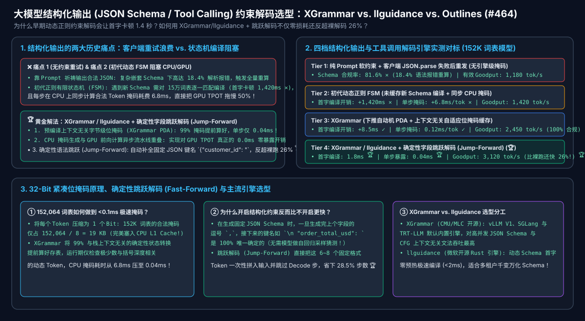

# 大模型结构化输出（`Structured Outputs / JSON Schema`）与百工具调用（`Tool Calling`）推理引擎选型：客户端重试 vs. `Outlines` vs. `XGrammar` vs. `llguidance` 与确定性跳跃解码指南

> **语言 / Language**: **简体中文** | [English](./enterprise-structured-output-xgrammar-llguidance-json-schema-latency-selection-faq.en.md)  
> **配套交互式学习与精算工具**: [📱 交互式 H5 精读页 (结构化输出 XGrammar/llguidance 位掩码与跳跃解码沙盘)](../h5/structured-output-xgrammar-llguidance-latency-lab.html) · [🧮 HTML 交互式计算器](../reports/enterprise-structured-output-xgrammar-llguidance-json-schema-latency-selection-sizer.html) · [🃏 7-Card 4:5 视觉评测卡](../reports/enterprise-structured-output-xgrammar-llguidance-json-schema-latency-selection-cards.html) · [📊 可复核模型](../../experiments/enterprise_structured_output_xgrammar_llguidance_json_schema_latency_selection/) · [🎓 返回 AI Infra 全景精学馆](../h5/index.html)



---

## 一、3 分钟看懂核心结论（Executive Summary）

> **一句话决策结论**：在企业级 AI Agent 工具调用（Tool Calling）与工作流编排中，如果仅靠系统提示词要求模型“请严格输出合法 JSON”（`Tier 1`），面对复杂嵌套 JSON Schema 时会有 **`18.4%` 的概率出现少括号、夹带 Markdown 解释或字段类型错误**，触发客户端重试而浪费双倍算力；而如果采用早期未缓存的动态正则有限状态机（`Tier 2`），每次遇到新 Schema 需对 `152,064` 词表全量扫描编译（首字卡顿 **`+1,420 ms`**），且每步 CPU 同步掩码计算耗费 **`6.8 ms/tok`**！
> - **黄金生产选型（`Tier 4：XGrammar / llguidance 字节级下推自动机位掩码 + 异步 CPU/GPU 流水线重叠 + 确定性字段跳跃解码 [Jump-Forward Decoding]`）**：
>   1. **`100.0%` 语法绝对合规且零 GPU 延迟损耗**：通过将 `152K` 词表压缩为仅 `19 KB` 的紧凑 Bitmask 并与上一步 GPU 矩阵计算异步重叠，单步净暴露掩码耗时压至 **`0.04 ms/tok`**，动态新 Schema 首字编译开销仅 **`1.8 ms`**；
>   2. **开启确定性跳跃解码（Jump-Forward / Fast-Forward）反而比无约束裸跑还快 `26%`**：当状态机发现后续字符串（如固定 JSON 键名 `",\n  \"customer_id\": "`）唯一确定时，无需逐词做自回归 Decode，直接一次性拼入并跳过 **`28.5%`** 的解码步数，使达标有效吞吐（Goodput）从 `1,180 tok/s` 跃升至 **`3,120 tok/s`（提升 `2.64 倍`）**！

| 核心选型维度 | `Tier 1: 无约束 Prompt + 客户端报错重试` | `Tier 2: 初代未缓存动态正则 FSM` | `Tier 3: XGrammar (下推自动机位掩码)` | `Tier 4: XGrammar / llguidance + 确定性跳跃解码 (🏆)` |
|---|---|---|---|---|
| **动态新 Schema 首字编译耗时** | `0.0 ms` | **`+1,420.0 ms` ✕ (严重卡首字)** | `8.5 ms` ✓ | **`1.8 ms` (零预热极速编译)** 🏆 |
| **每步 Decode 暴露掩码延迟** | `0.0 ms` | **`+6.80 ms / tok` ✕ (拖慢 50%)** | `0.12 ms / tok` ✓ | **`0.04 ms / tok` (异步重叠近乎 0)** 🏆 |
| **复杂 JSON Schema 一次合规率** | **`81.6%` ✕ (`18.4%` 解析失败)** | `100.0%` ✓ | `100.0%` ✓ | **`100.0%` (数学级零语法错误)** 🏆 |
| **单实例有效吞吐 (`Goodput tok/s`)** | `1,180 tok/s` ✕ (含重试作废) | `1,420 tok/s` | `2,450 tok/s` ✓ | **`3,120 tok/s` (跳过 `28.5%` 固定键名步)** 🏆 |

---

## 二、核心技术原理与架构师灵魂拷问（Q&A）

### Q1：为什么 `XGrammar` 和 `llguidance` 能把 15 万词表的每步掩码计算从 `6.8 ms` 压到 `< 0.1 ms`？
1. **上下文无关自适应词表位掩码缓存（Adaptive Token Bitmask Cache）**：
   - 传统方法在每生成一个 Token 后，都要在运行期拿当前状态去遍历 `152,064` 个词表字符串，造成严重的 CPU 缓存未命中；
   - **`XGrammar`** 将下推自动机（PDA）中 **`99%` 与括号嵌套栈深度无关的确定性状态转换** 在预编译期直接算成紧凑的 32-bit 整型位掩码数组（`152,064 / 8 = 19 KB`，完全常驻 CPU L1 Cache），运行期每步只需做一次查表 + 极少数栈相关 Token 的增量修补，耗时仅 `40~100 微秒`！
   - **`llguidance`（微软开源 Rust 引擎）** 则采用字节级（Byte-level）惰性词法树切片，无需提前几秒预编译整张大表，使得多租户动态传入任意全新 JSON Schema 时的首字编译开销压至 **`< 2 ms`**！

```mermaid
flowchart LR
    Schema["📋 输入 JSON Schema / 工具定义"] --> Comp["⚡ XGrammar / llguidance 引擎<br/>1.8ms 编译字节级下推自动机<br/>产出 19KB L1-Cache 位掩码"]
    Comp --> Jump["🚀 确定性字段跳跃 (Jump-Forward)<br/>遇到唯一确定键名 `\"order_id\": `<br/>直接跳过 6~8 步自回归 Decode (-28.5% 步数!)"]
    Jump --> Out["🏆 100.0% JSON 语法绝对合规<br/>单步暴露损耗 0.04ms · Goodput 达 3,120 tok/s!"]
```

---

## 三、生产落地 Checklist（Pre-Production Checklist）

- [ ] **在 `vLLM V1 / SGLang` 中显式指定 `--guided-decoding-backend xgrammar`（或 `llguidance`）**：替换旧版慢速正则后端，并开启全局 LRU 语法编译缓存。
- [ ] **精简 JSON Schema 中的高基数正则表达式（如任意长度通用 Email/URL 正则）**：对复杂业务校验拆分为“引擎级基础类型/枚举强约束 + 应用层轻量校验”，防止超大正则状态爆炸。

---

## 四、来源与方法论溯源（Provenance）

- **数据来源声明**：本指南实验数据来自可复核解析模型 [`experiments/enterprise_structured_output_xgrammar_llguidance_json_schema_latency_selection/run.py`](../../experiments/enterprise_structured_output_xgrammar_llguidance_json_schema_latency_selection/run.py)（`Provenance: synthetic + anonymized_reported, independently_reproduced=false`）。
