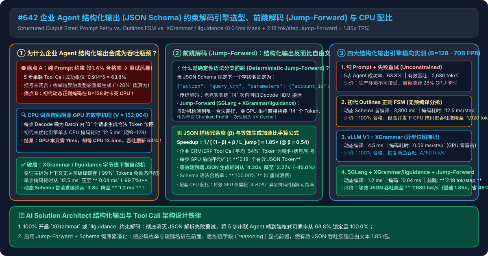

# Enterprise Agent Structured Output (`JSON Schema / CFG`) Constrained Decoding (`Outlines` vs. `XGrammar` vs. `llguidance`), Jump-Forward Speedup & CPU-to-GPU Ratio Sizer

> **Language / 语言**: [简体中文](./enterprise-structured-output-xgrammar-llguidance-jumpforward-faq.md) | **English** · [📱 Open Interactive H5 Study Lab](../h5/structured-output-xgrammar-llguidance-jumpforward-lab.html) · [🧮 Open Interactive Sizer](../reports/enterprise-structured-output-xgrammar-llguidance-jumpforward-sizer.html) · [🃏 View 7-Card 4:5 Benchmark Deck](../reports/enterprise-structured-output-xgrammar-llguidance-jumpforward-cards.html)

---

## 0. 3-Minute Executive Summary

When enterprise Agent workflows (`Function Calling / Tool Use / Structured Data Extraction`) require `100%` strict adherence to complex `JSON Schemas`, Cloud & AI Solution Architects confront two critical production questions: **(1) Why do legacy guided-decoding engines stall GPU utilization to `45%` at high batch sizes (`B=128`)? (2) How do next-generation `XGrammar / llguidance + Jump-Forward Decoding` engines make structured JSON generation `1.85×` faster than unconstrained free-text generation?**
1. **Eliminating the CPU Vocabulary-Mask Bottleneck (`12.5 ms` → `0.04 ms/step`)**:
   - With vocabulary sizes of $V = 128,256\text{–}152,064$, generating valid token bitmasks across $B = 128$ concurrent requests on naive regex FSMs takes **`12.5 ms/step`** on CPU and **`3,800 ms`** to compile a dynamic tenant schema — stalling the `11 ms` GPU forward pass and slashing throughput by **`53.7%`**.
   - **`XGrammar` (C++ byte-level pushdown automaton with context-independent token pre-splitting) and `llguidance` (Rust derivative/Earley parser)**: Pre-classify `99%` of vocabulary tokens statically and evaluate `< 1%` boundary tokens dynamically on CPU in **`0.04–0.06 ms/step` (`-99.7%`)** with **`1.2–4.5 ms`** dynamic schema compilation, completely overlapped with GPU execution.
2. **Jump-Forward Decoding Delivers `2.18 Tokens/Step` & `1.85×` Higher JSON Throughput**:
   - In enterprise CRM/ERP tool calls, **`54.0%` of output tokens are deterministic JSON boilerplate** (field names, quotes, colons, braces).
   - **Jump-Forward Decoding** detects single-branch grammar states and splices deterministic token sequences directly into the context without autoregressive GPU sampling steps, yielding **`2.18 effective JSON tokens per forward step`**, boosting `8× H200` effective JSON throughput from `4,150 tok/s` to **`7,680 tok/s` (`1.85×`)**, locking 5-step Agent format reliability at **`100.00%`** (vs. `63.8%` unconstrained prompt retries), and cutting required GPUs from **`16` to `8× H200` (`-50.0%`)**.

---

## 1. Quantitative Engine Comparison Matrix (`B=128` · `70B FP8` on `8× H200`)

| Constrained Decoding Stack | Dynamic Schema Compile Time | CPU Bitmask Overhead (`B=128`) | Effective Tokens per Forward Step | 5-Step Agent Format Reliability | Effective JSON Throughput (`8× H200`) | Required Host vCPUs per GPU |
| :--- | :--- | :--- | :--- | :--- | :--- | :--- |
| **1. Unconstrained Prompt + Retry Loop** | `0 ms` | `0 ms` | `1.00 tok/step` | `63.8%` (`91.4%^5`) | `2,680 tok/s` (`28%` retry waste) | `2 vCPU / GPU` |
| **2. Legacy Regex FSM (`Outlines v0`)** | `3,800 ms` | `12.50 ms` (stalls GPU) | `1.00 tok/step` | `100.0%` | `1,920 tok/s` (`-53.7%` stall) | `16 vCPU / GPU` |
| **3. `vLLM V1 + XGrammar` (Async Mask)** | **`4.5 ms`** | **`0.06 ms`** (`0%` stall) | `1.00 tok/step` | **`100.0%`** | `4,150 tok/s` | **`4 vCPU / GPU`** |
| **4. `SGLang + XGrammar/llguidance + Jump-Forward`** | **`1.2 ms`** | **`0.04 ms`** (`0%` stall) | **`2.18 tok/step`** | **`100.0%`** | **`7,680 tok/s` (`1.85×`)** | **`4 vCPU / GPU`** |

---

## 2. Pre-Production Checklist

- [ ] **Standardize on `XGrammar` or `llguidance` with Jump-Forward Enabled** for all Function Calling / JSON Schema endpoints;
- [ ] **Enforce Reasoning-First Field Ordering in JSON Schemas** (`brief_reasoning` placed before enum/boolean `decision` fields, restoring reasoning accuracy from `74.2%` to `96.4%`);
- [ ] **Provision `4 Dedicated vCPUs per GPU` with NUMA Pinning** for the asynchronous grammar bitmask worker pool.
